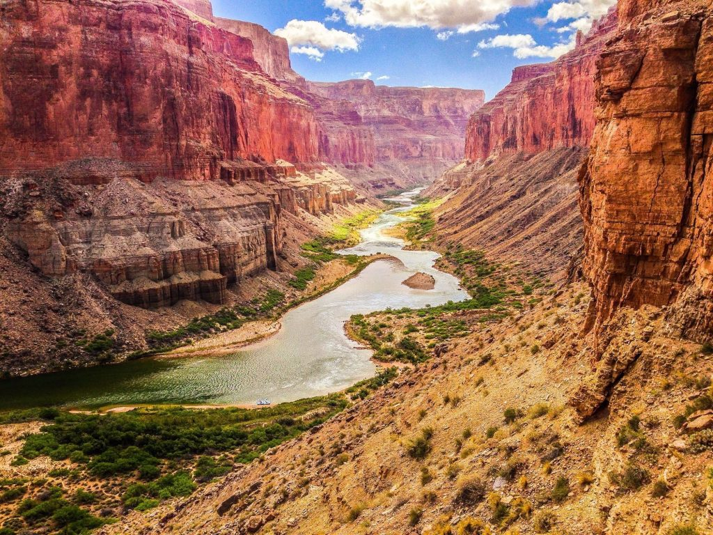
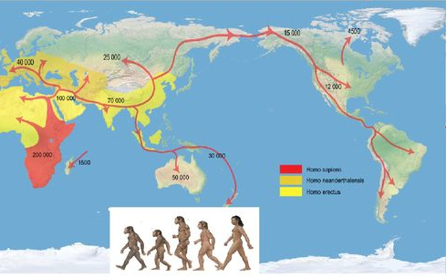
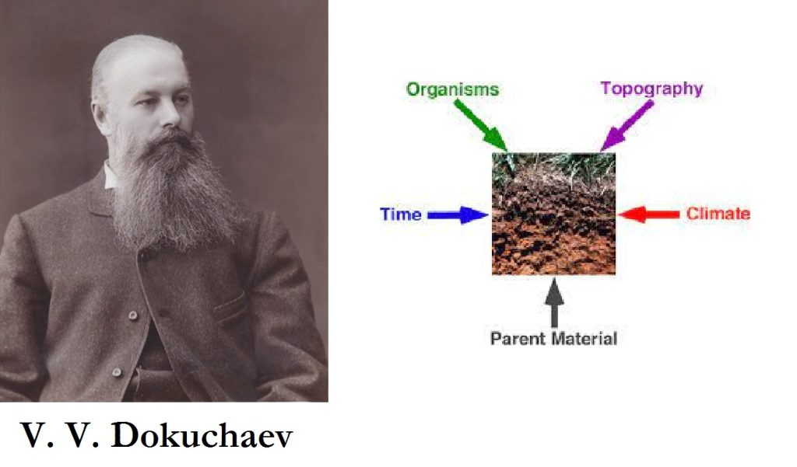
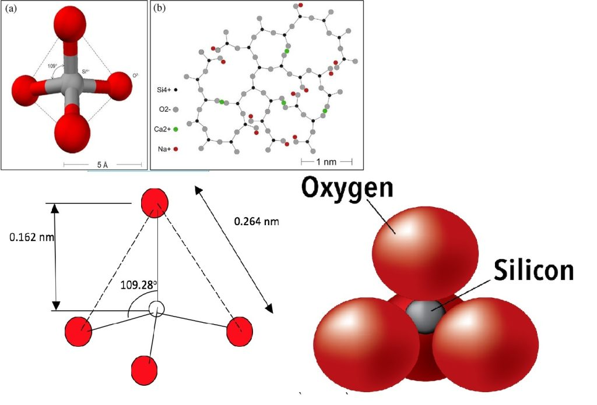
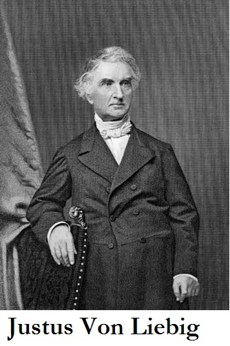
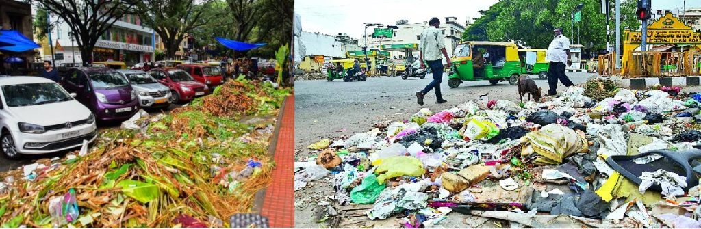

**ಮಣ್ಣಿಂದ ಕಾಯ ಮಣ್ಣಿಂದ…** ಮಣ್ಣಿಂದಲೇ ಎಲ್ಲವೂ… ಮಣ್ಣಿಂದಲೇ ಅನ್ನ, ಬಣ್ಣ, ಮಣ್ಣಿಂದಲೇ ಬೊಕ್ಕಸ, ಬಂಗಾರ, .. ಮಣ್ಣಿಂದಲೇ ಪರ್ವತ, .. ಕಡೆಗೆ ವೈಕುಂಠವೂ ಮಣ್ಣೇ ಎಂದು ಹದಿನೈದು-ಹದಿನಾರನೆಯ ಶತಮಾನದ ಸಂತ ಕವಿ ಪುರಂದರದಾಸರು ನಮ್ಮ ಜೀವನವನ್ನು ಮಣ್ಣಿಗೆ ಸಮೀಕರಿಸಿ ಹಾಡಿದ್ದಾರೆ. ಅದಕ್ಕೂ ಹಿಂದೆಯೇ ಬೈಬಲ್ಲಿನ ಜೆನೆಸಿಸ್‌ನಲ್ಲಿಯೂ **“ದೇವರು ಮಾನವರನ್ನು ಮಣ್ಣಿನಿಂದಲೇ ಮಾಡಿ ಮೂಗಿನ ಹೊಳ್ಳೆಗಳಲ್ಲಿ ಜೀವದ ಉಸಿರನ್ನು ಊದಿದ್ದಾನೆ ಹಾಗಾಗಿ ಮಾನವರು ಜೀವಂತ ಆತ್ಮವಾಗಿದ್ದಾರೆ”** (**“ _Formed man of the dust of the ground, and breathed into his nostrils the breath of life; and man became a living soul”_** (**Genesis 2:7**).) ಎಂಬ ಉಲ್ಲೇಖವಿದೆ.

ದಾರ್ಶನಿಕವಾಗಿ ಮಣ್ಣು ಮತ್ತು ಮಾನವರ ಜೀವಂತಿಕೆಯ ಸಂಬಂಧದ ಬಗೆಗಿನ ತಿಳಿವಳಿಕೆಯು ಸಾಕಷ್ಟೇ ಪುರಾತನವಾದದು. ಸಾಲದಕ್ಕೆ ಮಣ್ಣು ಮತ್ತು ನಾಗರಿಕತೆಗಳ ಸಂಬಂಧದ ಉಗಮ ಹಾಗೂ ಅಳಿವುಗಳ ಚರಿತ್ರೆಯ ಕುರಿತೂ ಮಾನವ ಕುಲಕ್ಕೆ ಪರಿಚಯವಿದೆ. ಹಾಗೆ ನೋಡಿದರೆ ಸಂಸ್ಕೃತಿಯ ಹುಟ್ಟೂ ಮಣ್ಣಿನಿಂದಲೇ ಸಾಧ್ಯವಾಗಿದೆ, ಜೊತೆಗೆ ಸಂಸ್ಕೃತಿಗಳ ವಿನಾಶವೂ ಮಣ್ಣಿನ ಅವನತಿಯಿಂದಲೇ! ಆದರೂ ಅಂತಹಾ ಪಾಠಗಳನ್ನು ಆಧುನಿಕ ಮಾನವರು ಕಲಿಯದ ವಿಪರ್ಯಾಸ ಇಂದಿನದು. ಆಹಾರದ ಹುಡುಕಾಟ, ಕೃಷಿಯ ಉಗಮ, ವಿಸ್ತರಣೆ, ವಿವಿಧತೆಗಳ ಹರಹು, ನಾಗರಿಕ ಬೆಳವಣಿಗೆ, ಮಾನವಕುಲದ ನೆಲೆ, ದೇಶ-ಗಡಿಗಳ ವಿಕಾಸ.. ಅಷ್ಟೇಕೆ ಆಧುನಿಕ ಆರೋಗ್ಯದ ಚರ್ಚೆಗಳ ವೈಜ್ಞಾನಿಕತೆ ಹಿನ್ನೆಲೆಯಲ್ಲೂ ಮಣ್ಣಿನಿಂದ ಅರಿತ ಸಾವಿರಾರು ಸಂಗತಿಗಳಿವೆ. ಅವೆಲ್ಲವನ್ನೂ ಮಾನವ ತನ್ನ ಬದುಕಿನ ಪಾಠವಾಗಿಸದ ಸನ್ನಿವೇಶದಿಂದ ಹವಾಮಾನ ಬದಲಾವಣೆಯಂತಹ ನೈಸರ್ಗಿಕ ವಿಕೋಪಗಳಲ್ಲಿ ಮಾನವ ಸಂಸ್ಕೃತಿಯು ನರಳುವಂತಾಗಿದೆ. ಈ ಪಾಠಗಳ ಸೂಕ್ಷ್ಮ ವಿಚಾರಗಳ ಪರಿಚಯದ ಟಿಪ್ಪಣಿಗಳು ಇವು.

ಇಡೀ ಭೂಮಿಯನ್ನು ಕೇವಲ ಎರಡೇ ವಸ್ತುಗಳು ಆವರಿಸಿವೆ. ನೀರು ಮತ್ತು ನೆಲ – ವಾಟರ್‌ ಆಂಡ್‌ ಲ್ಯಾಂಡ್‌- ಇವೆರಡನ್ನೂ ಸಂಪನ್ಮೂಲವಾಗಿ ಗುರುತಿಸಿದ್ದೇವೆ. ಭೂಮಿಯ ಮೇಲಿನ ಯಾವುದೇ ಪ್ರಮುಖ ಆಗುಹೋಗುಗಳಿಗೂ ಇವೆರಡೇ ಮೂಲಭೂತ ಕಾರಣಗಳು. ಈ ನೆಲದ ಮೇಲೆ ಏನೆಲ್ಲಾ ಸಾಧ್ಯವಾಗಿದ್ದರೂ ಅವೆಲ್ಲವೂ ಈ ಎರಡು ವಸ್ತುಗಳನ್ನೇ ಆಧರಿಸಿವೆ. ಅದರಲ್ಲೂ ಮಣ್ಣನ್ನು **“ಎಲ್ಲ ಜೀವಿಗಳ ಹೊಟ್ಟೆ”** ಎಂದೇ ಕರೆಯಲಾಗುತ್ತದೆ. ಜೀವಿವಿಕಾಸದಲ್ಲಿ ಮಣ್ಣಿನ ಪಾತ್ರ ಹಿರಿದು. ಎಲ್ಲಾ ಜೀವಿಗಳ ಅವಶ್ಯಕತೆಗಳನ್ನು ನಿಭಾಯಿಸುವ ಆತ್ಯಂತಿಕ ಪ್ರಕ್ರಿಯೆಯಲ್ಲಿ ಮಣ್ಣು ಮತ್ತು ನೀರು ಪರಿಪೂರ್ಣ ಜವಾಬ್ದಾರಿಯನ್ನು ಹೊತ್ತಿವೆ. ಜನಸಂಖ್ಯೆಯು ಬೆಳೆದಂತೆ ಅವುಗಳ ಹೊಟ್ಟೆಯನ್ನು ತುಂಬುವ ಆಶಯದಲ್ಲಿ ಮಣ್ಣಿನ ಅರಿವನ್ನು ವಿಸ್ತರಿಸುತ್ತಾ ಸಾಗಿದ್ದೇವೆ, ಆದಾಗ್ಯೂ ಪ್ರತೀ ಹಂತಗಳಲ್ಲೂ ಎಡವುತ್ತಲೇ ಇದ್ದೇವೆ. ಆ ಕಾರಣದಿಂದಲೇ ಮಣ್ಣನ್ನು ಅರಿತೂ ಅದರಿಂದ ಪಾಠಗಳನ್ನು ಮಾನವ ಸಂಕುಲವು ಕಲಿಯುತ್ತಿಲ್ಲ ಎಂಬುದೇ ಆತಂಕದ ವಿಚಾರ.

ಮೂಲತಃ ಆದಿಮಾನವ ಆಫ್ರಿಕಾದ ನೆಲೆಯಿಂದ ನೈಲ್‌ ಮತ್ತು ಯೂಫ್ರೆಟಿಸ್‌/ಟೈಗ್ರಿಸ್‌ ನಡುವಿನ ಅರ್ಧ ಚಂದ್ರಾಕಾರದ (The Fertile Crescent) ನೆಲವನ್ನು ತಲುಪಲು ಏನಿಲ್ಲವೆಂದರೂ ಒಂದು ಲಕ್ಷ ಮೂವತ್ತು ಸಾವಿರ ವರ್ಷಗಳಾಗಿವೆ. ಅಲ್ಲಿನ ಫಲವತ್ತಾದ ನೆಲದ ಹಿನ್ನೆಲೆಯಲ್ಲಿ ಕೃಷಿಯು ವಿಕಾಸವಾಗಿ ಈಗ್ಗೆ ಕೇವಲ 12-15 ಸಾವಿರ ವರ್ಷಗಳಷ್ಟೇ ಆಗಿವೆ. ಮುಂದೆ ನಾಗರಿಕತೆಯು ಹುಟ್ಟಿ 5000 ವರ್ಷಗಳಷ್ಟೇ! ಆಧುನಿಕ ವಿಜ್ಞಾನದ ತಿಳಿವಳಿಕೆಯು ಸುಮಾರು 500-600 ವರ್ಷದ್ದು! ಜೀವಿ-ವೈಜ್ಞಾನಿಕ ತಿಳಿವಿಗೆ ಇನ್ನೂ 100 ವರ್ಷಗಳೂ ತುಂಬಿಲ್ಲ, ಇಂದಿಗೂ ಹುಡುಕಾಟ ನಡದೇ ಇದೆ. ಅದರ ಪರಿಧಿಯು ಇನ್ನೂ ವಿಸ್ತಾರ ಆಗಬೇಕಿದೆ, ಎಂಬುದನ್ನು ಕಳೆದ ವರ್ಷಗಳ ಕೊರೊನಾ ಸಾಬೀತು ಮಾಡಿದೆ. ಆಹಾರ-ಆರೋಗ್ಯದ ಮುಖಾಮುಖಿಯ ಹಿನ್ನೆಲೆಯಲ್ಲಿ ಕೇವಲ ಆಫ್ರಿಕಾದ ಸಂಪನ್ಮೂಲಕ್ಕೆ ಒಗ್ಗಿದ ಮಾನವ ಸಂಕುಲವು _Australopithecus afarensis_ ನಿಂದಾ _Homo habilis, Homo erectus, Homo neanderthalensis_ ಪ್ರಭೇದಗಳನ್ನು ದಾಟಿ ಬರಲು ಮಿಲಿಯನ್‌ ಗಟ್ಟಲೆ ವರ್ಷಗಳು ಕಳೆದಿವೆ.

ಈಗಿನ ಮಾನವರನ್ನು ಸುಮಾರಾಗಿ ಹೋಲುವ ಜೀವಿ ವಿಕಾಸವಾಗಿದ್ದು 3 ಲಕ್ಷ ವರ್ಷಗಳ ಹಿಂದೆಯಷ್ಟೇ. _Homo sapiens_ ಎಂದು ಗುರುತಿಸಲಾಗಿದ್ದು ಕೇವಲ 2 ಲಕ್ಷ ವರ್ಷಗಳ ಹಿಂದಿನ ವಿಕಾಸ ಫಲದ ಜೀವಿಯನ್ನು. ಈ ಜೀವಿಯು ಆಫ್ರಿಕಾದಿಂದ ಹೊರಹೊರಟು ಬಗೆ ಬಗೆಯ ಆಹಾರಕ್ಕೆ ಒಗ್ಗಲು ತಮ್ಮೊಳಗೆ ಹುಟ್ಟುತ್ತಿದ್ದ ಅಲರ್ಜಿಯನ್ನು ಎದುರಿಸಿ ಸಾವಿರಾರು ಬಗೆಯ ಸಸ್ಯ ಮೂಲಗಳನ್ನು, ನೂರಾರು ಪ್ರಾಣಿ-ಪಕ್ಷಿಗಳನ್ನೂ ಆಹಾರವಾಗಿ ಒಗ್ಗಿಸಿ ಹೊಂದಿಕೊಂಡಿವೆ. ಆ ವಲಸೆಯ ಮೊದಲ ಒಂದೂವರೆ ಲಕ್ಷ ವರ್ಷಗಳು ಧ್ವನಿಯು ಮಾತುಗಳಾಗುವ ವಿಕಾಸ ನಡೆದಿದೆ. ಮಾತು ಹುಟ್ಟಿ ಕೇವಲ 50 ಸಾವಿರ ವರ್ಷಗಳಷ್ಟೇ! ಮಾನವ ಸಂಕುಲದ ಮಾತು ಮತ್ತು ತಿಳಿವಿನ ಹಾದಿಯಲ್ಲಿ ಅತಿ ಹೆಚ್ಚು ಚರ್ಚೆಗಳು ನಡೆದಿರುವುದು ನಮ್ಮ ಊಟದ ತಾಟಿನ ಕುರಿತು. ಇವತ್ತಿಗೂ ಬಹಳ ಮುಖ್ಯವಾದ ಮಾತು ಎಂದರೆ -ಆಯಾ ಸಮಯಕ್ಕೆ ಸರಿಯಾಗಿ- ಕಾಫಿ, ಚಹಾ, -ಊಟ ಆಯಿತಾ? ಏನು ಊಟಕ್ಕೆ? ಎನ್ನುವುದು ಹೆಚ್ಚು. ಮನೆಯನ್ನು ನಿರ್ವಹಿಸುವ ಗೃಹಣಿಯರಂತೂ ಪ್ರತೀ ದಿನವು ನೆರೆಯವರೊಂದಿಗೆ ಏನು ಸಾರು, ಸಾಂಬಾರು ಇವತ್ತು ಎನ್ನುವುದು ಸಹಜವಾದ ಪ್ರಶ್ನೆ! ಅದೆಷ್ಟು ಬಾರಿ ಸಾರು ಮಾಡಿದ್ದರೂ ಮತ್ತೆ ಮತ್ತೆ ಚರ್ಚೆಗೆ ಬರುತ್ತದೆ. ಪ್ರತೀ ದಿನವೂ ತಮ್ಮ ಊಟದ ತಯಾರಿಯಲ್ಲಿ ವಿಕಾಸಗೊಳಿಸುತ್ತಾ ಕನಿಷ್ಟ ಕಳೆದ 5-8 ಸಾವಿರ ವರ್ಷಗಳ ಕಾಲ ಆಹಾರದ ಚರ್ಚೆಗಳು ನಡೆದಿವೆ. ಇನ್ನೂ ಮುಂದುವರೆದಿವೆ. ಜಾಗತೀಕರಣದ ನಂತರದಲ್ಲಿ ಬೇರೆ ಬೇರೆ ಸ್ಥಳಗಳ ಆಹಾರ ಪದ್ಧತಿಗಳು ನಮ್ಮ ಹೋಟೆಲುಗಳ ಮೆನುಗಳಲ್ಲಿ ಸೇರಿ, ನಮ್ಮ ಅಡುಗೆ ಮನೆಯನ್ನೂ ಹೊಕ್ಕಿವೆ.

ಕ್ರಿಸ್ಟೋಫರ್‌ ಕೊಲಂಬಸ್‌, ಸುಮಾರು (1492 ಮತ್ತು 1504) 530 ವರ್ಷಗಳ ಹಿಂದೆ ಅಮೆರಿಕಾ ತಲುಪಿದ ನಂತರವಷ್ಟೇ ನಮಗೆ ಮೆಣಸಿನಕಾಯಿ, ಟೊಮ್ಯಾಟೊ, ಆಲೂಗಡ್ಡೆ, ಮೆಕ್ಕೆಜೋಳ, ಪೇರಲ, ಪಪ್ಪಾಯ, ಕೋಸುಗಳು ಮುಂತಾದವು ದಕ್ಕಿದ್ದು. ಪ್ರತಿಯಾಗಿ ಅಲ್ಲಿಗೂ ಏಲಕ್ಕಿ, ಚಕ್ಕೆ ಲವಂಗ, ಮಾವು, ಅಕ್ಕಿ, ಮುಂತಾದವು ಹೋಗಿದ್ದು ಆನಂತರವಷ್ಟೇ! ಅಷ್ಟರ ಮಧ್ಯೆಯೂ ಯೂರೋಪು, ಏಶಿಯಾ ಆಫ್ರಿಕಾಗಳ ನಡುವೆ ಸಾಕಷ್ಟೇ ವಹಿವಾಟುಗಳಲ್ಲಿ ಹಲವಾರು ಕೊಡು-ಕೊಳ್ಳುವಿಕೆಯ ಬೆಳವಣಿಗೆಯಿಂದ ತಟ್ಟೆಗಳ ರುಚಿಗಳು ಬಗೆ ಬಗೆಯಾಗಿ ವಿಕಾಸಗೊಂಡಿವೆ.

ಇಂತಹಾ ಬೃಹತ್‌ ಹಿನ್ನೆಲೆಯ ನಮ್ಮ ಆಹಾರ ತಾಟಿನ ಹಿನ್ನೆಲೆಯಲ್ಲಿ ಸಸ್ಯಗಳು ಊಹೆಗಿಂತಾ ಬಲು ದೊಡ್ಡ ಪಾತ್ರವನ್ನೇ ಮಾಡಿವೆ. ಏನಿಲ್ಲವೆಂದರೂ ಸುಮಾರು 6000ಕ್ಕೂ ಹೆಚ್ಚಿನ ಬಗೆಯ ಸಸ್ಯಗಳನ್ನು ನಾವು ತಿನ್ನಬಹುದಾದರೂ, ಕೇವಲ ನೂರಾರು ಸಸ್ಯಗಳು ಮಾತ್ರವೇ ನಮ್ಮ ಆಹಾರದ ಇಕಾನಮಿಯನ್ನು ನಿರ್ಧರಿಸುತ್ತಿವೆ. ನಮ್ಮ ಆಹಾರದ ತಿಳಿವಿನ ವಿಕಾಸವನ್ನೂ ನಾವು ಹೇಗೆ ಸಂಕುಚಿತಗೊಳಿಸಿದ್ದೇವೆ ಎನ್ನುವುದಕ್ಕೆ ಒಂದು ಉದಾಹರಣೆಯ ವಿವರವಿದೆ. “**ನಮ್ಮ ಭೂಮಿಯು ಸುಮಾರು 2000 ಗಿಡ-ಮರಗಳನ್ನು ತಿನ್ನುವ ಅವಕಾಶವಿತ್ತಿದೆ, ಅದರಲ್ಲಿ ನಾವು 200 ಬಗೆಯ ಸಸ್ಯಗಳನ್ನು ಆರ್ಥಿಕತೆಯನ್ನು ತೀರ್ಮಾನಿಸುವಷ್ಟು ಬೆಳೆಯುತ್ತೇವೆ… ಆದರೂ 20 ಮಾತ್ರವೇ ಬಹುಪಾಲು ವಹಿವಾಟನ್ನು ಆವರಿಸಿವೆ.. ಆದಾಗ್ಯೂ ಕೇವಲ 2 ಬಗೆಯ ಸಸ್ಯಗಳು ಮಾತ್ರ ನಮ್ಮ ದೈನಂದಿನ ಆಹಾರದ ಮುಕ್ಕಾಲು ಪಾಲನ್ನು ನಿರ್ಧರಿಸುತ್ತವೆ”.** ಈನೆಲವು ನಮಗಿತ್ತ ಅನುಕೂಲವನ್ನು ಸಂಕುಚಿತಗೊಳಿಸುತ್ತಲೇ ಹೋಗುತ್ತಿರುವುದರ ಪ್ರಮುಖವಾದ ಸಂಗತಿ ಇದು. ಇಷ್ಟೊಂದು ಅಗಾಧತೆಯ ಬದುಕಿನ ಅವಕಾಶ ಬಂದದ್ದು ವಿಕಾಸದ ಹಿನ್ನೆಲೆಯಿಂದ, ವಹಿವಾಟಿನಿಂದ ಅಲ್ಲ! ಹಾಗಾಗಿ ಮಣ್ಣು ಹುಟ್ಟಿದ್ದಾದರೂ ಹೇಗೆ? ಹುಟ್ಟಿ ಬೆಳೆಯುತ್ತಿರುವುದಾದರೂ ಹೇಗೆ? ಇದರ ಆಯಾಮಗಳನ್ನು ವಿವಿಧ ನಾಗರಿಕ ಬದುಕಿನಲ್ಲಿ ಅದೆಷ್ಟು ಬೆಲೆ ಕೊಟ್ಟಿದ್ದೇವೆ?

## ಮಣ್ಣಿನ ಹುಟ್ಟಿನ ಹಿನ್ನೆಲೆ

ಈಗ ಭೂಮಿಯ ಮೇಲೆ ಕಾಣಬರುವ ಸಮೃದ್ಧವಾದ ಮಣ್ಣು ಈ ಬಗೆಯಲ್ಲಿ ವಿಕಾಸವಾಗಲು ಸಹಸ್ರಾರು ವರ್ಷಗಳೇ ಆಗಿವೆ. ಅದಕ್ಕೂ ಮೊದಲು 4500 ಮಿಲಿಯನ್ ವರ್ಷಗಳ ಹಿಂದೆ ಭೂಮಿ ಉಗಮವಾದಾಗ ಇಂದಿನಂತಹ ಮಣ್ಣಿನ ಪದರವನ್ನು ಹೊಂದಿದ್ದ ಭೂಮಿ ಅದಾಗಿರಲಿಲ್ಲ. ಇಂದು ನಮ್ಮ ಕಣ್ಣನ್ನು ತಂಪಾಗಿಸುತ್ತಿರುವ ಅದ್ಭುತ ಶಕ್ತಿಯ ಹಚ್ಚಡವೂ ಅದಕ್ಕಿರಲಿಲ್ಲ. ಬಿಸಿ ಉಂಡೆ ನಿಧಾನವಾಗಿ ತಂಪಾಗಿ ಕೊನೆಗೊಂದು ದಿನ ಮೊದಲ ಜೀವಿಯ ಉಗಮದೊಂದಿಗೆ, ಮಣ್ಣಿನ ಹುಟ್ಟಿಗೂ ನಾಂದಿ ಹಾಡಿತು. ಕಲ್ಲು ಬಂಡೆಗಳ ಮೇಲೆ ಮರದ ಕಾಂಡಗಳ ಮೇಲೆ ಬೆಳೆವ ಹೂ ನೋಡಿಯೇ ಇರುತ್ತೀರಿ. ಕಲ್ಲಿನಲ್ಲಿ ಬೇರನ್ನು ಆಳಕ್ಕಿಳಿಸಿ ಕಲ್ಲನ್ನು ಒಡೆದ ಶಕ್ತಿಯುತ ಜೀವಚರದ ಸಂಪರ್ಕ ಮುಂದೊಂದು ದಿನ ಇಂತಹ ಅದ್ಭುತ ಮಣ್ಣಿನ ಜನನಕ್ಕೆ ಕಾರಣವಾಗಿದೆ. ಹಾಗೆಂದು ಮಣ್ಣು ಈಗಾಗಲೇ ಉಗಮವಾಗಿಯೇ ಹೋಯ್ತು, ಇನ್ನೇನಿದ್ದರೂ ಅದನ್ನು ಮಾನವ ಹಿತಕ್ಕೆ ಬಳಸುವುದಷ್ಟೇ ಕೆಲಸ ಎಂದು ಅರ್ಥವಲ್ಲ. ಮಣ್ಣು ಸಹಾ ಎಲ್ಲಾ ಜೀವಿಗಳಂತೆಯೇ ತನ್ನೊಳಗೇ ವಿಕಾಸವನ್ನು ನಡೆಸಿಕೊಂಡೇ ಬೆಳೆಯುತ್ತಿದೆ. ಇದು ನಿರಂತರವೂ ಕೂಡ. ಈ ನಿರಂತರವಾದ ವಿಕಾಸದ ಜೊತೆಗೆ ಅರ್ಥೈಸಿಕೊಂಡು ಬದುಕನ್ನೂ ಹೊಂದಿಸಿಕೊಂಡು ಬಾಳಬೇಕೆ ವಿನಃ ಅದನ್ನು ಕೇವಲ ಲಾಭದ ಹಿನ್ನೆಲೆಯಿಂದ ನೋಡುವುದು ಸರಿಯಲ್ಲ.

“Parent material being a blank paper on which climate write as it desires” ಎಂಬುದು ಮಣ್ಣಿನ ಹುಟ್ಟಿನ ಆಯಾಮಗಳನ್ನು ವಿವರಿಸಿದ ರಷ್ಯಾದ ವಿಜ್ಞಾನಿ ಡುಕೊಚೇವ್‌ (V.V.**Dokuchaev**) ಹೇಳಿದ್ದಾರೆ. ಅವರು **ತಾಯಿ ಬಂಡೆ (Parent material) ಜೀವಿಗಳು (Organisms) ಹವಾಮಾನ (Climate), ಇಳಿಜಾರು (Topography) ಮತ್ತು ಕಾಲ (Time)** ಇವುಗಳನ್ನು ಮಣ್ಣಿನ ಪ್ರಸ್ತುತ ಇರುವಿಕೆಯ ವಿಕಾಸದ ಹಿನ್ನೆಲೆಯಲ್ಲಿ ಮೊದಲು ವಿವರಿಸಿದವರು. ಮಣ್ಣನ್ನು ಅಗೆಯುತ್ತಾ ಭೂಮಿಯ ಆಳಕ್ಕೆ ಇಳಿದರೆ ಗಟ್ಟಿ ಮಣ್ಣು, ಗೊರಚಲು, ಕಲ್ಲು, ಬಂಡೆ ಹೀಗೆ ದೊರೆಯುತ್ತಾ ಹೋಗುತ್ತದೆ. ಹೀಗೆ ಇವೆಲ್ಲದರಿಂದಾಗಿಯೇ ಮೇಲ್ಪದರದಲ್ಲಿ ಅದ್ಭುತ ಅಂತಸತ್ವವುಳ್ಳ ಈ ಮಣ್ಣುಗಳು, -ನೆಲದ ಮೇಲಿನ ಜೀವಿಗಳು, ಮೇಲ್ಮೆಯ ಹರಹು, ವಾತಾವರಣದ ಹವಾಮಾನ ಕೆಳಗಣ ತಾಯಿ ಬಂಡೆಯೊಂದಿಗೆ ವರ್ತಿಸಿ ಕಾಲದ ಕ್ರಿಯೆಯಲ್ಲಿ ವಿಕಾಸಗೊಂಡಿದೆ. ಹಾಗಾಗಿ, ಈ ತಾಯಿಬಂಡೆ ಮೇಲ್ಮೆಯ, ಹವಾಮಾನ, ಜೀವಿಗಳು ಮತ್ತು ಕಾಲ ಇದನ್ನೇ ಮಣ್ಣಿನ ವಿಕಾಸದ ಮೂಲ ಸಾಮಗ್ರಿಗಳು ಎನ್ನುವರು. ಈ ವಿಕಾಸ ಒಂದು ರೀತಿಯಲ್ಲಿ ನಿರಂತರವಾದ ಕ್ರಿಯೆ.

ಈ ರೀತಿ ಪೋಷಕ ಪದಾರ್ಥಗಳಿಂದ ಮಾರ್ಪಾಡಾದ ಮಣ್ಣಿನ ಪ್ರೊಫೈಲ್ (ಒಂದು ಪಾರ್ಶ್ವದಲ್ಲಿ ನೋಡಿದಾಗ) ವಿವಿಧ ಪದರುಗಳಾಗಿ ರಚಿತವಾಗಿರುತ್ತದೆ. ಇಡಿಯಾಗಿ ಮಣ್ಣು ವಿವಿಧ ಗಾತ್ರದ ಕಣಗಳ ಸಮೂಹವಾಗಿದೆ. ಇವುಗಳ ಜತೆಗೆ ಸಾವಯವ (ಇಂಗಾಲಯುಕ್ತ) ವಸ್ತು ಗಾಳಿ ಮತ್ತು ನೀರು ಅದರ ಪ್ರಮುಖವಾದ ಘಟಕಗಳಾಗಿದ್ದು ಮಣ್ಣಿನ ಒಟ್ಟಾರೆ ಸಮೂಹವನ್ನು ನಿರ್ಮಿಸಿವೆ.

ಮೇಲ್ನೋಟಕ್ಕೆ ಮಣ್ಣು ಘನವಸ್ತುವಿನಂತೆ ಕಂಡರೂ ಸುಮಾರು ಶೇಕಡಾ 50 ರಷ್ಟು ರಂಧ್ರಮಯ. ಕಾರಣ ಮಣ್ಣು ವಿವಿಧ ಗಾತ್ರದ ಕಣಗಳಿಂದ ಸಂರಚನೆಗೊಂಡಿದೆ. ಹಾಗಾಗಿ ಕಣಗಳ ನಡುವಿನ ಜಾಗದಲ್ಲಿ ಗಾಳಿ ಮತ್ತು ನೀರು ತುಂಬಿರಬಹುದು. ಹಾಗಾಗಿಯೇ, ಮೊದಲ ಮಳೆಯಲ್ಲಿ ಮಣ್ಣಿನ ಬಾಯಾರಿಕೆ ಹೆಚ್ಚು ಅಂದರೆ ಆ ಸಮಯದಲ್ಲಿ ರಂಧ್ರಮಯ ಭಾಗದಲ್ಲೆಲ್ಲಾ ಗಾಳಿಯೇ ತುಂಬಿದ್ದು, ನೀರನ್ನು ಕುಡಿಯಲು ಹವಣಿಸುತ್ತದೆ. ಧಾರಾಕಾರ ಮಳೆಯ ನಂತರ ಮಣ್ಣಿನ ಒಳಗಿರುವ ಖಾಲಿ ಜಾಗದಲ್ಲಿ ನೀರೇ ತುಂಬಿರುತ್ತದೆ. ಹೀಗೆ ಮಣ್ಣಿನ ಒಳಭಾಗವು ಒಣಗಿದ್ದಾಗ ಬರೀ ಗಾಳಿಯನ್ನೂ ಮತ್ತು ಹಸಿಯಾದಾಗ ನೀರನ್ನು ತುಂಬಿಕೊಂಡಿರುತ್ತದೆ. ಅಲ್ಲದೆ ಸಂಪೂರ್ಣ ಒಣಗಿದೆ ಎಂದು ಕಾಣುವಾಗಲೂ ಸ್ವಲ್ಪಮಟ್ಟಿಗಿನ ನೀರನ್ನು ಹಿಡಿದಿಟ್ಟುಕೊಂಡಿರುತ್ತದೆ. ಆದರೆ ಇದು ಸಸ್ಯಗಳಿಗೇನೂ ದೊರೆಯುವುದಿಲ್ಲ.

ಅದೇನೇ ಇರಲಿ. ಮೊದಲ ಮಳೆಯ ಪ್ರಸ್ತಾಪವೆಂದ ಕೂಡಲೇ ಅದರ ಆಹ್ಲಾದಕರ ಸುವಾಸನೆಯನ್ನು ನೆನಪಿಸಿಕೊಳ್ಳದೆ ಇರಲು ಸಾಧ್ಯವಿಲ್ಲ. ಇದು ಒಂದು ಬಗೆಯಲ್ಲಿ ಮಣ್ಣಿನ ಜೀವಂತಿಕೆಯ ಸಾಕ್ಷಿ ಕೂಡಾ. ಮುಂದೆ ವಿವರ ನೀಡುವ ಮಣ್ಣಿನಲ್ಲಿರುವ ಒಂದು ಬಗೆಯ ಜೀವಿಗಳಾದ ಅಕ್ಟೀನೋ ಮೈಸಿಟೇಸ್ ಎಂಬ ಒಂದು ಜಾತಿಯ ಜೀವಿಗಳಿಂದ ಸ್ರವಿಸಿದ ರಾಸಾಯನಿಕದಿಂದ ಅಂತಹ ಸುವಾಸನೆ ಬರುತ್ತದೆ. ಮೊದಲ ಮಳೆಯ ಸುವಾಸನೆಗೆ ಖುಷಿಗೊಳ್ಳದವರು ಯಾರೂ ಇಲ್ಲ. ಮಣ್ಣಿನ ಜೀವಂತಿಕೆಯ ಸಹಜವಾದ ಅನುಭವವಿದು.

ಇಂತಹಾ ಮಣ್ಣಿಗೆ ಹೊರ ನೋಟದಲ್ಲಿ ಹಚ್ಚ ಹಸಿರಿನ ಕಣ್ಣಿಗಾನಂದ ಕೊಡುವ ನೋಟದ ಜೊತೆಗೆ ಅಂತರಂಗವೂ ಸುಂದರವಾದುದೇ. ಮಣ್ಣಿನ ಕಣಗಳ ಜೋಡಣೆಯು ವಿಶಿಷ್ಟವಾದ ಸೌಂದರ್ಯವನ್ನು ಹೊಂದಿದೆ. ಕಣ ಜೋಡಣೆಯು ಅವುಗಳು ಒಂದನ್ನೊಂದು ಆತು ಹೊಂದಿಕೊಳ್ಳುವ ಎಲ್ಲಾ ಬಗೆಯ ಆಕಾರಗಳನ್ನೂ ಕೊಡುತ್ತವೆ. ಹಾಗಾಗಿ ಚಪ್ಪಟೆ, ನೀಳ, ತಟ್ಟೆಯಂತೆ, ಮುಂತಾಗಿ ವೈವಿಧ್ಯಮಯ ಆಕಾರಗಳನ್ನು ಹೊಂದಿವೆ. ಅಂತರಂಗವು ರಸಾಯನಿಕ ಚೆಲುವನ್ನು ಹೊಂದಿದೆ. ಮಣ್ಣು ರಸಾಯನಿಕವಾಗಿ ಆಕ್ಸಿಜನ್‌ ಮತ್ತು ಸಿಲಿಕಾನ್‌ಗಳ ಆಕರ್ಷಕ ಜೋಡಣೆ. ಒಂದು ಸಿಲಿಕಾನ್‌ ಪರಮಾಣುವನ್ನು ನಾಲ್ಕು ಆಕ್ಸಿಜನ್‌ ಪರಮಾಣುಗಳು ಸುತ್ತುವರೆದು ಗೊತ್ತಾದ ಸಂರಚನೆಗೆ ಕಾರಣವಾಗುತ್ತವೆ. ಜೊತೆಗೆ ಇವೇ ಆಯಾ ಸಂಯುಕ್ತಗಳಲ್ಲಿ ಬಗೆ ಬಗೆಯ ವಿವಿಧ ಪರಮಾಣುಗಳಿಗೂ ತಮ್ಮ ಚಾರ್ಜುಗಳ ಬೆಂಬಲದಿಂದ ಆಶ್ರಯ ಕೊಡುತ್ತವೆ. ಇವೆಲ್ಲವೂ ಅಯಾನು ವರ್ಗೀಕರಣದ ಗೊತ್ತಾದ ಶ್ರದ್ಧಾ ಪೂರ್ವಕ ರೀತಿ-ನೀತಿಯೊಂದಿಗೆ ನಡೆಯುತ್ತದೆ. ಇದನ್ನು ಅಯಾನುಗಳ ಎಕ್ಸ್‌ಚೇಂಜ್‌ ಸಾಮರ್ಥ್ಯ (Ion Exchange Capacity) ಎಂದೇ ಕರೆಯಲಾಗುತ್ತದೆ. ಇದೇ ಆಹಾರ ತಯಾರಿಯಲ್ಲಿ ಸಸ್ಯಗಳಿಗೆ ಬೇಕಾದ ವಿವಿಧ ರಸಾಯನಿಕ ಅಯಾನುಗಳನ್ನು ಒದಗಿಸುವ ಚಟುವಟಿಕೆ. ದ್ಯುತಿ ಸಂಶ್ಲೇಷಣೆ (ಫೋಟೊಸಿಂಥೆಸಿಸ್‌) ನಂತರ ಜಗತ್ತಿನ ಅತ್ಯಂತ ಪ್ರಮುಖವಾದ ನೈಸರ್ಗಿಕ ಚಟುವಟಿಕೆಯೆಂದೇ ಇದನ್ನು ಗುರುತಿಸಲಾಗುತ್ತದೆ. ದ್ಯುತಿ ಸಂಶ್ಲೇಷಣೆಯಲ್ಲಿ ಗ್ಲೂಕೋಸ್‌ ಉತ್ಪನ್ನವಾದರೆ, ಈ ಅಯಾನು ಎಕ್ಸ್‌ಚೇಂಜ್‌ ನಿಂದಾಗಿ ಮಣ್ಣಿನ ಕಣಗಳಲ್ಲಿ ಚಾರ್ಜ್‌ನಿಂದಾಗಿ ಹಿಡಿದಿಡಲ್ಪಟ್ಟ ಸಾರಜನಕ, ರಂಜಕ, ಪೊಟ್ಯಾಸಿಯಂ, ಕ್ಯಾಲ್ಸಿಯಂ, ಮುಂತಾದ ಆಹಾರಾಂಶಗಳು ಸಸ್ಯಗಳಿಗೆ ಸರಬರಾಜಾಗುತ್ತವೆ. ಈ ಆಹಾರಾಂಶಗಳಿಂದ ಸಸ್ಯದ ಉತ್ಪನ್ನಗಳಲ್ಲಿ ಪ್ರೊಟೀನು, ಕೊಬ್ಬು, ವಿಟಮಿನ್ನುಗಳೇ ಮುಂತಾದವು ಉತ್ಪತ್ತಿಯಾಗುತ್ತವೆ. ಹಾಗಾಗಿ ಇಡೀ ಜೀವ ಜಗತ್ತಿನ ಹೊಟ್ಟೆ ಎಂದು ಮಣ್ಣನ್ನು ಕರೆಯಲಾಗುತ್ತದೆ.

ಹಾಗಿದ್ದ ಮೇಲೆ ಈ ಎಲ್ಲಾ ಪ್ರಕ್ರಿಯೆಗಳೂ ಮಣ್ಣಿನಿಂದ ನಡೆಯುವಲ್ಲಿ ಒಂದು ಸಾಮರಸ್ಯ ಇರಬೇಕಲ್ಲವೇ? ಇವುಗಳೆಲ್ಲಾ ಮಣ್ಣಿನಿಂದ ದೊರಕುವ ಪುನಃ ಮಣ್ಣಿಗೆ ಹಿಂದಿರುಗುವ ವಿಚಾರಗಳನ್ನು ಅರ್ಥೈಸಲು ವೈಜ್ಞಾನಿಕವಾಗಿ ಪ್ರಶ್ನಿಸಿದವರು 1840 ರಷ್ಟು ಹಿಂದೆ, ಜರ್ಮನಿಯ **“ಜಸ್ಟಸ್ ವಾನ್ ಲೀಬಿಗ್”** ಎಂಬ ಪ್ರತಿಭಾವಂತ ರಸಾಯನ ವಿಜ್ಞಾನಿಯನ್ನು ಆಧುನಿಕ ಗೊಬ್ಬರಗಳ ಪಿತಾಮಹ ಎನ್ನುತ್ತಾರೆ. 1842 ರಲ್ಲೇ ಮೊಟ್ಟ ಮೊದಲ ಗೊಬ್ಬರವನ್ನು ಸೃಷ್ಟಿಸಿದಾತ. ಅವರೇ 1865 ವರ್ಷಗಳಷ್ಟು ಹಿಂದೆಯೇ ಲಂಡನ್ನಿನ ಮೇಯರ್‌ಗೆ ಪತ್ರ ಬರೆದು **“ನಿಮ್ಮ ಲಂಡನ್ನಿನ ಸುತ್ತ ಮುತ್ತಲ ಹೊಲ-ತೋಟಗಳ ಮಣ್ಣಿನ ಸಾರವೆಲ್ಲಾ ನಗರದಲ್ಲಿ, ಥೇಮ್ಸ್ ನದಿಯಲ್ಲಿ ಉಳಿಕೆಯಾಗಿ, ಕೊಳೆತು ಮಲಿನತೆಯ ತರುತ್ತಿದೆ. ಇದನ್ನು ನಿಭಾಯಿಸದಿದ್ದರೆ, ಅತಿ ದೊಡ್ಡ ಬೆಲೆ ತರಬೇಕಾದೀತು** ” ಎಂದೂ ಎಚ್ಚರಿಸಿದ್ದರು. ಅದೇ ಕಾಲದ ಖ್ಯಾತ **ಆರ್ಥಿಕ ತಜ್ಞ ಕಾರ್ಲ್‌ ಮಾರ್ಕ್ಸ್‌** ಸಹಾ ಲೀಬಿಗ್ ಸಂಶೋಧನೆಗಳಿಂದ ಪ್ರಭಾವಿತರಾಗಿ ಹಳ್ಳಿಗಳ ಹೊಲ-ಗದ್ದೆಗಳಿಗೆ ಗೊಬ್ಬರಗಳ ಸಾರವನ್ನು ಹಿಂತಿರುಗಿಸಿ, ಜಮೀನಿನ ಉತ್ಪತ್ತಿಯನ್ನು ಕಾಪಾಡುವ ಕಾಳಜಿ ಹೊಂದಿದ್ದರು. ನಗರದ ಕೈಗಾರಿಕೆಗಳಿಗೆ ಕಚ್ಚಾ ಮಾಲನ್ನು ಒದಗಿಸಿದ ಹಳ್ಳಿಗಳಿಗೆ ಗೊಬ್ಬರಗಳ ರೂಪದಲ್ಲಿ ಅವರ ಜಮೀನಿನ ಮಣ್ಣಿನ ಸಾರವನ್ನು ಹಿಂದಿರುಗಿಸುವ ಋಣ ಆಧುನಿಕ ನಗರಗಳದ್ದು ಎನ್ನುವ ಅಭಿಪ್ರಾಯವುಳ್ಳವರಾಗಿದ್ದರು. ಹಳ್ಳಿ ಮತ್ತು ನಗರಗಳ ಸಹಕಾರವನ್ನು ಮಣ್ಣಿನ ಸಾರದ ಕೊಡು-ಕೊಳ್ಳುವಿಕೆಯ ಸಮೀಕರಣದಿಂದ ಸಮಾನತೆಯ ಸಾಧ್ಯತೆಯ ಬಗೆಗೆ ತಿಳಿವಳಿಕೆಯನ್ನು ಶತಮಾನಗಳ ಹಿಂದೆಯೇ ಕಂಡವರು. ಈ ಮೂಲಕ ಓರ್ವ ಆರ್ಥಿಕ ತಜ್ಞರಾಗಿ ಮಾರ್ಕ್ಸ್‌ ಹಳ್ಳಿ-ನಗರಗಳ ಸಮಾನತೆಯ ಆದರ್ಶವನ್ನು ಹೊಂದಿದ್ದರು.

ಎಲ್ಲಾ ನಿಸರ್ಗದತ್ತವಾದ ವಸ್ತುಗಳಿಗೂ ನೈಸರ್ಗಿಕ ಕೆಲಸಗಳಿಗೆ. ಆಯಾ ನೈಸರ್ಗಿಕ ಕಾರ್ಯವನ್ನು ನಡೆಸಿಕೊಂಡು ಹೋಗುವಂತೆ ನಿಸರ್ಗದ ಜತೆಗೇ ಸಹಕರಿಸುವುದು ನಿಸರ್ಗದ ಎಲ್ಲಾ ಪಾಲುದಾರರ ಕರ್ತವ್ಯ. **ಮಣ್ಣಿಗೆ ಎರಡು ಬಹು ಮುಖ್ಯವಾದ ಕೆಲಸಗಳಿವೆ. ಉತ್ಪಾದನೆ ಮತ್ತು ಉತ್ಪಾದಿತವಸ್ತುಗಳನ್ನು ತನ್ನೊಳಗೇ ಕೊಳೆಯಿಸುವ ಗುಣ. Soil is the only natural medium that can produce as well decompose.** ಇದನ್ನು ಸೃಜನಶೀಲವಾಗಿ ನಿಸರ್ಗ ವಿಕಾಸಗೊಳಿಸಿ ನಿರಂತರವಾಗಿಸಿದೆ. **ಮಣ್ಣು ಕಲಿಸಿಕೊಟ್ಟ ಈ ತಿಳಿವಳಿಕೆ** ಯನ್ನು ಮಾನವ ಇನ್ನೂ ಆಧುನಿಕಗೊಳ್ಳುವ ಮೊದಲು ಪಾಲಿಸುತ್ತಿದ್ದನಾದರೂ, ಆಧುನಿಕತೆಯ ದೌಡಿನಲ್ಲಿ ಮರೆತು, ಅದರಲ್ಲೂ ನಗರೀಕರಣದ ಆಸೆಯಲ್ಲಿ ಇದನ್ನು ಸಂಪೂರ್ಣ ಮರೆತು ಎಲ್ಲವನ್ನೂ ಕಂಗೆಡಿಸಿ ಹವಾಮಾನ ಬದಲಾವಣೆ ಎಂದು ನಿಸರ್ಗಕ್ಕೇ ಆರೋಪಿಸಿ ತಾನು ಕೈತೊಳೆದುಕೊಳ್ಳುವ ಜಾಯಮಾನ ಇರಿಸಿಕೊಂಡಿದ್ದಾನೆ. ಇದಕ್ಕೆಲ್ಲಾ ತಾನೇ ಕಾರಣ ಎನ್ನುವುದನ್ನೂ ಒಪ್ಪಿಕೊಳ್ಳದ ರಾಜಕೀಯವೇ ಅಧಿಕಾರದಲ್ಲಿರುವುದು. **ಮಣ್ಣಿನ ಹುಟ್ಟನ್ನು ಅರ್ಥೈಸುವಲ್ಲಿಯೇ ಹವಾಮಾನ ತನ್ನಿಚ್ಛೆಯಂತೆ ಬರೆಯಬಲ್ಲುದು ಎಂಬ ಸೂಕ್ಷ್ಮವನ್ನು ಮಣ್ಣು ವಿಜ್ಞಾನಿ** ಡ್ಯುಕೊಚೇವ್‌ ಹೇಳಿದ್ದರೂ ಜೊತೆಗೆ ಮುಂದೆ ಬಂದ ಅನೇಕರೂ ಪ್ರತಿಪಾದಿಸುತ್ತಲೇ ಇದ್ದರೂ ಎಲ್ಲಾ ಮರೆತ ಸಂಸ್ಕೃತಿ ನಮ್ಮದಾಗಿದೆ.

## ಕಳೆದುಕೊಳ್ಳುವ ಗ್ರಾಮಗಳು.. ಕೊಳೆತು ನಾರುವ ನಗರಗಳು

ನಗರೀಕರಣದ ಪ್ರಭಾವದಿಂದ ಮಣ್ಣಿನಲ್ಲಿ ಫಲವತ್ತತೆಯನ್ನು ಕಳೆದುಕೊಳ್ಳುವ ಗ್ರಾಮಗಳು, ಆಹಾರದ ತ್ಯಾಜ್ಯದಿಂದ ಕೊಳೆಸಿಕೊಳ್ಳುವ ನಗರಗಳು ಸೃಷ್ಟಿಯಾಗುತ್ತಿವೆ. ಹಲವಾರು ಕಾರಣಗಳಿಂದ ಅನೇಕರು ಕೃಷಿಯಿಂದ ವಿಮುಖಗೊಂಡು ನಗರಗಳತ್ತ ಹೊರಟರು. ಇದೀಗ ನಮ್ಮ ರಾಜ್ಯದಲ್ಲಿಯೇ ಪ್ರತಿಶತ 40-45 ರಷ್ಟು ಅಂದರೆ ಸುಮಾರು 2.5 ಕೋಟಿಗಳಷ್ಟು ಜನರು ನಗರವಾಸಿಗಳಾಗಿದ್ದಾರೆ. ಪರಿಸ್ಥಿತಿ ಇನ್ನೂ ಹೆಚ್ಚುತ್ತಲೇ ಇದೆ. ಇವರುಗಳಿಗೆ ಸರಬರಾಜಾದ ಆಹಾರ ನಗರಗಳಲ್ಲೇ ಕೊಳೆಯುತ್ತಾ ಗೊಬ್ಬರವಾಗಿ ವಾಪಸ್ಸು ಹಳ್ಳಿಗಳ ಜಮೀನಿಗೆ ತಲುಪುತ್ತಿಲ್ಲ. ಹಳ್ಳಿಯ ತೋಟಗಳ ಹೂ-ಹಣ್ಣುಗಳು ತಾಜಾ ಆಗಿ ಬಂದು ನಗರದ ಮಾರುಕಟ್ಟೆಯಲ್ಲಿ ಕಳೆಕಟ್ಟಿ, ಮಾರಾಟಗೊಂಡು, ಊರಲ್ಲೇ ಉಳಿದು, ಕೊಳೆತು ನಾರುತ್ತವೆ. ಜೊತೆಗೆ ಉಳಿದ ಆಹಾರ ಪದಾರ್ಥವೂ ನಗರಗಳನ್ನು ಸೇರಿ ಅಲ್ಲೇ ಚರಂಡಿ ನೀರಿಗೆ ಸೇರುತ್ತಾ ಅಲ್ಲಲ್ಲೇ ಕೊಳೆಯುತ್ತಾ ತಾಜಾಗಳಿಂದ ತ್ಯಾಜ್ಯಗಳಾಗುತ್ತವೆ. ಹಬ್ಬಗಳಂತೂ ಒಂದರ ಹಿಂದೆಯೇ ಮತ್ತೊಂದು ಬರುತ್ತವೆ. ಹಳ್ಳಿಯ ಹೊಲ-ತೋಟಗಳಿಂದ ಸಾಕಷ್ಟು ಹೂವು ಹಣ್ಣು, ಹಸಿರೆಲೆಗಳು ನಗರಕ್ಕೆ ಸೇರುತ್ತವೆ. ತೋಟಗಳಿಂದ ಸೇವಂತಿಗೆ, ಚೆಂಡು ಹೂ, ಜೊತೆಗೆ ಬಾಳೆಯ ಕಂಬಗಳು, ಮಾವಿನ ಎಲೆ ಸಾಲದ್ದಕ್ಕೆ ಬೂದುಗುಂಬಳಕಾಯಿ ಟನ್ನುಗಟ್ಟಲೆ ನಗರಗಳನ್ನು, ಊರುಗಳನ್ನು ಸೇರುತ್ತದೆ. ಹಬ್ಬ ಹಬ್ಬಕ್ಕೂ ನಮ್ಮ ಈ ಬಗೆಯ ಹೂ-ಹಣ್ಣುಗಳ ವೈಭವ ಹೆಚ್ಚುತ್ತಲೇ ಸಾಗಿದೆ. ಹಬ್ಬದ ಕೊಯಿಲಿಗೆಂದೇ ರೈತರು ಸಾಕಷ್ಟು ಸಾರಜನಕ, ರಂಜಕ ಮುಂತಾದ ಗೊಬ್ಬರಗಳನ್ನು ಹಾಕಿ ಬೆಳೆದಿರುತ್ತಾರೆ. ಎಲ್ಲವೂ ನಗರಗಳ ಆಸುಪಾಸಿನ ಜಮೀನಿಂದ, ಅಲ್ಲಿನ ಮಣ್ಣಿನ ಸಾರದಿಂದಲೇ ಸೃಷ್ಟಿಯಾಗಿ ಹಬ್ಬದ ರಂಗನ್ನು ಬಣ್ಣಬಣ್ಣದ ಹೂ ಹಣ್ಣುಗಳಲ್ಲಿ ತುಂಬಿಕೊಂಡು ಮೆರುಗನ್ನು ಹೆಚ್ಚಿಸುತ್ತದೆ. ಇಂತಹ ಆಚರಣೆಗಳು ನಗರಗಳಲ್ಲಿ ಬಹು ದೊಡ್ಡ ಫ್ಯಾಷನ್‌ಗಳೆಂಬಂತೆ ಜರುಗುತ್ತವೆ. ಜತೆಗೆ ಮುಗಿದ ಮರುದಿನವೇ ರಸ್ತೆ ಸೇರುವ ತ್ಯಾಜ್ಯಗಳಾಗುತ್ತವೆ. ನಮ್ಮ ಹಳ್ಳಿಗಳ ಜಮೀನಿನ ಸಾರ ಕಳೆದು ಗ್ರಾಮೀಣ ಪರಿಸರಕ್ಕೆ ಬಹು ದೊಡ್ಡ ನಷ್ಟವಾದರೆ, ಅದೇ ತ್ಯಾಜ್ಯವು ನಗರಗಳಲ್ಲಿ ಮಲಿನತೆಗೆ ಕಾರಣವಾಗುತ್ತದೆ. 

ನಗರಗಳಲ್ಲಿ ತುಂಬಿಕೊಳ್ಳುತ್ತಿರುವ ಈ ತ್ಯಾಜ್ಯಗಳು ವಾಪಸ್ಸು ಗೊಬ್ಬರಗಳಾಗಿ ನಮ್ಮ ಹೊಲಗಳನ್ನು ಸೇರದೆ ಹೋದರೆ, ನಮ್ಮೆಲ್ಲಾ ಮಣ್ಣುಗಳೂ ನಿರಂತರವಾಗಿ ಆಹಾರದ ಉತ್ಪಾದನೆಯ ಮೂಲಕ ಖನಿಜಗಳ ಗಣಿಕಾರಿಕೆಯಂತಾಗಿ ಸೊರಗಿ ಸೋಲುತ್ತವೆ. **ನಗರದ ಕೈಗಾರಿಕೆಗಳಿಗೆ ಕಚ್ಚಾ ಮಾಲನ್ನು ಒದಗಿಸಿದ ಹಳ್ಳಿಗಳಿಗೆ ಗೊಬ್ಬರಗಳ ರೂಪದಲ್ಲಿ ಅವರ ಜಮೀನಿನ ಮಣ್ಣಿನಸಾರವನ್ನು ಹಿಂದಿರುಗಿಸುವ ಋಣ ಆಧುನಿಕ ನಗರಗಳದ್ದು.** ಹಳ್ಳಿ ಮತ್ತು ನಗರಗಳ ಸಹಕಾರವನ್ನು ಮಣ್ಣಿನ ಸಾರದ ಕೊಡು-ಕೊಳ್ಳುವಿಕೆಯ ಸಮೀಕರಣವು ತಪ್ಪಿ ಅಸಮಾನತೆಯ ಸೃಷ್ಟಿ ಹೆಚ್ಚುತ್ತಲೇ ಇದೆ. ನಗರ ವ್ಯಾಮೋಹ ಮುಂದುವರೆಯುತ್ತಿರುವ ಈ ಕಾಲದಲ್ಲಿ ಇದೊಂದು ದೊಡ್ಡ ಆಘಾತ. 

ನಮ್ಮ ರಾಜ್ಯದಲ್ಲಿ ವಾರ್ಷಿಕ ಸುಮಾರು 800,000 ಟನ್ನುಗಳಷ್ಟು ಸಾರಜನಕ, 500,000 ಟನ್ನುಗಳಷ್ಟು ರಂಜಕ ಮತ್ತು 300,000 ಟನ್ನುಗಳಷ್ಟು ಪೊಟ್ಯಾಷ್ ಗೊಬ್ಬರಗಳನ್ನು ಬಳಸಲಾಗುತ್ತಿದೆ. ವರ್ಷದಿಂದ ವರ್ಷಕ್ಕೆ ಇವುಗಳ ಬಳಕೆಯು ಹೆಚ್ಚುತ್ತಲೇ ಇದೆ. ಆಹಾರದ ಬೆಳೆಗಳಿಗೆ, ಹಣ್ಣು ತರಕಾರಿಗಳಿಗೆ ಅತಿ ಹೆಚ್ಚಿನ ಗೊಬ್ಬರಗಳನ್ನು ಬಳಸುತ್ತಿದ್ದೇವೆ. ನಾವು ಬಳಸುವ ಪ್ರತೀ ಗ್ರಾಂ ಪೊಟ್ಯಾಷನ್ನು ಬೇರೆ ರಾಷ್ಟ್ರಗಳಿಂದ ಆಮದು ಮಾಡಿಕೊಳ್ಳುತ್ತಿದ್ದೇವೆ. ಹತ್ತಾರು ವರ್ಷಗಳಿಂದ ರಂಜಕ ಗೊಬ್ಬರದ ಬೆಲೆಯು ನಿರಂತರವಾಗಿ ಏರುತ್ತಲೇ ಇದೆ. ಮಣ್ಣನ್ನು ಎಲ್ಲಾ ಜೀವಿಗಳ ಹೊಟ್ಟೆ ಎನ್ನುತ್ತಾರೆ, ಏಕೆಂದರೆ ಇಷ್ಟೆಲ್ಲಾ ಸಾರವು ಮಣ್ಣಿನಿಂದ ನಮ್ಮ ಆಹಾರ, ಹೂ-ಹಣ್ಣು ಹಸಿರೆಲೆಗಳ ಮೂಲಕ ನಮ್ಮ ಊರು ಸೇರಿ, ಮನೆಗೆ ಬಂದು, ಹೊಟ್ಟೆಯನ್ನು ತಲುಪುತ್ತಿದೆ. ಇವುಗಳನ್ನು ನಿಭಾಯಿಸುವಲ್ಲಿನ ಎಡವಟ್ಟುಗಳಿಂದಾಗಿ ಅಲ್ಲಲ್ಲೇ ಉಳಿಕೆಗಳಾಗಿ, ತ್ಯಾಜ್ಯಗಳಾಗಿ ಒಟ್ಟಾಗಿ ಕೊಳೆಯುತ್ತಿದೆ. 

ಇಂದು ತಿಪ್ಪೆಗಳು ಯಾರಿಗೂ ಬೇಡವಾಗಿವೆ. ನಗರದವರಿಗೆ ಜಾಗವಿಲ್ಲ! ಹಳ್ಳಿಗರಿಗೆ ಆಸಕ್ತಿಯಿಲ್ಲ. ಮನೆಯ ಕಸವನ್ನು ತಿಪ್ಪೆಯಾಗಿಸುವ ಅನಿವಾರ್ಯತೆಯಿದೆ. ಹಳ್ಳಿಗಳಿಗೆ ಕೇವಲ ಗೊಬ್ಬರ ತಲುಪಿಸುವ ಆಶಯವಾದರೆ ಸರಿಯಿತ್ತೇನೋ. ಜೊತೆಗೆ ಮಲಿನಕಾರಕಗಳ ಬೆರೆಸಿ ಪ್ಲಾಸ್ಟಿಕ್ ಚೀಲಗಳಿಂದ ಕಟ್ಟಿ ಗಾಳಿಯೂ ಆಡದಂತಾದರೆ, ಅವು ಕೊಳೆಯುವುದು ಹೇಗೆ? ಗೊಬ್ಬರವಾಗುವುದು ಹೇಗೆ? ಕೊಳೆಯಬಹುದಾದ ಹಸಿ ಕಸವನ್ನು ಸರಿಯಾದ ರೀತಿಯಲ್ಲಿ ಸಂಗ್ರಹಿಸಿ ಕೊಳೆಯಲು ಅನುವು ಮಾಡಿಕೊಟ್ಟು ಸುಲಭವಾಗಿ ಗೊಬ್ಬರವನ್ನು ಪಡೆಯಬಹುದು. ಇಂದಿಗೂ ತಿಪ್ಪೆಗಳನ್ನು ನಿರ್ವಹಿಸುವ ಕ್ರಮ ಲಾಭದಾಯಕವಾಗಿ ವಿಕಸನವಾಗಿಲ್ಲ. ಸುಮ್ಮನೆ ಎಸೆದರೆ ಕೊಳೆತು ಗೊಬ್ಬರವಾಗಲಿ ಎಂಬ ಸುಲಭೋಪಾಯದ ಮನೋಭಾವ ನಮ್ಮೆಲ್ಲರದು. ಕೊಳೆಯಲು ಅನುವಾಗುವ ಪರಿಸರದ ಸೃಷ್ಟಿಯಾಗಬೇಕಿದೆ. ಹಳ್ಳಿಗಳಲ್ಲಿ ತಿಪ್ಪೆಗಳಾಗಿಸುವ ಸಾಧ್ಯತೆಗಳಿವೆ ಎಂದುಕೊಂಡರೂ, ಹೆಚ್ಚಿನ ಜನಸಂಖ್ಯೆಯನ್ನು ನಿಭಾಯಿಸುವ ನಗರಗಳಲ್ಲಿ ತಿಪ್ಪೆಗಳಾಗಿಸಬಲ್ಲ ಸಾಧ್ಯತೆಗಳಿಲ್ಲ. ನಮ್ಮ ರಾಜ್ಯದಲ್ಲಿಯೇ ಪ್ರತೀ ವರ್ಷ ಲಕ್ಷಾಂತರ ಟನ್ನುಗಳಿಗಿಂತಲೂ ಹೆಚ್ಚು - ಯೂರಿಯಾ, ಡಿ.ಎ.ಪಿ. ಮತ್ತು ಪೊಟ್ಯಾಷ್, ಅವುಗಳಲ್ಲದೆ ಇನ್ನೂ ಅನೇಕ ಪೋಷಕಾಂಶಗಳನ್ನು ಕೃಷಿಯಲ್ಲಿ ಬಳಸಲಾಗುತ್ತಿದೆ. ಇವೆಲ್ಲವೂ ಒಂದಲ್ಲಾ ಒಂದು ರೀತಿಯಲ್ಲಿ ಆಹಾರದ ಮೂಲಕ ನಮ್ಮೆಲ್ಲರ ಹೊಟ್ಟೆಯನ್ನು ಸೇರುತ್ತಿವೆ. ರಾಜ್ಯದ ನಗರವಾಸಿಗಳಿಂದಾಗಿ ಪ್ರತೀ ವರ್ಷವೂ ಹೆಚ್ಚೂ ಕಡಿಮೆ 400,000 ಟನ್ನುಗಳಷ್ಟು(ಯೂರಿಯ), 200,000 ಟನ್ನುಗಳಷ್ಟು (ಡಿ.ಎ.ಪಿ.) ಮತ್ತು 100,000 ಟನ್ನುಗಳಷ್ಟು (ಪೊಟ್ಯಾಷ್) ಗೊಬ್ಬರಗಳು ನಗರಗಳನ್ನು ಒಂದಲ್ಲಾ ಒಂದು ರೀತಿಯಲ್ಲಿ ತಲುಪುತ್ತಿವೆ. ನಮ್ಮ ಬೆಂಗಳೂರು, ಮೈಸೂರು, ಮಂಗಳೂರು, ಹುಬ್ಬಳ್ಳಿ, ಗುಲ್ಬರ್ಗ, ಬೆಳಗಾಂ, ದಾವಣಗೆರೆಗಳಂತಹ ನಗರಗಳಲ್ಲಿ ಅಷ್ಟೇಕೆ ಶಿವಮೊಗ್ಗ, ಕೋಲಾರ, ತುಮಕೂರುಗಳಂತಹ ಚಿಕ್ಕ ನಗರಗಳಲ್ಲೂ ತ್ಯಾಜ್ಯಗಳ ಸೇರಿಕೆಯಾಗುತ್ತಲಿವೆ. ರಾಜ್ಯದ 237 ಪಟ್ಟಣಗಳಲ್ಲಿ 100 ಹೆಚ್ಚು ಸ್ಥಳಗಳಲ್ಲಿ ಸಾವಿರಾರು ಟನ್ನುಗಳಷ್ಟು ಗೊಬ್ಬರವು ತ್ಯಾಜ್ಯಗಳಾಗಿ ತುಂಬಿಕೊಳ್ಳುತ್ತಿದೆ. ಸುತ್ತಲಿನ ಮಣ್ಣುಗಳು ಕಳೆದುಕೊಂಡ ಸಾರಗಳು ಮತ್ತೆ ಗೊಬ್ಬರವಾಗಿ ಅದೇ ನೆಲ ಸೇರದೆ ಕೊರಗುತ್ತಿವೆ. 

ಇವೆಲ್ಲವುದರ ತಿಳಿವನ್ನು ಕೊಟ್ಟೇ ಮಣ್ಣು ಇಡೀ ಜೀವಿ ಸಮುದಾಯವನ್ನು ಬೆಂಬಲಿಸುತ್ತಲೇ ತನ್ನಿರುವನ್ನು ಪ್ರತಿಷ್ಠಾಪಿಸುತ್ತಲೇ ಬಂದಿದೆ. ಮಾನವ ಸಮುದಾಯವು ನೆಲವನ್ನೇ ನಂಬಿ ಜೀವನ ನಡೆಸುತ್ತಿರುವ ಸಂಗತಿಯೇನೂ ಹೊಸದಲ್ಲ. ಎಷ್ಟರ ಮಟ್ಟಿಗೆ ಎಂದರೆ ನೆಲವನ್ನು ಬಿಟ್ಟರೆ ಬದುಕೇ ಕೊನೆಯಾದಂತೆ ಎನ್ನುವಂತೆ. ಆದರೆ ಇದೀಗ ಸಂಭವಿಸುತ್ತಿರುವ ಆಧುನಿಕ ಬದಲಾವಣೆಯಲ್ಲಿ ನೆಲವನ್ನೇ ಎಲ್ಲಾ ವಹಿವಾಟಿನ ಲಾಭಗಳಲ್ಲೂ ಬಳಸುತ್ತಾ, ನಮ್ಮದಲ್ಲವೆಂಬುದನ್ನು ನಮಗಾಗಿ ಪಡೆಯುವ ಅಥವಾ ಬಳಸುತ್ತಿರುವ ಹುನ್ನಾರ ಮಾತ್ರ ನಾಗರಿಕ ಲಕ್ಷಣವಲ್ಲ. ಆದಾಗ್ಯೂ ಇದೇ ಬಲು ದೊಡ್ಡ ಅಭಿವೃದ್ಧಿ ಆಯಾಮವಾಗಿರುವುದು ನಾಗರಿಕತೆಯ ದುರಂತವೂ ಹೌದು. ಎಲ್ಲಾ ಜೀವಿಗಳಂತೆ ಮಾನವ ಸಮುದಾಯಗಳೂ ಸಹ ಅಲೆಮಾರಿಯಾಗಿ ಒಂದೇ ನೆಲದ ವ್ಯಾಮೋಹಕ್ಕೆ ಒಳಗಾಗಿರಲಿಲ್ಲ. ಆಗ ಅವರಿಗಿದ್ದ ತಿಳಿವು ಕೇವಲ ನೆಲದ ಬಳಕೆ ವಿನಃ ಅದರ ಶೋಷಣೆಯಲ್ಲ. ಬದುಕು ನಾಗರಿಕವಾಗುತ್ತಿದ್ದಂತೆ ನೆಲದ ಜೊತೆಗಿನ ನಮ್ಮ ಸಂವಾದ ತನ್ನ ಭಾಷೆಯನ್ನು ಬದಲಿಸಿದೆ. ನಾಕರಿಕತೆಯ ವಿಕಾಸವು ನೆಲದ ಜತೆಗಿನ ಪ್ರೀತಿ ಮತ್ತು ವಿಶ್ವಾಸವನ್ನು ಹಿಂದಕ್ಕೆ ತಳ್ಳಿದೆ. ಎಲ್ಲವೂ ನಮ್ಮ ಲಾಭದ ಹಿನ್ನೆಲೆಯಷ್ಟೇ ಎನ್ನುವಂತಾಗಿವೆ.

**ಎಡ್ವರ್ಡ್ ಹೈಮ್ ಎಂಬ ಬ್ರಿಟಿಷ್ ಬರಹಗಾರ,** ಮತ್ತು **ಚಿಂತಕ** ಮಣ್ಣಿನೊಡನೆಯ ನಾಗರಿಕ ಸಂಬಂಧಗಳನ್ನು ವಿಮರ್ಶಿಸುತ್ತಾ ಕೆಲವೊಂದು ಹೊಳಹುಗಳನ್ನು ನೀಡಿದ್ದಾರೆ. ಅದರಲ್ಲೂ ಭಾರತೀಯ ಸಂದರ್ಭದಲ್ಲಿ ಬುದ್ಧನ ಕಾಲದಿಂದಲೂ ನೆಲದ ಗ್ರಹಿಕೆಯು ಕೇವಲ ಕಂದಾಯ ನೀತಿಯ ಆಯಾಮಗಳಲ್ಲಿ ಕಳೆದುಹೋಗುತ್ತಿರುವ ಬಗ್ಗೆ ಎಚ್ಚರಿಸುತ್ತಾರೆ. ನೆಲದ ಗ್ರಹಿಕೆಯು ಸಮುದಾಯಗಳಲ್ಲಿ ಬದಲಾಗುತ್ತಾ ದುರಂತದೆಡೆಗೆ ಸಾಗುತ್ತಿರುವ ಬಗೆಗೆ ಅನೇಕ ವಿಜ್ಞಾನಿಗಳೂ, ಸಮಾಜವಿಜ್ಞಾನಿಗಳೂ ಎಚ್ಚರಿಸುತ್ತಲೇ ಬಂದಿದ್ದಾರೆ. ನನ್ನ ಗೆಳೆಯರೊಬ್ಬರು ಕೃಷಿ ಆಸಕ್ತರು, ಜತೆಗೆ ನನ್ನ ಸಂಶೋಧನೆ ಓದಿನ ತಿರುಳನ್ನು ಚರ್ಚಿಸುವಾಗ ಭಾಗಿಯಾಗುವ ಮನಸ್ಸುಳ್ಳವರು- ಹೀಗೆ ಹೇಳುತ್ತಿದ್ದರು. **“ಎಲ್ಲಿದೆ ರೀ... ಡೆವಲೆಪ್‌ಮೆಂಟ್.....? ಎಲ್ಲಾ ಎಸ್ಟೇಟ್ ಏಜೆನ್ಸಿ ಅಷ್ಟೇ!”** ಎನ್ನುತ್ತಿದ್ದರು. ಅಪ್ಪಟ ನಗರವಾಸಿಗಳಾಗಿ ಜೀವನದ ಬಹುದೊಡ್ಡ ಭಾಗವನ್ನು ಕಳೆದ ಆತ ನಗರ ಪಟ್ಟಣಗಳ ಬೆಳವಣಿಗೆಗಳನ್ನು ನೋಡಿ ಹಾಗಂದಿರಬಹುದು, ಎಂದು ತಳ್ಳಿ ಹಾಕುವಂತಿಲ್ಲ. ಎಸ್ಟೇಟ್ ಏಜೆನ್ಸಿಯ ಅಭಿವೃದ್ಧಿಯು ಇದೀಗ ಎಲ್ಲ ಕಡೆಗೂ ವ್ಯಾಪಿಸಿರುವುದು ಮತ್ತು ಅಂತಹ ಸಂದರ್ಭವು ವಿಜ್ಞಾನದಲ್ಲೂ ಚರ್ಚೆಯ ವಸ್ತುವಾಗುತ್ತಿದೆ. ಆದರೆ ಅದಕ್ಕೆ ಕೊಡುತ್ತಿರುವ, ಕೊಟ್ಟಿರುವ ಹೆಸರುಗಳು ಹೊಸ ಬಗೆಯವು ಅಷ್ಟೇ!

ನಮ್ಮನ್ನು ಎರಡು ಶತಮಾನಕ್ಕೂ ಹೆಚ್ಚು ಸಮಯ ಆಳಿದ ಬ್ರಿಟೀಷರು ಕೂಡ ಇಲ್ಲಿನ ನೆಲದ ಆಸೆಯಿಂದಲೇ ಬಂದವರು. ಅದಕ್ಕೂ ಬಹಳ ಮುಂಚೆಯೇ ಕೊಲಂಬಸ್ ಭಾರತದ ನೆಲ ತಲುಪುವ ದಾರಿ ಹುಡುಕುತ್ತಾ ಅಲ್ಲಿಯವರೆಗೂ ಹಳೆಯ ಪ್ರಪಂಚಕ್ಕೆ ಗೊತ್ತಿರದೇ ಇದ್ದ ಅಮೇರಿಕಾ ತಲುಪಿದ್ದ. ಆತ ಒಟ್ಟು ನಡೆಸಿದ ಸುಮಾರು ನಾಲ್ಕು ನೌಕಾಯಾನಗಳಲ್ಲಿ ಮೊದಲ ಮೂರನ್ನು ರಾಜನಂತೆ ಮಾಡಿದ್ದರೂ ನಾಲ್ಕನೆಯದನ್ನು ಕೈದಿಯಾಗಿ ಮಾಡಬೇಕಾಯಿತು. ಕಾಲಿಗೆ ಸರಪಳಿ ಹಾಕಿ ಸ್ಪೇನಿನ ರಾಣಿ ಇಸೆಬೆಲ್ಲಳು ಕಳಿಸಿದ್ದಳು. ಏಕೆಂದರೆ ಮೊದಲ ಮೂರೂ ಯಾನಗಳನ್ನು ಸ್ಪೇನಿನ ರಾಜಮನೆತನದ ಸಹಾಯದಿಂದಲೇ ಮಾಡಿದ್ದರೂ, ಅಲ್ಲಿದ್ದ ಸರಕನ್ನು ಸಾಕಷ್ಟು ದೋಚಿ ವೈಯಕ್ತಿಕವಾದ ಹೆಚ್ಚಿನ ಲಾಭಕ್ಕೆ ಕೈಹಾಕಿದ್ದ ಕೊಲಂಬಸ್. ಅದಕ್ಕೆ ರಾಜಪರಿವಾರವು ನಾಲ್ಕನೆಯದಕ್ಕೂ ಆತನನ್ನೇ ಕಳಿಸಿ ಮತ್ತಷ್ಟು ಲಾಭಕ್ಕೂ ನಡೆಸುವಂತೆ ಹಿಂದೂ ಮುಂದೂ ನೋಡದೇ ಕಳಿಸಿದ್ದರು. ಅದಕ್ಕೇ ಇಂದಿಗೂ ಸ್ಪೇನಿನ ದಾಳಿಗೆ ಒಳಗಾದ ಇಡೀ ದಕ್ಷಿಣ ಅಮೇರಿಕಾದ ಅನೇಕ ದೇಶಗಳು ಸ್ಪಾನಿಶ್ ಪ್ರಭಾವದಿಂದ ಹೊರ ಬಂದಿಲ್ಲ, ಮಾತ್ರವಲ್ಲ ಅವರ ವಸಾಹತೀಕರಣದ ನಷ್ಟದಿಂದಲೂ ಕೂಡ. ನೆಲದ ಆಸೆಯೂ ಸ್ಥಳೀಯತೆಯನ್ನೇ ನುಂಗಿ ಹಾಕಿ ವಸಾಹತೀಕರಣದ ಮಜಲನ್ನು ಸೇರಿಸುತ್ತಲೇ ಬದಲಾವಣೆಗಳನ್ನು ಹೇರುತ್ತಿರುವುದು, ಸಾಮಾನ್ಯವಾಗಿದೆ. ವಸಾಹತೋತ್ತರ ಸಂದರ್ಭದಲ್ಲಿ ಹೊಸ ಅಭಿವೃದ್ಧಿ ಆಯಾಮವಾಗಿ ಅಕ್ರಮ-ಸಕ್ರಮ, ಭೂ ನೀಡಿಕೆ, ಎಸ್.ಇ.ಜಡ್, ಕೈಗಾರಿಕಾ ಎಸ್ಟೇಟ್‌ಗಳು ಮುಂತಾದ ಹೆಸರಲ್ಲಿ ವಿಜೃಂಭಿಸುತ್ತಿವೆ.

ಈ ಬಗೆಯ ವಿಚಾರಗಳನ್ನು ಮಣ್ಣಿನ ತಿಳಿವಳಿಕೆಯ ಹಿನ್ನೆಲೆಯಲ್ಲಿ ನೆನಪಿಸಲು ಮುಖ್ಯ ಕಾರಣವೆಂದರೆ ಈ ಬಗೆಯ ದೇಶಗಳ ಹುಡುಕಾಟದಿಂದ ಅಮೆರಿಕವೂ ಸೇರಿ ಭಾರತದಲ್ಲೂ ಆದಂತೆ ವಸಾಹತೀಕರಣದಿಂದ ನೆಲದ ಮೇಲಾದ ದಬ್ಬಾಳಿಕೆಯ ನಷ್ಟಗಳನ್ನು ಅಳೆದು ನೋಡುವ ದಿನಗಳು ವಿಜ್ಞಾನದಲ್ಲಿ ಚರ್ಚೆಯಾಗುತ್ತಿವೆ. ಇಂತಹ ಎಲ್ಲಾ ಸಂದರ್ಭದಲ್ಲೂ ನಗರಗಳ ಹೊರಭಾಗದ ಕೃಷಿ ಭೂಮಿಯೇ ಬಲಿಯಾಗುತ್ತಿದೆ. ಇದು ಪ್ರತೀ ಊರುಗಳನ್ನೂ ವ್ಯಾಪಿಸಿದೆ. ಅದರಿಂದ ಇಂದಿನ ಸಂದರ್ಭದಲ್ಲೂ ವಸಾಹತೀಕರಣದ ಪ್ರಭಾವದಿಂದ ನೆಲವನ್ನು ಪರಿಭಾವಿಸುವ ರೀತಿಯಿಂದ ಆಗುವ ಅವಾಂತರಗಳನ್ನೂ ವೈಜ್ಞಾನಿಕ ಸಂಗತಿಗಳ ಮೂಲಕ ನೋಡುತ್ತಿರುವ ಅಧ್ಯಯನಗಳೀಗ ಸಂಶೋಧಕರಲ್ಲಿ ಚರ್ಚೆಗಳಾಗುತ್ತಿವೆ. ಮುಖ್ಯವಾಗಿ ಕಳೆದುಕೊಳ್ಳುವುದು ನೆಲದ ಹರಹನ್ನಷ್ಟೇ ಅಲ್ಲ, ಅದರ ಮೇಲ್ಮೆಯನ್ನು ಹೊದ್ದಿರುವ ಅದ್ಭುತವಾದ ಜೀವಂತ ಮಣ್ಣನ್ನು. ಅದನ್ನು ಲೆಕ್ಕಾಚಾರ ಮಾಡುವ ಸೂತ್ರಗಳೇ ಇಲ್ಲ!

ಸುಮಾರು 1700 ಮುಂಚಿನ ದಿನಗಳಿಂದಲೂ ಐರೋಪ್ಯರು ಜಗತ್ತಿನ ಇತರೇ ದೇಶಗಳಲ್ಲಿ ಕಾಡಿನ ನೆಲವನ್ನು ಕೃಷಿಗೆಂದು ಬಯಲುಗೊಳಿಸತೊಡಗಿದರು. ತಮ್ಮ ವಸಾಹತುಗಳು ಇರುವ ಎಲ್ಲಾ ಸ್ಥಳಗಳಲ್ಲೂ ಇದೇ ಮಾದರಿಯ ಅಭಿವೃದ್ಧಿಯನ್ನು ದೃಢೀಕರಿಸುತ್ತಾ ಜನರಲ್ಲಿ ನೆಲದ ಮೇಲಿನ ಗ್ರಹಿಕೆಯನ್ನೇ ಬದಲಿಸಿದರು. ಇಲ್ಲದಿದ್ದರೆ ಈಗೂ ಕೂಡ ಅರಣ್ಯವಾಸಿಗಳಲ್ಲಿ ಕಾಣದ ಕಾಡು ಕಡಿದು ನೆಲ ಅಗೆಯುವ ಮಾತಿರಲಿ, ಅಚ್ಚುಕಟ್ಟಾದ ಕೃಷಿ ನೆಲವನ್ನೇ ಅಪಾರ್ಟುಮೆಂಟಗಳಾಗಿ, ಕೆರೆಗಳನ್ನು ಮೈದಾನ, ಬಸ್ಸು ನಿಲ್ದಾಣ ಮುಂತಾದ ಸ್ಥಳಗಳಾಗಿ ಬದಲಿಸುತ್ತಿರಲಿಲ್ಲ. ಹಲವಾರು ವರ್ಷಗಳ ಹಿಂದೆಯಷ್ಟೇ ನಮ್ಮ ಕಾವೇರಿ, ಗೋದಾವರಿ, ಗಂಗಾ, ಯಮುನೆಯರ ತೀರದಲ್ಲಿ ಇಂದಿನ ವಾತಾವರಣ ಕಾಣುತ್ತಿರಲಿಲ್ಲ. ಇಂದು ಹಲವಾರು ಬಗೆಗಳಲ್ಲಿ ನಮ್ಮ ನದಿಗಳ ಮೂಲಕ ಹರಿದು ಹಂಚಿಕೆಯಾಗಿ ಸರೋವರ, ಸಮುದ್ರಗಳ ಸೇರುತ್ತಿರುವ ಮಣ್ಣು ದಿನವೂ ಹೆಚ್ಚುತ್ತಿದೆ. ಇದು ಆಹಾರ ಸಮಸ್ಯೆಯನ್ನು ಗಂಭೀರವಾಗಿ ಪರಿಗಣಿಸುತ್ತಿರುವ ಹೊತ್ತಿನಲ್ಲಿ, ಜತೆಗೆ ನಮ್ಮ ಜನಸಂಖ್ಯೆಯೂ ಹೆಚ್ಚುತ್ತಿರುವಲ್ಲಿ ದೊಡ್ಡ ಆಘಾತ ಎಂದು ವಿವಿಧ ಸಂಶೋಧಕರ ಅಭಿಪ್ರಾಯ.

ಯೂರೋಪ್ ದೇಶಗಳ ಆಡಳಿತಕ್ಕೆ ಸಿಕ್ಕಿದ್ದ ಭಾರತವೂ ಸೇರಿದಂತೆ ವಿವಿಧ ದೇಶಗಳ ವಸಾಹತೀಕರಣದ ಹಿನ್ನೆಲೆಯಲ್ಲಿ ನೆಲದ ಮೇಲಾದ ಮಣ್ಣಿನ ನಷ್ಟ ಮತ್ತಿತರ ಜೀವವಿರೋಧಿ ಸಂಕೇತಗಳನ್ನು ಹಲವಾರು ನದೀ ತೀರಗಳ ಮತ್ತು ಕಾಡಿನ ಅಂಚಿನ ವೈವಿಧ್ಯತೆಗಳನ್ನು ಅರಿಯುವ ಮೂಲಕ ಅಧ್ಯಯನ ನಡೆಸಲಾಗಿದೆ. ಅಂತರರಾಷ್ಟ್ರೀಯ ವಿಜ್ಞಾನಿಗಳ ತಂಡವು ನಡೆಸಿದ ಈ ಅಧ್ಯಯನವು ಬಹಳ ಮುಖ್ಯ ಸಂಗತಿಯನ್ನು ಅಂದಾಜಿಸಿದೆ. ಏನೆಂದರೆ ಮಳೆ, ಗಾಳಿಯ ಹೊಡೆತಕ್ಕೆ ಮಣ್ಣಿನ ನಷ್ಟವೇನೋ ಸಹಜವೇ! ಆದರೆ ಅದು ನೈಸರ್ಗಿಕವಾಗಿ ಆಗುತ್ತಿರುವುದಕ್ಕೂ ಸುಮಾರು ಒಂದು ನೂರು ಪಟ್ಟು ಹೆಚ್ಚಾಗಿ ಕೇವಲ ವಸಾಹತೀಕರಣದ ನೆಲದ ಗ್ರಹಿಕೆಯಿಂದಾಗಿದೆ ಎನ್ನುವುದಾಗಿದೆ. ಇತ್ತೀಚೆಗೆ ನಮ್ಮ ನಗರ ಪ್ರದೇಶಗಳ ಅನಿಯಮಿತ ಬೆಳವಣಿಗೆಗಳನ್ನು ಜಗತ್ತಿನಾದ್ಯಂತ ಅರಿತಿರುವ ವಿಜ್ಞಾನಿಗಳ ತಂಡವು ಇದರಲ್ಲಿ ನೇರವಾಗಿ ವಸಾಹತೀಕರಣದ ಧೋರಣೆಗಳನ್ನು ಒಳಗೊಂಡಿರುವ ಮಹತ್ವದ ಅಂಶವನ್ನು ಮನಗಾಣಿಸಿದೆ. ಅದೂ ಸಾಲದೆಂಬಂತೆ ವಸಾಹತುಗೊಳ್ಳುವುದಕ್ಕೆ ಮುಂಚೆ ಕಳೆದ ಒಟ್ಟು 2500 ವರ್ಷಗಳಲ್ಲಿ ಜಗತ್ತಿನ ಗುಡ್ಡಗಾಡು ನೆಲದಲ್ಲಿನ ಸುಮಾರು ಕನಿಷ್ಠ ಒಂದು ಅಂಗುಲದಷ್ಟು ಮಣ್ಣು ಸಂಪೂರ್ಣ ಕೊಚ್ಚಿಹೋಗಿರಬಹುದು ಎನ್ನುತ್ತದೆ ಸಂಶೋಧನೆ. ಆದರೆ ಅದರಲ್ಲೂ 1800 ಮತ್ತು 1900 ರ ಮಧ್ಯೆ ಅತಿಹೆಚ್ಚಿನ ಪರಿಣಾಮವನ್ನು ಎದುರಿಸಿದ್ದಲ್ಲದೆ ಕಳೆದುಕೊಳ್ಳುವ ನಷ್ಟದ ಪರಿಣಾಮ ಪ್ರತೀ 25 ವರ್ಷಕ್ಕೆ ಒಂದು ಅಂಗುಲದಷ್ಟು ಎಂದೂ ದಾಖಲಿಸುತ್ತದೆ. ಇಂತಹ ಸಂಗತಿಗಳು ಬಹು ಮುಖ್ಯ ಸಂಗತಿಯನ್ನು ಈ ವೈಜ್ಞಾನಿಕ ಅಧ್ಯಯನಗಳು ಯೂರೋಪ್ ರಾಷ್ಟ್ರಗಳ ಆಳ್ವಿಕೆಯಲ್ಲಿ ನಲುಗಿದ ದೇಶಗಳಿಗೆ ಎಚ್ಚರಿಕೆ ನೀಡುತ್ತಿವೆ. ಏನೆಂದರೆ ನಿಸರ್ಗವೇ ಮಾಡುವ ಹಾನಿಯ ಹತ್ತು ಪಟ್ಟು ಕೇವಲ ಮಾನವ ನಿರ್ಮಿತ ಅಭಿವೃದ್ಧಿಗಳು ಮಾಡಿದ್ದಾದರೆ ನಮ್ಮೆಲ್ಲಾ ಚಟುವಟಿಕೆಗಳನ್ನೂ ಸ್ಥಳೀಯ ವಿದ್ಯಮಾನಗಳಲ್ಲಿ ಜತೆಗೆ ಜಾಗತಿಕ ಗ್ರಹಿಕೆಗಳಲ್ಲಿ ಪರಿಭಾವಿಸಿ ಕಾಪಾಡುವ ಹೊಣೆಯನ್ನು ನಾವೇ ಭರಿಸಬೇಕಾಗುತ್ತದೆ ಎನ್ನುತ್ತದೆ.

ಇಷ್ಟೆಲ್ಲದರ ನಡುವೆ ನಮ್ಮ ನಗರಗಳಲ್ಲಿ ಕಟ್ಟಡಗಳ ನಿರ್ಮಾಣಕ್ಕಾಗಿ ಬರೀ ಹರಿವ ನೀರಿನ ಸೆಲೆಗಳಿಂದ ಮರಳು ಎತ್ತುವ ಮಾತಿರಲಿ, ಕೃಷಿ ನೆಲದ ಮಣ್ಣಿನಲ್ಲೂ ಸೋಸಿ ಮರಳು ಪಡೆಯುತ್ತಿರುವ ಈ ದಿನಗಳಲ್ಲಿ ಇಂತಹ ಅಧ್ಯಯನಗಳು ದೊಡ್ಡ ಎಚ್ಚರಿಕೆಯನ್ನೂ ಕೊಡುತ್ತಿವೆ. ಮರಳು ಮಣ್ಣಿನ ರಚನೆಯಲ್ಲಿ ಮುಖ್ಯಪಾತ್ರ ವಹಿಸುವುದಲ್ಲದೆ ಮಣ್ಣಿನಿಂದ ನೀರು ಇಂಗಿ ಅಂತರ್ಜಲ ಸೇರುವುದಕ್ಕೂ ಸಹಕಾರಿಯಾಗುತ್ತದೆ. ಈಗ್ಗೆ ಕೇವಲ ಕೆಲವೇ ದಶಕಗಳಿಂದಾದ ಚಟುವಟಿಕೆಗಳಲ್ಲಿ ಗೌರಿಬಿದನೂರು ತಾಲ್ಲೂಕಿನ ಸುತ್ತ ಮುತ್ತಲಿನ ಪರಿಸರವು ಈ ಬಗೆಯಲ್ಲಿ ಮರಳು ಕಳೆದುಕೊಂಡದ್ದರಿಂದಲೇ ಅಲ್ಲಿನ ಅಂತರ್ಜಲದ ಇಳಿಕೆಯನ್ನು ದಾಖಲುಮಾಡಿದೆ. ಇದನ್ನು ಈಗ ಇದರ ಮುಂದುವರಿಕೆಯಾಗಿರುವ ರಾಜ್ಯದ ಯಾವುದೇ ಊರಿನ ಸುತ್ತಲಿನ ಕೃಷಿಕರು ಅರಿಯದೆ ಹೋದರೆ ಮುಂದೊಂದು ದಿನ ಈಗಿರುವುದಕ್ಕಿಂತಲೂ ದೊಡ್ಡ ನಷ್ಟವನ್ನು ಅನುಭವಿಸಬೇಕಾಗುತ್ತದೆ. ಇಂತಹದ್ದಕ್ಕೆಲ್ಲಾ ನಮ್ಮ ತಯಾರಿ ನಿಸರ್ಗದ ಮುಂದೆ ಏನೇನೂ ಸಾಲದು. ಅದಕ್ಕೆ ನಿಸರ್ಗದ ಜತೆಗೆ ಹೊಂದಿಕೊಂಡು ಅಭಿವೃದ್ಧಿಯನ್ನು ಕೈಗೊಳ್ಳಬೇಕು ಎಂಬುದು ಸಂಶೋಧಕರ ಖಚಿತ ಅಭಿಪ್ರಾಯ. ಈ ಹಿನ್ನೆಲೆಯಲ್ಲಿ ನಿರಂತರವಾಗಿ ಬೆಳೆಯುತ್ತಿರುವ ನಗರಗಳಿಗೆ ಕಡಿವಾಣ ಹಾಕದೆ ಬೇರೆ ವಿಧಿಯಿಲ್ಲ. ಈಗಾಗಲೇ ಕೃಷಿ ನೆಲವನ್ನು ಸಾಕಷ್ಟು ಹೆಚ್ಚಿಸುವ ದಿನಗಳಲ್ಲಿ ಕೃಷಿ ನೆಲವನ್ನು ಮತ್ತೆ ಕಳೆದುಕೊಳ್ಳುವ ಕೆಲಸಗಳಿಂದ ಅಭಿವೃದ್ಧಿ ಸಾಧಿಸುವುದನ್ನು ವಿವೇಚಿಸಬೇಕಿದೆ. ಅನೇಕ ಆಹಾರ ಭದ್ರತೆಯ ಅಧ್ಯಯನಕಾರರು ಕೃಷಿ ಮುಂದಿನ ದಿನಗಳ ಅಭದ್ರತೆಯ ನೆಲೆಗಳನ್ನು ಗುರುತಿಸುವಲ್ಲಿ ವಸಾಹತೀಕರಣದ ವರ್ತನೆಗಳನ್ನೇ ಮುಂದುವರೆಸುವುದರ ಬಗ್ಗೆಯು ಅನುಮಾನವೆತ್ತಿದ್ದಾರೆ.

## ಮಣ್ಣು ಪರೀಕ್ಷೆಯಲ್ಲಿ ರೈತರು ಫೇಲು

ಇಂದು ಯಾವುದೇ ರೈತನ ಬಳಿ ಹೋಗಿ, ‘ನಿಮ್ಮ ಹೊಲದ ಮಣ್ಣಿನ ಗುಣ ಮಟ್ಟ ಹೇಗಿದೆ?’ ಎಂದು ಕೇಳಿ ನೋಡಿ. ಆತ ಗಲಿಬಿಲಿಗೊಳ್ಳಬಹುದು! ಅದೇ ಅವನ ಬೈಕಿನ ಸಾಮರ್ಥ್ಯ ಕೇಳಿ, ಚಟ ಪಟಾಂತ ಉತ್ತರ ಬರುತ್ತದೆ. ಅದರ ಮೈಲೇಜು ಮಾಡೆಲ್, ಕಂಪನಿ ಎಲ್ಲವೂ ತಿಳಿದಾವು. ಅದು ಬಿಡಿ, ಅವರ ಹತ್ತಿರದ ಮೊಬೈಲ್ ಬಗ್ಗೆ ಕೇಳಿ! ಅದರ ಕಂಪನಿ, ಮಾಡಲ್ ನಂಬರ್, ಅದರಲ್ಲಿನ ಮೆಮೊರಿಯಲ್ಲಿ ಅದೆಷ್ಟು ಸಿನಿಮ ಹಾಡು ಹಿಡಿಸಬಹುದೂ ಎಂಬುದೂ ತಿಳಿಯುತ್ತದೆ. ಆದರೆ ಅವರ ಜಮೀನಿನ ಮಣ್ಣು ಪರೀಕ್ಷೆಯ ವಿವರ ಕೇಳಿ, ಮಣ್ಣಿನ ರಸಸಾರ, ಇತರೇ ಗುಣಗಳ ಬಗ್ಗೆಯ ಯಾವುದೇ ಮಾಹಿತಿ ದೊರೆಯುವುದಿಲ್ಲ.

ಮಣ್ಣಿನಲ್ಲಿ ಏನಿದ್ದೀತು? ಏನಿರಬೇಕು ಎಂಬ ಪ್ರಶ್ನೆ 19ನೇ ಶತಮಾನ ಪೂರ್ವಾರ್ಧದ್ದು. ಜಸ್ಟಸ್ ವಾನ್ ಲೀಬಿಗ್ ಎಂಬ ಜರ್ಮನಿಯ ವಿಜ್ಞಾನಿಯು ತನಗೆ ತಾನೇ ಹಾಕಿಕೊಂಡ ಪ್ರಶ್ನೆಗಳಿಂದ ಸಂಶೋಧನೆ ಆರಂಭಿಸಿದ. ಅಂದಿನಿಂದ ಇದರ ಬೆಳವಣಿಗೆಯು ನಿರಂತರವಾಗಿ ಸಾಗಿತು. ಈವರೆಗೆ ಮಣ್ಣಿನ ವೈಜ್ಞಾನಿಕ ಅರಿವನ್ನೂ ತಿಳಿಯಬಲ್ಲ ಸಾಧನೆಗಳ ಸಂಶೋಧನೆ ಸಾಕಷ್ಟೇ ಆಗಿದೆ. ಆದರೆ ಅದೆಲ್ಲವೂ ಕೃಷಿಕರನ್ನು ತಲುಪಿದ್ದು ತೀರಾ ಕಡಿಮೆ. ಅವುಗಳ ತಕ್ಕ ಮಟ್ಟಿಗಿನ ಬಳಕೆಯೂ ನಮ್ಮ ಪ್ರಯೋಗಾಲಯಗಳ ದಾಖಲೆಯಲ್ಲಿದೆ. ಮಣ್ಣು ಪರೀಕ್ಷೆಯ ಉಪಯೋಗದ ಬಹುಪಾಲು, ಗೊಬ್ಬರಗಳ ಬಳಕೆಯ ಹಿಂದಣ ಚಮತ್ಕಾರದಲ್ಲೇ ಮುಳುಗಿ ಹೋದವು. ಅದಕ್ಕಿಂತ ಹೆಚ್ಚೆಂದರೆ ಒಂದಷ್ಟು ಕೃಷಿವಿಜ್ಞಾನಿಗಳ ಬಯೋಡೇಟಾಗಳ ಹೆಚ್ಚುಗಾರಿಕೆ ಸೃಜಿಸುವ ವೈಜ್ಞಾನಿಕ ಪ್ರಬಂಧಗಳ ರಚನೆಗಳಿಗೆ ಸಹಾಯಕವಾದವು. ಇಡೀ ಮಣ್ಣುಪರೀಕ್ಷೆಯ ಇತಿಹಾಸವನ್ನು ಅಳೆದು ನೋಡಿದರೆ ಭಾರತೀಯ ಪರಿಸ್ಥಿತಿಯಲ್ಲಿ ರೈತರಿಗೆ ಮಣ್ಣಿನ ಇಡಿಯಾದ ತಿಳಿವನ್ನು ಕೊಡಲು ಸಾದ್ಯವಾಗಿಲ್ಲ. ಅಂತಹ ಪರಿಸರವೇ ನಿರ್ಮಾಣವಾಗಲಿಲ್ಲ.

ಪಾಶ್ಚಾತ್ಯರಲ್ಲಿ ಮಣ್ಣಿನ ಪರೀಕ್ಷೆಯ ಫಲಿತಾಂಶ ನೀಡುವಾಗ ಇಡೀ ಜಮೀನಿನ ಮಣ್ಣನ್ನು ಆಯಾ ದೇಶೀಯ ಸಂಧರ್ಭದಲ್ಲಿನ ಸಾಮಾನ್ಯ ಫಲವತ್ತತೆಗೆ ಸಮೀಕರಿಸಿ, ಹೆಚ್ಚಿನ ತಿಳಿವನ್ನು ರೈತರಲ್ಲಿ ಹಂಚಿಕೊಳ್ಳಲಾಗುತ್ತದೆ. ಇದನ್ನಿಲ್ಲಿ ಹೇಳಲು ಕಾರಣವಿದೆ. 1981 ರಲ್ಲಿ ನಮ್ಮ ದೇಶದಲ್ಲಿ ಸುಮಾರು 20-30 ಲಕ್ಷಮಣ್ಣು ಮಾದರಿಗಳನ್ನು ಪರೀಕ್ಷಿಸಲಾಗುತ್ತಿತ್ತು. 2007 ರ ವೇಳೆಗೆ ಒಟ್ಟಾರೆ ಸುಮಾರು 70ಲಕ್ಷಗಳಿಗಿಂತಲೂ ಹೆಚ್ಚು ಮಾದರಿಗಳನ್ನು ಪರೀಕ್ಷಿಸುವ ಸಾಮರ್ಥ್ಯದ ಪ್ರಯೋಗಾಲಯಗಳಾದವು. 11ನೇ ಪಂಚವಾರ್ಷಿಕ ಯೋಜನೆಯಲ್ಲಿ ಸುಮಾರು 750 ನೂತನ ಪ್ರಯೋಗಾಲಯಗಳನ್ನು ಸ್ಥಾಪಿಸುವ ಗುರಿಹೊಂದಿದ್ದು, ಇಡೀ ಸಾಮರ್ಥ್ಯವನ್ನು ದ್ವಿಗುಣಗೊಳಿಸಲಾಗಿದೆ. ಅಂದರೆ ಪ್ರತಿವರ್ಷ 14 ದಶಲಕ್ಷ ಮಣ್ಣಿನ ಮಾದರಿಗಳ ಪರೀಕ್ಷೆಯ ಸಾಧ್ಯತೆಯಿದೆ. ಅಂದರೆ ಈವರೆಗೆ ನಡೆಸಿದ ಮಣ್ಣು ಪರೀಕ್ಷೆಯ ವಾರ್ಷಿಕ ಸರಾಸರಿ 35-40 ಲಕ್ಷ ಮಾದರಿಗಳು ಎಂದುಕೊಂಡರೆ, ಕಳೆದ 30 ವರ್ಷದಲ್ಲಿ ಸರಿ ಸುಮಾರು 14-15 ಕೋಟಿ ಮಣ್ಣು ಮಾದರಿಗಳ ಪರೀಕ್ಷೆಯಾಗಿದೆ. ದೇಶಾದ್ಯಂತ ಇಂದು ಸುಮಾರು ೧೦೦೦ಕ್ಕೂ ಹೆಚ್ಚಿನ ಪ್ರಯೋಗಾಲಯಗಳು ಸೇವೆಗಳನ್ನು ಒದಗಿಸುತ್ತವೆ. ಪ್ರತೀ ಜಿಲ್ಲೆಗೂ ಒಂದು ಕೃಷಿ ಇಲಾಖೆಯ ಪ್ರಯೋಗಾಲಯದ ಜೊತೆಗೆ ಆಯಾ ಜಿಲ್ಲಾ ಕೃಷಿ ವಿಜ್ಞಾನ ಕೇಂದ್ರಗಳಲ್ಲೂ ಒಂದೊಂದು ಮಣ್ಣು ವಿಜ್ಞಾನ ಕೇಂದ್ರಗಳಿವೆ. ಜೊತೆಗೆ ಸುಮಾರು 350 ಸಂಚಾರಿ ಪ್ರಯೋಗಾಲಯಗಳೂ. ಅಲ್ಲದೆ, ಬಹು ಪಾಲು ಎಲ್ಲಾ ಗೊಬ್ಬರ ಉದ್ಯಮಗಳ ಪ್ರಯೋಗಾಲಯಗಳೂ, ಅಲ್ಲದೆ ಹಲವು ಖಾಸಗಿ ಪ್ರಯೋಗಾಲಯಗಳೂ ನಿರತವಾಗಿವೆ. 10-15 ಕೋಟಿ ಮಣ್ಣು ಪರೀಕ್ಷೆಯ ಫಲಿತಾಂಶಗಳಿಂದ ನಾವು ಹೆಚ್ಚೂ ಕಡಿಮೆ ದೇಶದ ಮಣ್ಣಿನ ಚರಿತ್ರೆಯನ್ನೇ ಬರೆಯುವುದೇ ಅಲ್ಲದೇ ಮಣ್ಣಿನ ಜೊತೆಗೆ ಒಂದು ಅರ್ಥಪೂರ್ಣ ಸಂವಹನವನ್ನೇ ಇಟ್ಟುಕೊಳ್ಳಬಹುದಿತ್ತು. ಅದಾಗಿಲ್ಲ ಎನ್ನುವುದು ನಮ್ಮ ದೌರ್ಭಾಗ್ಯ! ಈಗೂ ಕನಿಷ್ಟ ಹತ್ತೇವರ್ಷದಲ್ಲಿ ಸರಾಸರಿ ಎಲ್ಲಾ ಹಿಡುವಳಿಗಳ ಮಣ್ಣಿನ ಮೂಲ ಭೂತ ಗುಣಗಳನ್ನು ಅಳೆದು ನೋಡುವ ಸಾಧ್ಯತೆಯಿದೆ, ಸಾಮರ್ಥ್ಯವಿದೆ. ಅಷ್ಟೂ ಮಾಹಿತಿಯನ್ನು ಕಂಪ್ಯೂಟರೀಕರಿಸಿ ಫಲಿತಾಂಶಗಳ ತಾಳೆಗಳಲ್ಲಿ ಬಳಸುವಂತಾದರೆ, ಮಣ್ಣಿನ ಪರೀಕ್ಷೆಗಳನ್ನು ಅರ್ಥಪೂರ್ಣವಾಗಿ ಮಾಡಬಹುದು. 

ಮಣ್ಣಿನ ಕುರಿತು ನಾವು ವಸ್ತುನಿಷ್ಟವಾಗಿ ವೈಜ್ಞಾನಿಕ ನಿಖರತೆಯಿಂದ ಹೇಳುವ ತಾಂತ್ರಿಕತೆಗಳಿವೆ, ಅದು ಬಿಟ್ಟು ಎಷ್ಟು ಗೊಬ್ಬರ ಹಾಕಿ ಎನ್ನುವ ಕೇವಲ ಮಾರಾಟದ ಸರಕಾಗಿ ಬಳಸುವ ನಮ್ಮ ಮಣ್ಣು ಪರೀಕ್ಷೆಗಳಿಂದ ಇಡೀ ನೆಲದ ಅರಿವಿನಲ್ಲಿ ಏನೂ ಬದಲಾಗದು, ಇನ್ನು ರೈತರಿಗೂ ಅಷ್ಟಕಷ್ಟೇ! ಸಾಮರ್ಥ್ಯ ಕೇವಲ ಹೇಳಿಕೊಳ್ಳುವುದಕ್ಕೆ ಅನ್ನಿಸುವುದೇನೋ, ಆದರೆ ಸಾಧನೆಯಿಂದ ತೋರಿಸುವ ಜಾಣ್ಮೆ ಬೇಕು.

ಇದಕ್ಕಿಂತಾ ಹೆಚ್ಚಿನ ತಮಾಷೆಯೆಂದರೆ ನಮ್ಮ ರೈತರು ಮಣ್ಣು ಪರೀಕ್ಷೆ ಏಕೆ ಮಾಡಿಸುತ್ತಾರೆ ಗೊತ್ತೆ? ಸಾಲ ಬೇಕಾದರೆ, ಸಬ್ಸಿಡಿ ಬೇಕಾದರೆ, ಮತ್ತೇನೋ ಸವಲತ್ತು ಬೇಕಾದರೆ, ಮಣ್ಣು ಪರೀಕ್ಷೆಮಾಡಿಸಿದ ರಿಪೋರ್ಟು ಕೊಡಬೇಕು ಎಂಬ ಕಡ್ಡಾಯ ಇದೆ, ಅದಕ್ಕೆ! ಒಂಥರಾ ಕೆಲಸಕ್ಕೆ ಅರ್ಜಿ ಹಾಕಿದಾಗ ಹುಟ್ಟಿದ ತಾರೀಕಿಗೆ ಹತ್ತನೇ ತರಗತಿ ಮಾರ್ಕ್ಸ್‌ ಕಾರ್ಡ್ ಹಾಕುವ ಹಾಗೆ. ಅದೊಂದು ಕಡತದೊಳಗೆ ಸೇರಲೇಬೇಕಾದ ಕಾಗದ ಅಷ್ಟೆ. ಸರಕಾರಿ ಸವಲತ್ತುಗಳ ಬಿಡುಗಡೆ ಮಾಡಲು ಪರೀಕ್ಷೆಯಲ್ಲಿ ಮಣ್ಣು ಪಾಸಾ-ಫೇಲಾ ನೋಡುವಂತಿಲ್ಲ! ಅದು ಅಡಕವಾಗಿದ್ದರೆ ಆಯಿತು. ಮುಂದಿನದೆಲ್ಲಾ ಹೇಗೋ ನಡೆದೇ ಹೋಗುತ್ತದೆ. ಇನ್ನೂ ಪರೀಕ್ಷಾ ಫಲಿತಾಂಶದ ತಾಳೆಯನ್ನು ನೋಡಿ ಅದು ಸಂತೆಯಲ್ಲಿ ಗುಡ್ಡೆ ಇಟ್ಟು ಈರುಳ್ಳಿ ಬೆಳ್ಳುಳ್ಳಿ ಮಾರುತ್ತಾರಲ್ಲಾ ಹಾಗೆಯೇ ಕಡಿಮೆ, ಹೆಚ್ಚು, ಮಧ್ಯಮ ಎಂದೇ ವಿವರಿಸಲಾಗಿರುತ್ತದೆ. ಒಂದು ಬಗೆಯ ಅಂದಾಜು ಮಾತಿನ ರೂಪದಲ್ಲಿರುತ್ತದೆ. ಕಣ್ಣಳತೆಗೆ ಅಂಕೆಗಳ ಸ್ಪರ್ಶ ಇದ್ದು ಸಮಾಧಾನ ಹೇಳುವ ರಿಪೋರ್ಟು ಸಿಗುತ್ತದೆ.

ನಮ್ಮ ದೇಶದಲ್ಲಿ ಪ್ರತೀ ವರ್ಷ ಒಂದು ಕೋಟಿಗೂ ಹೆಚ್ಚಿನ ಮಣ್ಣು ಪರೀಕ್ಷೆಗಳು ನಡೆಯುತ್ತವೆ. ಅದರಂತೆ ಇರುವ ಸುಮಾರು 12 ಕೋಟಿಗಳಷ್ಟಿರುವ ಹಿಡುವಳಿಗಳಲ್ಲಿ ಶೇ10 ರಷ್ಟನ್ನು ಒಂದೇ ವರ್ಷದಲ್ಲಿ ಅಂದರೆ ಸುಮಾರು ಒಂದು ಕೋಟಿ ಹತ್ತು ಲಕ್ಷ ಹಿಡುವಳಿಗಳ ಮಣ್ಣಿನ ಆರೋಗ್ಯ ವರದಿಗಳು ಸಿದ್ದವಾಗುತ್ತವೆ. ಇದರಲ್ಲಿ ಅರ್ಧದಷ್ಟಾದರೂ ಕಳೆದ ಐದೇ ವರ್ಷದಲ್ಲಿ ನಡೆದಿದ್ದರೂ ನಮಗೀಗ ಕನಿಷ್ಟ ಎರಡೂವರೆ ಕೋಟಿಯಷ್ಟು ಮಣ್ಣಿನ ಫಲಿತಾಂಶಗಳು ದಾಖಲೆಗಳಿಂದ ಸಿಗಬೇಕಿತ್ತು. 1981 ರಿಂದ ಮಣ್ಣಿನ ಪರೀಕ್ಷೆಯನ್ನು ತುಂಬಾ ಸೀರಿಯಸ್ಸಾಗಿಯೇ ಪರಿಗಣಿಸಿದ ನಮ್ಮ ದೇಶದ ಸಾಧನೆಯಲ್ಲಿ ಇದನ್ನೂ ಸೇರಿಸಬಹುದು. ಅಷ್ಟು ಸಂಖ್ಯೆಯ ಮಣ್ಣುಪರೀಕ್ಷೆಗಳು ನಡೆದಿವೆ. ಇದುವರೆಗೂ ನಡೆದ ಮಣ್ಣಿನ ಮಾದರಿ ಪರೀಕ್ಷೆಗಳು ಏನಿಲ್ಲವೆಂದರೂ ಸುಮಾರು 14-15 ಕೋಟಿಯಷ್ಟಾದರೂ ಇದ್ದಾವು. ಇಂದು “**ಬಿಗ್‌ ಡೆಟಾ** ” ಎನ್ನುವ ಹಿನ್ನೆಲೆಯಲ್ಲಿ ಇದನ್ನು ಪರಿಗಣಿಸಿದ್ದರೆ ಅದೊಂದು ಮಹತ್ವದ ದಾಖಲೆಯೇ ಆಗುತ್ತಿತ್ತು. ಅಂಕಿ ಅಂಶಗಳ ದೃಷ್ಟಿಯಲ್ಲಿ ಇದೊಂದು ದಾಖಲೆಯೇ ಸರಿ. ಏಕೆಂದರೆ ನಮ್ಮ ಹಿಡುವಳಿಗಳೂ 12 ಕೋಟಿಯಷ್ಟೇ ಇವೆ. ಹೆಚ್ಚೂ ಕಡಿಮೆ ಪ್ರತೀ ಹೊಲದ ಮಣ್ಣಿನ ಪರೀಕ್ಷೆ ನಡೆದಿರಬೇಕು! ಈ ಡೆಟಾ.. ಮಾಹಿತಿ ಏನಾದರೂ ನಮ್ಮಲ್ಲಿದೆಯೇ? ಇದ್ದಿದ್ದರೆ ಮಣ್ಣಿನ ಜೊತೆಗೊಂದು ಸಂವಾದ ಮಾಡಬಹುದಿತ್ತು. ದುರಾದೃಷ್ಟಕ್ಕೆ ಇಲ್ಲ... ಹಾಗಾಗಿ **ಮಣ್ಣಿನ ಪರೀಕ್ಷೆಯಲ್ಲಿ ಮಣ್ಣು ಪಾಸಾಗಿ ರೈತರು ಫೇಲಾಗುತ್ತಿದ್ದಾರೆ!**

ಇದರಿಂದ ನಮ್ಮ ಇಡೀ ನೆಲದ ವೈಜ್ಞಾನಿಕತೆಯು ನಮ್ಮಲ್ಲಿರಬೇಕು. ಇದೆಯೇ? ಇಂದಿನ ಮಾಹಿತಿ ದತ್ತಾಂಶಗಳ ಸಂಧರ್ಭದಲ್ಲಿ ಇದರಿಂದ ಎಂತಹಾ ಸೃಜನಶೀಲ ಮಣ್ಣಿನ ಸಂಶ್ಲೇಷಣೆಯು ಸಾದ್ಯವಾಗುತ್ತಿತ್ತು. ಇದೇನು ಸಣ್ಣ ಸಂಗತಿ ಎನ್ನೋಣ. ಐತಿಹಾಸಿಕವಾಗಿ ಇಡೀ ಮಾನವ ಸಂಕುಲದ ನಾಗರಿಕ ಅಳಿವು ಉಳಿವುಗಳ ಅರಿವೆಂದೂ ಮಣ್ಣಿನ ತಿಳಿವಿನ ಸರಕಾಗೇ ಇಲ್ಲ! ಅವೇನಿದ್ದರೂ ಇತಿಹಾಸದ ಪುಟಗಳಲ್ಲಿ ಕಥಾನಕಗಳಾಗಿವೆ. 

ಮಾಯನ್‌ ಸಂಸ್ಕೃತಿಯಿಂದ ಸಿಂಧೂ ನದಿಯ ಹರಪ್ಪ ಮಹೆಂಜದಾರೋ ಚೀನಿಯರ ನಾಗರಿಕತೆ ಎಲ್ಲವೂ ಮಣ್ಣು ಕಳೆದುಕೊಂಡದ್ದರಿಂದಲೇ ಎಂಬ ಯಾವ ಪಾಠಗಳೂ ಇಂದು ನೆಲ ಉಳಿಸುವ ಮಾದರಿಯ ಚಿಂತನೆಗಳಲ್ಲಿ ಇಲ್ಲ. ಇಂದು ನಗರಗಳ ಬೆಳೆಸುತ್ತಿರುವ ರಾಜಕೀಯ ಹಿನ್ನೆಲೆಯಲ್ಲಿ ನೋಡಿದರೆ, ನೆಲಕ್ಕೊಂದು ನೈಸರ್ಗಿಕವಾದ ಕಾರ್ಯವಿದೆ, ಅದನ್ನು ಗೌರವಿಸುವಂತೆ ನಡೆದುಕೊಳ್ಳಬೇಕೆನ್ನುವ ಯಾವುದೇ ಒತ್ತಾಸೆಗಳು ಇಲ್ಲ. ಹೀಗಿದ್ದಲ್ಲಿ ಫಲವತ್ತಾದ ನೆಲದಲ್ಲಿ ಕಟ್ಟಡಗಳು ವಿಜೃಂಭಿಸುತ್ತಿರಲಿಲ್ಲ. **ನೆಲ ಸಂಪನ್ಮೂಲ ಅದರ ಮೇಲಿನ ಹೊದಿಕೆ ಮಣ್ಣು ಸಂಪನ್ಮೂಲ ಅಲ್ಲ. Land is a resource, but not soil. Water is a resource but not tanks! ಹಾಗೆಯೇ ನೀರು ಸಂಪನ್ಮೂಲ ಕೆರೆ-ಬಾವಿಗಳಲ್ಲ.** ರಾಷ್ಟ್ರೀಯ ಭೂಮಿ ಬಳಕೆಯ ಸರ್ವೇಕ್ಷಣೆ ನಡೆಸಿ ಯಾವ ನೆಲವನ್ನು ಯಾವುದಕ್ಕೆ ಬಳಸಬೇಕು ಎನ್ನುವ ಸಮೀಕ್ಷೆ ಮಾಡಿ ದಾಖಲೆಗಳು ಸೃಷ್ಟಿಯಾಗುತ್ತವೆ, ಬಳಕೆಯಾಗುವಂತೆ ಜಾರಿಯಾಗುವುದಿಲ್ಲ. ನೆಲ ಕಂದಾಯ (ರೆವಿನ್ಯೂ) ಇಲಾಖೆಗೆ ಸೇರಿದ್ದು. ಅಲ್ಲಿ ಮಣ್ಣಿನ ವಾಸನೆ ಇಳಿಯುವುದಿಲ್ಲ. ಅದಕ್ಕೆ ಕೇವಲ ಗಡಿಗಳ ರೇಖೆಗಳು ಮಾತ್ರವೇ ತಿಳಿದಾವು. ನೆಲ ಯಾವ ಪ್ರಜೆಯ ಸ್ವತ್ತೂ ಅಲ್ಲ, we are not owners but only tenants! ಆದ್ದರಿಂದಲೇ ನಮ್ಮದೇ ಆಸ್ತಿಗೆ ನಾವು ತೆರಿಗೆ ಕಟ್ಟುತ್ತೇವೆ. ರಾಷ್ಟ್ರದ ಪ್ರತೀ ಪ್ರಜೆಯ ಹಿತದಲ್ಲಿ ಇಂತಹದ್ದೊಂದು ತೀರ್ಮಾನವಾಗಿದ್ದರೂ, ರಾಜಕೀಯ ಕಬಳಿಕೆಗೆ ಅಲ್ಲ. ಇಂತಹ ದ್ವಂದ ಅರ್ಥಹೀನ ದುರಾಸೆಗಳಿಂದಲೇ ಸಾಮ್ರಾಜ್ಯಗಳು ಅಳಿದದ್ದು, ನಾಗರಿಕತೆಗಳು ಮುಳುಗಿದ್ದು. 

ಕರ್ನಾಟಕ ರಾಜ್ಯದ ಏಕೀಕರಣದ ಆರಂಭದಲ್ಲಿ ಕೃಷಿ ಅಧ್ಯಯನಕ್ಕೆಂದೇ ಪ್ರತ್ಯೇಕ ವಿಶ್ವವಿದ್ಯಾಲಯ ಒಂದೂ ಇರಲಿಲ್ಲ. ಇದೀಗ 72 ವರ್ಷಗಳಲ್ಲಿ **ರಾಜ್ಯದಲ್ಲಿ ಕೃಷಿ ಸಂಬಂಧಿತ ಅಧ್ಯಯನಗಳಿಗೆಂದೇ ಆರು ವಿಶ್ವವಿದ್ಯಾಲಯ** ಗಳಿವೆ. ಹೆಚ್ಚೂ ಕಡಿಮೆ ಪ್ರತೀ ದಶಕಕ್ಕೆ ಒಂದರಂತೆ ವಿಶ್ವ ವಿದ್ಯಾಲಯಗಳಾಗಿವೆ. ಬೌದ್ಧಿಕ ಮಾನದಂಡದಲ್ಲಿ ಇದೊಂದು ದೊಡ್ಡ ಬದಲಾವಣೆಯೇ! 1964 ರಲ್ಲಿ ಬೆಂಗಳೂರು ವಿಶ್ವವಿದ್ಯಾಲಯ ಮೊದಲು ಆರಂಭವಾಗಿದ್ದು, ನಂತರ ಧಾರವಾಡ, ರಾಯಚೂರು ಹಾಗೂ ಶಿವಮೊಗ್ಗಾಗಳಲ್ಲಿ ತಲಾ ಒಂದರಂತೆ ಕೃಷಿ ವಿಶ್ವವಿದ್ಯಾಲಯಗಳಾಗಿವೆ. ಹಾಗೆಯೇ ಬೀದರ್‌ನಲ್ಲಿ ಪಶುವೈದ್ಯಕೀಯ ಹಾಗೂ ಮೀನುಗಾರಿಕೆ ವಿಶ್ವವಿದ್ಯಾಲಯ ಮತ್ತು ಬಾಗಲಕೋಟೆಯಲ್ಲಿ ತೋಟಗಾರಿಕೆ ವಿಶ್ವವಿದ್ಯಾಲಯ ಕೂಡ ಆರಂಭವಾಗಿವೆ. ಕೃಷಿ, ತೋಟಗಾರಿಕೆ, ಪಶುವೈದ್ಯಕೀಯ, ಮೀನುಗಾರಿಕೆ ಇವುಗಳಲ್ಲಿ ಅಧ್ಯಯನ, ಸಂಶೋಧನೆ ಇತ್ಯಾದಿ ಬೌದ್ಧಿಕ ಚಟುವಟಿಕೆಗಳಿಗೆ ವಿಪುಲ ಅವಕಾಶಗಳು ರಾಜ್ಯದಲ್ಲಿ ಒದಗಿದ್ದು ಒಟ್ಟಾರೆ **ಕೃಷಿಯ ಮಣ್ಣಿನ ಹಿತದಲ್ಲಿ ದೊಡ್ಡ ಬದಲಾವಣೆ** ಎಂದೇ ಹೇಳಬಹುದು. ಆರು ವಿಶ್ವವಿದ್ಯಾಲಯಗಳೇ ಅಲ್ಲದೆ, ಬೆಂಗಳೂರಿನ **ಹೆಸರುಘಟ್ಟದಲ್ಲಿ ಭಾರತೀಯ ತೋಟಗಾರಿಕೆ ಬೆಳೆಗಳ ಸಂಶೋಧನಾ ಸಂಸ್ಥೆ, ಆಡುಗೋಡಿಯಲ್ಲಿ ಹೈನು ಅಭಿವೃದ್ಧಿ ಸಂಸ್ಥೆ, ಮೈಸೂರಿನಲ್ಲಿ ರೇಷ್ಮೆ ಬೆಳೆಯ ಸಂಶೋಧನಾ ಮತ್ತು ತರಬೇತಿ ಸಂಸ್ಥೆ,** ಬಾಳೆಹೊನ್ನೂರಿನಲ್ಲಿ **ಕಾಫಿ ಸಂಶೋಧನಾ ಸಂಸ್ಥೆ** ಇವುಗಳು ಅಖಿಲ ಭಾರತ ಮಟ್ಟದಲ್ಲಿ ಆರಂಭಗೊಂಡು ಕರ್ನಾಟಕದಲ್ಲಿ ಪ್ರಧಾನ ಕಛೇರಿ ಹಾಗೂ ಸಂಶೋಧನಾಲಯಗಳನ್ನು ಒಳಗೊಂಡಿರುತ್ತವೆ. ಇವುಗಳ ಜೊತೆಯಲ್ಲಿ ಹಲವಾರು ವೈವಿಧ್ಯಮಯ ಬೆಳೆಗಳ ಅನುಕೂಲಕ್ಕಾಗಿ ಆಯಾ ಬೆಳೆ ಕುರಿತ ಸಂಶೋಧನಾ ಸಂಸ್ಥೆಗಳೂ ರಾಜ್ಯದಲ್ಲಿ ರೈತರ ಪರವಾದ ಕೆಲಸಗಳಲ್ಲಿ ನಿರತವಾಗಿವೆ. ಇವೆಲ್ಲಾ ಅಧ್ಯಯನ, ಸಂಶೋಧನೆಗಳಲ್ಲಿ ನಿರತವಾಗಿದ್ದು ಇವುಗಳೆಲ್ಲದರ ಮೂಲ ಆಶಯದಲ್ಲಿ ಮಣ್ಣಿನ ಹಿತವನ್ನು ಖಡ್ಡಾಯವಾಗಿ ರಕ್ಷಿಸುವ ಪ್ರಮುಖ ಗುರಿಯಾಗಿ ಹೊಂದಿರುವ ಸಂಸ್ಥೆಗಳು. ಇದರ ಜೊತೆಗೆ ಬಹಳ ಮುಖ್ಯವಾಗಿ ಏಶಿಯಾ ಖಂಡದಲ್ಲೇ ವಿಶೇಷವಾಗಿ ಸ್ಥಾಪಿತವಾದ ಮೀನುಗಾರಿಕೆ ಕಾಲೇಜು ಮಂಗಳೂರಿನಲ್ಲಿ ಕಾರ್ಯನಿರತವಾಗಿದೆ. ಕಳೆದ ವರ್ಷಗಳಲ್ಲಿ ಕೃಷಿ ಅಧ್ಯಯನ ಸಂಶೋಧನೆ ಇತ್ಯಾದಿ ಬೌದ್ಧಿಕ ಚಟುವಟಿಕೆಗಳ ಸೌಕರ್ಯಗಳು ಗಣನೀಯವಾಗಿ ಹೆಚ್ಚಿವೆ. ಹೆಚ್ಚೂ ಕಡಿಮೆ **ಪ್ರತೀ ಜಿಲ್ಲೆಯಲ್ಲಿ ಒಂದರಂತೆ ಕೃಷಿ ವಿಜ್ಞಾನ ಕೇಂದ್ರ ಹಾಗೂ ಕನಿಷ್ಠ ಎರಡು ಮಣ್ಣು ಆರೋಗ್ಯ ಕೇಂದ್ರಗಳು** ಕಾರ್ಯ ನಿರ್ವಹಿಸುತ್ತಿವೆ. ಈ ಹಿನ್ನೆಲೆಯಲ್ಲಿ ಕೇವಲ ಏಕೀಕರಣದಿಂದ ಇಲ್ಲಿನವರೆಗೂ ಕೃಷಿಯ ಮೂಲಕ ಮಣ್ಣು ಬೌದ್ಧಿಕ ಬೆಂಬಲವನ್ನು ಪಡೆದದ್ದು ಅವುಗಳನ್ನು ಪ್ರತಿನಿಧಿಸುವ ಸಂಸ್ಥೆಗಳ ಲೆಕ್ಕದಲ್ಲಂತೂ ಎದ್ದು ಕಾಣುತ್ತದೆ.

ಇಷ್ಟೆಲ್ಲಾ ಇದ್ದರೂ ಕಡೆಗೀಗ **ಮಣ್ಣನ್ನು ರಕ್ಷಿಸಲು ಸಾಧು ಸದ್ಗುರು, ಧರ್ಮಗುರು, ಮುಂತಾದವರ ನರ್ತನವನ್ನು ಪ್ರಚಾರ ಮಾಡುವ ವಿಜ್ಞಾನಿಗಳನ್ನೂ ಕಾಣುತ್ತಿದ್ದೇವೆ**. ಧಾರ್ಮಿಕ ಹೀರೋಗಳು ಎನಿಸಿಕೊಂಡವರ ಜೊತೆ ಡ್ಯಾನ್ಸ್‌ ಮಾಡಿದರೆ ಮಣ್ಣು ಸಂರಕ್ಷಣೆಯಾಗುವುದಿಲ್ಲ, ಬದಲಿಗೆ ಅವರ ಜೊತೆಯ ನರ್ತನಕ್ಕೆ ನಿಮ್ಮ ಜೇಬಿನಿಂದ ಒಂದಷ್ಟು ಹಣ ಅವರ ಬೊಕ್ಕಸಕ್ಕೆ ಹೋಗುತ್ತದೆ. **ತಮಗೆ ತಿಳಿಯದ್ದನ್ನು ಪವಾಡೀಕರಿಸುವ (ಮಿಸ್ಟಿಸೈಜ್‌) ಬೌದ್ಧಿಕ ದಾರಿದ್ರ್ಯದ ದೇಶ ನಮ್ಮದು.**

ಜನ ಯಾವ ಕಾರಣದಿಂದ ನಗರಕ್ಕೆ ವಲಸೆ ಹೋಗುತ್ತಾರೆ? ಶಿಕ್ಷಣ, ಆರೋಗ್ಯ, ಆದಾಯವನ್ನು ಅರಸಿಕೊಂಡು ತಾನೇ? ಕೇವಲ ಪ್ರಾಥಮಿಕ ಶಿಕ್ಷಣವನ್ನು ದೇಶಾದ್ಯಂತ ಒಂದೇ ಬಗೆಯದ್ದಾಗಿದ್ದು, ಎಲ್ಲವೂ ಒಂದೆ ಬೆಲೆಯಲ್ಲಿಯೇ ಸಿಗುವಂತೆ ಮಾಡಲಾಗದ ಪರಿಸ್ಥಿತಿಯಲ್ಲಿದ್ದೇವೆ. ಆರೋಗ್ಯವನ್ನು ಕೊಳ್ಳುವ ಮೂಲಕ ನಮ್ಮ ಮೂಲಭೂತ ಹಕ್ಕಿನ ಬದುಕನ್ನು ಕೊಳ್ಳಬೇಕಿದೆ. ಕುಡಿಯುವ ನೀರನ್ನು ಕೊಳ್ಳುವುದನ್ನು ಒಪ್ಪಿಕೊಂಡಿದ್ದೇವೆ. ಇನ್ನು ಇಡೀ ನೆಲಕ್ಕೆ ಆತುಕೊಂಡ ಮಣ್ಣಿನ ಗತಿ ಏನು? ಅದನ್ನು ತಿಳಿಯುವ ನೂರಾರು ವರ್ಷಗಳ ಸಂಶೋಧನೆಗಳಿಂದ ಅದು ಕಲಿಸಿದ ಪಾಠಗಳು ನಮಗೆ ಅರ್ಥವಾಗಲೇ ಇಲ್ಲ!‌

**ನಮಸ್ಕಾರ**

**ಡಾ. ಟಿ.ಎಸ್.‌ ಚನ್ನೇಶ್**

**ಹೆಚ್ಚಿನ ಓದಿಗೆ:**

David Mongomery. **Dirt : The Erosion of Civilizations** 2012. University of California Press

Edward Hyams **Soil and Civilization** 1952. Thames and Hudson London &NewYork

_FAO of the United Nations_ 2019 _.**Current world fertilizer trends and outlook to 2019** _[_http://www.fao.org/3/a-i5627e.pdf_](http://www.fao.org/3/a-i5627e.pdf)

Jonathan A. Foley _2011_**Can we feed the world and Sustain the planet?**

_Scientific American, 60-65_. Nov. 2011

ಟಿ.ಎಸ್.‌ ಚನ್ನೇಶ್.‌ **ಮಣ್ಣು ಮತ್ತು ಮಾನವ**. 2010 ಪ್ರಸಾರಾಂಗ ಕನ್ನಡ ವಿಶ್ವವಿದ್ಯಾಲಯ, ಹಂಪಿ.
