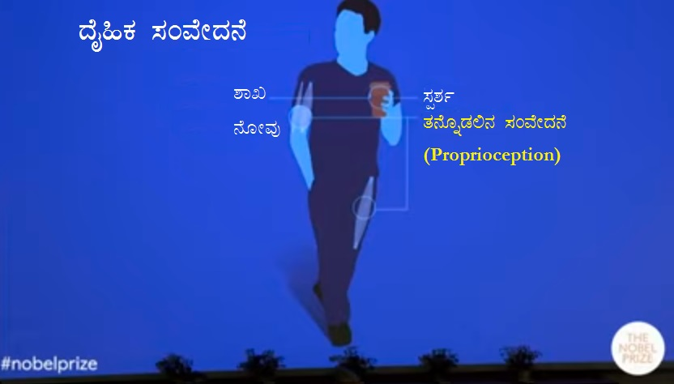
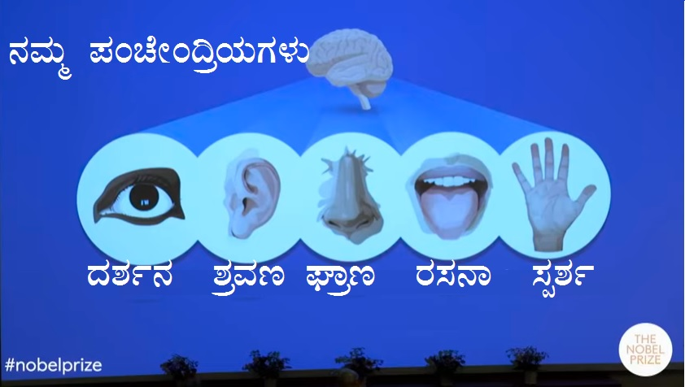
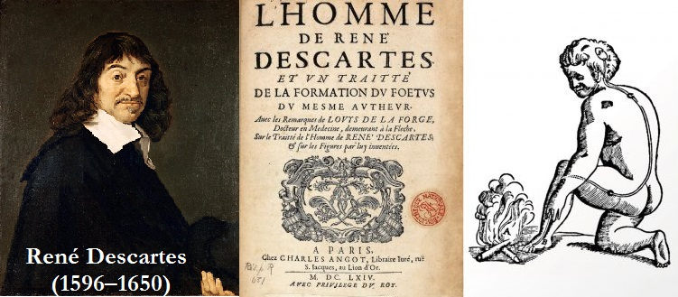
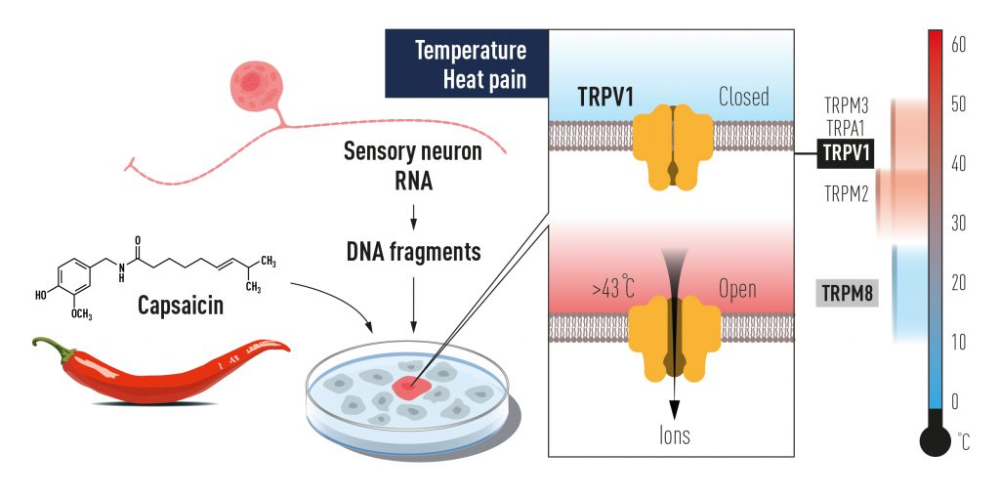
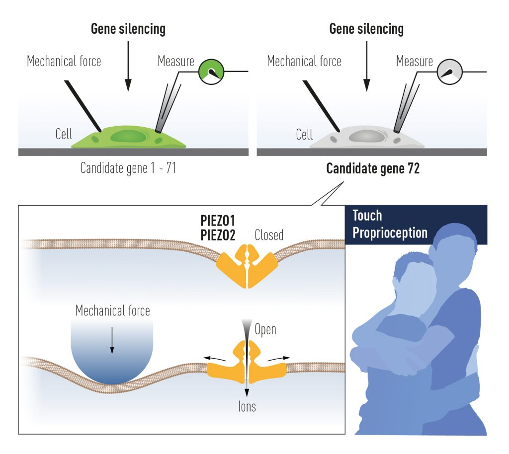
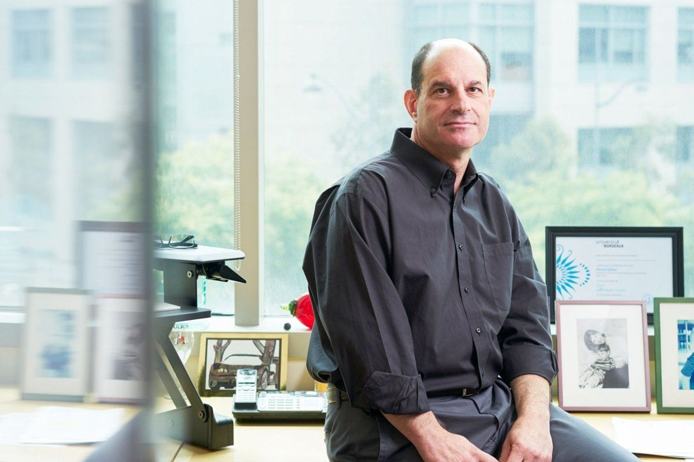
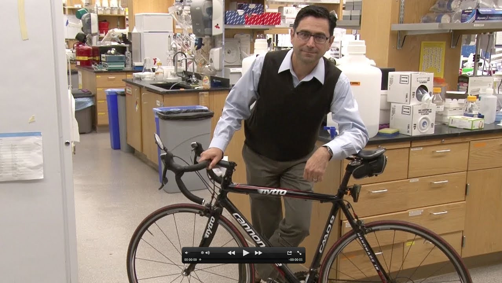

ಶಾಖ, ಶೀತ ಮತ್ತು ಸ್ಪರ್ಶವನ್ನು ಗ್ರಹಿಸುವ ನಮ್ಮ ಸಾಮರ್ಥ್ಯವು ಬದುಕಿಗೆ ಬೇಕೇ ಬೇಕು. ಅದರಿಂದಲೇ ನಮ್ಮ ಸುತ್ತಲಿನ ಪ್ರಪಂಚದೊಂದಿಗಿನ ಸಂವಹನವು ಸಾಧ್ಯವಾಗಿದೆ. ನಮ್ಮ ದೈನಂದಿನ ಜೀವನದಲ್ಲಿ ನಾವು ಇಂತಹಾ ಈ ಸಂವೇದನೆಗಳನ್ನು ತೀರಾ ಹಗುರವಾಗಿ ಪರಿಗಣಿಸುತ್ತೇವೆ. ಇಂತಹಾ ಸಂವೇದನೆಯ ಗ್ರಹಿಕೆಯ ನರ ಪ್ರಚೋದನೆಗಳನ್ನು ವೈಜ್ಞಾನಿಕ ವಿವರಗಳ ಅನುಶೋಧನೆಗೆ 2021ನೆಯ ವರ್ಷದ ನೊಬೆಲ್ ಪ್ರಶಸ್ತಿಯನ್ನು ನೀಡಲಾಗಿದೆ. ಸ್ಯಾನ್‌ ಫ್ರಾನ್ಸಿಸ್ಕೊದ ಕ್ಯಾಲಿಫೋರ್ನಿಯಾ ವಿಶ್ವವಿದ್ಯಾಲಯದ ಪ್ರೊ. ಡೇವಿಡ್‌ ಜೂಲಿಯಸ್‌ ಮತ್ತು ಕ್ಯಾಲಿಫೋರ್ನಿಯಾದ ಲಾ ಹೊಯಾ (La Jolla)ದ ಸ್ಕ್ರಿಪ್ಸ್‌ ರೀಸರ್ಚ್‌(Scripps Research) ಸಂಸ್ಥೆಯ ಪ್ರೊ. ಆರ್ಡೆಮ್‌ ಪತಪೌಂಚ ಅವರು ಜಂಟಿಯಾಗಿ ನೊಬೆಲ್‌ ಪುರಸ್ಕಾರವನ್ನು ಪಡೆದಿದ್ದಾರೆ.

ತೀರಾ ಗ್ರಹಿಕೆಯಲ್ಲೇ ಸಿಗದ ಆದರೆ, ಸ್ವಾಭಾವಿಕವಾಗಿ ನಿರಂತರವಾಗಿ ನಮ್ಮ ದೇಹ ಹಾಗೂ ಹೊರಗಿನ ಜಗತ್ತನ್ನು ಸದಾ ಸಂವಾದದಲ್ಲಿ ಇರಿಸುವ ಈ ಶೋಧನೆಯ ವಿವರಗಳಾದರೂ ಹೇಗೆ ಎಂಬದನ್ನು ನೋಡೋಣ. ಒಂದು ಮುಂಜಾವಿನಲ್ಲಿ ಎಳೆಯ ಬಿಸಿಲಿನಲ್ಲಿ ಬರಿಗಾಲಿನಲ್ಲಿ ನಡೆದು ಹೋಗುತ್ತಿದ್ದೀರಿ ಎಂದು ಭಾವಿಸಿಕೊಳ್ಳಿ. ಆಗ ನಿಮಗೆ ಎಳೆ ಬಿಸಿಲಿನ ಹಿತವಾದ ಶಾಖ, ಮುಂಜಾವಿನ ಆಹ್ಲಾದಕರ ತಂಗಾಳಿ ಜೊತೆಗೆ ನೆಲದ ಹಾಸಿನ ಹಸಿರು ಹುಲ್ಲಿನ ಎಸಳು ಕಾಲಿಗೆ ತರಚುವ ಹಿತವಾದ ಅನುಭವ ಎಲ್ಲವೂ ಒಟ್ಟೊಟ್ಟಿಗೆ ಆಗುತ್ತವಲ್ಲವೇ? ಈ ಸಂವೇದನೆಗಳು ಉಷ್ಣತೆ, ತಂಪು ಹಾಗೂ ಸ್ಪರ್ಶ ಎಲ್ಲವನ್ನೂ ಚಲನೆಯ ಜೊತೆಗೆ ನಮ್ಮ ಅನುಭವಕ್ಕೆ ತರುತ್ತವೆ. ಇವೆಲ್ಲವೂ ಒಟ್ಟಾರೆಯ ನಮ್ಮ ದೈಹಿಕ ಸಂವೇದನೆಯಾಗಿ ನಮ್ಮ ಗ್ರಹಿಕೆಗೆ ಒಳಗಾಗುತ್ತವೆ. ಚಲಿಸುತ್ತಿರುವ ನಮ್ಮ ದೇಹವು ತೀರಾ ಸಹಜ ಎನ್ನುವಂತೆ ಇವನ್ನೆಲ್ಲಾ ನಿಭಾಯಿಸುತ್ತಿರುತ್ತದೆ. ಈ ಬಗೆಯ ಇಡೀ ದೇಹವು ನಿರ್ವಹಿಸುವ ಉಷ್ಣತೆ, ಸ್ಪರ್ಶ ಹಾಗೂ ಚಲನೆಯ ಸಂವೇದನೆಗಳನ್ನು ದೈಹಿಕ ಸಂವೇದನೆಗಳು (Somato Sensation) ಎಂದು ಕರೆಯಲಾಗುತ್ತದೆ.

ಇನ್ನೂ ಮುಂದುವರೆದಂತೆ ವಾಕಿಂಗ್‌ ಮುಗಿಸಿ ವಾಪಾಸಾದ ನೀವು ಕಾಫಿಯನ್ನೋ ಚಹಾವನ್ನೋ ಕುಡಿಯಲು ಕುಳಿತರೆ ಇಡೀ ನಿಮ್ಮ ದೇಹವು ಚಹಾ/ಕಾಫಿಯ ಲೋಟದ ಬಿಸಿಯನ್ನು ಅನುಸರಿಸುತ್ತಲೇ ಹಿಡಿದುಕೊಳ್ಳುವ ಬಗೆಯಲ್ಲೂ ಸ್ಪರ್ಶ ಹಾಗೂ ಉಷ್ಣತೆಯ ನಿರ್ವಹಣೆ ಎರಡನ್ನೂ ಸಹಜವಾಗಿ ನಿಭಾಯಿಸಿತ್ತೀರಿ ಅಲ್ಲವೇ? ಶಾಖವನ್ನು ತಡೆದುಕೊಳ್ಳುವಷ್ಟು ಹಾಗೂ ಲೋಟವನ್ನು ನಿಭಾಯಿಸುವಷ್ಟೂ ಜಾಣತನವು ಅರಿವಿಲ್ಲದ ಹಾಗೆ ನಡೆದಿರುತ್ತದೆ. ಹೀಗೆ ನಮ್ಮ ಸುತ್ತಲಿನ ಜಗತ್ತಿಗೆ ಸ್ಪಂದಿಸುವ ನಮ್ಮೊಳಗಿನ ಆಂತರಿಕ ಜಗತ್ತೂ ನಿರಂತರವಾಗಿ ಹಾಗೂ ಅಷ್ಟೇ ಸಹಜವಾಗಿ ಸಂವಾದವನ್ನು ನಡೆಸಿಯೇ ಇರುತ್ತದೆ.

ಮೆಣಸಿನಕಾಯಿಯಲ್ಲಿರುವ ಕ್ಯಾಪ್ಸಿಸಿನ್‌ ರಸಾಯನಿಕವು ನಮ್ಮ ದೇಹದಲ್ಲಿ ಈ ಬಗೆಯ ಶಾಖದ ಸಂವೇದನೆಯನ್ನು ಉಂಟುಮಾಡುವ ಬಗೆಯನ್ನು ವಿವರಿಸಬಲ್ಲದು. ಪ್ರೊ. ಡೇವಿಡ್‌ ಜೂಲಿಯಸ್‌ ಈ ಕ್ಯಾಪ್ಸಿಸಿನ್‌ ಅನ್ನು ಬಳಸಿ ಅದು ನಮ್ಮ ನರಮಂಡಲದಲ್ಲಿ ಶಾಖವು ಗ್ರಹಿಸುವ ಬಗೆಯನ್ನು ಅನ್ವೇಷಿಸಿದರು. ಆರ್ಡೆಮ್‌ ಪತಪೌಂಚ ಅವರು ಒತ್ತಡಕ್ಕೆ ಸೂಕ್ಷ್ಮವಾಗಿ ವರ್ತಿಸುವ ಜೀವಿಕೋಶಗಳನ್ನು ಬಳಸಿ ಯಾಂತ್ರಿಕ ಪ್ರಚೋದನೆಗಳಿಗೆ ನಮ್ಮ ದೇಹದ ಚರ್ಮ ಹಾಗೂ ಆಂತರಿಕ ಅಂಗಗಳು ಪ್ರತಿಕ್ರಿಯಿಸುವ ವಿಧಾನಗಳನ್ನು ಸ್ಪರ್ಶದ ಪ್ರತಿಕ್ರಿಯೆಯಾಗಿ ಕಂಡುಹಿಡಿದರು. ಇವೆರಡೂ ಪ್ರಸ್ತುತ ವೈದ್ಯಕೀಯದಲ್ಲಿ ನೋವು ಮತ್ತು ತಾಪಮಾನ ಎರಡನ್ನೂ ನರಮಂಡಲವು ನಿಭಾಯಿಸುವಿಕೆಯ ವಿವರಗಳನ್ನು ಒದಗಿಸಲು ಸಹಾಯವಾಗಲಿವೆ. ನೋವಿಗೆ ಅಥವಾ ಉಷ್ಣತೆಗೆ ಬಲಿಯಾದ ಜೀವಿಕೋಶ ಅಥವಾ ಅಂಗಾಂಶವನ್ನು ಗುರಿಯಾಗಿಸಿ ಚಿಕಿತ್ಸೆ ನೀಡಲೂ ಈ ಅನ್ವೇಷಣೆಯು ಮುಂದೆ ಹೊಸತೊಂದು ಬಾಗಿಲನ್ನು ತೆರೆಯಲಿದೆ.

ಮಾನವ ಕುಲವು ತಮ್ಮ ಸುತ್ತಲಿನ ಪರಿಸರವನ್ನು ಗ್ರಹಿಸುವ ಬಗೆಯು ತುಂಬಾ ನಿಗೂಢವಾದದ್ದು. ನಮ್ಮ ಪಂಚೇಂದ್ರಿಯಗಳು ಉದಾಹರಣೆಗೆ ಕಣ್ಣು ಬೆಳಕನ್ನು ಗ್ರಹಿಸಿ ನೋಟವನ್ನು ಸಾಧ್ಯಗೊಳಿಸುತ್ತದೆ. ಕಿವಿಯು ಸದ್ದನ್ನು ಗ್ರಹಿಸಿ ನಿಭಾಯಿಸುತ್ತದೆ. ವಿವಿಧ ರಸಾಯನಿಕಗಳನ್ನು ವಾಸನೆಗಳಿಂದಲೇ ಮೂಗು ನಿರ್ವಹಿಸಿದರೆ ನಾಲಿಗೆಯು ಅವುಗಳನ್ನು ರುಚಿಯಾಗಿಸಿ ಅನುಭವಕ್ಕೆ ತರುತ್ತದೆ. ಸುತ್ತಲಿನ ಜಗತ್ತನ್ನು ಇಡಿಯಾಗಿ ನಿಭಾಯಿಸುತ್ತಲೇ ಸ್ಪರ್ಶ ಮತ್ತು ಉಷ್ಣತೆಯ ಅನುಭವದಿಂದ ಚರ್ಮವು ನಮ್ಮೊಳಗಿನ ಆಂತರಿಕ ಜೀವಿಚೈತನ್ಯವನ್ನು ಹಿಡಿದಿಟ್ಟಿದೆ. ಹೀಗೆ ಹೊರಗಣ ಹಾಗೂ ದೇಹದೊಳಗಣ ಜಗತ್ತೆರಡನ್ನೂ ನಿರ್ವಹಿಸುವ ಈ ಸ್ಪರ್ಶ ಮತ್ತು ತಾಪಮಾನದ ಗ್ರಹಿಕೆಯನ್ನು ತನ್ನೊಡಲಿನ (ಸ್ವಶರೀರದ) ಸಂವೇದನೆ (Proprioception) ಎಂದು ಕರೆಯಲಾಗುತ್ತದೆ. ಇಂತಹಾ ಚರ್ಮ ಹಾಗೂ ಮನಸ್ಸಿನ ಸಂವಹನಾ ಆಲೋಚನೆಯನ್ನು 17ನೆಯ ಶತಮಾನದಲ್ಲೇ ಫ್ರೆಂಚ್‌ ತತ್ವಜ್ಞಾನಿ ರೆನೆ ಡಿಕಾರ್ಟ್‌ಯು ದೇಹವು ಒಳಗೆ ದಾರಗಳಿಂದ ಸಂಪರ್ಕವನ್ನು ಸಾಧಿಸಿ ಮೆದುಳಿಗೆ ಮುಟ್ಟಿಸುತ್ತದೆ ಎಂಬುದರ ಮೂಲಕ ಮಾಡಿದ್ದರು. ಮುಂದೆ ಇದುವೆ ಕಾಲಾಂತರದಲ್ಲಿ ಜೋಸೆಫ್‌ ಎರ್ಲೆಂಗರ್‌ (Joseph Erlanger) ಮತ್ತು ಹರ್ಬರ್ಟ್‌ ಗೇಸರ್‌ (Herbert Gasser) ದೇಹದೊಳಗಿನ ನರವ್ಯೂಹದ ವಿವಿಧ ಬಗೆಯ ಸಂವೇದನೆಗಳನ್ನು ಸಂಶೋಧಿಸುವ ಮೂಲಕ 1944ರಲ್ಲಿ ನೊಬೆಲ್‌ ಪುರಸ್ಕಾರವನ್ನು ಪಡೆದಿದ್ದರು. ಇದೀಗ ಡೇವಿಡ್‌ ಮತ್ತು ಆರ್ಡೆಮ್‌ ಚಲನೆಯ ಸ್ಪರ್ಶ ಮತ್ತು ಶಾಖದ ಸಂವೇದನೆಯ ಮಾಲೆಕ್ಯುಲಾರ್‌ ವಿವರಗಳನ್ನು ಸಂಶೋಧಿಸಿ ನಮ್ಮ ಇಂದ್ರಿಯಗಳ ಗ್ರಹಿಕೆಯ ತಿಳಿವನ್ನು ವಿಸ್ತರಿಸಿದ್ದಾರೆ.

## ನೋವು ಮತ್ತು ಸ್ಪರ್ಶದ ವಿಜ್ಞಾನ (The Science of Pain and Touch)

ಡೇವಿಡ್‌ ಜೂಲಿಯಸ್‌ ಅವರು ಡಿ.ಎನ್‌.ಎ. ಅನ್ನು ತುಣುಕುಗೊಳಿಸಿ ಅದರಲ್ಲಿ ಕ್ಯಾಫ್ಸಿಸಿನ್‌ ಬಳಕೆಯಿಂದ ಶಾಖ ಮತ್ತು ಶಾಖದ ನೋವಿನ ಗ್ರಹಿಕೆಯ ವಿವರಗಳನ್ನು ಒದಗಿಸಿದ್ದಾರೆ. ಆ ಮೂಲಕ ದೊರಕಿಸಿದ ಜೀನ್‌ ಶಾಖ ಹಾಗೂ ನೋವಿಗೆ ಸ್ಪಂದಿಸುವ ಬಗೆಯನ್ನು ತೆರೆದುಕೊಳ್ಳುವ ಹಾಗೂ ಮುಚ್ಚಿಕೊಳ್ಳುವ ಬಗೆಯಿಂದ ವಿವರಿಸಿದ್ದಾರೆ. ಡೇವಿಡ್‌ ತಂಡದವರು ಲಕ್ಷಾಂತರ ಡಿ.ಎನ್‌.ಎ. ತುಣುಕುಗಳನ್ನು ಇಡೀ ಸಂಶೋಧನೆಯಲ್ಲಿ ಬಳಸಿ ವಿವರಗಳನ್ನು ಕಲೆಹಾಕಿದ್ದಾರೆ. ಪ್ರತೀ ತುಣುಕೂ ಕ್ಯಾಪ್ಸಿಸಿನ್‌ ಜೊತೆಗೆ ವರ್ತಿಸುವ ಪ್ರೊಟೀನ್‌ ಅನ್ನು ತಡಕಾಡಿ ಗ್ರಹಿಕೆಯನ್ನು ಸಾಬೀತು ಮಾಡಿದ್ದಾರೆ. ಕಡೆಯಲ್ಲಿ ಕ್ಯಾಪ್ಸಿಸಿನ್‌ ಜೊತೆ ವರ್ತಿಸಿದ ತುಣಿಕಿನ ಜೀನ್‌ (DNA) ಗೆ TRPV1 ಎಂದು ಹೆಸರಿಸಿದ್ದಾರೆ.

## ಜೀವಿಕೋಶಗಳ ಸಂವಾದದಲ್ಲಿ ಸ್ಪರ್ಶದ ಗ್ರಹಿಕೆ (Mechanosensation)

ಜೀವಿಕೋಶಗಳು ಯಾಂತ್ರಿಕ ಬಲಕ್ಕೆ ವರ್ತಿಸುವ ಸ್ಪರ್ಶದ ಗ್ರಹಿಕೆಯನ್ನು ತೀರಾ ಸೂಕ್ಷ್ಮವಾದ ಜೀನುಗಳ ಹುಡುಕಾಟದ ಮೂಲಕ ಆರ್ಡಮ್‌ ಸಂಶೋಧಿಸಿದ್ದಾರೆ. ಸರಿ ಸುಮಾರು 72 ಜೀನುಗಳನ್ನು ನಿಷ್ಕ್ರಿಯಗೊಳಿಸಿ ಜೀವಿಕೋಶಗಳಲ್ಲು ಸ್ಪರ್ಶದ ಗ್ರಹಿಕೆಯ ಸಾಬೀತನ್ನು ಪಡೆಯಲು ಹೆಣಗಿದ್ದಾರೆ. ಸುಮಾರು 71 ಜೀನುಗಳ ನಿಷ್ಕ್ರಿಯೆಯಲ್ಲೂ ಸಾಬೀತು ಸಿಗದೆ 72ನೆಯ ಜೀನು ಸ್ಥಬ್ದವಾದಾಗ ಸ್ಪರ್ಶದ ಗ್ರಹಿಕೆಯ ವಿವರವು ದೊರಕಿದ್ದನ್ನು ಸಾಬೀತಿಗೆ ಬಳಸಿದ್ದಾರೆ. ಯಾಂತ್ರಿಕ ಬಲದ ಪ್ರಚೋದನೆಗೆ ತೆರೆದುಕೊಳ್ಳುವ ಮತ್ತು ಮುಚ್ಚಿಕೊಳ್ಳುವ ಬಗೆಯನ್ನು Piezo channel ಎಂದು ಕರೆದು ಸ್ಪರ್ಶದ ಗ್ರಹಿಕೆಯನ್ನು ಸಾಬೀತು ಮಾಡಿದ್ದಾರೆ.

ಡೇವಿಡ್‌ ಜೂಲಿಯಸ್‌ ಪೂರ್ವಜರು ಅಮೆರಿಕೆಗೆ ವಲಸೆಗೊಂಡು ನೆಲೆಸಿದ ರಷಿಯನ್‌ ಯಹೂದಿಗಳು. ನ್ಯೂಯಾರ್ಕ್‌ ಸಮೀಪದ ಬ್ರುಕ್‌ಲಿನ್‌ ಎಂಬಲ್ಲಿ 1955ರ ನವೆಂಬರ್‌ 4ರಂದು ಜನಿಸಿದರು. ಮೆಸಾಚುಸೇಟ್ಸ್‌ ತಾಮತ್ರಿಕ ಸಂಸ್ಥೆ ಹಾಗೂ ಕ್ಯಾಲಿಫೋರ್ನೀಯಾ ವಿಶ್ವವಿದ್ಯಾಲಯದಲ್ಲಿ ಶಿಕ್ಷಣವನ್ನು ಪಡೆದವರು. ಪ್ರಸ್ತುತ ಸ್ಯಾನ್‌ಫ್ರಾನ್ಸಿಸ್ಕೊದಲ್ಲಿ ನೆಲೆಸಿದ್ದಾರೆ.

ಡೇವಿಡ್‌ ಜೂಲಿಯಸ್‌ (David Julius) ಅವರ ನೋವು ಮತ್ತು ಸ್ಪರ್ಶದ ವಿಜ್ಞಾನದ (The Science of Pain and Touch) ವಿಚಾರವನ್ನು ಅವರ 1ನಿಮಿಷ 55 ಸೆಕೆಂಡುಗಳ ಮಾತಿನಲ್ಲೇ ಈ ಲಿಂಕ್‌ ಅಲ್ಲಿ ಕೇಳಿ _**<https://www.youtube.com/watch?v=2l0SFCuVnog>**_

ಆರ್ಡೆಮ್‌ ಪತಪೌಂಚ ಮೂಲತಃ ಲೆಬನಾನಿನವರು. ಲೆಬನಾನ್‌ ನ ಬೈರೂತ್‌ನಲ್ಲಿ 1967ರಲ್ಲಿ ಜನಿಸಿದರು. ಮುಂದೆ 1986ರಲ್ಲಿ ಅಮೆರಿಕೆಗೆ ಹೆಚ್ಚಿನ ವಿದ್ಯಾಭ್ಯಾಸಕ್ಕೆ ಬರುವ ವರೆಗೂ ಲೆಬನಾನ್‌ ಅಲ್ಲಿಯೇ (ಬೈರೂತ್‌ ನ ಅಮೆರಿಕನ್‌ ವಿಶ್ವವಿದ್ಯಾಲಯ) ವಿದ್ಯಾಭ್ಯಾಸ ಮಾಡಿದರು. ಅಮೆರಿಕೆಯಲ್ಲಿ ಯೂನಿವರ್ಸಿಟಿ ಆಫ್‌ ಕ್ಯಾಲಿಫೋರ್ನಿಯಾ ಹಾಗೂ ಕ್ಯಾಲಿಫೋರ್ನಿಯಾ ತಾಂತ್ರಿಕ ಸಂಸ್ಥೆ (ಕ್ಯಾಲ್‌ ಟೆಕ್‌)ನಲ್ಲಿ ಉನ್ನತ ಶಿಕ್ಷಣವನ್ನು ಪಡೆದು ಪ್ರಸ್ತುತ ಕ್ಯಾಲಿಫೋರ್ನಿಯಾ ರಾಜ್ಯದ ಲಾ ಹೊಯಾ (La Jolla) ದ ಸ್ಕ್ರಿಪ್ಸ್‌ ಸಂಶೋಧನಾ (Scripps Research) ಸಂಸ್ಥೆಯಲ್ಲಿ ನೆಲೆಸಿದ್ದಾರೆ.

ಆರ್ಡೆಮ್‌ ಪತಪೌಂಚ (Ardem Patapoutian) ಅವರ ಜೀವಿಕೋಶಗಳು ಒಂದನ್ನೊಂದು ಹೇಗೆ ಸಂವಾದಿಸಿ ವರ್ತಿಸುತ್ತವೆ ("Mechanosensation"- how cells talk to each other through mechanical force.) ಎಂಬುದರ ವಿವರಗಳನ್ನು ಅವರ 1ನಿಮಿಷ 40 ಸೆಕೆಂಡುಗಳ ಮಾತಿನಲ್ಲೇ ಈ ಲಿಂಕ್‌ ಅಲ್ಲಿ ಕೇಳಿ _**<https://www.youtube.com/watch?v=YNM-KUVIiF0>**_

ನೊಬೆಲ್ ಪ್ರಶಸ್ತಿ ಪುರಸ್ಕೃತ ಈ ಸಂಶೋಧನೆಯು ನಮ್ಮ ಸುತ್ತಲಿನ ಪ್ರಪಂಚವನ್ನು ಗ್ರಹಿಸಲು ಶಾಖ, ಶೀತ ಮತ್ತು ಸ್ಪರ್ಶ (ಯಾಂತ್ರಿಕ ಶಕ್ತಿ - Mechanical force) ಯು ಉಂಟುಮಾಡುವ ನರ ಪ್ರಚೋದನೆಗಳನ್ನು ಅರ್ಥಮಾಡಿಕೊಳ್ಳಲು ನಮಗೆ ಅವಕಾಶ ಮಾಡಿಕೊಟ್ಟಿದೆ. ಇದರ ಮೂಲಕ ಈ ವರ್ಷದ ನೊಬೆಲ್ ಪ್ರಶಸ್ತಿ ಪಡೆದ ಸಂಶೋಧನೆಗಳು ವಿವಿಧ ಶಾರೀರಿಕ ಪ್ರಕ್ರಿಯೆಗಳಲ್ಲಿ ತಮ್ಮ ಕಾರ್ಯಗಳನ್ನು ಸ್ಪಷ್ಟಪಡಿಸಲು ಸಹಕರಿಸುತ್ತವೆ. ದೀರ್ಘಕಾಲದ ನೋವನ್ನು ಒಳಗೊಂಡಂತೆ ವ್ಯಾಪಕ ಶ್ರೇಣಿಯ ರೋಗ ಪರಿಸ್ಥಿತಿಗಳಿಗೆ ಚಿಕಿತ್ಸೆಯನ್ನು ಅಭಿವೃದ್ಧಿಪಡಿಸಲು ಈ ಜ್ಞಾನವನ್ನು ಬಳಸಬಹುದಾಗಿದೆ.

ಇಂದ್ರಿಯಗಳ ಸಂವೇದನೆಗಳ ಬಗೆಗೆ ಹೊಸತಾದ ಬೆಳಕಿಗೆ ಕಾರಣರಾದ ಡೇವಿಡ್‌ ಹಾಗೂ ಆರ್ಡೆಮ್‌ ಇಬ್ಬರಿಗೂ ಶುಭಾಶಯಗಳು.

**ನಮಸ್ಕಾರ**

ಡಾ. ಟಿ.ಎಸ್.‌ ಚನ್ನೇಶ್‌
