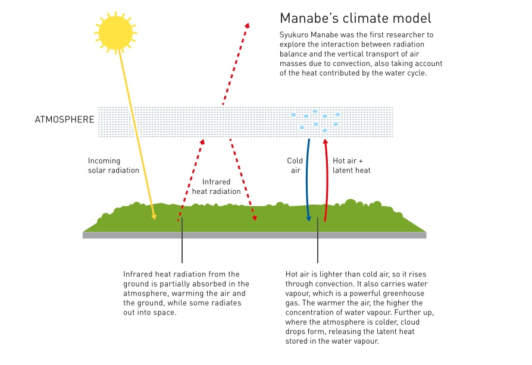
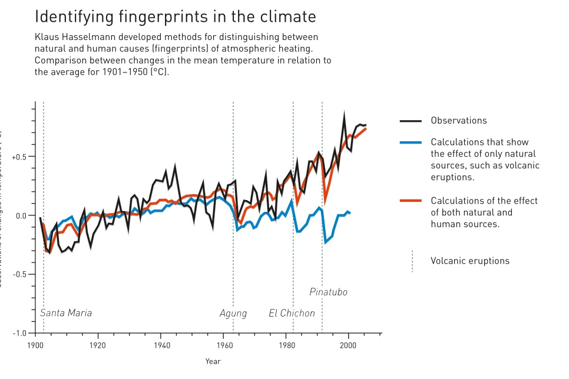
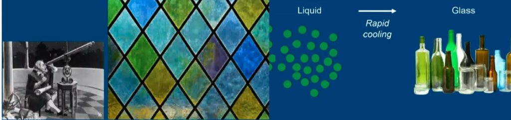
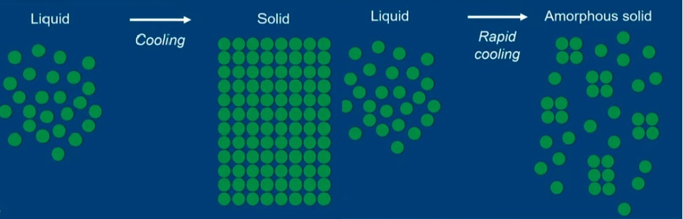
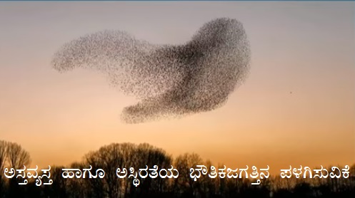

ನಾವೆಲ್ಲಾ ಸಾಮಾನ್ಯವಾಗಿ ಭೌತವಿಜ್ಞಾನ ಎಂದರೆ ಸರಳ ಹಾಗೂ ನಿರ್ಧಿಷ್ಟವಾದ ಸಂಗತಿಗಳಿಗೆ ಸೇರಿದ್ದು ಮಾತ್ರ ಎಂದುಕೊಳ್ಳುತ್ತೇವೆ. ಉದಾಹರಣೆಗೆ ಭೂಮಿಯು ಸೂರ್ಯನ ಸುತ್ತಲೂ ಸದಾ ಗೊತ್ತಾದ ಅಂಡಾಕಾರದ ಚಲನೆಯನ್ನು ಹೊಂದಿರುವುದರ ಬಗ್ಗೆ, ಅಥವಾ ಮೂಲವಸ್ತುಗಳ ಪರಮಾಣುಗಳು ನಿಗಧಿತವಲ್ಲದ ಹರಳಿನ ರಾಚನಿಕ ವಿನ್ಯಾಸದವು ಎಂದಾಗಲಿ ಅಥವಾ ಎಲೆಕ್ಟ್ರಿಕ್‌ ಕರೆಂಟ್‌ ಚಲಿಸುವಾಗಿನ ನಿರ್ದಿಷ್ಟ ಮಾರ್ಗದ ವಿವರಗಳು ಬಲ್ಬನ್ನು ಬೆಳಗುವಲ್ಲಿಯೋ, ಮತ್ತಾವುದೋ ವಿದ್ಯುತ್‌ ಉಪಕರಣದಲ್ಲಿಯೋ ಕೊನೆಯಾಗುತ್ತವೆ ಎನ್ನುತ್ತೇವೆ ಅಲ್ಲವೆ? ಆದರೆ ನಿಜಕ್ಕೂ ಭೌತವಿಜ್ಞಾನ ಇದಕ್ಕಿಂತಲೂ ಹೆಚ್ಚು ಅಥವಾ ಅದರಾಚೆಗೂ ಸಾಕಷ್ಟು ಹುಡುಕಾಟ ನಡೆಸುವ ಭೌದ್ಧಿಕ ಮಾರ್ಗ.

ಭೌತ ವಿಜ್ಞಾನವು ಸದಾ ಸರಳವಾದ ವಸ್ತು ನಿರ್ಮಿತಿಯ ಸಂಗತಿಗಳನ್ನು ಬಳಸುತ್ತದೆ ಎಂಬುದೇನೋ ನಿಜ! ಆದರೆ ಅದು ಸದಾ ಸಂಕೀರ್ಣವಾದ ಬೃಹತ್ತಾದ ಅನೇಕ ಸಂಗತಿಗಳನ್ನು ವಿವರಿಸುತ್ತದೆ. ಉದಾಹರಣೆಗೆ ಗಾಜಿನಂತಹಾ ವಸ್ತುಗಳ ರಚನೆಯನ್ನೂ ಹಾಗೂ ಭೂಮಿಯ ಅತ್ಯಂತ ಏರುಪೇರಾದ ಹವಾಮಾನದ ವಿವರಗಳಲ್ಲೂ ಅದರ ಆಸಕ್ತಿಯು ಇರುತ್ತದೆ. ಇಂತಹದರ ಅಧ್ಯಯನಗಳಲ್ಲಿ ಯಾವ ರಾಚನಿಕ ಸ್ಥಿತಿಯು ಅನುಕೂಲಕರ, ಯಾವ ಬದಲಾವಣೆಯುಳ್ಳ ಬೆಳವಣಿಗೆಯನ್ನು ಅರ್ಥೈಸಬೇಕು ಎನ್ನುವ ಒತ್ತಾಸೆಯೂ ತುಂಬಿರುತ್ತದೆ. ಇದಕ್ಕೆಲ್ಲಾ ಅವುಗಳನ್ನು ನಿರ್ವಹಿಸಬಲ್ಲ ಸೈದ್ಧಾಂತಿಕ ವಿವರಗಳನ್ನು ಹಾಗೂ ಮಾದರಿಗಳನ್ನು ಕಟ್ಟಬಲ್ಲ ಗಣಿತದ ಜಾಣತನವು ಅತ್ಯವಶ್ಯಕವಾಗಿ ಒಳಗೊಂಡಿರುತ್ತದೆ. ಈ ಹಿನ್ನೆಲೆಯ ಸಂಕೀರ್ಣ ಮಹತ್ವವನ್ನು ಅತ್ಯದ್ಭುತವಾಗಿ ಬಳಸಿರುವ ಈ ವರ್ಷ 2021ರ ನೊಬೆಲ್‌ ಪುರಸ್ಕೃತರು ನಿಜವಾದ ಭೌತವಿಜ್ಞಾನದ ಹರಿಕಾರರಾಗಿದ್ದಾರೆ.

**“ದೂರದ ಗುಡ್ಡ ಕಣ್ಣಿಗೆ ನುಣ್ಣಗೆ”** ಎಂಬ ಜನಪ್ರಿಯ ಮಾತಿದೆ!ತುಂಬ ದೂರದಲ್ಲಿನ ಸಂಕೀರ್ಣ ವಸ್ತುಗಳೂ ಸರಳವಾಗಿ ಗೋಚರಿಸುತ್ತವೆ. ಪರಮಾಣುಗಳಿಂದ ಆಕಾಶಕಾಯಗಳವರೆಗೂ ಸಹಾ ಹತ್ತಿರದ ನೋಟದಿಂದ ಮಾತ್ರವೇ ಅವುಗಳ ರಾಚನಿಕ ವಿನ್ಯಾಸವು ತುಸುವಾದರೂ ತಿಳಿದೀತು. ನಮ್ಮ ಸುತ್ತಲಿನ ಜಗತ್ತು ಬೃಹತ್‌ ಸಂಕೀರ್ಣವಾದ ವ್ಯವಸ್ಥೆ. ವಿಜ್ಞಾನವು ವೀಕ್ಷಣೆಯ ವಿವರಗಳಿಗೆ ಅದೆಷ್ಟು ವಿವರಗಳು ಬೇಕಾದೀತು ಎಂಬುದನ್ನು ಸದಾ ಪ್ರಶ್ನಿಸುತ್ತಲೇ ಇರುತ್ತದೆ. ಈ ವರ್ಷದ ನೊಬೆಲ್‌ ಪುರಸ್ಕಾರವು ಅಂತಹಾ ಸಂಕೀರ್ಣ ವ್ಯವಸ್ಥೆಗಳನ್ನು ಅರಿವಿನ ಜಾಡಿನಲ್ಲಿ ಹಿಡಿದಿಡುವಂತಹದು. ಸಂಕೀರ್ಣವಾದ ಹವಾಮಾನ ಹಾಗೂ ಅಣುಗಳಿಂದ ಆಕಾಶಕಾಯದ ಭೌತಿಕ ಜಗತ್ತಿನ ಮಾದರಿಗಳ ಹುಡುಕಾಟದ್ದು! ಭೂಮಿಯ ಅತ್ಯಂತ ಹಳೆಯ ಆಸಕ್ತಿಯಲ್ಲೊಂದಾದ ಹವಾಮಾನದ ಬದಲಾವಣೆ. ಸುಮಾರು 1824ರಷ್ಟು ಹಿಂದೆಯೇ ಜೊಸೆಫ್‌ ಫೂಯೆ (Joseph Fourier – 1768-1830) ಭೂಮಿಯ ವಾತಾವರಣವು ನೋಟಕ್ಕೆ ದಕ್ಕಬಲ್ಲ ಬೆಳಕಿಗೆ ಪಾರದರ್ಶಕವಾಗಿದೆ ಎಂದೂ, ಹಾಗಾಗಿ ಸೂರ್ಯನ ಉಷ್ಣತೆಯು ಹಾದು ಭೂಮಿಯನ್ನು ತಲುಪುವ ಬಗ್ಗೆ ತಿಳಿಸಿದ್ದರು. ಅದು ಆತನ ಊಹೆಯಂತೆ “ಕಪ್ಪುಶಾಖ- (Dark Heat)” ಹೆಸರಿಂದ ವಿವರಿಸಿದ್ದನು. ಇದು ಭೂಮಿಯನ್ನು ಬೆಚ್ಚಗಿಡಲು ಸಹಾಯ ಮಾಡುವ ಬಗ್ಗೆ ತಿಳಿಸಿದ್ದನು. ಇದನ್ನೇ ಮುಂದೆ ಪ್ರಾಯೋಗಿಕವಾಗಿ ಅಧ್ಯಯನ ಮಾಡಿ “Infrared -ಅವರೋಹಿತ” ವಿಕಿರಣವೆಂದೂ ಹೆಸರಿಸಲಾಗಿತ್ತು.

ಮುಂದೆ ಸರಿ ಸುಮಾರು 70 ವರ್ಷಗಳ ತರುವಾಯು ಅರ‍್ಹೇನಿಯಸ್‌ ಈ ವಿವರಗಳನ್ನು ಗಮನಿಸಿ ಇದರ ಗಣಿತೀಯ ಮಾದರಿಯ ತಿಳಿವನ್ನಾಗಿಸಿ ಹವಾಮಾನದ ಬದಲಾವಣೆಯ ಬಗ್ಗೆ ವಿವರಿಸಿದ್ದನು. ಹಾಗೇಯೇ ವಾತಾವರಣದ ಇಂಗಾಲದ ಡೈಆಕ್ಸೈಡ್‌ ಹೆಚ್ಚಾದಂತೆ ಉಷ್ಣತೆಯೂ ಹೆಚ್ಚಾಗುವ ಬಗ್ಗೆ ಊಹಿಸಿದ್ದನು. ಆನಂತರದ 70 ವರ್ಷಗಳಲ್ಲಿ ಕಂಪ್ಯೂಟರ್‌ಗಳ ಕ್ರಾಂತಿಯು ಆರಂಭವಾಗಿ ಸುಕುರೊ ಮನಾಬೆ ಅವರು ಲೆಕ್ಕಾಚಾರಗಳ ಸಹಿತ ವಾತಾವರಣದ ಬದಲಾವಣೆಯನ್ನು ವಿವರಿಸಿದ್ದರು. ವಾತಾವರಣದ ಇಂಗಾಲದ ಡೈ ಆಕ್ಸೈಡ್‌ ಎರಡು ಪಟ್ಟಾದರೆ, ಉಷ್ಣತೆಯು 2 ಡಿಗ್ರಿ ಸೆಲ್ಸಿಯಸ್‌ ಹೆಚ್ಚಾಗುವುದನ್ನು ಮೊಟ್ಟ ಮೊದಲಬಾರಿಗೆ ವಿವರಿಸಿದ್ದರು. ಅದೇ ಸಂದರ್ಭದಲ್ಲಿ ಎಡ್ವರ್ಡ್‌ ಲೊರಾಂಝ್‌ (Edward Lorenz-1917-2008) ಹವಾಮಾನವು ತೀರಾ ಅವ್ಯವಸ್ಥೆಯುಳ್ಳದ್ದೆಂದು ಅದನ್ನು ಊಹಿಸುವುದು ಕಷ್ಟವೆಂದೂ ಆಗಾಗ್ಗೆಯಷ್ಟೇ ಅದು ವಿಕಸಿಸಿ ವರ್ತಿಸುವ ಬಗ್ಗೆಯೂ ತಿಳಿಸಿದ್ದರು. ಅದನ್ನೆ ಬಟರ್‌ಫ್ಲೈ ಎಫೆಕ್ಟ್‌ - ಚಿಟ್ಟೆಯಂತೆ ಪ್ರತೀಕ್ಷಣವೂ ಹಾರಾಟದ ಬಗೆಯದ್ದೆಂದು ವಿವರಿಸಿದ್ದರು. ಅದೇ ಬಗೆಯಲ್ಲಿ ಕ್ಲಾಸ್ ಹ್ಯಾಸೆಲ್ಮನ್ ಅವರು ಕ್ಷಣ ಕ್ಷಣವೂ ಬದಲಾಗುವ ವಾತಾವರಣದ ವ್ಯವಸ್ಥೆಯನ್ನು ನಿಧಾನವಾಗಿ ಪರಿಣಾಮದ ಹವಾಮಾನದೊಡನೆ ಹೋಲಿಸಿ ವಿವರಿಸಿದ್ದರು. ಅದಕ್ಕೆಂದು ನಿಶ್ಚಲ ಸ್ಥಿತಿಯನ್ನೆಂದೂ ತಲುಪದ ಬ್ರೌನಿಯನ್‌ ಚಲನೆಯ ಸಾದೃಶ್ಯವನ್ನು ಬಳಸಿ ಅರ್ಥೈಸಿದ್ದರು.

ಇದನ್ನು ಬಳಸಿ ವಾತಾವರಣದ ಬದಲಾವಣೆಯು ದಿನದ ಲೆಕ್ಕದಲ್ಲಿ ಸಾಗರಗಳ ಮೇಲೆ ವರ್ಷಗಳ ಕಾಲದ ಬದಲಾವಣೆಯನ್ನು ತರುವ ಬಗ್ಗೆ ಊಹೆ ಮಾಡಿದ್ದರು. ಮುಂದುವರೆದು ಹವಾಮಾನದ ಏರುಪೇರಿನ ಅಳತೆಗಳು, ವೀಕ್ಷಣೆಗಳು ಮತ್ತು ಮಾದರಿಗಳನ್ನು ಹೋಲಿಸಿ ಭೌತಿಕ ಪ್ರಕ್ರಿಯೆಗಳ ಬೆರಳಚ್ಚ(Finger Print)ನ್ನು ಪಡೆಯಲು ವ್ಯವಸ್ಥಿತವಾದ ಸಂಖ್ಯಾಶಾಸ್ತ್ರೀಯ ಮಾರ್ಗವನ್ನು ರೂಪಿಸಿದ್ದಾರೆ.

ಹವಾಮಾನ ಬದಲಾವಣೆಗಳ ಮಾದರಿ ತಯಾರಿಯ ನಂತರ, ಹ್ಯಾಸೆಲ್ಮನ್ ಹವಾಮಾನ ವ್ಯವಸ್ಥೆಯ ಮೇಲೆ ಮಾನವ ಪ್ರಭಾವ ಗುರುತಿಸುವ ವಿಧಾನಗಳನ್ನು ಅಭಿವೃದ್ಧಿಪಡಿಸಿದರು. ಮಾದರಿಗಳು, ಅವಲೋಕನ ಮತ್ತು ಸಿದ್ಧಾಂತದ ಜೊತೆಗೆ ಶಬ್ದ ಮತ್ತು ಸಿಗ್ನಲ್‌ಗಳ ಗುಣಲಕ್ಷಣಗಳ ಬಗ್ಗೆ ಸಾಕಷ್ಟು ಮಾಹಿತಿಯನ್ನು ಒಳಗೊಂಡಿರುತ್ತವೆ. ಉದಾಹರಣೆಗೆ, ಸೌರ ವಿಕಿರಣ, ಜ್ವಾಲಾಮುಖಿ ಕಣಗಳು ಅಥವಾ ಹಸಿರುಮನೆ ಅನಿಲಗಳ ಮಟ್ಟದಲ್ಲಿನ ಬದಲಾವಣೆಗಳು ಅನನ್ಯ ಸಂಕೇತಗಳಾಗಿ ಪ್ರತ್ಯೇಕಿಸಬಹುದು. ಬೆರಳಚ್ಚುಗಳನ್ನು ಗುರುತಿಸುವ ಈ ವಿಧಾನವನ್ನು ಹವಾಮಾನ ವ್ಯವಸ್ಥೆಯ ಮೇಲೆ ಮಾನವರ ಪ್ರಭಾವವನ್ನು ಅರಿಯಲು ಸಹಾ ಅನ್ವಯಿಸಬಹುದು ಹ್ಯಾಸೆಲ್ಮನ್ ಇದರಿಂದಾಗಿ ಹವಾಮಾನದ ಮೇಲೆ ಮಾನವ ಪ್ರಭಾವದ ಕುರುಹುಗಳನ್ನು ಪ್ರದರ್ಶಿಸಿ ಹವಾಮಾನ ಬದಲಾವಣೆಯ ಸ್ವತಂತ್ರ ಅಧ್ಯಯನಕ್ಕೆ ದಾರಿ ಮಾಡಿಕೊಟ್ಟರು. ಹಾಗಾಗಿ ಈಗಿನ ಹವಾಮಾನದ ಮಾದರಿಗಳು ಸಾಕಷ್ಟು ನಾವೀನ್ಯತೆಯನ್ನು ಹೊಂದಿದ್ದು ಅಲ್ಲದೆ ಮಾನವರ ಪ್ರಭಾವವನ್ನು ಅಲ್ಲಗಳೆಯುವಂತೆಯೇ ಇಲ್ಲ. ಈ ಅಧ್ಯಯನದಿಂದಾಗಿ ಕಳೆದ 19ನೆಯ ಶತಮಾನದಿಂದ ಇಂಗಾಲದ ಡೈಆಕ್ಸೈಡ್‌ ವಾತಾವರಣದಲ್ಲಿ ಹೆಚ್ಚಿದ್ದು ನಿಜವಾಗಿದೆಯಲ್ಲದೆ ಅದರಲ್ಲಿ ಮಾನವರ ಪ್ರಭಾವವೂ ಪ್ರಮುಖವಾಗಿದೆ. ಈ ಮೂಲಕ ಕಳೆದ 150 ವರ್ಷಗಳಲ್ಲಿ ಜಗತ್ತಿನ ತಾಪಮಾನ 1 ಡಿಗ್ರಿ ಸೆಲ್ಸಿಯಸ್‌ ಅಧಿಕವಾಗಿದ್ದು ಸಾಬೀತಾದಂತಾಗಿದೆ.

ದೂರದರ್ಶಕವನ್ನು ರೂಪಿಸಿ ಆಗಸದಾಚೆಗಿನ ಹೊರಜಗತ್ತನ್ನು ಗೆಲಿಲಿಯೋ ಪ್ರವೇಶಿಸಿದಂತೆ ಜಾರ್ಜಿಯೊ(Giorgio Parisi) ಪಾರಿಸಿಯು ಒಳಜಗತ್ತಿನ ಪ್ರವೇಶಕ್ಕೆ ಗಣಿತವನ್ನು ಬಳಸಿದರು. ಗಾಜಿನಂತಹಾ ವಸ್ತುವಿನ ಒಳಹೊಕ್ಕು ನೋಡುವ ಮಾರ್ಗದಿಂದ ಭೌತವಿಜ್ಞಾನದ ಅನೇಕ ವಿಭಾಗಗಳನ್ನು ಪ್ರಭಾವಿಸಿದರು. ಉದಾಹರಣೆಗೆ ದ್ರವರೂಪದ ನೀರನ್ನು ನಿಧಾನವಾಗಿ ತಂಪಾಗಿಸಿದರೆ, ಅದರ ಅಣುಗಳು ವ್ಯವಸ್ಥಿತವಾಗಿ ಜೋಡಣೆಯಾಗುತ್ತವೆ. ಆದರೆ ಅದೇ ನೀರನ್ನು ತಕ್ಷಣದ ತಂಪಿಗೆ ಒಳಪಡಿಸಿದರೆ ಘನೀಕರಿಸಿದ ವಸ್ತುವಿನ ರಚನೆಯೇ ಭಿನ್ನವಾಗುತ್ತದೆ. ಅದರ ರಚನೆಯಲ್ಲಿ ವ್ಯವಸ್ಥಿತ ರೂಪವೇ (Amorphous Solid) ಇರುವುದಿಲ್ಲ. ಒಂದು ಬಗೆಯಲ್ಲಿ ಘನ ಹಾಗೂ ದ್ರವರೂಪದ ರಾಚನಿಕ ಜೋಡಣೆ ಇದ್ದಂತೆ! ಗಾಜು ಒಡೆದಾಗ ಘನರೂಪದಲ್ಲಿ ಚದುರಿದಂತೆ ಅದರ ಅಣುಗಳ ಸ್ಥಿತಿಯು ಇದ್ದರೆ, ಅದೇ ಗಾಜಿನಲ್ಲಿ ಅಣುಗಳು ದ್ರವರೂಪದಂತೆ ಹರಿಯಬಲ್ಲವೂ ಕೂಡ. ಏಕೆಂದರೆ ಗಾಜು ಒಂದು ಸಂಕೀರ್ಣವಾದ ಹರಹಿನಿಂದ ಕೂಡಿದ್ದು. ಸರಳವಾದ ಘನರೂಪದಲ್ಲಿ ವ್ಯವಸ್ಥಿತವಾದ ಸ್ಥಳವನ್ನು ಅಣುಗಳು ಆಕ್ರಮಿಸಿದ್ದರೆ, ಗಾಜಿನಲ್ಲಿ ಅಣುಗಳು ಸ್ಥಳದ ಆಕ್ರಮಿಸುವಿಕೆಯಲ್ಲಿ ನಿರಾಶೆಗೊಂಡಂತಿರುತ್ತವೆ. ಜಾರ್ಜಿಯೊ ಈ ನಿರಾಶೆಯ ಆಕ್ರಮಿಸಿವಿಕೆಯನ್ನೂ ಪಳಗಿಸಿ ವ್ಯವಸ್ಥಿತವಾದ ಸಾದೃಶ್ಯಕ್ಕೆ ರೂಪಿಸಿದರು. ಈ ಮೂಲಕ ಭೌತಿಕ ವ್ಯವಸ್ಥೆಗಳ ಅಸ್ತವ್ಯಸ್ತತೆ ಹಾಗೂ ಅಸ್ಥಿರತೆಯನ್ನೂ ಪಳಗಿಸಿ ಅರಿಯಬಲ್ಲ ಭೌತವೈಜ್ಞಾನಿಕ ಮಾರ್ಗಕ್ಕೆ ದಾರಿಯನ್ನು ತಂದುಕೊಟ್ಟರು. ಇದೆಲ್ಲವೂ ಈಗಿನ ಕಂಪ್ಯುಟೇಶನ್‌ ಮಾದರಿಗಳಲ್ಲಿ ಅರ್ಥಪೂರ್ಣವಾಗಿ ಭೌತಜಗತ್ತನ್ನು ವಿವರಿಸಬಲ್ಲದ್ದಾಗಿದೆ. ಸೈದ್ಧಾಂತಿಕ ಸಮಸ್ಯೆಗಳಿಗೆ ಪರಿಹಾರಗಳನ್ನು ಹುಡುಕುವಲ್ಲಿ ಈ ಮಾದರಿಗಳು ಸಹಾಯವಾಗಲಿವೆ.

ಈ ವರ್ಷದ ಭೌತಶಾಸ್ತ್ರದ ನೊಬೆಲ್ ಪ್ರಶಸ್ತಿಯ ಅರ್ಧದಷ್ಟನ್ನು ಸುಕುರೊ ಮನಾಬೆ, ಕ್ಲಾಸ್ ಹ್ಯಾಸೆಲ್ಮನ್ ಮತ್ತು ಇನ್ನರ್ಧವನ್ನು ಜಾರ್ಜಿಯೊ ಪಾರಿಸಿಗೆ ಜಂಟಿಯಾಗಿ ನೀಡಲಾಗುತ್ತದೆ. ಮುನಾಬೆ ಹಾಗೂ ಹ್ಯಾಸೆಲ್ಮನ್‌ ಭೂಮಿಯ ಹವಾಮಾನ ಮತ್ತು ಮಾನವೀಯತೆ ಅದು ಬೀರುವ ಪ್ರಭಾವದ ಬಗ್ಗೆ ನಮ್ಮ ಜ್ಞಾನದ ಅಡಿಪಾಯವನ್ನು ಹಾಕಿದ್ದಾರೆ. ಜಾರ್ಜಿಯೊ ಪಾರಸಿಯವರು ಅಸ್ತವ್ಯಸ್ತವಾಗಿರುವ ವಸ್ತುಗಳು ಮತ್ತು ಅವ್ಯಸ್ಥೆಯ ಪ್ರಕ್ರಿಯೆಗಳ ಸಿದ್ಧಾಂತವನ್ನು ಗಣಿತೀಯವಾಗಿ ಮಾದರಿಯಾಗಿಸಿದರು. ಇವೆರಡೂ ನಮ್ಮ ಭೌತಿಕ ಜಗತ್ತಿನ ತಿಳಿವನ್ನು ವಿಸ್ತರಿಸುವಲ್ಲಿ ಭೌತವಿಜ್ಞಾನದ ಮಹತ್ವದ ಕೊಡುಗೆಯಾಗಿವೆ.

**ಸುಕುರೊ ಮನಾಬೆ** ಯವರು ಜಪಾನ್‌-ಅಮೆರಿಕನ್‌ ಹವಾಮಾನ ವಿಜ್ಞಾನಿ. 1931ರಲ್ಲಿ ಜನಿಸಿದ ಮುನಾಬೆಯವರು 1958ರಲ್ಲಿ ಟೊಕಿಯೋ ವಿಶ್ವವಿದ್ಯಾಲಯದ ಡಾಕ್ಟೊರೇಟ್‌ ಪದವಿ ಪಡೆದು ಮುಂದೆ ಅಮೆರಿಕೆ ಪ್ರವೇಶಿಸಿದರು. ಜಾಗತಿಕ ತಾಪಮಾನದ ವೈವಿಧ್ಯಮಯ ಅಧ್ಯಯನಗಳಲ್ಲಿ ಅವರದು ಹೆಸರು ಶಾಶ್ವತವಾಗಿ ಇರುವಂತಹದು. ಮೊಟ್ಟ ಮೊದಲ ಹವಾಮಾನ ಮಾದರಿಗಳನ್ನು ತಯಾರಿಸಿದ ಕೀರ್ತಿ ಅವರದು. ಪ್ರಸ್ತುತ ಪ್ರಿನ್ಸ್‌ಟನ್‌ ವಿಶ್ವವಿದ್ಯಾಲಯದಲ್ಲಿ ನೆಲೆಯಾಗಿದ್ದಾರೆ.

**ಕ್ಲಾಸ್ ಹ್ಯಾಸೆಲ್ಮನ್** ಅವರು ಜರ್ಮನಿಯವರು ಮಾಕ್ಸ್‌ ಪ್ಲಾಂಕ್‌ ವಿಜ್ಞಾನ ಸಂಸ್ಥೆಗೆ ಸೇರಿದವರು. ಜರ್ಮನಿಯ ಖ್ಯಾತ ಸಾಗರ ವಿಜ್ಞಾನಿ ಹಾಗೂ ಹವಾಮಾನ ತಜ್ಞ. ಹವಾಮಾನ ಏರುಪೇರಿನ ಮಾದರಿಯ ವಿವರಗಳಲ್ಲಿ ಹ್ಯಾಸೆಲ್ಮನ್‌ ಹೆಸರು ವಿಖ್ಯಾತವಾದದು. ಹ್ಯಾಸೆಲ್ಮನ್‌ ಮಾಕ್ಸ್‌ ಪ್ಲಾಂಕ್‌ ಹವಾಮಾನ ವಿಜ್ಞಾನ ಸಂಸ್ಥೆಯ ಆರಂಭಿಕ ನಿರ್ದೇಶಕರು.

**ಜಾರ್ಜಿಯೊ ಪಾರಿಸಿ** ಅವರು ಇಟಲಿಯ ಸೈದ್ಧಾಂತಿಕ ಭೌತವಿಜ್ಞಾನಿ. ರೋಮ್‌ ವಿಶ್ವವಿದ್ಯಾಲಯದ ಪದವಿ ಪಡೆದು ಮುಂದೆ ಕೊಲಂಬಿಯಾ ವಿಶ್ವವಿದ್ಯಾಲಯದ ವಿಸಿಟಿಂಗ್‌ ವಿಜ್ಞಾನಿ. ಸದ್ಯ ರೋಮ್‌ ನಲ್ಲೇ ನೆಲೆಯಾಗಿದ್ದಾರೆ. ಯೂರೋಪಿನಲ್ಲಿ ಮೂಲ ವಿಜ್ಞಾನದ ಸಂಶೋಧನೆಗೆ ಒತ್ತಾಯಿಸುತ್ತಿರುವ ಪ್ರಮುಖ ವಿಜ್ಞಾನಿ ಜಾರ್ಜಿಯೊ ಪಾರಸಿ.

ಮೂವರು ವಿಜ್ಞಾನಿಗಳಿಗೂ CPUS ಕನ್ನಡಿಗರೆಲ್ಲರ ಪರವಾಗಿ ಅಭಿನಂದನೆಗಳನ್ನು ಸಲ್ಲಿಸುತ್ತದೆ.

**ನಮಸ್ಕಾರ**

ಡಾ. ಟಿ.ಎಸ್.‌ ಚನ್ನೇಶ್
