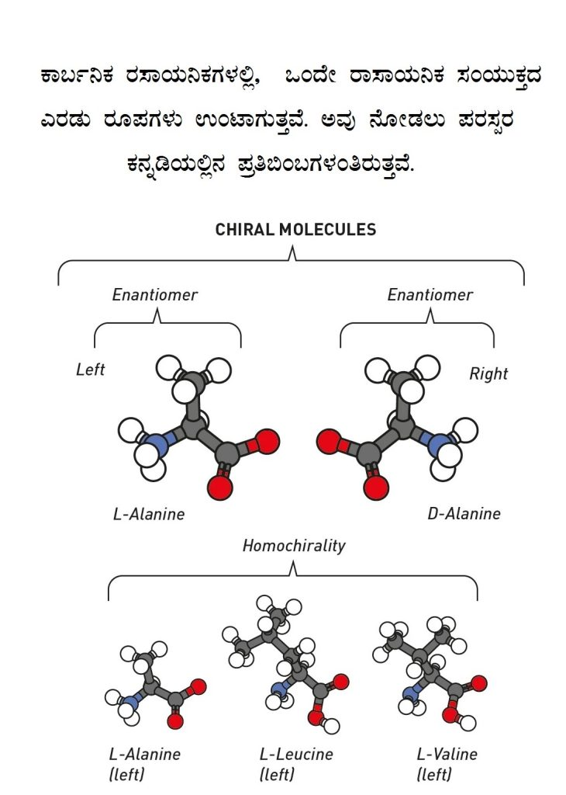
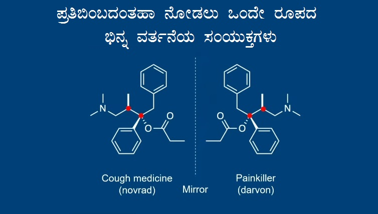
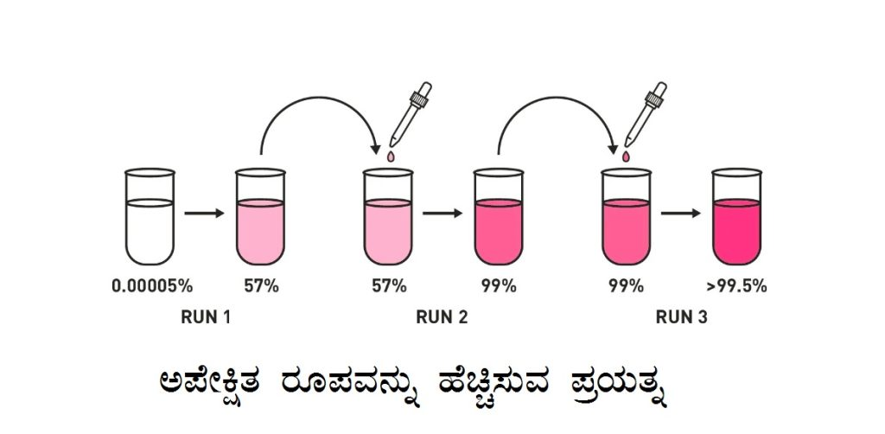

ಈ ವರ್ಷ 2026ರ ರಸಾಯನವಿಜ್ಞಾನದ ನೊಬೆಲ್ ಪ್ರಶಸ್ತಿಯನ್ನು ಹೆನ್ರಿ ಕಗಾನ್‌ (Henri B. Kagan) ಮತ್ತು ಕೆನ್ಸೊ ಸುಆಯ್‌ (Kenso Soai) ಅವರಿಗೆ ನೀಡಲಾಗಿದೆ. ಅವರ ಸಂಶೋಧನೆಯ ಕೇಂದ್ರ ಬಿಂದು ರಸಾಯನವಿಜ್ಞಾನಲ್ಲಿ ಶತಮಾನಗಟ್ಟಲೆ ಅತ್ಯಂತ ಕುತೂಹಲಕಾರಿ ಪ್ರಶ್ನೆಯಾಗಿದ್ದ—ಒಂದಕ್ಕೊಂದು ಕನ್ನಡಿಯ ಪ್ರತಿಬಿಂಬದಂತಿರುವ ಎರಡು ಅಣುಗಳಲ್ಲಿ ಒಂದನ್ನೇ ಆಯ್ದು ತಯಾರಿಸುವುದು ಹೇಗೆ? ಎಂಬುದರ ಉತ್ತರವಾಗಿದೆ.

ಕೆಲವು ರಾಸಾಯನಿಕ ಕ್ರಿಯೆಗಳಲ್ಲಿ, ಅದರಲ್ಲೂ ಕಾರ್ಬನಿಕ ರಸಾಯನಿಕಗಳಲ್ಲಿ, ಒಂದೇ ರಾಸಾಯನಿಕ ಸಂಯುಕ್ತದ ಎರಡು ರೂಪಗಳು ಉಂಟಾಗುತ್ತವೆ. ಅವು ನೋಡಲು ಪರಸ್ಪರ ಕನ್ನಡಿಯಲ್ಲಿನ ಪ್ರತಿಬಿಂಬಗಳಂತಿರುತ್ತವೆ. ಇದನ್ನು ಸರಳವಾಗಿ ಹೇಳುವುದಾದರೆ ನಮ್ಮ ಎಡಗೈ ಮತ್ತು ಬಲಗೈ ನೋಡಲು ಒಂದೇ ರೀತಿಯಂತೆ ಕಾಣುತ್ತವೆ. ಆದರೆ ಎಡಗೈಗೆ ಸರಿಯಾಗುವ ಕೈಗವಸು ಬಲಗೈಗೆ ಸರಿಯಾಗಿ ಹೊಂದುವುದಿಲ್ಲ. ಏಕೆಂದರೆ ಅವು ಪರಸ್ಪರ ಕನ್ನಡಿಯ ಪ್ರತಿಬಿಂಬಗಳಂತೆ ಇವೆ. ರಸಾಯನ ವಿಜ್ಞಾನದಲ್ಲಿಯೂ ಕೆಲವು ಅಣುಗಳು ಇದೇ ರೀತಿಯಾಗಿರುತ್ತವೆ. ಒಂದೇ ಅಣುವಿನ ಎರಡು ರೂಪಗಳಿರುತ್ತವೆ—ಒಂದು “ಎಡಗೈ”ಯಂತದ್ದು, ಮತ್ತೊಂದು “ಬಲಗೈ”ಯಂತದ್ದು. ಇವುಗಳನ್ನು ಎನಾಂಶಿಯೊಮರ್‌ಗಳು (Enantiomers) ಎನ್ನುತ್ತಾರೆ.

ಸಾಮಾನ್ಯವಾಗಿ ಇವೆರಡೂ ಒಂದೇ ರೀತಿಯ ರಾಸಾಯನಿಕ ಸಂಯೋಜನೆಯನ್ನು ಹೊಂದಿದ್ದರೂ, ಜೈವಿಕ ವ್ಯವಸ್ಥೆಗಳೊಂದಿಗೆ (Living Systems) ಅವುಗಳ ವರ್ತನೆ ಭಿನ್ನವಾಗಿರಬಹುದು. ಒಂದು ರೂಪ ಔಷಧಿಯಾಗಿ ಉಪಯುಕ್ತವಾಗಿದ್ದರೆ, ಅದರ ಕನ್ನಡಿಯ ಪ್ರತಿಬಿಂಬದಂತಹಾ ರೂಪವು ಅನಗತ್ಯವಾದ ಅಥವಾ ಹಾನಿಕಾರಕ ಪರಿಣಾಮಗಳನ್ನು ಉಂಟುಮಾಡಬಹುದು..ಆದ್ದರಿಂದ ಬಹಳ ಮುಖ್ಯವಾಗಿ ಔಷಧಿ ತಯಾರಿಕೆಯಲ್ಲಿ ಸರಿಯಾದ ಎನಾಂಶಿಯೊಮರ್‌ ಅನ್ನು ಸಾಧ್ಯವಾದಷ್ಟು ಶುದ್ಧವಾಗಿ ಪಡೆಯುವುದು ಬಹಳ ಮುಖ್ಯ.

ಆದರೆ ಸಮಸ್ಯೆ ಏನೆಂದರೆ, ಒಂದು ರಾಸಾಯನಿಕ ಕ್ರಿಯೆ ನಡೆಸಿದಾಗ ಸಾಮಾನ್ಯವಾಗಿ ಈ ಎರಡೂ ರೂಪಗಳು ಒಟ್ಟಿಗೆ ಉತ್ಪತ್ತಿಯಾಗುತ್ತವೆ. ಆದರೆ ನಮ್ಮ ದೇಹಕ್ಕೆ ಅವು ಎರಡೂ ಒಂದೇ ರೀತಿಯಾಗಿ ಕೆಲಸ ಮಾಡುವುದಿಲ್ಲ. ಒಂದು ಔಷಧಿಯಾಗಿ ಉಪಯುಕ್ತವಾಗಬಹುದು; ಮತ್ತೊಂದು ಅನಗತ್ಯ ಅಥವಾ ಹಾನಿಕಾರಕ ಪರಿಣಾಮ ನೀಡಬಹುದು. ಆದ್ದರಿಂದ ವಿಜ್ಞಾನಿಗಳಿಗೆ ಬೇಕಾಗಿರುವುದು—“ನನಗೆ ಈ ಎರಡು ರೂಪಗಳಲ್ಲಿ ಬೇಕಾದ ಒಂದನ್ನೇ ಹೇಗೆ ತಯಾರಿಸಬಹುದು?” ಎಂಬ ಪ್ರಶ್ನೆಗೆ ಉತ್ತರ.

ಯಾಕೆ ಹೀಗೆ ಎನ್ನುವುದಕ್ಕೆ ಮತ್ತೂ ಒಂದು ಉದಾಹರಣೆಯನ್ನು ನೋಡೋಣ. ನೀವು ಒಬ್ಬ ಬೀಗದ ಕೀಲಿಗಳ ತಯಾರಕರು ಎಂದುಕೊಳ್ಳಿ. ನೀವು ತಯಾರಿಸಿದ ಎರಡು ಕೀಲಿ ಕೈಗಳು ನೋಡಲು ಒಂದೇ ರೀತಿಯವು ಆದರೆ ಒಂದಕ್ಕೊಂದು ಕೀಲಿಗಳು ಕನ್ನಡಿಯ ಪ್ರತಿಬಿಂಬಗಳಂತಿವೆ. ಬೀಗಕ್ಕೆ ಸರಿಹೊಂದುವುದು ಒಂದೇ ಕೀಲಿ. ತಪ್ಪಾದ ಕೀಲಿಯನ್ನು ಬಳಸಿದರೆ ಹಾನಿಯೂ ಉಂಟಾಗಬಹುದು. ಔಷಧೀಯ ಅಣುಗಳಲ್ಲಿಯೂ ಇದೇ ರೀತಿಯ ಸಮಸ್ಯೆ ಕಂಡುಬರುತ್ತದೆ. ಹಾಗಾಗಿ ಸರಿಯಾದ ಕೀಲಿ ಕೈ ತರಹ ಏಕ ರೂಪದ ರಸಾಯನಿಕ.

## ಜೀವಜಗತ್ತಿನಲ್ಲಿ “ಒಂದೇ ಕೈ” ರೂಪದ ರಸಾಯನನಿಕಗಳು

ಈ ಪ್ರಶ್ನೆ ಇನ್ನೂ ಆಳವಾದದ್ದು. ಜೀವಂತ ಜಗತ್ತಿನ ಬಹುತೇಕ ಪ್ರಮುಖ ಅಣುಗಳು ಎರಡು ಸಾಧ್ಯ ಕನ್ನಡಿಯ ರೂಪಗಳಲ್ಲಿ ಒಂದನ್ನು ಮಾತ್ರವೇ ಬಳಸುತ್ತವೆ. ಇದನ್ನು homochirality ಎಂದು ಕರೆಯಲಾಗುತ್ತದೆ. ಇದೊಂದು ಜೀವಿವಿಕಾಸದ ಬಹು ದೊಡ್ಡ ಅಚ್ಚರಿ. “Chiral” ಎಂಬ ಪದವು “ಕೈ” ಎಂಬ ಅರ್ಥವನ್ನು ಸೂಚಿಸುತ್ತದೆ—ನಮ್ಮ ಎಡ ಮತ್ತು ಬಲ ಕೈಗಳಂತೆ, ಎರಡು ರೂಪಗಳು ಪರಸ್ಪರ ಪ್ರತಿಬಿಂಬಗಳಾಗಿದ್ದರೂ ಒಂದೇ ರೀತಿಯಲ್ಲಿ ಹೊಂದಿಕೆಯಾಗುವುದಿಲ್ಲ.

ಉದಾಹರಣೆಗೆ ಜೀವಿಗಳಲ್ಲಿರುವ ಅಮೈನೋ ಆಮ್ಲಗಳು ಎರಡು ಕನ್ನಡಿಯ ರೂಪಗಳಲ್ಲಿ ಇರಬಹುದಾದರೂ, ಜೀವಿಗಳ ಪ್ರೋಟೀನುಗಳಲ್ಲಿ ಅವುಗಳಲ್ಲಿ ಒಂದೇ ರೂಪ ಮುಖ್ಯವಾಗಿ ಕಂಡುಬರುತ್ತದೆ. ನಮ್ಮೊಳಗಿನ ಅಮೈನೊ ಆಮ್ಲಗಳು, ಎಡಗೈ ತರಹದವು. ಬಲಗೈ ತರಹದ ಅಮೈನೊ ಆಮ್ಲಗಳು ನಿಸರ್ಗದಲ್ಲಿ ಅಪರೂಪ! ಹೀಗಾಗಿ ಇದು ಒಂದು ಮೂಲಭೂತ ಪ್ರಶ್ನೆ ಉದ್ಭವಿಸುತ್ತದೆ: ಜೀವನದ ಆರಂಭದಲ್ಲೇ ಈ “ಒಂದೇ ಕೈಯ” ರಸಾಯನ ಹೇಗೆ ಉಂಟಾಯಿತು? ನಿಜಕ್ಕೂ ಇದು ಒಂದು ನಿಗೂಢವಾದ ಸಂಗತಿಯೇ! ಜೀವಿಗಳಲ್ಲಿ ಒಂದು ರೂಪದ ರಸಾಯನಿಕ ಆಯ್ಕೆಯನ್ನು ಪ್ರತಿಬಿಂಬಿಸುವ ಪ್ರಕ್ರಿಯೆಯ ಹುಡುಕಾಟವೇ ಈ ಪುರಸ್ಕಾರದ ಶೋಧ.

## ಲೂಯಿ ಪಾಶ್ಚರ್‌ ಅವರಿಂದ ಆರಂಭವಾದ ಕಥೆ

ಈ ನೊಬೆಲ್ ಪ್ರಶಸ್ತಿಯ ಹಿಂದಿರುವ ರಸಾಯನಿಕ ರೂಪಗಳ ವಿಚಾರಗಳ ಸರಣಿ 19ನೇ ಶತಮಾನದಲ್ಲಿಯೇ ಆರಂಭವಾಯಿತು. ಲೂಯಿ ಪಾಶ್ಚರ್‌ ಟಾರ್ಟಾರಿಕ್ ಆಮ್ಲದ ಸ್ಫಟಿಕಗಳನ್ನು ಅಧ್ಯಯನ ಮಾಡುವಾಗ ಮಹತ್ವದ ಸಂಗತಿಯನ್ನು ಗಮನಿಸಿದರು. ಅವರು ಸೂಕ್ಷ್ಮದರ್ಶಕದ ಮೂಲಕ ನೋಡಿದಾಗ, ಟಾರ್ಟಾರಿಕ್ ಆಮ್ಲದ ಸ್ಫಟಿಕಗಳು ಎರಡು ವಿಧಗಳಾಗಿದ್ದು, ಅವು ಪರಸ್ಪರ ಕನ್ನಡಿಯ ಪ್ರತಿಬಿಂಬಗಳಾಗಿರುವುದನ್ನು ಕಂಡರು. ಅವರು ಎರಡೂ ವಿಧದ ಸ್ಫಟಿಕಗಳನ್ನು ಬೇರ್ಪಡಿಸಿ ಪ್ರತ್ಯೇಕವಾಗಿ ದ್ರಾವಣದಲ್ಲಿ ಕರಗಿಸಿ ಅದರಲ್ಲಿ ಬೆಳಕನ್ನು ಹಾಯಿಸಿದಾಗ ಒಂದು ದ್ರಾವಣ ಬೆಳಕನ್ನು ಬಲಕ್ಕೆ ತಿರುಗಿಸಿದರೆ, ಮತ್ತೊಂದು ಎಡಕ್ಕೆ ತಿರುಗಿಸಿತು. ಎರಡನ್ನೂ ಸೇರಿಸಿದಾಗ ಬೆಳಕಿನ ತಿರುಗುವಿಕೆಯೇ ಕಾಣಿಸಲಿಲ್ಲ. ಅಂದರೆ ಎರಡೂ ಭಿನ್ನವಾದ ವರ್ತನೆಯ ರೂಪಗಳು!

1857ರಲ್ಲಿ ಪಾಶ್ಚರ್ ಇನ್ನೊಂದು ಮಹತ್ವದ ಸಂಗತಿಯನ್ನು ಗಮನಿಸಿದರು. ಟಾರ್ಟಾರಿಕ್ ಆಮ್ಲದ ಎರಡು ಎನಾಂಶಿಯೋಮರ್‌ಗಳಲ್ಲಿ ಬ್ಯಾಕ್ಟೀರಿಯಾಗಳು ಒಂದನ್ನು ಮಾತ್ರ ಹುದುಗಿಸಿದವು (Fermentation). ಮತ್ತೊಂದು ರೂಪವನ್ನು ಅವುಗಳು ಮುಟ್ಟಲೂ ಇಲ್ಲ. ಇದರಿಂದ ಜೀವ ರಸಾಯನವೇ ಕೈರಲ್ (Chiral) ಅಥವಾ ಅಸಮಮಿತವಾಗಿರಬಹುದೆಂಬ ಕಲ್ಪನೆಯು ಬಲವಾಯಿತು. ನಂತರ ಅಮೈನೋ ಆಮ್ಲಗಳು ಮತ್ತು DNAಯ ಸಕ್ಕರೆಗಳಲ್ಲಿಯೂ ಪ್ರಕೃತಿಯು ಒಂದೊಂದು ರೂಪವನ್ನು ಮಾತ್ರವೇ ಬಳಸುತ್ತದೆ ಎಂಬುದು ಕೂಡ ತಿಳಿಯಿತು.

## ಮಾರ್ಕ್‌ವಾಲ್ಡ್ ಮತ್ತು ಮೊದಲ ಅಸಮಮಿತ (Chiral) ಕ್ರಿಯೆ

ಸಾಮನ್ಯವಾದ ಉತ್ಪಾಕತೆಯ ರಸಾಯನಿಕ ಕ್ರಿಯೆಗಳಲ್ಲಿ ಎರಡೂ ರೂಪದ ಉತ್ಪನ್ನಗಳು ಸಮಪ್ರಮಾಣದಲ್ಲಿ ಬರುವುದು ಸಹಜ. ಆದರೆ 20ನೇ ಶತಮಾನದ ಆರಂಭದಲ್ಲಿ ಜರ್ಮನ್ ರಸಾಯನವಿಜ್ಞಾನಿ ವಿಲ್ಕಿ ಮಾರ್ಕ್‌ವಾಲ್ಡ್‌ (Willy Marckwald) ಅವರು ಇದನ್ನು ಮೀರುವಂತಹಾ ಒಂದು ಪ್ರಮುಖ ಹೆಜ್ಜೆ ಇಟ್ಟರು. ಅವರು ರಸಾಯನಿಕ ಕ್ರಿಯಗಳಲ್ಲಿ ಅಸಮ್ಮಿತಿಯನ್ನು (Asymmetric Reaction) ಸಾಧಿಸಿದರು—ಅಂದರೆ ಎರಡು ಕನ್ನಡಿಯ ರೂಪಗಳಲ್ಲಿ ಒಂದನ್ನು ಮತ್ತೊಂದಕ್ಕಿಂತ ಸ್ವಲ್ಪ ಹೆಚ್ಚು ಪ್ರಮಾಣದಲ್ಲಿ ಉತ್ಪಾದಿಸುವ ರಾಸಾಯನಿಕ ಕ್ರಿಯೆ.

ಇದರಲ್ಲಿ ಅವರು ಕೈರಾಲಿಟಿಯನ್ನು ಉತ್ತೇಜಿಸುವ ವಸ್ತು (Chiral Catalyst)ವನ್ನು ಬಳಸಿದರು. Catalyst ಎಂದರೆ ರಾಸಾಯನಿಕ ಕ್ರಿಯೆಯನ್ನು ವೇಗಗೊಳಿಸುವ ಆದರೆ ಸ್ವತಃ ಖರ್ಚಾಗದ ವಸ್ತು. ಕೈರಲ್ Catalyst ಒಂದು ನಿರ್ದಿಷ್ಟ ಕನ್ನಡಿಯ ರೂಪದ ಉತ್ಪಾದನೆಯನ್ನು ಮತ್ತೊಂದಕ್ಕಿಂತ ಸ್ವಲ್ಪ ಹೆಚ್ಚು ಉತ್ತೇಜಿಸಿತು. ವ್ಯತ್ಯಾಸ ಬಹಳ ಸಣ್ಣದಾಗಿದ್ದರೂ, ಇದು ಅತ್ಯಂತ ಮಹತ್ವದ ಆರಂಭವಾಗಿತ್ತು.

## ಚಾರ್ಲ್ಸ್‌ ಫ್ರಾಂಕ್‌ (Charles Frank) ಅವರ ಸೈದ್ಧಾಂತಿಕ ಮಾದರಿ

1953ರಲ್ಲಿ ಬ್ರಿಟನ್‌ನ **ಚಾರ್ಲ್ಸ್‌ ಫ್ರಾಂಕ್‌** ಈ ಸಮಸ್ಯೆಗೆ ಒಂದು ಗಣಿತೀಯ-ಸೈದ್ಧಾಂತಿಕ ಮಾದರಿಯನ್ನು ನೀಡಿದರು. ಅವರ ಪ್ರಕಾರ ಒಂದೇ ರೂಪದ ವಸ್ತು (Homochirality) ಉಂಟಾಗಬೇಕಾದರೆ ಮೂರು ಪ್ರಮುಖ ಅಂಶಗಳು ಅಗತ್ಯ:

* ಒಂದು ಕೈರಲ್‌ ಉತ್ತೇಜಕ (Chiral Catalyst) ಮತ್ತು ಅಸಮ್ಮಿತಿಯ ಕ್ರಿಯೆ (Asymmetric Reaction) ಇರಬೇಕು.
* ಒಂದು ರೂಪದ ಅಥವಾ ಎನಾಂಶಿಯೊಮರ್‌ನ ಉತ್ಪಾದನೆ ಹೆಚ್ಚಾಗಬೇಕು, ಮತ್ತೊಂದು ಕಡಿಮೆಯಾಗಬೇಕು.
* ಉತ್ಪತ್ತಿಯಾಗುವ ವಸ್ತುವೇ ಮತ್ತೆ ಉತ್ತೇಜಕ ವಸ್ತು (Catalyst) ಆಗಿ ಕಾರ್ಯನಿರ್ವಹಿಸಬೇಕು. ಇದನ್ನು ಸ್ವಯಂಉತ್ತೇಜಕತೆ (Autocatalysis) ಎಂದು ಕರೆಯಲಾಗುತ್ತದೆ.

ಇದರಲ್ಲಿ ಮೂರನೆಯ ಅಂಶವೇ ತುಂಬಾ ವಿಶೇಷ. ಒಂದು ರೂಪ ಸ್ವಲ್ಪ ಹೆಚ್ಚಾದರೆ, ಅದು ಮತ್ತಷ್ಟು ತನ್ನದೇ ರೂಪವನ್ನು ಉತ್ಪಾದಿಸಲು ನೆರವಾಗುತ್ತದೆ. ಹೀಗೆ ಸಣ್ಣ ಆರಂಭಿಕ ವ್ಯತ್ಯಾಸವು ಕ್ರಮೇಣ ಬಹಳ ದೊಡ್ಡ ವ್ಯತ್ಯಾಸವಾಗಿ ಬೆಳೆಯಬಹುದು. ಹೆಚ್ಚೂ ಕಡಿಮೆ ಬೇಕಾದ ರೂಪದ ರಸಾಯನಿಕ ಉತ್ಪನ್ನವನ್ನು ಹೆಚ್ಚು ಪಡೆಯಬಹುದು, ಅಥವಾ ಜೈವಿಕವಾಗಿ ನಡೆದಂತೆ ಅದನ್ನು ಮಾತ್ರವೇ ಪಡೆಯಬಹುದು! ಇದನ್ನು Self-Reinforcing ಅಥವಾ ಸ್ವಯಂ-ಬಲವರ್ಧಕ ಪ್ರಕ್ರಿಯೆ ಎಂದು ಕರೆಯಬಹುದು.

ಆದರೆ ಫ್ರಾಂಕ್‌ ಅವರ ಮಾದರಿಯಲ್ಲಿದ್ದ ಮೂರು ಷರತ್ತುಗಳನ್ನು ನಿಜವಾದ ರಾಸಾಯನಿಕ ಪ್ರಯೋಗದಲ್ಲಿ ಸಾಧಿಸುವುದು ಬಹಳ ಕಷ್ಟವಾಗಿತ್ತು. ಏಕೆಂದರೆ ಇದೊಂದು ಸೈದ್ಧಾಂತಿಕ ಸಂಗತಿ ಮಾತ್ರವಾಗಿತ್ತು. ಇದಕ್ಕೆ ಉತ್ತರವೆಂಬಂತೆ ಪ್ರಾಯೋಗಿಕ ಮಾದರಿಗಳನ್ನು ಶೋಧಿಸಿದ್ದೇ ಪ್ರಸ್ತುತ ಪುರಸ್ಕಾರದ ಆವಿಷ್ಕಾರಗಳು.

## ಹೆನ್ರಿ ಕಾಗನ್‌ (Henri Kagan) ಅವರ ಮಹತ್ವದ ಸಂಶೋಧನೆ

ಹೆನ್ರಿ ಕಾಗನ್‌ 1986ರಲ್ಲಿ ಒಂದು ಮಹತ್ವದ ಸಂಗತಿಯನ್ನು ಕಂಡುಹಿಡಿದರು. ಎರಡು ರೂಪಗಳನ್ನು catalystನಲ್ಲಿ ಬೆರೆಸಿದಾಗ ಫಲಿತಾಂಶ ಸರಳ ಅನುಪಾತದಲ್ಲಿ ಬರದೆ. ಬದಲಾದವು. ಅಂದರೆ ಕೆಲವು catalyst ಸಂಯೋಜನೆಗಳು ನಿಧಾನವಾಗಿ ಕೆಲಸ ಮಾಡಿದರೆ, ಕೆಲವು ವೇಗವಾಗಿ ಮಾಡಿದವು. ಇದರಿಂದ ಒಂದು ರೂಪ ಅಥವಾ ಎನಾಂಶಿಯೊಮರ್‌ ಮತ್ತೊಂದಕ್ಕಿಂತ ಹೆಚ್ಚು ಪ್ರಮಾಣದಲ್ಲಿ ಉತ್ಪತ್ತಿಯಾಗುವಂತೆ ಮಾಡಲು ಸಾಧ್ಯವಾಯಿತು. ಇದನ್ನೇ Non-Linear Effect ಎಂದು ಕರೆಯಲಾಯಿತು. ಅಂದರೆ ಒಂದು ಎಷ್ಟು ಬಂತೋ ಮತ್ತೊಂದು ಅಷ್ಟೇ ಬರಲಿಲ್ಲ. ಅವುಗಳು ಸರಳರೇಖೀಯ (Linear)ಉತ್ಪಾದಕಗಳು ಆಗಿರಲಿಲ್ಲ.

ಆ ಕಾಲದ ವಿಜ್ಞಾನಿಗಳ ಸಾಮಾನ್ಯ ಊಹೆ ಏನೆಂದರೆ ಉತ್ತೇಜಕ (Catalyst) ದಲ್ಲಿ ಇರುವ ಎರಡು enantiomer ಗಳ ಪ್ರಮಾಣ ಮತ್ತು ಅಂತಿಮ ಉತ್ಪನ್ನದಲ್ಲಿ ದೊರೆಯುವ Enantiomer ಗಳ ಪ್ರಮಾಣದ ನಡುವೆ ಒಂದೇ ಏಕ ರೀತಿಯ ಸಂಬಂಧ -Linear Relationship- ಇರುತ್ತದೆ ಎಂಬುದಾಗಿತ್ತು. ಈ ಊಹೆಯನ್ನು ಪ್ರಶ್ನಿಸಿದ್ದರಿಂದಲೇ ಹೆನ್ರಿ ಅವರ ಶೋಧವು ಮಹತ್ವದ್ದಾಗಿದ್ದು. ಶುದ್ಧ ಅಥವಾ ಹೆಚ್ಚು ಎನಾಂಶಿಯೊಮರ್‌ ಅನ್ನು ಪಡೆಯುವತ್ತ ಅವರ ಸಂಶೋಧನೆಯು ದಾರಿ ತೋರಿತ್ತು.

ಅವರ ಪ್ರಯೋಗಗಳು ಒಂದು ಅಚ್ಚರಿಯ ಫಲಿತಾಂಶವನ್ನು ತೋರಿಸಿದವು. ಎರಡು ವಿಭಿನ್ನ Enantiomersಗಳಿಂದ ರೂಪುಗೊಂಡ Catalyst ನಿಧಾನವಾಗಿ ಕಾರ್ಯನಿರ್ವಹಿಸಿತು; ಒಂದೇ ರೀತಿಯ ಎರಡು Enantiomersಗಳಿಂದ ರೂಪುಗೊಂಡ Catalyst ಹೆಚ್ಚು ವೇಗವಾಗಿ ಕಾರ್ಯನಿರ್ವಹಿಸಿತು. ಆದ್ದರಿಂದ ಉತ್ಪನ್ನದಲ್ಲಿನ Enantiomerಗಳ ಪ್ರಮಾಣ Catalystನಲ್ಲಿನ ಪ್ರಮಾಣಕ್ಕೆ ಸರಳರೇಖೀಯ (Linear Effect) ಸಂಬಂಧ ಹೊಂದಿರಲಿಲ್ಲ. ಇದನ್ನೇ Non-Linear Effect ಎಂದು ಕರೆಯಲಾಯಿತು. 1986ರಲ್ಲಿ Kagan ಇಂತಹ ಪರಿಣಾಮವನ್ನು ತೋರಿಸುವ ಮೂರು Asymmetric Reactionsಗಳನ್ನು ಪ್ರಕಟಿಸಿದರು. ಇದರಿಂದ ಚಾರ್ಲ್ಸ್‌ ಫ್ರಾಂಕ್‌ ನ ಮಾದರಿಯ ಎರಡನೇ ಷರತ್ತಿಗೆ ಪ್ರಾಯೋಗಿಕ ನೆಲೆ ದೊರೆಯಿತು.

## ಕಿನ್ಸೊ ಸುಆಯ್‌ (Kenso Soai) ಮತ್ತು ಅವರ ಸ್ವಯಂ-ಉತ್ಪಾದಕ ರಸಾಯನ

ಮುಂದಿನ ಮತ್ತು ಅಂತಿಮ ಪ್ರಮುಖ ಹೆಜ್ಜೆಯನ್ನು ಜಪಾನ್‌ನ ಕಿನ್ಸೊ ಸುಆಯ್‌ ಅವರು ಇಟ್ಟರು. ಕಾಗನ್‌ ಅವರ Non-Linear Effectನಿಂದ ಪ್ರೇರಿತರಾದ ಸುಆಯ್‌, ಅವರಿಗೆ ಒಂದು ಹೊಸ ಆಲೋಚನೆ ಬಂದಿತು: ಉತ್ಪನ್ನವೇ Catalyst ಆಗಿ ತನ್ನದೇ ರೀತಿಯ ಉತ್ಪನ್ನವನ್ನು ಮತ್ತೆ ಉತ್ಪಾದಿಸಿದರೆ? ಅಂದರೆ Autocatalysis ಅನ್ನು Asymmetric Chemistryಯೊಂದಿಗೆ ಜೋಡಿಸಬಹುದೇ?

ಅನೇಕ ಪ್ರಯೋಗಗಳ ನಂತರ ಕಿನ್ಸೊ ಸುಆಯ್‌ ಅವರು 5-Pyrimidyl Alkanol ಎಂಬ Chiral Substance ಅನ್ನು ಬಳಸಿಕೊಂಡು ಸ್ವಯಂ-ಬಲವರ್ಧಕ (Self-Reinforcing) ಕ್ರಿಯೆಯನ್ನು ಕಂಡುಹಿಡಿದರು. 1995ರ ಪ್ರಯೋಗದಲ್ಲಿ ಆರಂಭದಲ್ಲಿ ಒಂದು enantiomer ಕೇವಲ 2% ಹೆಚ್ಚುವರಿ ಪ್ರಮಾಣದಲ್ಲಿತ್ತು. ಆದರೆ ಪ್ರತಿಕ್ರಿಯೆಯ ಅಂತ್ಯದಲ್ಲಿ ಅದರ ಹೆಚ್ಚುವರಿ ಪ್ರಮಾಣ 87% ಕ್ಕೆ ಏರಿತು. ಇದು Frankನ ಮಾದರಿಯ ಮೂರು ಷರತ್ತುಗಳನ್ನೂ ಪೂರೈಸುವ ಮಹತ್ವದ ಸಾಧನೆಯಾಗಿತ್ತು.

ಆದರೆ ಕಿನ್ಸೊ ಸುಆಯ್‌ ಅಲ್ಲಿಯೇ ನಿಲ್ಲಲಿಲ್ಲ. ಇನ್ನೂ ಎಂಟು ವರ್ಷಗಳ ಪ್ರಯತ್ನದ ನಂತರ, 2003ರಲ್ಲಿ ಅವರು ಇನ್ನಷ್ಟು ಅದ್ಭುತವಾದ Autocatalytic Reaction ಅನ್ನು ಪ್ರದರ್ಶಿಸಿದರು. ಆರಂಭದಲ್ಲಿ ಎರಡು ರೂಪದವು ಬಹುತೇಕ ಸಮಾನವಾಗಿ ರೂಪುಗೊಳ್ಳುತ್ತವೆ. ಆದರೆ ಯಾದೃಚ್ಛಿಕ (Random)ವಾಗಿ ಒಂದರ ಪ್ರಮಾಣ ಅತಿ ಸ್ವಲ್ಪ ಹೆಚ್ಚಾಗುತ್ತದೆ. ಆ ಸಣ್ಣ ವ್ಯತ್ಯಾಸವೇ ನಂತರ ಅದೇ Enantiomerನ ಉತ್ಪಾದನೆಯನ್ನು ಹೆಚ್ಚಿಸುತ್ತಾ ಹೋಗುತ್ತದೆ. ಅಂತಿಮವಾಗಿ ಉತ್ಪನ್ನದಲ್ಲಿ ಒಂದು Enantiomer 99.99% ಅಷ್ಟಿರಬಹುದು.

“ಉತ್ಪತ್ತಿಯಾಗುವ ಅಣುವೇ ಮತ್ತೆ catalyst ಆಗಿ, ತನ್ನದೇ ರೀತಿಯ ಅಣುಗಳನ್ನು ಉತ್ಪತ್ತಿ ಮಾಡತೊಡಗಿದರೆ?” ಎಂಬ ಕಿನ್ಸೊ ಸುಆಯ್‌ ಅವರ ಸಣ್ಣ ಪ್ರಶ್ನೆಯ ಉತ್ತರವೇ ಆರಂಭಿಕ ಸಣ್ಣ ವ್ಯತ್ಯಾಸದಿಂದ ದೊಡ್ಡದಾಗುತ್ತಾ ಹೋಗುತ್ತದೆ. ಉದಾಹರಣೆಗೆ, ಆರಂಭದಲ್ಲಿ ಒಂದು ರೂಪ 51%, ಮತ್ತೊಂದು 49% ಇದ್ದರೂ ಸಾಕು! ಆ 51% ರೂಪವೇ ಮತ್ತೆ ತನ್ನನ್ನೇ ಉತ್ಪಾದಿಸಿಕೊಳ್ಳಲು ಸಹಾಯ ಮಾಡಿದರೆ, ಮುಂದಿನ ಹಂತದಲ್ಲಿ ಅದರ ಪ್ರಮಾಣ ಇನ್ನಷ್ಟು ಹೆಚ್ಚುತ್ತಾ ಹೋಗುತ್ತದೆ. ನಂತರ ಇನ್ನಷ್ಟು ಹೆಚ್ಚುತ್ತದೆ. ಹೀಗೆ ಒಂದು ಹಂತದಲ್ಲಿ ಬಹುತೇಕ ಸಂಪೂರ್ಣ Reaction ಅದೇ ರೂಪದ ಉತ್ಪಾದನೆಯತ್ತ ಸಾಗಬಹುದು.

ಕಿನ್ಸೊ ಸುಆಯ್‌ ಅವರ ಪ್ರಯೋಗದಲ್ಲಿ self-reinforcing chemical process ಯಶಸ್ವಿಯಾಯಿತು. 2003ರ ಅವರ ಪ್ರಸಿದ್ಧ ಸುಆಯ್‌ ಪ್ರಕ್ರಿಯೆ (**_Soai reaction) ಯ_** ಲ್ಲಿ ಅಂತಿಮವಾಗಿ ಒಂದು Enantiomer 99.99% ದಷ್ಟು ಪ್ರಾಬಲ್ಯ ಪಡೆಯುವ ಸಾಧ್ಯತೆಯನ್ನು ತೋರಿಸಿದರು. ಆರಂಭದಲ್ಲಿ ಯಾವ ರೂಪ ಸ್ವಲ್ಪ ಹೆಚ್ಚಾಗುತ್ತದೆ ಎಂಬುದು ಯಾವುದೋ ಆಗಿರಬಹುದು; ಆದರೆ ಒಮ್ಮೆ ಬೇಕಾದ ಒಂದು ರೂಪವು ಸ್ವಲ್ಪ ಮೇಲುಗೈ ಪಡೆದರೆ, ಅದು ತನ್ನದೇ ರೂಪವನ್ನು ಮತ್ತಷ್ಟು ಉತ್ಪಾದಿಸುತ್ತಾ ಹೋಗುತ್ತದೆ. ಆಗ ಬೇಕಾದ ರೂಪದ ಎನಾಂಶಿಯೊಮರ್‌ ರಸಾಯನಿಕವೇ ಹೆಚ್ಚು ದೊರೆಯುತ್ತಾ ಹೋಗುತ್ತದೆ.

## ಈ ಸಂಶೋಧನೆಗಳ ಮಹತ್ವ

ಸುಆಯ್‌ ಪ್ರಕ್ರಿಯೆ _(Soai_ _R_ _eaction)_ ಯು ನೇರವಾಗಿ ಜೀವಜಗತ್ತಿನ ರಸಾಯನವನ್ನು ಪುನರ್‌ನಿರ್ಮಿಸುವುದಿಲ್ಲ. ಆದರೂ ಇದು ಜೀವನದ ಆರಂಭದ ಸಂದರ್ಭದಲ್ಲಿ Homochirality ಹೇಗೆ ಉಂಟಾಗಿರಬಹುದು ಎಂಬ ಪ್ರಶ್ನೆಗೆ ಹೊಸ ದಾರಿಯನ್ನು ತೆರೆದಿದೆ. ವಿಶ್ವದ ವಿವಿಧೆಡೆ ವಿಜ್ಞಾನಿಗಳು ಇದೇ ರೀತಿಯ ಪ್ರಕ್ರಿಯೆಗಳನ್ನು ಬಳಸಿ ಅಮೈನೊ ಆಮ್ಲಗಳು ಮತ್ತು ಡಿಎನ್‌ಎಗಳ ಸಕ್ಕರೆಯಲ್ಲಿ Homochirality ಹೇಗೆ ರೂಪುಗೊಳ್ಳಬಹುದು ಎಂಬುದನ್ನು ಅಧ್ಯಯನ ಮಾಡುತ್ತಿದ್ದಾರೆ.

ಹೆನ್ರಿ ಕಾಗನ್‌ ಅವರ ಸಮರೇಖೆಯಲ್ಲದ ಪರಿಣಾಮಗಳು (Non-Linear Effects) ಕೂಡ ಈಗ ರಸಾಯನವಿಜ್ಞಾನಿಗಳಿಗೆ ಬಹುಮುಖ್ಯ ಸಾಧನವಾಗಿದೆ. ಒಂದು ಪ್ರಕ್ರಿಯೆಯು Linear ಆಗಿಲ್ಲ ಎಂಬುದನ್ನು ತಿಳಿದುಕೊಳ್ಳುವುದರಿಂದ ಅದರ ಒಳಗಿನ ಕಾರ್ಯವಿಧಾನ (Mechanism) ದ ಕುರಿತು ಮಾಹಿತಿ ಪಡೆಯಬಹುದು. ಆ ಮಾಹಿತಿಯನ್ನು ಬಳಸಿಕೊಂಡು ರಾಸಾಯನಿಕ ಕ್ರಿಯೆಯನ್ನು ಸುಧಾರಿಸಿ, ಸಾಧ್ಯವಾದಷ್ಟು ಶುದ್ಧ Enantiomer ಪಡೆಯಬಹುದು. ಇದರಿಂದ ಔಷಧಗಳು, ಸುವಾಸನೆಯ ಸಂಯುಕ್ತಗಳು, ಕೃಷಿ ರಾಸಾಯನಿಕಗಳು ಮತ್ತು ಕೆಲವು ಹೊಸ ವಸ್ತುಗಳ ಉತ್ಪಾದನೆಯಲ್ಲಿ ಮಹತ್ವದ್ದಾಗಿ ಪರಿಣಾಮವಾಗಿದೆ.

## ಒಟ್ಟಾರೆ ಸಾರಾಂಶ

2026ರ ರಸಾಯನವಿಜ್ಞಾನದ ನೊಬೆಲ್ ಪ್ರಶಸ್ತಿಯ ಹಿಂದಿರುವ ಕಥೆ ಒಂದು ಶತಮಾನಕ್ಕೂ ಹೆಚ್ಚು ಕಾಲ ಮುಂದುವರಿದ ವೈಜ್ಞಾನಿಕ ಹುಡುಕಾಟದ ಕಥೆಯಾಗಿದೆ. ಲೂಯಿ ಪಾಶ್ಚರ್ ಅವರು ಅಣುಗಳು ಕನ್ನಡಿಯ ಪ್ರತಿಬಿಂಬಗಳಂತೆ ಎರಡು ರೂಪಗಳಲ್ಲಿ ಇರಬಹುದು ಎಂದು ತೋರಿಸಿದರು. ಮಾರ್ಕ್‌ವಾಲ್ಡ್‌ Asymmetric Reaction ಮೂಲಕ ಒಂದು ರೂಪವನ್ನು ಸ್ವಲ್ಪ ಹೆಚ್ಚಾಗಿ ಪಡೆಯಬಹುದು ಎಂದು ತೋರಿಸಿದರು. ಚಾರ್ಲ್ಸ್‌ ಫ್ರಾಂಕ್‌ ಅವರು ಇದಕ್ಕೆ ಸೈದ್ಧಾಂತಿಕ ಮಾದರಿಯನ್ನು ನೀಡಿದರು. ಇದನ್ನು ಪ್ರಾಯೋಗಿಕವಾಗಿ ಬಳಸಿ ಹೆನ್ರಿ ಕಾಗನ್‌ Non-Linear Effects ಮೂಲಕ ಒಂದು Enantiomerನ ಉತ್ಪಾದನೆಯನ್ನು ಪರಿಣಾಮಕಾರಿಯಾಗಿ ಹೆಚ್ಚಿಸುವ ಮಾರ್ಗವನ್ನು ಕಂಡುಕೊಂಡರು. ಅಂತಿಮವಾಗಿ ಕಿನ್ಸೊ ಸುಆಯ್‌ Autocatalysis ಮೂಲಕ ಒಂದು ಸಣ್ಣ ಆರಂಭಿಕ ವ್ಯತ್ಯಾಸವು ಸ್ವತಃ ಬಲಗೊಳ್ಳುತ್ತಾ ಬಹುತೇಕ ಒಂದೇ Enantiomerನ ಉತ್ಪಾದನೆಗೆ ಹೇಗೆ ಕಾರಣವಾಗಬಹುದು ಎಂಬುದನ್ನು ತೋರಿಸಿದರು.

ಹೀಗಾಗಿ ಹೆನ್ರಿ ಕಾಗನ್‌ ಮತ್ತು ಕಿನ್ಸೊ ಸುಆಯ್‌ ಅವರ ಸಾಧನೆ ಕೇವಲ ಹೊಸ ರಾಸಾಯನಿಕ ಪ್ರಕ್ರಿಯೆಯನ್ನು ಕಂಡುಹಿಡಿದ ಸಾಧನೆಯಲ್ಲ. ಜೈವಿಕ ಅಣುಗಳು ಏಕೆ ಮತ್ತು ಹೇಗೆ “ಒಂದೇ ಕೈಯ”(Chirality) ರೂಪವನ್ನು ಆಯ್ಕೆ ಮಾಡಿಕೊಂಡವು ಎಂಬ ರಸಾಯನವಿಜ್ಞಾನದ ಅತ್ಯಂತ ಹಳೆಯ ಮತ್ತು ಆಳವಾದ ರಹಸ್ಯವೊಂದನ್ನು ಅರ್ಥಮಾಡಿಕೊಳ್ಳಲು ಅವರು ಹೊಸ ದಾರಿ ತೋರಿಸಿದ್ದಾರೆ. ಅಂತಿಮವಾಗಿ ಅವರ ಸಂಶೋಧನೆಗಳು ರಸಾಯನವಿಜ್ಞಾನಿಗಳಿಗೆ ದಿನನಿತ್ಯದ ಕೆಲಸದಲ್ಲಿ ಉಪಯುಕ್ತವಾದ ಹೊಸ ಸಾಧನಗಳನ್ನು ನೀಡುವುದರ ಜೊತೆಗೆ, ಜೀವಜಗತ್ತಿನ ಏಕರೂಪದ ಸಂಯುಕ್ತಗಳು (Homochirality) ಹೇಗೆ ಸೃಷ್ಟಿಯಾಗಿರಬಹುದು ಎಂಬ ಮಹತ್ವದ ಪ್ರಶ್ನೆಗೆ ಪರಿಹಾರದ ದಾರಿಯನ್ನು ತೆರೆದಿವೆ.

ಪ್ರೊ. ಹೆನ್ರಿ ಕಾಗನ್‌ ಅವರು 1930ರಲ್ಲಿ ಜನಿಸಿದ ಫ್ರಾನ್ಸ್‌ ದೇಶದ ರಸಾಯನ ವಿಜ್ಞಾನಿ. ಪ್ಯಾರಿಸ್‌ ವಿಶ್ವವಿದ್ಯಾಲಯದಲ್ಲಿ ಎಮರೀಟಸ್‌ ಪ್ರಾಧ್ಯಾಪಕರಾಗಿದ್ದಾರೆ. ಅವರ ಅನುಶೋಧಗಳು ಔಷಧಗಳ ಉತ್ಪಾದನೆಯ ಮೇಲೆ ಮಹತ್ವದ ಪರಿಣಾಮವನ್ನು ಬೀರಿವೆ. ಜಪಾನ್‌ ದೇಶದ ಪ್ರೊ. ಕಿನ್ಸೊ ಸುಆಯ್‌ 1950೦ರಲ್ಲಿ ಜನಿಸಿದ ಕಾರ್ಬನಿಕ ರಸಾಯನ ವಿಜ್ಞಾನಿ. ಟೋಕಿಯೋದ ವಿಜ್ಞಾನ ವಿಶ್ವವಿದ್ಯಾಲಯದಲ್ಲಿ ಪ್ರಾಧ್ಯಾಪಕರಾಗಿದ್ದಾರೆ. ಅವರ ಪ್ರಸ್ತುತ ಪುರಸ್ಕಾರದ ಅನುಶೋಧ ಸುಆಯ್‌ ಪ್ರಕ್ರಿಯೆ ಎಂದೇ ವಿಜ್ಞಾನ ಜಗತ್ತಿನಲ್ಲಿ ಪರಿಚಿತವಾಗಿದೆ.

ನಮಸ್ಕಾರ

**ಡಾ. ಟಿ.ಎಸ್.‌ ಚನ್ನೇಶ್‌**
