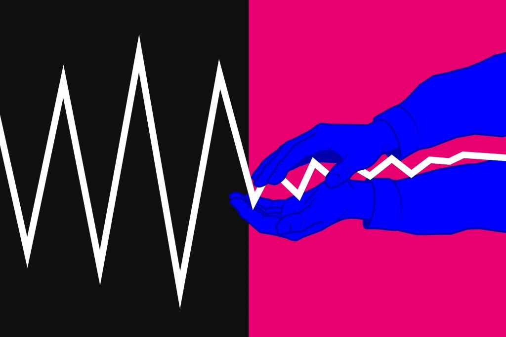
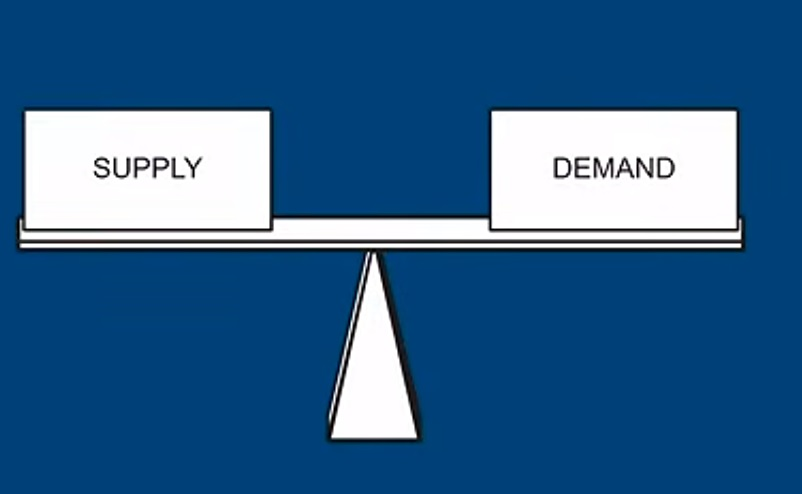

ಅಮೆರಿಕದ ಅರ್ಥಶಾಸ್ತ್ರಜ್ಞರಾದ ರಾಬರ್ಟ್ ಹಾಲ್ (Robert Hall) ಮತ್ತು ಮೈಕೆಲ್ ವುಡ್‌ಫರ್ಡ್ (Michael Woodford) ಅವರಿಗೆ ಈ ವರ್ಷ 2026ರ ಅರ್ಥವಿಜ್ಞಾನದ ನೊಬೆಲ್ ಪ್ರಶಸ್ತಿಯನ್ನು ನೀಡಲಾಗಿದೆ. ಅವರ "ಸಮಗ್ರವಾದ ಅಥವಾ ಸ್ಥೂಲವಾದ ಅಥವಾ ಬೃಹತ್ತಾದ (Macroeconomic) ಆರ್ಥಿಕ ಸ್ಥಿರೀಕರಣಕ್ಕೆ ಸೂಕ್ಷ್ಮವಾದ ಅಥವಾ ಗ್ರಾಹಕ ಮಟ್ಟದ (Microeconomic) ಆರ್ಥಿಕತೆ ಅಡಿಪಾಯಗಳ ಮಹತ್ವವನ್ನು ಅನುಶೋಧಿಸಿದ ಅಧ್ಯಯನಗಳಿಗೆ" ಪ್ರಸ್ತುತ ನೊಬೆಲ್‌ ಪುರಸ್ಕಾರ ಸಂದಿದೆ. ಕ್ಯಾಲಿಫೋರ್ನಿಯಾದಲ್ಲಿ ಜನಿಸಿದ ಹಾಲ್ ಸ್ಟ್ಯಾನ್‌ಫೋರ್ಡ್ ವಿಶ್ವವಿದ್ಯಾಲಯದ ಪ್ರಾಧ್ಯಾಪಕರು. ಮ್ಯಾಸಚೂಸೆಟ್ಸ್‌ನಲ್ಲಿ ಜನಿಸಿದ ವುಡ್‌ಫರ್ಡ್ ಕೊಲಂಬಿಯಾ ವಿಶ್ವವಿದ್ಯಾಲಯದಲ್ಲಿ ಪ್ರಾಧ್ಯಾಪಕರು.

ಸರಳವಾಗಿ ಹೇಳುವುದಾದರೆ, ಆರ್ಥಿಕತೆಯಲ್ಲಿ ಬರುವ ಏರಿಳಿತಗಳನ್ನು ಸರ್ಕಾರಗಳು ಮತ್ತು RBI ನಂತಹಾ ಕೇಂದ್ರ ಬ್ಯಾಂಕ್‌ಗಳು ಹೇಗೆ ತಗ್ಗಿಸಬಹುದು ಎಂಬುದನ್ನು ಈ ಇಬ್ಬರೂ ಅರ್ಥಶಾಸ್ತ್ರಜ್ಞರು ಸಿದ್ಧಾಂತದ ಮೂಲಕ ವಿವರಿಸಿದ್ದಾರೆ. ಇವರು ರೂಪಿಸಿದ ಹೊಸ ಸ್ಥೂಲ ಆರ್ಥಿಕ ಮಾದರಿಗಳು ಪರಿಣಾಮಕಾರಿ ಸ್ಥಿರೀಕರಣ ನೀತಿಗಳನ್ನು ರೂಪಿಸಲು ನೆರವಾಗುತ್ತವೆ. ಸರಿಯಾದ ಸಮಯದಲ್ಲಿ ಹಣಕಾಸು ಮತ್ತು ವಿತ್ತೀಯ ಕ್ರಮಗಳನ್ನು ಕೈಗೊಂಡರೆ ಆರ್ಥಿಕತೆಯ ಹಾನಿಕರ ಏರಿಳಿತಗಳ ತೀವ್ರತೆ ಕಡಿಮೆಯಾಗುತ್ತದೆ.

ಬ್ಯಾಂಕ್ ಬಡ್ಡಿದರ ಹೆಚ್ಚಿಸಿದರೆ ಅಥವಾ ಕಡಿಮೆ ಮಾಡಿದರೆ ಜನರ ಖರ್ಚು, ಉದ್ಯೋಗ ಮತ್ತು ಬೆಲೆಗಳ ಮೇಲೆ ಏನು ಪರಿಣಾಮವಾಗುತ್ತದೆ ಎಂದು ಮುಂಚೆಯೇ ಅಂದಾಜಿಸಲು ಭದ್ರವಾದ ಸೈದ್ಧಾಂತಿಕ ತಳಹದಿ ಬೇಕು. ಮನೆ ನಿಭಾಯಿಸುವ ಅಂದರೆ ಕಾಫಿ/ಟೀ ಕುಡಿಯುವ, ಸಣ್ಣ ಪುಟ್ಟ ದೈನಂದಿನ ಖರ್ಚುಗಳ ಸಂಗತಿಗಳನ್ನೊಳಗೊಂಡ ಮತ್ತು ಸಣ್ಣ ಪುಟ್ಟ ಕಂಪನಿಗಳು ತಮ್ಮ ನಿರ್ಧಾರಗಳನ್ನು ಹೇಗೆ ತೆಗೆದುಕೊಳ್ಳುತ್ತವೆ ಎಂಬ ಸೂಕ್ಷ್ಮ ಮಟ್ಟದ ತರ್ಕದಿಂದ ಇಡೀ ದೇಶದ ಆರ್ಥಿಕ ಚಿತ್ರಣವನ್ನು ಕಟ್ಟುವುದೇ ಇಲ್ಲಿನ **" ಸೂಕ್ಷ್ಮ ಆರ್ಥಿಕ ಅಡಿಪಾಯ"** ಎಂಬ ಮಾತಿನ ಅರ್ಥ. ಇದೆಲ್ಲವೂ ಮೈಕ್ರೊಇಕಾನಾಮಿಕ್‌ ಹಿನ್ನೆಲೆಯದ್ದಾದರೆ, ಇಡೀ ದೇಶದ ಇಕಾನಮಿಯನ್ನು ಅಳೆಯುವಾಗ ಅಥವಾ ಮಾತಾಡುವಾಗ ಒಟ್ಟಾರೆಯ ವಹಿವಾಟುಗಳ ಅಥವಾ ಜಿಡಿಪಿ ಮುಂತಾದ ಪದಗಳ ಬಳಸುತ್ತೇವಲ್ಲಾ, ಒಂದು ಬಗೆಯಲ್ಲಿ ರಾಷ್ಟ್ರೀಯ ಏಳಿಗೆಯನ್ನು ನಿಭಾಯಿಸುವುದನ್ನು ಮ್ಯಾಕ್ರೋಇಕಾನಮಿ ಹಿನ್ನೆಲೆಯದು ಎನ್ನುತ್ತೇವೆ.

## ನೊಬೆಲ್‌ ಸಮಿತಿಯ ಅಭಿಪ್ರಾಯ

ನೊಬೆಲ್‌ ಬಹುಮಾನ ಸಮಿತಿಯ ಅಧ್ಯಕ್ಷ ಜಾನ್ ಹ್ಯಾಸ್ಲರ್ ಅವರ ಪ್ರಕಾರ, ಈ ಇಬ್ಬರೂ ವಿದ್ವಾಂಸರ ಅಧ್ಯಯನಗಳ ಈ ಕೆಲಸವು ಇಂದು ವಿಶ್ವದಾದ್ಯಂತ ಕೇಂದ್ರ ಬ್ಯಾಂಕ್‌ಗಳು ಮತ್ತು ಸರ್ಕಾರಗಳು ಬಳಸುವ ಮಾದರಿಗಳಿಗೆ ಸ್ಥಿರವಾದ ಸೈದ್ಧಾಂತಿಕ ಅಡಿಪಾಯ ಒದಗಿಸಿದೆ. ಇಂಧನ ಬಿಕ್ಕಟ್ಟು ಅಥವಾ ಕುಟುಂಬಗಳ ಖರ್ಚಿನಲ್ಲಿ ಹಠಾತ್ ಬದಲಾವಣೆಯಂತಹ ಆಘಾತಗಳನ್ನು ಎದುರಿಸಲು ಅವರ ಅನುಶೋಧಿತ ಮಾದರಿಗಳು ಸಹಾಯವಾಗುತ್ತಿವೆ. ಈ ಮಾದರಿಗಳು ಆರ್ಥಿಕ ಹಿಂಜರಿತದಂತಹ ಸಂದರ್ಭಗಳನ್ನು ನಿಭಾಯಿಸಲು ಬಹಳ ಉಪಯುಕ್ತವಾಗಿವೆ ಎಂದೂ ಅಕಾಡೆಮಿ ಹೇಳಿದೆ. ರಾಬರ್ಟ್‌ ಹಾಲ್ ಅವರು ಗ್ರಾಹಕರ ಖರ್ಚಿನ ನಡವಳಿಕೆ ಮತ್ತು ನಿರುದ್ಯೋಗದ ಏರಿಳಿತಗಳ ಕುರಿತ ಸಂಶೋಧನೆಗೆ ಹೆಸರಾದವರು. ಮೈಕೆಲ್‌ ವುಡ್‌ಫರ್ಡ್ ಅವರು ಹಣಕಾಸು ನೀತಿ, ಬಡ್ಡಿದರ ಮತ್ತು ಬೆಲೆ ಸ್ಥಿರತೆಯ ಸಿದ್ಧಾಂತದಲ್ಲಿ ಪ್ರಭಾವಿ ಕೆಲಸ ಮಾಡಿದ್ದಾರೆ.

## ಸಾಮಾನ್ಯ ತಿಳಿವಳಿಕೆಯ ಅನುಶೋಧದ ವಿವರಗಳು

ನಮ್ಮ ಸಾಮಾನ್ಯವಾದ ತಿಳಿವಳಿಕೆಗೆ ಈಗಾಗಲೇ ಮೈಕ್ರೊಇಕಾನಾಮಿಕ್ಸ್‌ ಮತ್ತು ಮ್ಯಾಕ್ರೊಇಕಾನಾಮಿಕ್ಸ್‌ಗಳು ಬಂದಿವೆ ಎಂದುಕೊಂಡು ಅವುಗಳ ಆನ್ವಯತೆಯು ಹೇಗೆ ವಿಭಿನ್ನ ಮಾದರಿಗಳನ್ನು ಕೊಟ್ಟಿದೆ ಎಂದು ನೋಡೋಣ. ಆದರೂ ಒಂದು ಗಮನದಲ್ಲಿ ಇಟ್ಟುಕೊಳ್ಳಬೇಕು, ಇದೆಲ್ಲವೂ ಟಿಪಿಕಲ್‌ ಅಮೆರಿಕನ್‌ ಅಧ್ಯಯನಗಳ ದೃಷ್ಟಿಕೋನ ಹಾಗೂ ಬಂಡವಾಳಶಾಹಿ ಪ್ರಜಾಪ್ರಭುತ್ವದ -ಕ್ಯಾಪಟಲಿಸ್ಟ್ ಡೆಮಾಕ್ರಸಿಯ- ಪ್ರಬಲ ಚಿಂತನೆಯನ್ನು ಒಳಗೊಂಡಿವೆ.

ಈ ಹಿಂದೆಲ್ಲಾ ಗಮನಾರ್ಹವಾಗಿದ್ದ ಬಡ್ಡಿ ದರಗಳು, ವಹಿವಾಟು, ಉತ್ಪನ್ನ ಇತ್ಯಾದಿಗಳು ನಿರ್ಧರಿಸುವ ಬೇಡಿಕೆ ಮತ್ತು ಪೂರೈಕೆಯ ಚಿಂತನೆಗಳು ಈಗ ಅಷ್ಟಾಗಿ ಚರ್ಚೆಗೆ ಬರುತ್ತಿಲ್ಲ ಎಂಬುದನ್ನು ಗಮನಿಸಬೇಕು. ಇದೀಗ ಸಾಮಾನ್ಯರೂ ಕೂಡ ಪ್ರತೀ ತಿಂಗಳು ಕಟ್ಟಬೇಕಾದ EMIಗಳ ಚರ್ಚೆಗಳಲ್ಲಿ ಜೀವನ ನಿರ್ವಹಿಸುವ ಮಾತುಗಳನ್ನು ಕೇಳುತ್ತಿದ್ದೇವೆ. ಜೊತೆಗೆ ಬ್ಯಾಂಕಿಂಗ್‌ ಕೆಲಸ-ಕಾರ್ಯಗಳಲ್ಲಿ ಕೇಂದ್ರೀಯ ಬ್ಯಾಂಕ್‌ ಆದ ರಿಸರ್ವ್‌ ಬ್ಯಾಂಕಿನ ಹಿಡಿತದ ಅಥವಾ ಕೈವಾಡದ ವಿಚಾರಗಳನ್ನೂ ಕೇಳುತ್ತೇವೆ. ಅದರಲ್ಲೂ ಬಡ್ಡಿ ದರ ನಿರ್ವಹಣೆಯು ರಿಸರ್ವ್‌ ಬ್ಯಾಂಕ್‌ ಸಮ್ಮತವೇ ಇತ್ಯಾದಿಗಳು. ಮುಂದುವರೆದು ಬಡ್ಡಿ ದರ ಕಡಿಮೆಯಾಗುತ್ತಿರುವುದನ್ನೂ ಗಮನಿಸಿದ್ದೇವೆ. ಏಕೆ ಹೀಗೆ, ಆಗ ಜನ ಖರ್ಚು ಮಾಡುವ ಸಂಸ್ಕೃತಿಯನ್ನು ಅಪ್ಪಿಕೊಳ್ಳುತ್ತಾರೆ. ಹಿಂದೆಲ್ಲಾ ಬೇರೆಯದೇ ಇರುವುದನ್ನು ಅನುಭವಿಸಿದ್ದೆವು. ಈ ಪ್ರಮುಖ ಬದಲಾವಣೆ ಒಟ್ಟಾರೆಯ ಆರ್ಥಿಕ ಬೆಳವಣಿಗೆಯಲ್ಲಿ, ಪ್ರಮುಖವಾಗಿ ಬಂಡವಾಳಶಾಹಿ ಸಂಸ್ಕೃತಿಯಂತಹಾ ಅಮೆರಿಕದಲ್ಲಿ ಪ್ರಮುಖ ಬದಲಾವಣೆ ಕೊಟ್ಟಿವೆ.

ನಮ್ಮನ್ನೂ ಸೇರಿಸಿಕೊಂಡು ಅನೇಕರಿಗೆ ಅಮೆರಿಕದ ಮಾದರಿ ಬಹು ದೊಡ್ಡ ಬೆಳವಣಿಗೆಯ ಐಕಾನ್‌ ಅಲ್ಲವೇ? ಅದರಲ್ಲೂ 1930ರ ಆರ್ಥಿಕ ಕುಸಿತವನ್ನು ಸಾವರಿಸಿಕೊಂಡು ಬೆಳೆದ ಅಮೆರಿಕದ ಮಾದರಿ ಯಾರಿಗೆ ಹಿತವಲ್ಲ! ಅಲ್ಲವೇ? ಈಗಲೂ ಅಮೆರಿದಲ್ಲಿ ಕಾರು ಕೊಳ್ಳಲು ಅಥವಾ ಮನೆ ಖರೀದಿಸಲು ವಹಿವಾಟುದಾರರ ಸಂಪರ್ಕಿಸಿದರೆ ನಿಮ್ಮನ್ನು ಕೇಳುವುದು ನಿಮಗೆ ಎಷ್ಟು EMIಕಟ್ಟವ ಶಕ್ತಿ ಇದೆ ಎಂದೇ! ಕಾರಿನ ಬೆಲೆ ಹೇಳುವುದಕ್ಕೂ ಮೊದಲು ನಿಮ್ಮ EMI ಕಟ್ಟುವ ತಿಂಗಳುಗಳನ್ನು ಹೇಳುತ್ತಾರೆ. ಅದು ಹೆಚ್ಚು ಕಡಿಮೆ ಆದರೆ ಸಾಖು ಕಾರಿನ ಬೆಲೆ ಮುಖ ಆಗುವುದೇ ಇಲ್ಲ! ಇದೇನೇ ಇರಲಿ, ಇಂತಹಾ ಮಾರುಕಟ್ಟೆ ಆಧಾರಿತ ವಹಿವಾಟಿನಲ್ಲಿ ಏರಿಕೆಯ ಅಥವಾ ಬೆಳವಣಿಗೆಯ ಸೂಚ್ಯಾಂಕಗಳು ಗಮನಾರ್ಹ ಪಾತ್ರ ವಹಿಸುತ್ತವೆ. ಇದನ್ನೇ ಈ ಅಧ್ಯಯನಗಳು ಮಾಡಿದ್ದು. ಇದೊಂದು ಮಹತ್ತರವಾದ ಆರ್ಥಿಕ ಬೆಳವಣಿಗೆಯ ನವೀನ ಮಾದರಿಗಳನ್ನು ಹುಟ್ಟಿಹಾಕಿದೆ.

## ಅಧ್ಯಯನದ ಅಕೆಡೆಮಿಕ್‌ ವಿವರಗಳು

ಈ ಹಿಂದೆಲ್ಲಾ ಇಡೀ ಇಕಾನಮಿ ಅಥವಾ ಆರ್ಥಿಕತೆಯನ್ನು ಉತ್ಪನ್ನಗಳ ಬೇಡಿಕೆ (Demand) ಮತ್ತು ಪೂರೈಕೆಗಳಿಂದ (Supply) ಅಳೆದು ನಿರ್ಧರಿಸಿ ನಿಭಾಯಿಸುತ್ತಿದ್ದರು. ಆಗ ಏನಾದರೂ ಏರುಪೇರುಗಳಾದಾಗ ಸರ್ಕಾರಗಳು ಸರಿದೂಗಿಸಲು ಅವುಗಳನ್ನು ಬೆಂಬಲಿಸುವ ಅಥವಾ ಹಿಂಪಡೆಯುವ ಮೂಲಕ ಪ್ರಯತ್ನಿಸುತ್ತಿದ್ದರು. ಆದರೆ ಇದು ಬಹಳ ಕಾಲ ಹೌದೇನೋ ಎನ್ನುವ ಪರಿಸ್ಥಿತಿಯೇ ಬೆಳೆದು ಬಂದಿತ್ತು. ಕಾರಣ 1930ರಲ್ಲಿ ಅಮೆರಿಕಾ ಅಲ್ಲದೆ ಪಶ್ಚಿಮ ರಾಷ್ಟ್ರಗಳಲ್ಲಿಯ ಆರ್ಥಿಕ ಕುಸಿತಗಳು ಇವುಗಳಿಂದ ನಿಭಾಯಿಸಿ ಮುಂದೆ ಬಂದಿದ್ದ ಮಾದರಿಗಳೇ ಮುಖ್ಯವಾಗಿದ್ದವು. ಅದಕ್ಕೆ ಪ್ರಮುಖ ಕಾರಣ ಜಾನ್‌ ಮೇನಾರ್ಡ್‌ ಕೈನ್ಸ್‌ (John Maynard Keynes) ಅವರ ಮಾದರಿಗಳು. ಆದರೆ ಮುಂದೆ ೧೯೭೦ರ ಇಂದನ ಬಿಕ್ಕಟ್ಟು ಮುಂತಾದ ಸಂದರ್ಭಗಳಲ್ಲಿ ಇದರಿಂದ ಏನೂ ಉಪಯೋಗವಾಗದ, ಈ ಡಿಮ್ಯಾಂಡ್‌ ಮತ್ತು ಸಪ್ಲೈ ಸರಿದೂಗಿಸುವುದು ಒಂದು ಭ್ರಮೆ ಎಂಬಂತೆ ಅನುಭಕ್ಕೆ ಬಂದಾಗ ಕೈನ್ಸ್‌ ಮಾದರಿಗಳನ್ನು ಪುನರ್‌ ವಿಮರ್ಶಿಸಿ ನವ ಕೈನ್ಸ್‌ ಮಾದರಿಗಳ ಹುಡುಕಾಟದ ಆಧ್ಯಯನಗಳು ಪ್ರಸ್ತುತ ಪುರಸ್ಕೃತರ ಸಂಶೋಧನೆಗಳಿಂದ ಆರಂಭಗೊಂಡವು.

ರಾಬರ್ಟ್ ಹಾಲ್ ಅವರ ಅಧ್ಯಯನವು ಪ್ರಮುಖವಾಗಿ ಹಣದುಬ್ಬರ, ನಿರುದ್ಯೋಗ ಮತ್ತು ಒಟ್ಟು ದೇಶೀಯ ಉತ್ಪನ್ನದ (GDP)ಂತಹ ಪ್ರಮುಖ ಅಂಶಗಳನ್ನು ಪರಸ್ಪರ ಜೋಡಿಸುವ ಕೇನ್ಸ್ ಅವರ ಯಾಂತ್ರಿಕ ನಿಯಮಗಳ ಬದಲಿಗೆ, ಭವಿಷ್ಯದ ದೃಷ್ಟಿಕೋನವನ್ನು ಹೊಂದಿರುವ ಗ್ರಾಹಕರ ನಡವಳಿಕೆಯನ್ನು ಆಧರಿಸಿತ್ತು. ಅಂದರೆ ಮನೆ ಮನೆಯಲ್ಲೂ ವೈಯಕ್ತಿಕ ಹಣಕಾಸಿನ ನಿರ್ಧಾರಗಳನ್ನೂ, ಒಟ್ಟಾರೆಯ ಇಕಾನಮಿಗೆ ಹತ್ತಿರ ತಂದು ಮುಖಾಮಖಿಯಾಗಿಸಿ ಸರಿದೂಗಿಸುವ ಚಿಂತನೆಯನ್ನು ಕೊಟ್ಟಿತ್ತು.

ಇವರ ಈ ಕಾರ್ಯವನ್ನು ಆಧರಿಸಿ ಮೈಕೆಲ್ ವುಡ್‌ಫರ್ಡ್ ಅವರು 'ನವ-ಕೇನ್ಸಿಯನ್ ಮಾದರಿ'ಯನ್ನು (New Keynesian model) ರೂಪಿಸಿದರು; ಇದು ಸಮಗ್ರ ಸಮಷ್ಟಿ ಆರ್ಥಿಕ ಸ್ಥಿರೀಕರಣದ ಚೌಕಟ್ಟಾಗಿದ್ದು, ಪ್ರಸ್ತುತ ನೀತಿ ನಿರೂಪಕರಿಗೆ ಪ್ರಮುಖ ಸಾಧನವಾಗಿದೆ. ಇವರ ನಿರಂತವಾದ ಅಧ್ಯಯನಗಳು ಒಟ್ಟಾರೆಯ ಆರ್ಥಿಕ ನಿರ್ಧಾರಗಳಿಗೆ ಪ್ರಮುಖವಾಗಿ ದೇಶ ದೇಶಗಳ ಆರ್ಥಿಕ ರೀತಿ ರಿವಾಜುಗಳಿಗೆ ಸಹಾಯಕವಾಗಿವೆ. ಬಹಳ ಮುಖ್ಯವಾಗಿ 2008ರ ಆರ್ಥಿಕ ಬಿಕ್ಕಟ್ಟಿನ ನಂತರ, ಜಾಗತಿಕ ಆರ್ಥಿಕತೆಯನ್ನು ಎರಡನೇ ಮಹಾ ಆರ್ಥಿಕ ಕುಸಿತದ (Great Depression) ಅಪಾಯದಿಂದ ಪಾರು ಮಾಡುವ ಪ್ರಕ್ರಿಯೆಯಲ್ಲಿ ನೀತಿ ನಿರೂಪಕರು ಈ ಮಾದರಿಯನ್ನು ಬಳಸಿದ್ದಾರೆ.

ಇದರಲ್ಲಿ ಮುಖ್ಯವಾಗಿ ರಿಸರ್ವ್‌ ಬ್ಯಾಂಕ್‌ ಅಥವಾ ಕೇಂದ್ರೀಯ ಬ್ಯಾಂಕ್‌ ಒಂದು ರೀತಿಯಲ್ಲಿ ಎಸಿ ಕೋಣೆಯ ತಾಪಮಾನ ನೋಡಿ ತಾನಾಗಿ ಹೊಂದಿಸಿಕೊಳ್ಳುವ ಥರ್ಮೋಸ್ಟಾಟ್ ಇದ್ದ ಹಾಗೆ! ಬಡ್ಡಿದರ ಇಳಿದರೆ EMI ಕಡಿಮೆಯಾಗುತ್ತದೆ. ಜನ ಮನೆ, ಕಾರು ಖರೀದಿಸುತ್ತಾರೆ, ಕಂಪನಿಗಳು ಹೆಚ್ಚು ಜನರನ್ನು ನೇಮಿಸಿಕೊಳ್ಳುತ್ತವೆ. ಈ ಸರಪಳಿ ಎಷ್ಟು ಬಲವಾಗಿ ಕೆಲಸ ಮಾಡುತ್ತದೆ ಎಂದು ಮುಂಚೆಯೇ ಅಂದಾಜಿಸಲು ಪ್ರಸ್ತುತ ಮಾದರಿ ಬೇಕು. ಒಂದು ವೇಳೆ ಪೆಟ್ರೋಲ್ ಬೆಲೆ ಏರಿಕೆಯಂತಹಾ ಆಘಾತಗಳ ಸಮಯದಲ್ಲಿ, ಬೆಲೆ ಹೆಚ್ಚಾದರೆ ಕುಟುಂಬಗಳು ಸಹಜವಾಗಿ ಖರ್ಚು ಕಡಿಮೆ ಮಾಡುತ್ತವೆ. ಆ ಸಮಯಕ್ಕೆ ಪಾಲಿಯ ನೀತಿಯು ಕ್ರಮ ತೆಗೆದುಕೊಂಡರೆ ಈ ಹೊಡೆತ ಕಡಿಮೆಯಾಗುತ್ತದೆ.

ಹಾಗಾಗಿ ಇದೇ **" ಸೂಕ್ಷ್ಮ ಅಡಿಪಾಯ"** ಹಾಗಂದರೆ, ಒಂದು ಕುಟುಂಬ ಭವಿಷ್ಯದ ಭಯದಿಂದ ಹೆಚ್ಚು ಉಳಿತಾಯ ಮಾಡುವುದು ಸರಿಯಾದ ನಿರ್ಧಾರ. ಆದರೆ ಎಲ್ಲರೂ ಹಾಗೆ ಮಾಡಿದರೆ ಖರೀದಿ ಕುಸಿದು ಹಿಂಜರಿತ ಬರಬಹುದು. ಇಂತಹ ವೈಯಕ್ತಿಕ ನಿರ್ಧಾರಗಳಿಂದ ಒಟ್ಟಂದದ ಸಮಗ್ರ ಇಕಾನಮಿಯ ಇಡೀ ದೇಶದ ಚಿತ್ರಣ ಕಟ್ಟುವುದೇ ಈ ಅಧ್ಯಯನಗಳು ಕೊಟ್ಟಿರುವ ವಿಧಾನ.

**ಒಂದಷ್ಟು ಮಿತಿಗಳು:** ನನ್ನನ್ನೂ ಸೇರಿಸಿ ಹಲವರಿಗೆ ಭಾರತದ ಆರ್ಥಿಕತೆಗೆ EMI ಮತ್ತು ಫಿಕ್ಸೆಡ್ ಡೆಪಾಸಿಟ್ ಬಡ್ಡಿ ಮುಂತಾದವುಗಳ ಹೊರತಾಗಿ ಇಡೀ ಆರ್ಥಿಕತೆಯ ಮೇಲೆ ಯಾವ ಸಂಬಂಧವಿದೆ ಎನ್ನುವ ಅನುಮಾನವಿರಬಹುದು. ನಿಜ ನೇರವಾಗಿ ಕಾಣದಿರಬಹುದು. ಪರೋಕ್ಷವಾಗಿ ಸಂಬಂಧವಿದೆ. ಆದರೆ ಇದರ ಹಿಂದಿನ ಆಲೋಚನೆಗಳು ಭಾರತದ ನೀತಿ ನಿರೂಪಕರ ಚಿಂತನೆಯ ಮೇಲೆ ಪ್ರಭಾವ ಬೀರಿವೆ ಮತ್ತು ಬೀರುತ್ತಲೂ ಇವೆ. ಈ ಮಾದರಿಗಳನ್ನು ಮುಖ್ಯವಾಗಿ ಮುಂದುವರಿದ ದೇಶಗಳ ಆರ್ಥಿಕತೆಯ ಅಧ್ಯಯನಗಳಿಂದ ರೂಪಿಸಲಾಗಿದೆ.

ಭಾರತದಂತಹಾ ದೇಶಗಳಲ್ಲಿ ದೊಡ್ಡ ಅನೌಪಚಾರಿಕವಾದ ಕ್ಷೇತ್ರಗಳಿವೆ. ಹಣದುಬ್ಬರ, ಆಹಾರ ಉತ್ಪನ್ನಗಳ ಬೆಲೆಗಳು, ಮುಖ್ಯವಾಗಿ ಕೃಷಿಯಾಧಾರಿತ ಹಾಗೂ ಹವಾಮಾನ ಏರಿಳಿತಗಳ ಮೇಲೆ ಅವಲಂಬಿತವಾದವು. ಸಮಾಜದ ಸಂಸ್ಕೃತಿಯನ್ನು ಇಕಾನಮಿಯ ಜೊತೆಗೆ ಸಮೀಕರಿಸಿ ಮಾನವೀಯ ಮೌಲ್ಯಗಳ ಜೊತೆಗಿಡುವ ಪಾಲಿಸಿಗಳಲ್ಲಿ ಈದರ ಪರಿಣಾಮಗಳು ಕಷ್ಟ. ಇಂತಹ ಕಡೆಗಳಲ್ಲಿ ಬಡ್ಡಿದರ ಬದಲಾವಣೆಗಳು ನಿಧಾನವಾಗಿ ಪರಿಣಾಮ ಬೀರಬಹುದು. ಆದ್ದರಿಂದ ಈ ಸಿದ್ಧಾಂತದ ಅಧ್ಯಯನಗಳು ಸಹಾಯಕವಾಗುತ್ತವೆಯೇ ಹೊರತು, ಪೂರ್ಣವಾಗಿ ಜವಾಬುದಾರಿಕೆಯನ್ನು ಹೊಂದುವುದಿಲ್ಲ. ಇಂತಹಾ ಸಂದರ್ಭಗಳಲ್ಲಿ ಇಲ್ಲಿನ ಅರ್ಥಶಾಸ್ತ್ರಜ್ಞರ ಚರ್ಚೆ ಮತ್ತು ತಿಳಿವಳಿಕೆಗಳು ಬಹಳ ಮುಖ್ಯವಾಗುತ್ತವೆ. ಜೊತೆಗೆ ಅವರಿಗೆ ಇಂತಹಾ ದೇಶಗಳ ಸಾಂಸ್ಕೃತಿಕ ಆರ್ಥಿಕ ಬೆಳವಣಿಗೆಯ ತಿಳಿವಳಿಕೆಯು ಗಮನಾರ್ಹವಾಗಿ ಇರಬೇಕಾಗುತ್ತದೆ. ಆಗ ಹೆಚ್ಚಿನ ಪರಿಣಾಮ ಆಗಬಹುದು. ಇದು ನನ್ನ ಮತ್ತು ನನ್ನ ಕೆಲವು ಆಸಕ್ತ ಅಧ್ಯಯನಾಸಕ್ತ ಗೆಳೆಯರ ಓದು ಮತ್ತು ತಿಳಿವಳಿಕೆಯಲ್ಲಿ ಅನಿಸಿದ್ದು.

ನಮಸ್ಕಾರ

ಡಾ. ಟಿ.ಎಸ್.‌ ಚನ್ನೇಶ್
