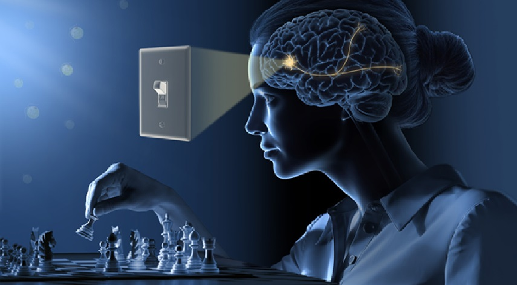
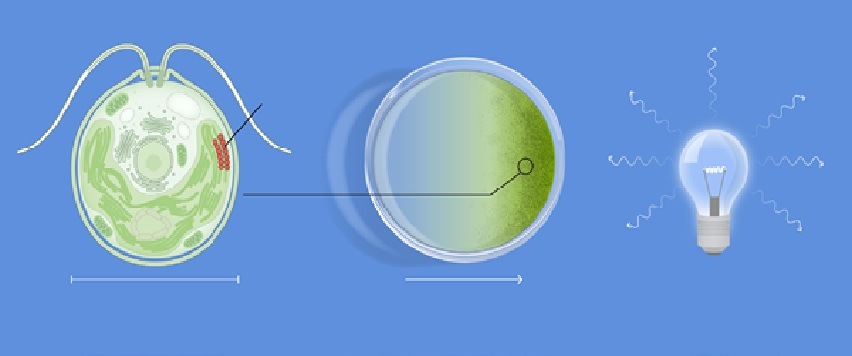
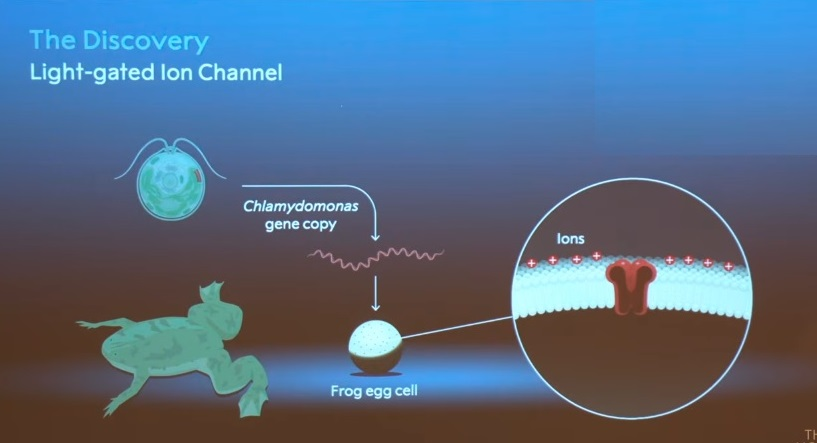
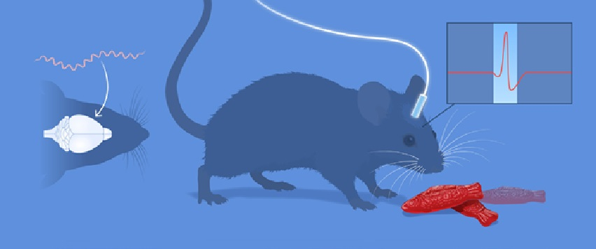
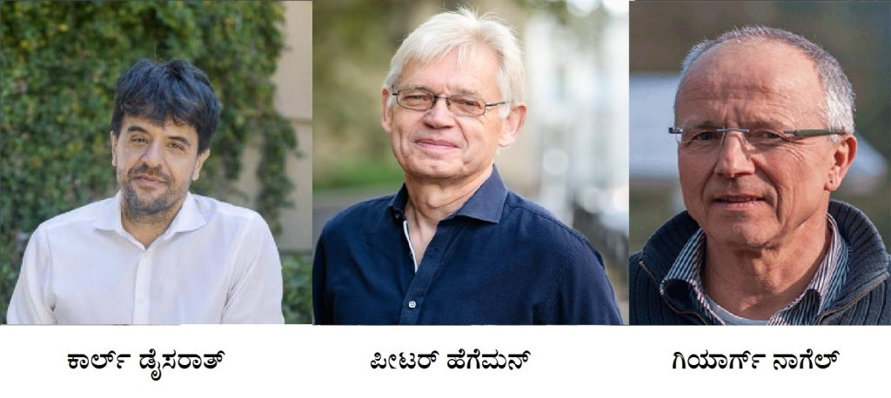

ಈ ವರ್ಷ 2026ರ ಶರೀರವಿಜ್ಞಾನ ಅಥವಾ ವೈದ್ಯಕೀಯ ವಿಭಾಗದ ನೊಬೆಲ್ ಪ್ರಶಸ್ತಿಯನ್ನು 'ಆಪ್ಟೊಜೆನೆಟಿಕ್ಸ್' (Optogenetics) ಎಂಬ ನರವಿಜ್ಞಾನದ ಕ್ಷೇತ್ರಕ್ಕಾಗಿ ನೀಡಲಾಗಿದೆ. ಪ್ರಸ್ತುತ ಶೋಧವು ಸುಮಾರು 1.3 ರಿಂದ 1.4 ಕಿ.ಗ್ರಾಂ ತೂಕದ ನಮ್ಮ ಮೆದುಳಿನ ನರಕೋಶಗಳು ನೆನಪುಗಳನ್ನು, ಭಾವನೆಗಳನ್ನು ಮತ್ತು ವರ್ತನೆಗಳನ್ನು ಹೇಗೆ ರೂಪಿಸುತ್ತವೆ ಎಂಬುದನ್ನು ತೋರಿಸಲು ಸಾಧ್ಯವಾಗಿರುವ ಒಂದು ವಿಧಾನವಾಗಿದೆ. ಜರ್ಮನಿಯ **ಪೀಟರ್ ಹೆಗೆಮನ್** ಮತ್ತು **ಗಿಯಾರ್ಗ್‌ ನಾಗೆಲ್** ಅವರಿಬ್ಬರು ಅದನ್ನು ಸಾಧ್ಯ ಮಾಡುವ 'ಚಾನೆಲ್‌ರೋಡಾಪ್ಸಿನ್' (Channelrhodopsin) ಎಂಬ ಗಮನಾರ್ಹ ಪ್ರೋಟೀನ್ ಅನ್ನು ಮೊದಲು ಪತ್ತೆಹಚ್ಚಿದರು. ನಂತರ ಅಮೆರಿಕದ **ಕಾರ್ಲ್ ಡೈಸರಾತ್** ಅವರು ಈ ಪ್ರೋಟೀನ್ ಅನ್ನು ನರಕೋಶಗಳಲ್ಲಿ ಬೆಳಕಿನಿಂದ ನಿಯಂತ್ರಿಸಲ್ಪಡುವ ಒಂದು ಸ್ವಿಚ್ ಆಗಿ ರೂಪಿಸಿದರು. ನರವಿಜ್ಞಾನದಲ್ಲಿ ಒಂದು ಹೊಸ ಯುಗಕ್ಕೆ ಅಡಿಪಾಯ ಹಾಕಿದ ಮೂವರ ಈ ಶೋಧವು 2026ರ ಶರೀರವಿಜ್ಞಾನ ಅಥವಾ ವೈದ್ಯಕೀಯ ನೊಬೆಲ್‌ ಪುರಸ್ಕಾರಕ್ಕೆ ಪಾತ್ರವಾಗಿದೆ.

ನಮ್ಮ ಮೆದುಳು, ಭಾವನೆಗಳನ್ನು, ವರ್ತನೆಗಳನ್ನು ಮತ್ತು ದೈಹಿಕ ಕಾರ್ಯಗಳನ್ನು ಹೇಗೆ ನಿಯಂತ್ರಿಸುತ್ತದೆ ಎಂಬುದು ಬಹುಕಾಲದಿಂದಲೂ ಒಂದು ರಹಸ್ಯವಾಗಿಯೇ ಉಳಿದಿತ್ತು. 20ನೇ ಶತಮಾನದಲ್ಲಿ, ಸಂಶೋಧಕರು ಮೆದುಳಿನ ಯಾವ ಭಾಗಗಳು ಯಾವ ಕಾರ್ಯಗಳ ಮೇಲೆ ಪ್ರಭಾವ ಬೀರುತ್ತವೆ ಎಂಬುದನ್ನು ಅಧ್ಯಯನ ಮಾಡಲು ಪ್ರಾರಂಭಿಸಿದರು. ಆದರೆ ಅವರು ಬಳಸಿದ ವಿಧಾನಗಳಿಂದಾಗಿ, ಕಾರ್ಯ-ಕಾರಣ ಸಂಬಂಧಗಳನ್ನು (Causal Relationships) ಸಾಬೀತುಪಡಿಸಲು ಸಾಧ್ಯವಾಗಲಿಲ್ಲ. ಆಗ ಅವರು ರೂಪಿಸಿದ್ದ ಮೆದುಳಿನ ಚಿತ್ರಣವು ಏನೂ ತಿಳಿಯದ ಚಿಹ್ನೆಗಳು ಮತ್ತು ಅರ್ಥವಾಗಿರದ ವಿಷಯಗಳಿಂದ ತುಂಬಿದ್ದಂತಹಾ ಒಂದು ಕರಡು ನಕ್ಷೆಯ ಹಾಗಿತ್ತು. ಈಗ ಇದೆಲ್ಲವೂ ಬದಲಾಗುತ್ತಿದೆ. ಏನೋ ಇದು ಕನಸು ಅಂದುಕೊಂಡಿದ್ದ ಮೆದುಳಿನ ನಕ್ಷೆಯನ್ನೂ ಸಹಾ ರೂಪಿಸಲು ಹೊಸ ಶೋಧದಿಂದಾದ 'ಆಪ್ಟೊಜೆನೆಟಿಕ್ಸ್' (Optogenetics) ಸಾಧ್ಯಮಾಡಿದೆ. ಇದು ಈ ವರ್ಷದ ನೊಬೆಲ್‌ ಪುರಸ್ಕಾರಕ್ಕೆ ಪಾತ್ರವಾದ ಸಂಶೋಧನೆಯ ಸಾರ. ಇದೆಲ್ಲಾ ಸಾಧ್ಯವಾದದ್ದು ಹೇಗೆ? ಮೂರು ಜನ ವಿಜ್ಞಾನಿಗಳ ಕೊಡುಗೆಗಳು ಏನು? ಇದನ್ನೆಲ್ಲಾ ವಿವರವಾಗಿ ಮುಂದೆ ನೋಡೋಣ.

ಇಪ್ಪತ್ತನೆಯ ಶತಮಾನದಲ್ಲಿ ಜೈವಿಕ ರಹಸ್ಯವನ್ನು ಅರಿಯುವ ಸಂಶೋಧಕರ ಮಹದಾಸೆಗೆ, 1953ರ ಡಿ.ಎನ್‌.ಎ. ರಚನೆಯು ಮಹತ್ತರವಾದ ಬೆಂಬಲವನ್ನು ಕೊಟ್ಟಿತು. ಅದಕ್ಕೆಂದು 1962ರ ವೈದ್ಯಕೀಯ ನೊಬೆಲ್‌ ಪ್ರಶಸ್ತಿಯನ್ನು ಪಡೆದವರಲ್ಲಿ ಒಬ್ಬರಾದ ಫ್ರಾನ್ಸಿಸ್‌ ಕ್ರಿಕ್‌ ನಂತರದ ದಿನಗಳಲ್ಲಿ ಮನಸ್ಸಿನ ಚಟುವಟಿಕೆಗಳ ಕುರಿತು ಆಸಕ್ತರಾಗಿದ್ದರು. ಅವರು ಮಾನವನ ಜಾಗ್ರತ ಮನಸ್ಸು ಮತ್ತು ಅದರ ಪ್ರಜ್ಞೆಯ ಕುರಿತು ಅಧ್ಯಯನಗಳನ್ನು ಆರಂಭಿಸಿದ್ದರು. ಮನಸ್ಸು ಬಹಳ ವೇಗವಾಗಿ ಕಾರ್ಯನಿರ್ವಹಿಸುತ್ತದೆ ಎಂಬುದು ತಿಳಿದ ವಿಷಯವೇ ಆಗಿತ್ತು. ಉದಾಹರಣೆಗೆ ನಾವು ಚೆಸ್‌ ಆಡುವಾಗ ಎದುರಾಳಿಯ ಆಟದ ವೈಖರಿಯನ್ನು, ಚೆಸ್‌ ಬೋರ್ಡಿನ ನಮೂನೆಯಲ್ಲಿ ಊಹಿಸಿ, ನೆನಪಿಟ್ಟುಕೊಂಡು, ನಮ್ಮ ಚಲನೆಯ ಮಾದರಿಗಳನ್ನು ರೂಪಿಸುವ ಕೆಲಸ ಇದೆಯಲ್ಲಾ, ಅದು ಎಷ್ಟು ಬಗೆ ಬಗೆಯಲ್ಲಿ ವೇಗ ಮತ್ತು ತೀಕ್ಷ್ಣತೆಯುಳ್ಳದ್ದು ಎಂದು ಊಹಿಸಿಕೊಳ್ಳಬಹುದಲ್ಲಾ ಹಾಗೆ! ಆದರೆ ಹಾಗಾಗಲು ನರಕೋಶದಲ್ಲಿ ಮಾಹಿತಿಯ ಚಟುವಟಿಕೆಗಳು ಬೆಳಕಿನಂತೆ ಪ್ರವಹಿಸುವುದರಲ್ಲಿ ಮಾತ್ರವೇ ಸಾಧ್ಯ ಎಂಬುದನ್ನು ಅವರು ಮೊದಲು ತೀರ್ಮಾನಿಸಿದರು. ಆದರೆ ಇದೊಂದು ಅತ್ಯದ್ಭುತವಾದ ಊಹೆಯಷ್ಟೇ ಆಗಿತ್ತು. ಅದಕ್ಕೊಂದು ಸಾಬೀತು ಬೇಕಿತ್ತು.

ಊಹೆಯೇನೋ ಸತ್ಯಕ್ಕೆ ಸಮೀಪವಾಗಿತ್ತು. ಪ್ರಾಯೋಗಿಕ ಸಾಧ್ಯತೆ ಇದ್ದಾಗ ಮಾತ್ರವೇ ವಿಜ್ಞಾನದ ತೀರ್ಪು ತಾನೇ? ಇದು ಪೀಟರ್ ಹೆಗೆಮನ್ ಅವರ ಕುತೂಹಲದಿಂದ ಪ್ರಾರಂಭವಾಯಿತು. ಮೊದಲು ಏಕಕೋಶೀಯ ಪಾಚಿಯಾದ 'ಕ್ಲಾಮಿಡೊಮೊನಾಸ್' (Chlamydomonas) ಬೆಳಕಿನ ಮೂಲದತ್ತ ಹೇಗೆ ಈಜಬಲ್ಲದು ಎಂಬು ಕುತೂಹಲವನ್ನು ಪ್ರಾಯೋಗಿಕ ತಿಳಿವಾಗಿಸಲು ಪ್ರಯತ್ನಿಸಿದರು. ಒಂದು ಪೆಟ್ರಿ ಡಿಶ್‌ (ಸೂಕ್ಷ್ಮ ಜೀವಿಗಳನ್ನು ಬೆಳೆಸುವ ಪುಟ್ಟ ಗಾಜಿನ ತಟ್ಟೆ) ಒಳಗೆ ಬೆಳೆಸಿದ ಪಾಚಿ (Algae) ಯು ಬೆಳಕಿನ ಮೂಲದ ಕಡೆಗೆ ಬೆಳೆಯುದನ್ನು ಗಮನಿಸಿದ ಹೆಗೆಮನ್‌, ಅದರಲ್ಲಿ ಬೆಳಕಿಗೆ ಸಂವೇದನೆಯಾಗುವ ಮಾಲೆಕ್ಯೂಲ್‌-ಅಣು ಯಾವುದು ಎಂಬ ಪ್ರಶ್ನೆಗೆ ಉತ್ತರದ ಹುಡುಕಾಟಕ್ಕೆ ತೊಡಗಿದರು. ಆ ಪಾಚಿಯ ಬೆಳಕಿಗೆ ಸ್ಪಂದಿಸುವ ಕಣ್ಣಿನ ಸ್ಥಳ (Eyespot) ವನ್ನು ಅವರು ಮೊದಲು ಕಂಡುಹಿಡಿದರು. ಒಂದು ಎಲೆಕ್ಟ್ರೋಡನ್ನು ಬಳಸಿ ಅದಕ್ಕೆ ಪ್ರತ್ಯೂತ್ತರವಾಗಿ ಸಿಗ್ನಲ್‌ ಕೊಡುವ ಆ ಸ್ಥಳವನ್ನು ಪತ್ತೆ ಹಚ್ಚಿದ್ದರು. ಆವರೆಗೂ ಇದ್ದ ತಿಳಿವಿಗಿಂತಲೂ ಆ ಸಿಗ್ನಲ್‌ ತುಂಬಾ ವೇಗದ್ದೆಂದು ಗೊತ್ತಾಯಿತು.

ಆದರೆ, ಅಷ್ಟು ಮಾತ್ರವೇ ಸಾಕಾಗದು. ಅದು ಹಾಗೆ ವರ್ತಿಸಲು ಕಾರಣ ಬೇಕಲ್ಲವೇ? ಮುಂದಿನ ಹಂತದಲ್ಲಿ ಅಲ್ಲಿ ಇರಬಹುದಾದ ಬೆಳಕಿನ ಸಂವೇದನೆಯುಳ್ಳ ಪ್ರೋಟೀನಿನ ಹುಡುಕಾಟಕ್ಕೆ ಆರಂಭಿಸಿದರು. ಆದರೆ, ಆ ಜಾಗದಿಂದ ಪ್ರೋಟೀನನ್ನು ಬೇರ್ಪಡಿಸಿದ ಕೂಡಲೇ ಅದಯ ನಿಸ್ತೇಜವಾಗಿ ಸಂವೇದನೆಯನ್ನು ಕಳೆದುಕೊಳ್ಳುತ್ತಿತ್ತು. ಹಾಗಾಗಿ ಆಗ ಹೆಗೆಮನ್‌ ಆ ಪ್ರೋಟೀನಿಗೆ ಕಾರಣವಾಗುವ ಜೀನುಗಳ ಹುಡುಕಾಟಕ್ಕೆ ಮೊದಲಾದರು. ಕಡೆಗೂ ಎರಡು ಜೀನ್‌ಗಳು ಬೆಳಕಿಗೆ ಸಂವೇದನೆಯನ್ನು ತೋರಿಸಬಲ್ಲ ಪ್ರೋಟೀನಿಗೆ ಕಾರಣವೆಂಬ ಫಲಿತವನ್ನು ಕಂಡುಕೊಂಡರು. ಆದಾಗ್ಯೂ ಆ ಜೀನ್‌ಗಳು ಪ್ರೋಟೀನಿಗೆ ಕಾರಣವಾಗಬಲ್ಲದು ಎಂಬುದರ ಪುರಾವೆ ಬೇಕಿತ್ತು ತಾನೇ? ಆಗ ಜೊತೆಯಾದವರು ಪ್ರೊ. ಗಿಯಾರ್ಗ್‌ ನಾಗೆಲ್‌.

ಹೆಗೆಮನ್‌ ಮತ್ತು ಗಿಯಾರ್ಗ್‌ ನಾಗೆಲ್ ಸೇರಿ ಪಾಚಿಯ ಕೋಶದ ಮೇಲ್ಮೈಯಲ್ಲಿ ಇರುವ 'ಚಾನೆಲ್‌ರೋಡಾಪ್ಸಿನ್' (channelrhodopsin) ಎಂಬ ವಿಶಿಷ್ಟ ಗುಣಲಕ್ಷಣಗಳನ್ನು ಹೊಂದಿರುವ ಪ್ರೋಟೀನ್ ಅನ್ನು ಕಂಡುಹಿಡಿದರು. ನೀಲಿ ಬೆಳಕು ಇದರ ಮೇಲೆ ಬಿದ್ದಾಗ, ಆ ಪ್ರೋಟೀನ್‌ನ ಮೂಲಕ ಒಂದು ಮಾರ್ಗ ಅಥವಾ 'ಚಾನೆಲ್' ತೆರೆದುಕೊಳ್ಳುತ್ತದೆ. ಆಗ ವಿದ್ಯುದಾವೇಶಿತ ಅಯಾನುಗಳು ಕೋಶದೊಳಗೆ ಪ್ರವೇಶಿಸಿ, ವಿದ್ಯುತ್ ಸಂಕೇತವನ್ನು (Electrical Impulse) ಸೃಷ್ಟಿಸುತ್ತವೆ. ಈ ಪ್ರೋಟೀನ್ ಅನ್ನು ಯಾವುದೇ ಕೋಶದಲ್ಲಿ ಅಳವಡಿಸಿದರೂ, ಆ ಕೋಶಗಳು ಬೆಳಕಿಗೆ ಸಂವೇದನಾಶೀಲವಾಗುತ್ತವೆ ಎಂಬುದನ್ನು ಅವರು ಕಂಡುಕೊಂಡರು.

ನಾಗೆಲ್‌ ಕಪ್ಪೆಯ ಜೀವಿಕೋಶಗಳನ್ನು ಬಳಸಿ, ಈ ಪ್ರೋಟೀನಿನ ಕಾರ್ಯಕ್ಷಮತೆಯನ್ನು ಪರೀಕ್ಷಿಸಲು ಪ್ರಯೋಗಗಳನ್ನು ನಡೆಸಿದರು. ಹೇಗೂ ಎರಡು ಜೀನ್‌ಗಳನ್ನು ಹೆಗೆಮನ್‌ ಗುರುತಿಸಿದ್ದರಲ್ಲವೇ? ಆ ಜೀನ್‌ಗಳನ್ನು ಕಪ್ಪೆಯ ದೇಹಕ್ಕೆ ಸೇರಿಸಿ, ಅದರ ಪ್ರತಿ ಸ್ಪಂದನವನ್ನು ಪ್ರಯೋಗಿಸಿದರು. ಹಲವಾರು ಬ್ಯಾಚ್‌ಗಳಲ್ಲಿ ಕಪ್ಪೆಗಳನ್ನು ನಿರಂತರವಾಗಿ ಬಳಸುತ್ತಾ ಆ ಪ್ರೋಟೀನಿನ ಪತ್ತೆಗೆ ನಿರತರಾದರು. ಹೆಗೆಮನ್‌ ಊಹಿಸಿದಂತೆ ಆ ಪ್ರೋಟೀನು ಬೆಳಕಿಗೆ ಸಂವೇದನೆಯನ್ನು ಒಂದು ಅಯಾನು ಚಾನೆಲ್‌ ತೆರೆಯುವ ಮೂಲಕ ತೋರುವುದನ್ನು ಕಂಡುಕೊಂಡರು. ಆ ಪ್ರೋಟೀನುಗಳಿಗೆ ಚಾನೆಲ್‌ರೊಡೊಪ್ಸಿನ್‌ -೧ ಮತ್ತು ಚಾನೆಲ್‌ರೊಡೊಪ್ಸಿನ್‌ -೨ (Channelrhodopsin-1 ಮತ್ತು Channelrhodopsin-2) ಎಂದು ಹೆಸರಿಸಿದರು. ಬೆಳಕಿಗೆ ಸಂವೇದನೆಯು ಪ್ರೋಟೀನಿನ ಅಯಾನುಗಳ ಚಾನೆಲ್‌ಗಳ ಪ್ರತಿಕ್ರಿಯೆಯಲ್ಲಿ ಸ್ಪಂದಿಸುವುದನ್ನು ದಾಖಲಿಸಿದರು.

ಹೆಗೆಮನ್‌ ಪ್ರಯೋಗದಂತೆ, ನಾಗೆಲ್‌ ಅವರ ವಿವರಣಾತ್ಮಕ ಪ್ರಯೋಗದಲ್ಲಿ ಚಾನೆಲ್‌ರೊಡೊಪ್ಸಿನ್‌-2 ಬೆಳಕಿಗೆ ತೀಕ್ಷ್ಣವಾಗಿ ಸಂವೇದನೆಯನ್ನು ನೀಡುತ್ತಿತ್ತು. ಇದರ ಸಂಪೂರ್ಣ ವಿವರಗಳನ್ನು ಇಬ್ಬರೂ ಸೇರಿ 2003ರಲ್ಲಿ ಸಂಶೋಧನಾ ಪ್ರಬಂಧವಾಗಿ ಪ್ರಕಟಿಸಿದರು. ಅದರಲ್ಲಿ ಚಾನೆಲ್‌ರೊಡೊಪ್ಸಿನ್‌-2ಅನ್ನು ಬಳಸಿದಾಗ ಶಕ್ತಿಯುತವಾದ ಇಲೆಕ್ಟ್ರಿಕ್‌ ಸಂಕೇತಗಳು ದೊರೆಯುವುದೆಂದು ಪ್ರಸ್ತಾಪಿಸಿದ್ದರು. ಈ ಕುರುಹನ್ನು ಮುಂದೆ ಕೊಂಡೊಯ್ದು ಮಾನವ ಜೀವಿಕೋಶಗಳ ಬಳಕೆಗೆ ಅನುವು ಮಾಡುವ ಸಂಶೋಧನೆಯ ಮಾರ್ಗವನ್ನು ಕಂಡುಹಿಡಿದವರು ಅಮೆರಿಕದ ಸ್ಟ್ಯಾನ್‌ ಪೊರ್ಡ್‌ ವಿಶ್ವವಿದ್ಯಾಲಯದ ಕಾರ್ಲ್‌ ಡೈಸರಾತ್‌ ಎಂಬ ಯುವ ವಿಜ್ಞಾನಿ.

ಮೂಲತಃ ವೈದ್ಯವಿದ್ಯಾರ್ಥಿಯಾದ ಕಾರ್ಲ್ ಡೈಸರೋತ್, ನರವಿಜ್ಞಾನದಲ್ಲಿ ಆಸಕ್ತರಾಗಿ ಸಂಶೋಧನೆಗೆ ತೊಡಗಿದ್ದರು. ನ್ಯೂರೋ ಸರ್ಜನ್‌ ಆಗುವ ಕನಸು ಹೊತ್ತವರು, ಮಹತ್ವದ್ದನ್ನೇ ಸಾಧಿಸಿದರು. ಮನೋರೋಗದ ಕ್ಲಿನಿಕಲ್‌ ತರಬೇತಿಯಲ್ಲಿದ್ದಾಗ, ಹೇಗೆ ವಿಭಿನ್ನ ಮನೋರೋಗಿಗಳಿಗೆ ಮೆದುಳು ವಿಭಿನ್ನವಾಗಿ ಕಾರ್ಯ ನಿರ್ವಹಿಸುತ್ತದೆ ಎಂಬ ಕುತೂಹಲವನ್ನು ಬೆಳೆಸಿಕೊಂಡಿದ್ದರು. ದುಃಖ, ಸಂತೋಷ, ನಿರಾಸೆ, ಖಿನ್ನತೆ ಎಲ್ಲವೂ ಒಂದೇ ಮನಸ್ಸಿನ ವಿಭಿನ್ನ ವರ್ತನೆಗಳಾಗುವ ಕಾರ್ಯವನ್ನು ಮಾಲೆಕ್ಯೂಲಾರ್‌ ಹಿನ್ನೆಲೆಯಿಂದ ತಿಳಿಯುವ ಹುಮ್ಮಸ್ಸುಳ್ಳ ಉತ್ಸಾಹಿಯಾಗಿದ್ದರು. ಖಿನ್ನತೆಯಿದ್ದ ಮನಸ್ಸು ಸಂತೋಷ ಪಡಲು ಏಕೆ ಕಷ್ಟ ಪಡುತ್ತದೆ? ಸ್ಕೀಜೊಫ್ರಿನಿಕ್‌ ಅಥವಾ ಆಟಿಸಂ ಬರುವುದಾರೂ ಹೇಗೆ ಇವೇ ಮುಂತಾಗಿ ಪ್ರಶ್ನೆಗಳಿದ್ದವು. ಇದು ಅವರಿಗೆ ನ್ಯೂರೊ ಸೈನ್ಸ್‌ ಪ್ರವೇಶಕ್ಕೆ ಪ್ರೇರೇಪಿಸಿದ್ದವು.

ನರವಿಜ್ಞಾನದ ಡಾಕ್ಟೊರೇಟ್‌ ಪದವಿಯ ಸಂಶೋಧನೆಯಲ್ಲಿ ಮೆದುಳನ್ನು ತೆಳುವಾದ ಹೋಳುಗಳಾಗಿಸಿ ಪೆಟ್ರಿ ಡಿಶ್‌ನಲ್ಲಿಟ್ಟು ಪರೀಕ್ಷಿಸುತ್ತಿದ್ದರು. ಆಗ ಜೀವಂತ ಮೆದುಳಿನಲ್ಲಿ ನರಕೋಶಗಳ ಅಧ್ಯಯನದ ಮಹತ್ವವು ಅರಿವಿಗೆ ಬಂದಿತ್ತು. ಹಿಂದೆಯೇ ಪ್ರಸ್ತಾಪಿಸಿದಂತೆ ಫ್ರಾನ್ಸಿಸ್‌ ಕ್ರಿಕ್‌ ಅವರ ಊಹೆಯ ಫಲಿತಗಳಿಗೆ ಸ್ಪಂದನೆಯಾಗಿ ಹಲವಾರು ಸಂಶೋಧಕರು ಆಗಲೇ ಪ್ರಯೋಗದಲ್ಲಿ ತೊಡಗಿದ್ದರು. ಅವರಿಗೆಲ್ಲಾ ಅದೊಂದು ಹಣ ಮತ್ತು ಸಮಯ ಎರಡೂ ವ್ಯರ್ಥವಾಗುವಂತಹಾ ಅನುಮಾನಗಳಿದ್ದವು. ಅಂತಹದರಲ್ಲಿ ಕಾರ್ಲ್ ಡೈಸರೋತ್ ತಮ್ಮದೇ ಸಂಶೋಧಕರ ಗುಂಪನ್ನು ಆರಂಭಿಸಿದರು. ನರಕೋಶಗಳು ಸ್ಪಂದಿಸುವ ಅಥವಾ ಸಂವೇದನೆಯನ್ನು ಕೊಡುವಂತಹಾ ಪ್ರೋಟೀನಿನ ಹುಡುಕಾಟದಲ್ಲಿ ಮೊದಲಾದರು. ಹೆಗೆಮನ್‌ ಮತ್ತು ನಾಗೆಲ್‌ ಅವರ ಚಾನೆಲ್‌ರೊಡೊಪ್ಸಿನ್‌ -2 ಕುರಿತು ತಿಳಿದದ್ದೇ ಕಾರಣವಾಗಿ ಅವರನ್ನು ಸಂಪರ್ಕಿಸಿದರು. ಆ ಪ್ರೋಟೀನಿನ ಗುಟ್ಟನ್ನು ಬಿಟ್ಟುಕೊಡುವ ಡಿ.ಎನ್‌.ಎ. ಪಡೆದು ಮುಂದುವರೆದರು.

ವೈದ್ಯಕೀಯ ವಿದ್ಯಾರ್ಥಿಯಾಗಿ ಮಾನವ ಸಂಕುಲದ ಹಿತದಲ್ಲಿ ಹುಡುಕ ಹೊರಟ ಡೈಸೆರಾತ್‌ ಡಿ.ಎನ್‌.ಎ.ಯನ್ನು ಇಲಿಗಳ ಮೇಲೆ ಪ್ರಯೋಗಿಸಲು ಮುಂದಾದರು. ಪಾಚಿಯಿಂದ ಪಡೆದ ಪ್ರೋಟೀನಿನ ಜೀನ್‌ ಆದ್ದರಿಂದ ತುಸು ಅನುಮಾನದಿಂದಲೇ ಆರಂಭಿಸಿದ್ದ ಪ್ರಯೋಗ ಚಾನೆಲ್‌ರೊಡೊಪ್ಸಿನ್‌ -2ಗೆ ಅದ್ಭುತವಾದ ಫಲಿತವನ್ನು ನೀಡಿತ್ತು. ಚಾನೆಲ್‌ರೊಡೊಪ್ಸಿನ್‌ -2 ಜೀನ್‌ ಇರುವ ಕೋಶದ ಸ್ಥಳವು ನೀಲಿ ಬೆಳಕಿಗೆ ಅತ್ಯದ್ಭುತವಾದ ಸಂವೇದನೆಯನ್ನು ನೀಡಿತು. ಇಲಿಗಳ ನರಕೋಶಗಳಲ್ಲಿ ನೀಲಿ ಬೆಳಕನ್ನು ಚೆಲ್ಲಿದಾಗ ನರ ಸಂಕೇತವೊಂದನ್ನು ಪ್ರಚೋದಿಸುವಲ್ಲಿ ಯಶಸ್ವಿಯಾದರು. ಅವರು ಈ ಮಹತ್ವದ ಸಂಶೋಧನೆಯನ್ನು 2005ರಲ್ಲಿ ಪ್ರಕಟಿಸಿದರು. ಎರಡು ವರ್ಷಗಳ ನಂತರ, ನರಕೋಶಗಳಿಗಾಗಿ ರೂಪಿಸಲಾದ ಈ ಬೆಳಕಿನ-ನಿಯಂತ್ರಿತ ಸ್ವಿಚ್ ಅನ್ನು ಜೀವಂತ ಇಲಿಗಳ ಮೆದುಳಿನಲ್ಲಿ ಕಾರ್ಯನಿರ್ವಹಿಸುವಂತೆ ಮಾಡಿದರು. ನರವಿಜ್ಞಾನದಲ್ಲಿ ಇದೊಂದು ಮಹತ್ವದ ಮೈಲುಗಲ್ಲಾಯಿತು.

ಬೆಳಕಿನಿಂದ ನರ ಸಂಕೇತಗಳನ್ನು ನಿಯಂತ್ರಿಸುವ ಈ ವಿಧಾನವನ್ನು ಈಗ ಆಪ್ಟೊಜೆನೆಟಿಕ್ಸ್ ಎಂದು ಕರೆಯಲಾಗುತ್ತದೆ. ಇದು ಅತ್ಯಂತ ವೇಗವಾಗಿ ನರ ವಿಜ್ಞಾನದ ಅಧ್ಯಯನಕಾರರಲ್ಲಿ ಜಾಗತಿಕ ಪ್ರಭಾವವನ್ನು ಗಳಿಸಿತು. ಈಗ ಆಪ್ಟೊಜೆನೆಟಿಕ್ಸ್ ಬಳಸಿ, ಸಂಶೋಧಕರು ನರವೈಜ್ಞಾನಿಕ ಮತ್ತು ಮನೋವೈದ್ಯಕೀಯ ಅಸ್ವಸ್ಥತೆಗಳಲ್ಲಿ ರೋಗಿಗಳ ನಿರ್ದಿಷ್ಟ ನೆನಪುಗಳು, ಭಾವನೆಗಳು ಮತ್ತು ನಡವಳಿಕೆಗಳನ್ನು ನಿಯಂತ್ರಿಸುವ ನರ ಸರ್ಕ್ಯೂಟ್‌ಗಳನ್ನು ಬಹಿರಂಗಪಡಿಸವಷ್ಟು ಸಮರ್ಥ ಉತ್ತರವಾಗಿ ಹೊರಹೊಮ್ಮಿದೆ. ಕ್ಲಿನಿಕಲ್ ಮೆಡಿಸಿನ್‌ನಲ್ಲಿ, ದೃಷ್ಟಿಹೀನತೆ ಹೊಂದಿರುವ ಜನರಲ್ಲಿ ದೃಷ್ಟಿಯನ್ನು ಪುನಃಸ್ಥಾಪಿಸುವ ಪ್ರಯತ್ನಗಳಲ್ಲಿ ಕೂಡ ಸಂಶೋಧಕರು ಈ ವಿಧಾನವನ್ನು ಬಳಸುತ್ತಿದ್ದಾರೆ.

ನರವಿಜ್ಞಾನದಲ್ಲಿ ಹೊಸದೊಂದು ಯುಗವಾದ ಆಪ್ಟೊಜೆನೆಟಿಕ್ಸ್ ಮೆದುಳಿನ ಬಗ್ಗೆ ನಮ್ಮ ತಿಳುವಳಿಕೆಯನ್ನು ಮೂಲಭೂತವಾಗಿ ಬದಲಾಯಿಸಿದೆ. ಪ್ರತಿದಿನ ಹೊಸ ಆವಿಷ್ಕಾರಗಳನ್ನು ತರುತ್ತದೆ, ಮಾನವೀಯತೆಯ ದೊಡ್ಡ ರಹಸ್ಯಗಳಲ್ಲಿ ಒಂದನ್ನು ಪರಿಹರಿಸಲು ಸಹಾಯ ಮಾಡುತ್ತದೆ: ನಮ್ಮ ನಂಬಲಾಗದ ಮೆದುಳು ಹೇಗೆ ಕಾರ್ಯನಿರ್ವಹಿಸುತ್ತದೆ, ಎಂಬ ನಂಬಿಕೆ ತರುವಷ್ಟು ಕಾಲದಲ್ಲಿ ಮುಂದೆ ಬರುತ್ತಿದೆ.

ನಮ್ಮ ಮೆದುಳು ಹೇಗೆ ನಮ್ಮ ನೆನಪುಗಳನ್ನು, ಭಾವನೆಗಳನ್ನು ಮತ್ತು ವರ್ತನೆಗಳನ್ನು ರೂಪಿಸುತ್ತದೆ ಎಂಬುದನ್ನು ಅರ್ಥಮಾಡಿಕೊಳ್ಳುವ ಸಂಶೋಧಕರ ಬಹುಕಾಲದ ಕನಸು ಪ್ರಸ್ತುತ ಸಂಶೋಧನೆಯಿಂದ ನನಸಾಗಿದೆ. ಜೀವಂತ ಮೆದುಳಿನಲ್ಲಿನ ಪ್ರತ್ಯೇಕ ನರಕೋಶಗಳ ಚಟುವಟಿಕೆಯನ್ನು ಸಕ್ರಿಯಗೊಳಿಸಲು ಅಥವಾ ನಿಷ್ಕ್ರಿಯಗೊಳಿಸಲು ಸಾಧ್ಯವಾಗಿಸುವ 'ಆಪ್ಟೊಜೆನೆಟಿಕ್ಸ್' (Optogenetics) ತಂತ್ರಜ್ಞಾನ ನಾಂದಿ ಹಾಡಿದೆ. ಮೆದುಳಿನ ರಹಸ್ಯಗಳನ್ನು ಅನಾವರಣಗೊಳಿಸಲು ಈ ವಿಧಾನವನ್ನು ಈಗಾಗಲೇ ಪ್ರಪಂಚದಾದ್ಯಂತದ ಅನೇಕ ಪ್ರಯೋಗಾಲಯಗಳಲ್ಲಿ ಬಳಸಲಾಗುತ್ತಿದೆ.

ಆಪ್ಟೊಜೆನೆಟಿಕ್ಸ್‌ ತಂತ್ರಜ್ಞಾನದ ಪ್ರಮುಖ ಹರಿಕಾರರು **ಪ್ರೊ. ಪೀಟರ್ ಹೆಗೆಮನ್‌, ಪ್ರೊ. ಗಿಯಾರ್ಗ್‌ ನಾಗೆಲ್ ಮತ್ತು ಪ್ರೊ. ಕಾರ್ಲ್ ಡೈಸರಾತ್.** ಪ್ರೊ. ಪೀಟರ್ ಹೆಗೆಮನ್‌, ಅವರು ಜರ್ಮನಿಯ ಮ್ಯಾಕ್ಸ್‌ ಪ್ಲಾಂಕ್‌ ಜೀವಿರಸಾಯನ ಸಂಸ್ಥೆಯಲ್ಲಿ ಪಿಎಚ್.ಡಿ. ಪದವಿಯನ್ನು ಪಡೆದಿದ್ದಾರೆ. ಇದೀಗ ಅವರು ಜರ್ಮನಿಯ ಹುಂಬೋಲ್ಟ್‌ ವಿಶ್ವವಿದ್ಯಾಲಯದಲ್ಲಿ ನರವಿಜ್ಞಾನದ ಪ್ರಾಧ್ಯಾಪಕರಾಗಿದ್ದಾರೆ. ಪ್ರೊ. ಗಿಯಾರ್ಗ್‌ ನಾಗೆಲ್ ಅವರು ಜರ್ಮನಿಯ ಫ್ರಾಂಕ್‌ಫರ್ಟ್‌ ವಿಶ್ವವಿದ್ಯಾಲಯದಲ್ಲಿ ಪಿಎಚ್.ಡಿ. ಪಡೆದಿದ್ದಾರೆ. ಪ್ರಸ್ತುತ ವೂರ್ಜ್‌ಬರ್ಗ್‌ ವಿಶ್ವವಿದ್ಯಾಲಯದಲ್ಲಿ ಶರೀರವಿಜ್ಞಾನ ಮತ್ತು ಜೀವಿಭೌತವಿಜ್ಞಾನದ ಪ್ರಾಧ್ಯಾಪಕರಾಗಿದ್ದಾರೆ. ಪ್ರೊ. ಕಾರ್ಲ್ ಡೈಸರಾತ್ ಅವರು ಸ್ಟ್ಯಾನ್‌ಫೊರ್ಡ್‌ ವಿಶ್ವವಿದ್ಯಾಲಯದಲ್ಲಿ ಎಂ.ಡಿ. ಮತ್ತು ಪಿಎಚ್.ಡಿ ಪದವಿಗಳೆರಡನ್ನೂ ಪಡೆದಿದ್ದಾರೆ. ಇದೀಗ ಅದೇ ವಿಶ್ವವಿದ್ಯಾಲಯದಲ್ಲಿ ಜೈವಿಕ ಇಂಜನಿಯರಿಂಗ್‌ ಮತ್ತು ವರ್ತನೆಯ ವಿಜ್ಞಾನದ ಪ್ರಾಧ್ಯಾಪಕರಾಗಿದ್ದಾರೆ.

ನಮಸ್ಕಾರ

ಡಾ. ಟಿ.ಎಸ್.‌ ಚನ್ನೇಶ್‌
