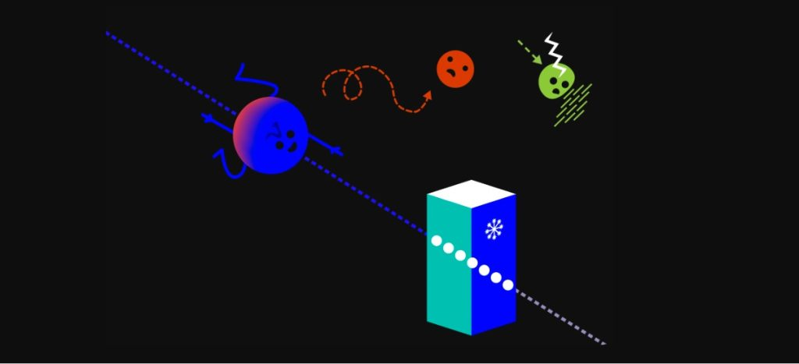
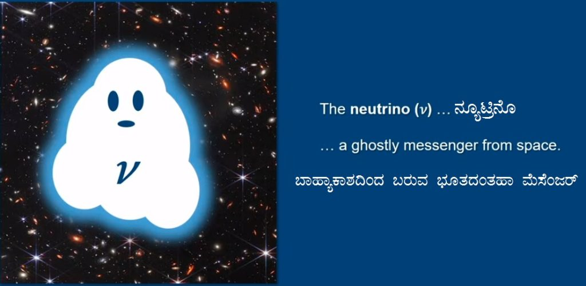
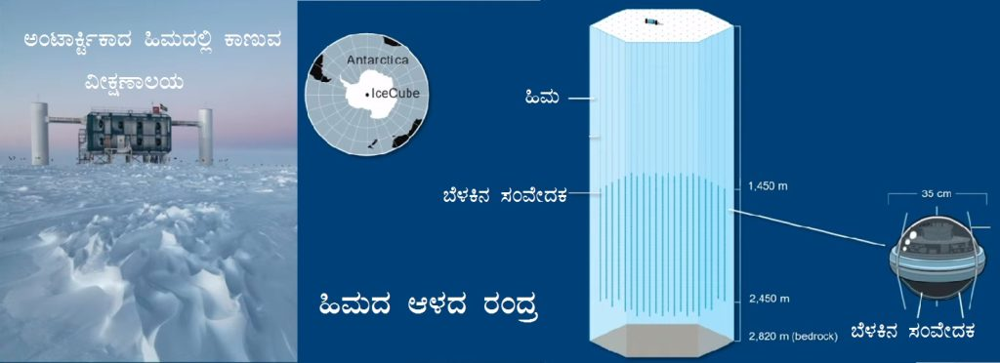
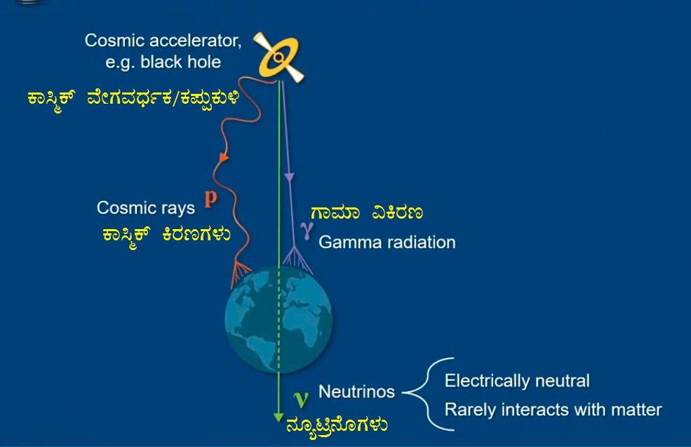
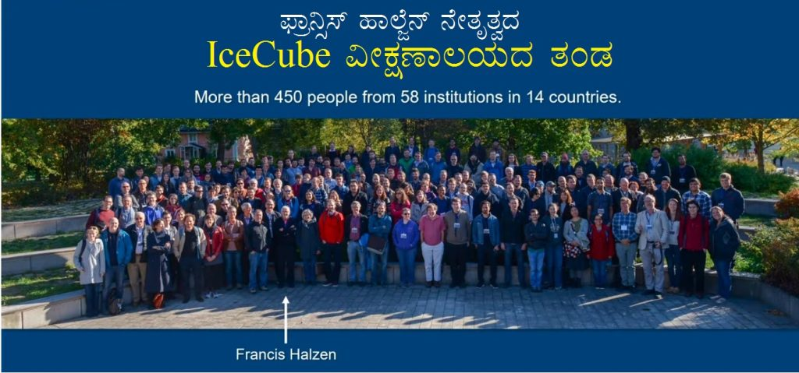

ಭೌತವಿಜ್ಞಾನದ ನೊಬೆಲ್‌ ಪುರಸ್ಕೃತ ಸಂಶೋಧನೆಗಳು ಹಲವಾರು ಬಾರಿ ಅತ್ಯಂತ ರಹಸ್ಯವಾದ, ಅನುಭಕ್ಕೆ ಸುಲಭವಾಗಿ ದಕ್ಕದ ಸಂಗತಿಗಳನ್ನು ಒಳಗೊಂಡಿರುತ್ತವೆ. ವಸ್ತು ಅಥವಾ ದ್ರವ್ಯದ ಮೂಲ ಕಣಗಳ, ಅವುಗಳ ವರ್ತನೆಗಳ ಅಥವಾ ಅವು ಉಂಟುಮಾಡುವ ವಿಚಿತ್ರಗಳ ವೈಜ್ಞಾನಿಕತೆಯು ಸಹಜವಾಗಿ ರಹಸ್ಯಮಯವಾಗಿರುತ್ತದೆ. ಈ ವರ್ಷ 2026ರ ಪ್ರಶಸ್ತಿಯು ಕಣ ಭೌತವಿಜ್ಞಾನ ಹಾಗೂ ಖಗೋಳವಿಜ್ಞಾನಗಳೆರಡರ ಸಮ್ಮಿಳನದ ಅತ್ಯಂತ ಮಹತ್ವಾಕಾಂಕ್ಷೆಯ ಸಾದ್ಯತೆಗೆ ಸಂದಿದೆ. ನ್ಯೂಟ್ರಿನೊ ಖಗೋಳ ವಿಜ್ಞಾನ (Neutrino Astronomy) ಎಂಬ ಹೊಸ ವಿಜ್ಞಾನದ ಶಾಖೆಯ ಹುಟ್ಟಿಗೆ ಕಾರಣವಾಗಿದೆ. ಇದೆಲ್ಲದರ ಪರಿಕಲ್ಪನೆ ಮತ್ತು ಪ್ರಾಯೋಗಿಕ ಸಾಕ್ಷಾತ್ಕಾರದ ಹರಿಕಾರ ಬೆಲ್ಜಿಯಂ ಸಂಜಾತ ಅಮೆರಿಕದ ನಿವಾಸಿ ಫ್ರಾನ್ಸಿಸ್ ಹಾಲ್ಜೆನ್ (Francis Halzen).

ಈಗಷ್ಟೇ ಪ್ರಸ್ತಾಪಿಸಿದಂತೆ ಇದೂ ಕೂಡ ಅತ್ಯಂತ ರಹಸ್ಯಮಯವಾದ, ಅನುಭವಕ್ಕೆ ದಕ್ಕದ ಸಂಗತಿಯೇ! ಇದನ್ನು ವಿವರವಾಗಿ ತಿಳಿಯಲು, ಮೊದಲು ನ್ಯೂಟ್ರಿನೊಗಳು ಎಂದರೇನು? ಅವು ಹೇಗಿವೆ? ಎಷ್ಟು ಬಗೆಯಲ್ಲಿವೆ? ಮುಂತಾಗಿ ಅರಿಯುವ ಮೂಲಕ ಆರಂಭಿಸಬೇಕಿದೆ. ಆನಂತರದ ಅವುಗಳ ಪತ್ತೆ ಹಚ್ಚುವ ಸಂಕೀರ್ಣ ಸಾಹಸದ ವಿವರಗಳನ್ನು ತಿಳಿಯಬಹುದು.

ನ್ಯೂಟ್ರಿನೋಗಳು ಈ ಬ್ರಹ್ಮಾಂಡದಲ್ಲಿ ನಿರಂತರವಾಗಿ ಹಾದು ಹೋಗುತ್ತಿರುವ ಅತ್ಯಂತ ಚಿಕ್ಕದಾದ ಮೂಲಭೂತ ಕಣಗಳು. ಅವುಗಳನ್ನು ಕಾಣುವುದಿರಲಿ, ಅನುಭವಿಸಲೂ ಸಾಧ್ಯವೇ ಆಗದ್ದರಿಂದ ಭೂತ (Ghost) ದಂತಹ ಕಣಗಳು ಎಂದು ಕರೆಯುವುದುಂಟು. ಅವುಗಳ ಅಗಾಧತೆ ಎಷ್ಟೆಂದರೆ ಪ್ರತಿ ಸೆಕೆಂಡಿಗೆ ಕೇವಲ ನಮ್ಮ ಹೆಬ್ಬೆರಳ ಉಗುರಿನಷ್ಟು ಜಾಗದ ಮೂಲಕ ಸುಮಾರು ೬೫ ಶತಕೋಟಿ ನ್ಯೂಟ್ರಿನೊಗಳು ಹಾದುಹೋಗುತ್ತವೆ. ಆದರೂ ಒಂದನ್ನೂ ನಾವು ಪತ್ತೆ ಹಚ್ಚಲು ಆಗದು. ಅವುಗಳಿಗೆ ಯಾವುದೇ ವಿದ್ಯುತ್ ಆವೇಶ (Charge) ಕೂಡ ಇರುವುದಿಲ್ಲ ಮತ್ತು ದ್ರವ್ಯರಾಶಿ ಕೂಡ, ಇಲ್ಲವೆನೋ ಅನ್ನುವಷ್ಟು ಕಡಿಮೆ ಇದ್ದು ಬೆಳಕಿನ ವೇಗದಲ್ಲಿ ಚಲಿಸುತ್ತವೆ.

ಅವುಗಳಲ್ಲಿ ಚಾರ್ಜ್‌ ಇಲ್ಲದಿರುವುದರಿಂದ, ವಿದ್ಯುತ್ಕಾಂತೀಯ (Electromagnetic Force) ಬಲಕ್ಕೂ ಕೂಡ ಒಳಗಾಗುವುದಿಲ್ಲ. ಅಲ್ಲದೆ ಯಾವುದೇ ವಸ್ತು ಅಥವಾ ದ್ರವ್ಯದ ಮೂಲಕ ನಿಲ್ಲದಂತೆ ಹಾದು ಹೋಗುತ್ತವೆ. ಅತ್ಯಂತ ದುರ್ಬಲವಾದ ಪರಮಾಣು ಬಲದ (Weak Nuclear Force) ಮೂಲಕ ಮಾತ್ರವೇ ಪರಸ್ಪರ ಕ್ರಿಯೆ ನಡೆಸುತ್ತವೆ. ಇವು ಎಲೆಕ್ಟ್ರಾನ್ (Electron), ಮ್ಯೂವಾನ್ (Muon) ಮತ್ತು ಟೌ (Tau) ಎಂಬ ಮೂರು ಬಗೆಗಳಲ್ಲಿ (ಅಥವಾ 'ಫ್ಲೇವರ್‌'ಗಳಲ್ಲಿ) ಕಂಡುಬರುತ್ತವೆ. ಇವು ಬಾಹ್ಯಾಕಾಶದಲ್ಲಿ ಚಲಿಸುವಾಗ ಒಂದು ಬಗೆಯಿಂದ ಮತ್ತೊಂದು ಬಗೆಗೆ ಬದಲಾಗುತ್ತಲೇ ಇರುತ್ತವೆ. ಇದನ್ನು 'ನ್ಯೂಟ್ರಿನೊ ಆಂದೋಲನ' (Neutrino Oscillation) ಎಂದು ಕರೆಯಲಾಗುತ್ತದೆ.

ಹಾಗಾದರೆ ಇವುಗಳು ಎಲ್ಲಿಂದ ಬರುತ್ತವೆ? ಸೂರ್ಯನಲ್ಲಿ ಉಂಟಾಗುವ ಪರಮಾಣು ಸಮ್ಮಿಲನ ಕ್ರಿಯೆ (Nuclear Fusion) ಯಿಂದ ಫೋಟಾನ್‌ಗಳು ಮತ್ತು ನ್ಯೂಟ್ರಿನೊಗಳು ಪ್ರವಾಹ ರೂಪದಲ್ಲಿ ಹೊರ ಹೊಮ್ಮುತ್ತವೆ. ಫೋಟಾನ್‌ಗಳು ಬೆಳಕನ್ನು ಸೂಸಿದರೆ, ನ್ಯೂಟ್ರಿನೊಗಳು ಇಡೀ ವಿಶ್ವಾದ್ಯಂತ ಪ್ರವಹಿಸುತ್ತಲೇ ಇರುತ್ತವೆ. ಅಲ್ಲದೆ ಕಾಸ್ಮಿಕ್‌ ಮೂಲದಿಂದಲೂ ಸೂಪರ್‌ನೋವಾದಲ್ಲಿ, ಕಾಸ್ಮಿಕ್‌ ಕಿರಣಗಳಿಂದ ಹೆಚ್ಚಿನ ಶಕ್ತಿಯ ನ್ಯೂಟ್ರಿನೊಗಳು ಪ್ರವಹಿಸುತ್ತಲೇ ಇರುತ್ತವೆ. ಭೂಮಂಡಲದಲ್ಲೂ ವಿಕಿರಣ ಸೂಸುವಿಕೆಯಲ್ಲಿ, ಪರಮಾಣು ರಿಯಾಕ್ಟರ್‌ಗಳು (Nuclear Reactors) ಮತ್ತು ಕಣ ವೇಗವರ್ಧಕ (Particle Accelerators)ಗಳೂ ಕೂಡ ನ್ಯೂಟ್ರಿನೊಗಳನ್ನು ಉತ್ಪಾದಿಸುತ್ತವೆ.

ಫ್ರಾನ್ಸಿಸ್ ಹಾಲ್ಜೆನ್ ಅವರ ಸಂಶೋಧನೆಯನ್ನು ನ್ಯೂಟ್ರಿನೋ ಖಗೋಳ ವಿಜ್ಞಾನದ ಆರಂಭಕ್ಕೆ ಕಾರಣವಾಗಿದೆ, ಎಂದು ಒಂದೇ ಮಾತಿನಲ್ಲಿ ಹೇಳುವುದು ಸುಲಭ! ಅವರು ಅದನ್ನು ಪರಿಕಲ್ಪಿಸಿ, ಪ್ರಾಯೋಗಿಕವಾಗಿ ಸಾಕ್ಷಾತ್ಕರಿಸಿದ ರೀತಿ ಮಾತ್ರ ಸಂಕೀರ್ಣವೂ, ಮಹತ್ವಾಕಾಂಕ್ಷೆಯ ಸಾಧ್ಯತೆಯೂ ಆಗಿದೆ. ಏಕೆಂದರೆ ಅದರ ಅಂತಿಮ ಪ್ರಯೋಗವನ್ನು ದಕ್ಷಿಣ ಧ್ರುವದ ಕೆಳಗೆ ಹರಡಿಕೊಂಡಿರುವ ಅಪಾರ ಪ್ರಮಾಣದ ಹಿಮವನ್ನು ಸುಮಾರು 3 ಕಿಮೀ ಕೊರೆದು ಆಳದಲ್ಲಿ ಪತ್ತೆ ಹಚ್ಚುವ ಪ್ರಾಯೋಗಿಕ ವಿಧಾನದ ಆವಿಷ್ಕಾರವನ್ನು ಒಳಗೊಂಡಿದೆ. ಇದೆಲ್ಲವೂ ಮುಂದೆ ಐಸ್‌ಕ್ಯೂಬ್ ನ್ಯೂಟ್ರಿನೊ ವೀಕ್ಷಣಾಲಯದ (IceCube Neutrino Observatory) ಸ್ಥಾಪನೆಗೆ ಕಾರಣವಾಗಿದೆ. ಇದೆಲ್ಲದರ ದಶಕಗಳ ಕಾಲದ ಬದ್ಧತೆಯ ಸಾಧನೆಗೆ ಪ್ರೊ. ಫ್ರಾನ್ಸಿಸ್ ಹಾಲ್ಜೆನ್ ಅವರಿಗೆ ಭೌತವಿಜ್ಞಾನದ ನೊಬೆಲ್‌ ಪುರಸ್ಕಾರ ನೀಡಲಾಗಿದೆ. ಅವರ ಪರಿಕಲ್ಪನೆಯಿಂದ ಪ್ರಾಯೋಗಿಕ ಪಯಣದ ವಿವರಗಳನ್ನು ಒಂದೊಂದಾಗಿ ಮುಂದೆ ನೋಡೋಣ.

ಅಗೋಚರವಾಗಿರುವ ಈ ಕಣಗಳು ವಿಶ್ವದಲ್ಲಿ ನಡೆಯುವ ಕೆಲವು ಅತ್ಯಂತ ತೀವ್ರವಾದ, ಭಯಾನಕ ರೌದ್ರ ಘಟನೆಗಳ ಬಗ್ಗೆ ಅಮೂಲ್ಯ ಮಾಹಿತಿಯನ್ನು ಹೊತ್ತು ತರುವ ನ್ಯೂಟ್ರಿನೊಗಳನ್ನು ಪತ್ತೆಹಚ್ಚಿದಾಗ, ಅವು ಹುಟ್ಟಿಕೊಂಡಿರುವ ಅತ್ಯಂತ ಹಿಂಸಾತ್ಮಕ ಅಥವಾ ತೀವ್ರ ರೌದ್ರಮಯ ಪರಿಸರಗಳತ್ತ ಹಿಂದಿರುಗಿ ಆಲೋಚಿಸಿ ಅರಿಯಲು ನೋಡಲು ವಿಜ್ಞಾನಿಗಳಿಗೆ ಸಾಧ್ಯವಾಗುತ್ತದೆ. ಇಂತಹಾ ಕಾಸ್ಮಿಕ್‌ ಸಂಗತಿಗಳ ಸಂದೇಶಗಳನ್ನು ತಿಳಿವಿಗೆ ತರಲು ನೆರವಾಗುತ್ತದೆ.

## ಕಣ ಭೌತವಿಜ್ಞಾನದಿಂದ ನ್ಯೂಟ್ರಿನೊ ಖಗೋಳವಿಜ್ಞಾನದವರೆಗೆ

ಫ್ರಾನ್ಸಿಸ್ ಹಾಲ್ಜೆನ್ ಬೆಲ್ಜಿಯಂನಲ್ಲಿ ಹುಟ್ಟಿ ಬೆಳೆದರು. 1960ರ ದಶಕದಲ್ಲಿ ಕಣ ಭೌತವಿಜ್ಞಾನದಿಂದ ಆಕರ್ಷಿತರಾಗಿ ಕ್ವಾರ್ಕ್‌ (Quarks) ಗಳಿಂದ ನಿರ್ಮಿತವಾದ ಭಾರವಾದ ಕಣಗಳ ಅಧ್ಯಯನದಲ್ಲಿ ತೊಡಗಿದ್ದರು. ಅದರಲ್ಲಿ ಪಿಎಚ್.ಡಿ. ಪೂರ್ಣಗೊಳಿಸಿದ ನಂತರ ಅವರು ಅಮೆರಿಕದ ವಿಸ್ಕಾನ್‌ಸಿನ್‌ ವಿಶ್ವವಿದ್ಯಾಲಯ (University of Wisconsin–Madison) ಬಂದು ನೆಲೆಯಾದರು. ಅಲ್ಲಿ ಬಾಹ್ಯಾಕಾಶದಿಂದ ಭೂಮಿಯನ್ನು ತಲುಪುವ ಕಣಗಳು, ಕಣ ಭೌತವಿಜ್ಞಾನಕ್ಕೆ ಎಷ್ಟು ಮಹತ್ವದ ಮಾಹಿತಿಯನ್ನು ನೀಡಬಲ್ಲವು ಎಂಬುದನ್ನು ಹಾಲ್ಜೆನ್ ಅರಿತುಕೊಂಡರು. ಜೊತೆಗೆ ಆಗಲೇ, ಕಣ ಭೌತವಿಜ್ಞಾನದಿಂದ ಖಗೋಳಭೌತವಿಜ್ಞಾನವೂ ಪ್ರಯೋಜನ ಪಡೆಯಬಹುದು ಎಂಬುದನ್ನು ಅವರು ಅರ್ಥಮಾಡಿಕೊಂಡರು. ವಿಶ್ವದಾದ್ಯಂತ ನಿರಂತರವಾಗಿ ಸಂಚರಿಸುವ ಕಣಗಳನ್ನು ಒಟ್ಟಾಗಿ ಕಾಸ್ಮಿಕ್‌ ಕಿರಣಗಳು (Cosmic Rays) ಎಂದು ಕರೆಯಲಾಗುತ್ತದೆ. ಅವುಗಳಲ್ಲಿ ಬಹುಪಾಲು ಪ್ರೋಟಾನ್‌ಗಳು — ಅಂದರೆ ಹೈಡ್ರೋಜನ್ ಪರಮಾಣುವಿನ ನ್ಯೂಕ್ಲಿಯಸ್‌ಗಳು, ಅವು ಬೆಳಕನ್ನು ಸೂಸುತ್ತವೆ, ಉಳಿದವು ನ್ಯೂಟ್ರಿನೊಗಳು! ಇವು ಅಚ್ಚರಿ ಎನ್ನುವಷ್ಟು ಅಪಾರ ಶಕ್ತಿಯನ್ನು ಹೊಂದಿರುತ್ತವೆ. ಅವುಗಳ ಶಕ್ತಿ ಭೂಮಿಯಲ್ಲಿರುವ ಮಾನವ ನಿರ್ಮಿತ ಕಣ ವೇಗವರ್ಧಕಗಳ ಶಕ್ತಿಗಿಂತಲೂ ತುಂಬಾ ಹೆಚ್ಚಾಗಿರಬಹುದು. ಈ ಶಕ್ತಿಯುತ ಕಾಸ್ಮಿಕ ಕಿರಣಗಳು ಎಲ್ಲಿಂದ ಬರುತ್ತವೆ ಎಂಬುದು ದೀರ್ಘಕಾಲದಿಂದ ವಿಶ್ವದ ದೊಡ್ಡ ರಹಸ್ಯಗಳಲ್ಲಿ ಒಂದು. ಅವುಗಳನ್ನು ಪತ್ತೆ ಹಚ್ಚಿ ಮೂಲವನ್ನು ಹಿಂದಿರುಗಿ ಊಹಿಸಲು ಸಾಧ್ಯವಾಗುವುದರಿಂದ ಫ್ರಾನ್ಸಿಸ್‌ ನ್ಯೂಟ್ರಿನೊಗಳ ಬೇಟೆಗಾಗಿ ಹುಡುಕಾಟ ಆರಂಭಿಸಿದರು.

ಭೌತವಿಜ್ಞಾನದ ನಿಯಮದಂತೆ, ಪ್ರೋಟಾನ್‌ಗಳನ್ನು ಇಷ್ಟೊಂದು ಅಪಾರ ಶಕ್ತಿಗೆ ವೇಗಗೊಳಿಸುವ ಪ್ರಕ್ರಿಯೆಗಳಲ್ಲಿಯೇ ಹೆಚ್ಚಿನ ಶಕ್ತಿಯ ನ್ಯೂಟ್ರಿನೋಗಳೂ ಉತ್ಪತ್ತಿಯಾಗಬೇಕು. ಆದ್ದರಿಂದ ನ್ಯೂಟ್ರಿನೋಗಳು ಈ ನೈಸರ್ಗಿಕ ಕಾಸ್ಮಿಕ್‌ ಕಣ ವೇಗವರ್ಧಕಗಳಾದ, ಸೂಪರ್‌ನೋವಾ ಮುಂತಾದ ನಕ್ಷತ್ರಗಳ ಸಾವು ಮುಂತಾದವುಗ ಬಗ್ಗೆ ಮಹತ್ವದ ಸುಳಿವುಗಳನ್ನು ನೀಡಬಲ್ಲವು. ಈ ಅತ್ಯಂತ ಹೆಚ್ಚಿನ ಶಕ್ತಿಯ ನ್ಯೂಟ್ರಿನೋಗಳನ್ನು ಗುರುತಿಸಲು ಸಾಧ್ಯವಾದರೆ, ಅವುಗಳನ್ನು ಸೂರ್ಯನಿಂದ, ಅಥವಾ ವಿಕಿರಣಶೀಲ ಪದಾರ್ಥಗಳಿಂದ ಅಥವಾ ಭೂಮಿಯ ವಾತಾವರಣದಲ್ಲಿ ಕಾಸ್ಮಿಕ ಕಿರಣಗಳ ಪರಸ್ಪರ ಕ್ರಿಯೆಯಿಂದ ಉತ್ಪತ್ತಿಯಾಗುವ ಕಡಿಮೆ ಶಕ್ತಿಯ ನ್ಯೂಟ್ರಿನೊಗಳಿಂದ ಪ್ರತ್ಯೇಕಿಸಬಹುದು. ಅಂತಹ ಹೆಚ್ಚಿನ ಶಕ್ತಿಯ ನ್ಯೂಟ್ರಿನೊಗಳು ಬಹಳ ದೂರದ ಮತ್ತು ರೌದ್ರಾವತಾರದ, ಹಿಂಸಾತ್ಮಕ ಬಾಹ್ಯಾಕಾಶ ಕ್ರಿಯೆಗಳ -ಉದಾಹರಣೆಗೆ ಸ್ಫೋಟಗೊಂಡ ನಕ್ಷತ್ರಗಳ ಪ್ರದೇಶಗಳಿಂದ ಅಥವಾ ಕಪ್ಪು ಕುಳಿಗಳಿಂದ, ಅಥವಾ ಸಕ್ರಿಯ ಗೆಲಾಕ್ಸಿಗಳಿಂದ ಬಂದಿರಬಹುದು. ಆಗ ನಮ್ಮ ಬ್ರಹ್ಮಾಂಡ ಅರಿವು ವಿಸ್ತಾರವಾಗುತ್ತದೆ.

ಈ ಪರಿಕಲ್ಪನೆಗೆ ನ್ಯೂಟ್ರಿನೊಗಳ ಊಹೆಯೇನೂ ಹೊಸತಾಗಿರಲಿಲ್ಲ. ಹಿಂದೆಯೇ 1930ರಲ್ಲಿ ವುಲ್ಫ್‌ಗ್ಯಾಂಗ್‌ ಪೌಲಿ (Wolfgang Pauli) ಎಂಬ ಭೌತವಿಜ್ಞಾನಿಯು ಪತ್ತೆ ಹಚ್ಚಲಾಗದ ಕಣಗಳ ಇರುವಿಕೆಯನ್ನು ಊಹಿಸಿದ್ದರು. ಅವರಿಗೆ 1945ರ ನೊಬೆಲ್‌ ಪುರಸ್ಕಾರ ಕೂಡ ಸಂದಿತ್ತು. ನಂತರದಲ್ಲಿ 1933ರ ಸಾಲ್ವೆ ಸಮ್ಮೇಳನದಲ್ಲಿ (Solvay Conference) ಎನ್ರಿಕೊ ಫರ್ಮಿ ಯಾವುದೇ ಚಾರ್ಜ್‌ ಇಲ್ಲದ ಇದನ್ನು ನ್ಯೂಟ್ರಿನೊ ಎಂದು ಕರೆದಿದ್ದರು. ಮುಂದೆ 1956ರಲ್ಲಿ ಅವುಗಳನ್ನು ಪ್ರಾಯೋಗಿಕವಾಗಿ ಪತ್ತೆಹಚ್ಚಿ ಪೌಲಿಯ ಊಹೆಯನ್ನು ಸತ್ಯ ಮಾಡಿದ್ದವರು ಕ್ಲೈಡ್‌ ಕೊವನ್‌ (Clyde Cowan) ಮತ್ತು ಫ್ರೆಡೆರಿಕ್‌ ರೆನೀಸ್‌ (Frederick Reines). ಅದಕ್ಕವರು ಬಾಹ್ಯಾಕಾಶದ ಅದ್ಭುತ ಮಾಹಿತಿಗಾರನೆಂದೇ ಕರೆದಿದ್ದರು. ಅವರಿಗೂ ೧೯೯೫ರಲ್ಲಿ ನೊಬೆಲ್‌ ಪ್ರಶಸ್ತಿಯನ್ನು ಕೊಡಲಾಗಿತ್ತು.

## ಪತ್ತೆ ಹಚ್ಚಲು ಹಿಮವನ್ನು ಬಳಸುವ ಆಲೋಚನೆ

1980ರ ದಶಕದಲ್ಲಿ ಹಾಲ್ಜೆನ್ ಕಾಸ್ಮಿಕ ಕಣಗಳ ಕುರಿತು ಸಂಶೋಧನೆ ನಡೆಸುತ್ತಿದ್ದಾಗ, ಸೋವಿಯತ್ ಸಂಶೋಧಕರು ಅಂಟಾರ್ಕ್ಟಿಕಾದಲ್ಲಿ ನ್ಯೂಟ್ರಿನೊ ಸಂಕೇತಗಳನ್ನು ಪತ್ತೆಹಚ್ಚಲು ರೇಡಿಯೋ ರಿಸೀವರ್‌ಗಳನ್ನು ಬಳಸುತ್ತಿದ್ದಾರೆ ಎಂದು ಅವರಿಗೆ ತಿಳಿಯಿತು. ಏಕೆಂದರೆ ನ್ಯೂಟ್ರಿನೊ ಯಾವುದಾದರೂ ವಸ್ತು ಅಥವಾ ದ್ರವ್ಯದ ಪರಮಾಣುವಿನ ನ್ಯೂಕ್ಲಿಯಸ್‌ಗೆ ಡಿಕ್ಕಿ ಹೊಡೆದಾಗ ವಿದ್ಯುತ್ ಪರಿಣಾಮ ಉಂಟಾಗಬಹುದು ಮತ್ತು ಅದರ ಪರಿಣಾಮವಾಗಿ ರೇಡಿಯೋ ತರಂಗವೂ ಉತ್ಪತ್ತಿಯಾಗಬಹುದು. ಫ್ರಾನ್ಸಿಸ್‌ ಹಾಲ್ಜೆನ್ ಇದರಿಂದ ಪ್ರೇರಿತರಾಗಿ, ನ್ಯೂಟ್ರಿನೊಗಳ ಡಿಕ್ಕಿಯಿಂದ ಉಂಟಾಗುವ ಸಣ್ಣ ಬೆಳಕಿನ ಹೊಳಪುಗಳನ್ನು ಪತ್ತೆಹಚ್ಚುವುದು ಇನ್ನೊಂದು ಮಾರ್ಗವಾಗಬಹುದು ಎಂದು ಅವರು ಅರಿತರು.

ಕೆಲವು ಭೌತವಿಜ್ಞಾನಿಗಳು ಬಾಹ್ಯಾಕಾಶದಿಂದ ಬರುವ ನ್ಯೂಟ್ರಿನೋಗಳನ್ನು ಪತ್ತೆಹಚ್ಚಲು ನೀರು ಉತ್ತಮ ಮಾಧ್ಯಮವಾಗಬಹುದು ಎಂದು ಸೂಚಿಸಿದ್ದರು. ಏಕೆಂದರೆ ನ್ಯೂಟ್ರಿನೊ ಒಂದು ಪರಮಾಣುವಿನ ನ್ಯೂಕ್ಲಿಯಸ್‌ಗೆ ಅಪರೂಪವಾಗಿ ಡಿಕ್ಕಿ ಹೊಡೆದಾಗ, ವಿದ್ಯುತ್‌ಭಾರ ಹೊಂದಿರುವ ಕಣವೊಂದು ಉತ್ಪತ್ತಿಯಾಗುತ್ತದೆ. ಅದು ಮೂಲ ನ್ಯೂಟ್ರಿನೋ ಚಲಿಸಿದ ದಿಕ್ಕಿನಲ್ಲಿಯೇ ಚಲಿಸುತ್ತಾ ನೀಲಿ ಬೆಳಕನ್ನು ಹೊರಸೂಸುತ್ತದೆ. ನೀರು ಪಾರದರ್ಶಕವಾಗಿರುವುದರಿಂದ ಈ ಬೆಳಕನ್ನು ಪತ್ತೆಹಚ್ಚುವುದು ಸುಲಭ. ಬೆಳಕಿನ ಚಲನೆಯ ದಿಕ್ಕನ್ನು ಗುರುತಿಸುವ ಮೂಲಕ ನ್ಯೂಟ್ರಿನೊ ಯಾವ ದಿಕ್ಕಿನಿಂದ ಬಂದಿದೆ ಎಂಬುದನ್ನು ನಿರ್ಧರಿಸಬಹುದು. ಇದಕ್ಕಾಗಿ ಅತ್ಯಂತ ದೊಡ್ಡ ಪ್ರಮಾಣದ ಪಾರದರ್ಶಕ ವಸ್ತು ಅಗತ್ಯವಿತ್ತು, ಏಕೆಂದರೆ ನ್ಯೂಟ್ರಿನೋಗಳ ಪರಸ್ಪರ ಕ್ರಿಯೆಗಳು ಅತ್ಯಂತ ಅಪರೂಪ. ಅದಕ್ಕಾಗಿ ಹಾಲ್ಜೆನ್ ನೀರಿನ ಬದಲು ನೈಸರ್ಗಿಕವಾಗಿ ದೊರೆಯುವ ಅಂಟಾರ್ಕ್ಟಿಕಾದ ಹಿಮವನ್ನು ಬಳಸುವ ಆಲೋಚನೆಯನ್ನು ಮುಂದಿಟ್ಟರು.

## ಏಕೆ ದಕ್ಷಿಣ ಧ್ರುವ? ಮತ್ತು ಹಿಮದ ಉಪಯೋಗವೇನು?

ದಕ್ಷಿಣ ಧ್ರುವದಲ್ಲಿ ವೀಕ್ಷಣಾಲಯ ನಿರ್ಮಿಸುವುದರಿಂದ ಹಲವಾರು ಅನುಕೂಲಗಳಿದ್ದವು. ಸಾಕಷ್ಟು ಆಳದಲ್ಲಿರುವ ಹಿಮವು ಅತ್ಯಂತ ಶಾಂತವಾದ ಪತ್ತೆಹಚ್ಚುವ ಪರಿಸರವನ್ನು ಒದಗಿಸುತ್ತದೆ. ಅಲ್ಲಿ ನಿರಂತರವಾದ ಕತ್ತಲು ಇರುತ್ತದೆ. ಸಮುದ್ರ ನೀರಾದರೆ ಜೀವಿಗಳಿಂದ ಅಡ್ಡಿ ಇರುತ್ತದೆ. ಹಿಮವು ಸ್ಥಿರವಾಗಿದ್ದು, ಸಂವೇದಕಗಳನ್ನು ಅಳವಡಿಸಲು ಸೂಕ್ತವಾಗಿದ್ದು, ಆಳದಲ್ಲಿ ಬೆಳಕನ್ನು ಗ್ರಹಿಸಲು ಅನುಕೂಲ ಎಂದು ಆಲೋಚಿಸಿದ್ದರು. ಅಲ್ಲದೆ ಪ್ರದೇಶ ಭೂವೈಜ್ಞಾನಿಕವಾಗಿಯೂ ಸ್ಥಿರವಾಗಿತ್ತು. ಹಾಲ್ಜೆನ್ ಅವರ ಆಲೋಚನೆಗೆ ವಿವಿಧ ಸಂಸ್ಥೆಗಳ ಸಂಶೋಧಕರಲ್ಲಿ ಆಸಕ್ತಿ ಹೆಚ್ಚಿ, ಕ್ರಮೇಣ ಒಂದು ತಂಡ ರೂಪುಗೊಂಡು, ಹಿಮದ ಆಳದಲ್ಲಿ ಉಪಕರಣಗಳನ್ನು ಅಳವಡಿಸುವ ಪ್ರಾಯೋಗಿಕ ಸಮಸ್ಯೆಗಳನ್ನು ಪರಿಹರಿಸಲು ಆರಂಭಿಸಿತು.

ಮೊದಲ ಹೆಜ್ಜೆಯಾಗಿ ಹಿಮನದಿತಜ್ಞರ ಸಹಾಯದಿಂದ, ಬಿಸಿನೀರನ್ನು ಬಳಸಿ ಹಿಮವನ್ನು ಕರಗಿಸಿ ಒಂದು ಕಿಲೋಮೀಟರ್‌ಗಿಂತಲೂ ಹೆಚ್ಚು ಆಳದ ರಂಧ್ರಗಳನ್ನು ಕೊರೆಯುವ ಸಾಹಸ. ನಂತರ ಬೆಳಕಿನ ಸಂವೇದಕಗಳನ್ನು ಹೊಂದಿರುವ ಉದ್ದವಾದ ಕೇಬಲ್‌ಗಳನ್ನು ಆ ರಂಧ್ರಗಳೊಳಗೆ ಇಳಿಸಿ ಬೆಳಕನ್ನು ಅಥವಾ ನ್ಯೂಟ್ರಿನೊಗಳ ಸ್ಪಂದನವನ್ನು ಸಂವೇದಕಗಳಲ್ಲಿ ಹಿಡಿಯುವ ಆಲೋಚನೆ! ಉತ್ತರವಾಗಿ ದಕ್ಷಿಣ ಧ್ರುವದಲ್ಲಿ ಐಸ್‌ಕ್ಯೂಬ್‌(IceCube)‌ನ ವೀಕ್ಷಣಾಲಯದ ನಿರ್ಮಾಣ ಆರಂಭವಾಯಿತು.

ಸುಮಾರು 1,400 ಮೀಟರ್‌ಗಿಂತ ಹೆಚ್ಚಿನ ಆಳದಲ್ಲಿ ಹಿಮ ಅತ್ಯಂತ ಶುದ್ಧ ಮತ್ತು ಪಾರದರ್ಶಕವಾಗಿರುವುದರಿಂದ ಅಷ್ಟೂ ಆಳಕ್ಕೆ ಕೊರೆದು ಪ್ರಯೋಗಕ್ಕೆ ಮೊದಲಾಯಿತು. ಅಲ್ಲಿ ನ್ಯೂಟ್ರಿನೊಗಳ ಪರಸ್ಪರ ಕ್ರಿಯೆಯಿಂದ ಉಂಟಾಗುವ ಬೆಳಕು ಸುಮಾರು 300 ಮೀಟರ್‌ಗಳಷ್ಟು ದೂರ ಪ್ರಯಾಣಿಸಬಲ್ಲದು ಎಂದು ಕಂಡುಬಂತು. ಅಂತೂ ದೊಡ್ಡದಾದ **IceCube‌ನ** ವೀಕ್ಷಣಾಲಯ ಉದಯವಾಯಿತು.

ಇಲ್ಲಿ ಒಂದು ಘನ ಕಿಲೋಮೀಟರ್ ಹಿಮದೊಳಗೆ ನಿರ್ಮಿಸಲಾದ ಬೃಹತ್ ನ್ಯೂಟ್ರಿನೊ ಪತ್ತೆಹಚ್ಚುವ ವ್ಯವಸ್ಥೆಯಾಗಿದೆ. 2011ರಲ್ಲಿ ಅದು ಪೂರ್ಣವಾಗಿ, ಅದರೊಳಗೆ ಒಟ್ಟು 86 ಕೇಬಲ್‌ಗಳಲ್ಲಿ 5,160 ಬೆಳಕಿನ ಸಂವೇದಕಗಳನ್ನು ಅಳವಡಿಸಲಾಗಿದೆ. ಅವು ಭೂಮಿಯ ಮೇಲ್ಮೈಯಿಂದ ಸುಮಾರು 1,450ರಿಂದ 2,450 ಮೀಟರ್‌ಗಳಷ್ಟು ಆಳದಲ್ಲಿವೆ.

IceCube ಪತ್ತೆಹಚ್ಚುವ ಪ್ರತಿಯೊಂದು ಸಂಕೇತವೂ ಬಾಹ್ಯಾಕಾಶದಿಂದ ಬಂದ ನ್ಯೂಟ್ರಿನೋದದ್ದೇ ಆಗಿರಲಿಲ್ಲ. ಭೂಮಿಯ ವಾತಾವರಣಕ್ಕೆ ಪ್ರವೇಶಿಸುವ ಕಾಸ್ಮಿಕ ಕಿರಣಗಳಿಂದ ಅಪಾರ ಸಂಖ್ಯೆಯ ಕಣಗಳು ಉತ್ಪತ್ತಿಯಾಗುತ್ತವೆ. ಅಂತವೆಲ್ಲವನ್ನೂ ಬೇರ್ಪಡಿಸಿ ಅಪರೂಪದ ನ್ಯೂಟ್ರಿನೊಗಳನ್ನು 2013ರಲ್ಲಿ IceCube ತಂಡವು ಪತ್ತೆಹಚ್ಚಿದ್ದಕ್ಕೆ ಮೊದಲ ದೃಢವಾದ ಸಾಕ್ಷ್ಯವನ್ನು ಪ್ರಕಟಿಸಿತು. ಮುಂದಿನ ಕೆಲವು ವರ್ಷಗಳಲ್ಲಿ ಹೆಚ್ಚಿನ ಮಾಹಿತಿಯನ್ನು ಸಂಗ್ರಹಿಸಿದ ನಂತರ ತಮ್ಮ ಆವಿಷ್ಕಾರದ ಬಗ್ಗೆ ವಿಜ್ಞಾನಿಗಳು ಖಚಿತವಾದರು.

## ನ್ಯೂಟ್ರಿನೊಗಳು ಈಗಾಗಲೇ ನಮಗೆ ಕಲಿಸಿರುವುದು

IceCube‌ಗಿಂತ ಬಹಳ ಹಿಂದೆಯೇ ನ್ಯೂಟ್ರಿನೊ ಖಗೋಳವಿಜ್ಞಾನದ ಆರಂಭವಾಗಿತ್ತು. 1960ರ ದಶಕದಲ್ಲಿ ಸೂರ್ಯನಿಂದ ಪ್ರವಹಿಸುವ ನ್ಯೂಟ್ರಿನೊಗಳನ್ನು ಮುಂದೆ 1987ರಲ್ಲಿ ಸೂಪರ್‌ನೋವಾದಿಂದ ಬಂದ ನ್ಯೂಟ್ರಿನೊಗಳ ಪ್ರವಾಹವನ್ನು ದಾಖಲಿಸಲಾಗಿತ್ತು. ಆ ಸೂಪರ್‌ನೋವಾದ ಮೂಲದ ನಮ್ಮ ನೆರೆಯ ಗೆಲಾಕ್ಸಿಯಾಗಿತ್ತು. ಈ ಸಂಶೋಧನೆಗಳು ನ್ಯೂಟ್ರಿನೋಗಳನ್ನು ಬಳಸಿ ಬಾಹ್ಯಾಕಾಶದ ವಿದ್ಯಮಾನಗಳನ್ನು ಅಧ್ಯಯನ ಮಾಡಬಹುದು ಎಂಬುದನ್ನು ತೋರಿಸಿಕೊಟ್ಟವು. ನಂತರ ವಿಜ್ಞಾನಿಗಳು ನ್ಯೂಟ್ರಿನೋಗಳಿಗೆ ಮೂರು ವಿಧಗಳಿವೆ ಮತ್ತು ಅವು ಪ್ರಯಾಣಿಸುವಾಗ ನ್ಯೂಟ್ರಿನೋ ಆಸಿಲೇಶನ್‌ನಿಂದಾಗಿ ಒಂದು ವಿಧದಿಂದ ಮತ್ತೊಂದು ವಿಧಕ್ಕೆ ಬದಲಾಗಬಲ್ಲವು ಎಂಬುದು ಗೊತ್ತಾಗಿತ್ತು. ಹೀಗಾಗಿ ನ್ಯೂಟ್ರಿನೊಗಳು ಸೂರ್ಯನ ಒಳಭಾಗದಲ್ಲಿ ನಡೆಯುವ ಪ್ರಕ್ರಿಯೆಗಳನ್ನು ಮತ್ತು ಸೂಪರ್‌ನೋವಾಗಳಲ್ಲಿನ ವಿದ್ಯಮಾನಗಳನ್ನು ಅರ್ಥಮಾಡಿಕೊಳ್ಳಲು ವಿಜ್ಞಾನಿಗಳಿಗೆ ಸಹಾಯ ಮಾಡಿವೆ.

ನ್ಯೂಟ್ರಿನೊಗಳು ದೂರದ ಮತ್ತು ಅಡಗಿರುವ ಕಾಸ್ಮಿಕ್‌ ಪರಿಸರಗಳ ಬಗ್ಗೆ ವಿಶಿಷ್ಟ ಮಾಹಿತಿಯನ್ನು ನೀಡಬಲ್ಲವು. IceCube‌ನ ಪ್ರಮುಖ ಗುರಿಗಳಲ್ಲಿ ಒಂದು, ಆಕಾಶದಲ್ಲಿರುವ ನ್ಯೂಟ್ರಿ‌ನೊಗಳ ನಿರ್ದಿಷ್ಟ ಮೂಲಗಳನ್ನು ಗುರುತಿಸುವುದಾಗಿದೆ. IceCube‌ನ ಕಥೆ ಇಲ್ಲಿಗೆ ಮುಗಿದಿಲ್ಲ. ಇದು ವಿಶ್ವವನ್ನು ನೋಡುವ ಒಂದು ಸಂಪೂರ್ಣ ಹೊಸ ಕಿಟಕಿಯನ್ನು ಈಗಾಗಲೇ ತೆರೆದಿದೆ. ನ್ಯೂಟ್ರಿನೊ ಸಂಶೋಧನೆಯ ಮಹತ್ವ ಅದರ ಪತ್ತೆಹಚ್ಚುವಿಕೆಯಲ್ಲಷ್ಟೇ ಇಲ್ಲ. ಈ ಕಣಗಳು ವಿಶ್ವದ ಧೂಳಿನ ಮೋಡಗಳ ಹಿಂದೆ ಅಡಗಿರುವ ಪ್ರದೇಶಗಳಿಂದ, ಅತ್ಯಂತ ದೂರದ ವಸ್ತುಗಳಿಂದ ಮತ್ತು ವಿಶ್ವದ ಅತ್ಯಂತ ಹಿಂಸಾತ್ಮಕ ಘಟನೆಗಳಿಂದ ಮಾಹಿತಿಯನ್ನು ಹೊತ್ತು ತರಬಲ್ಲವು.

ಸಾಂಪ್ರದಾಯಿಕ ಖಗೋಳವಿಜ್ಞಾನವು ಮುಖ್ಯವಾಗಿ ಬೆಳಕು, ರೇಡಿಯೋ ತರಂಗಗಳು, ಗಾಮಾ ಕಿರಣಗಳು ಮುಂತಾದ ವಿದ್ಯುತ್ಕಾಂತೀಯ ವಿಕಿರಣಗಳ ಮೂಲಕ ವಿಶ್ವವನ್ನು ಅಧ್ಯಯನ ಮಾಡುತ್ತದೆ. ನ್ಯೂಟ್ರಿನೊ ಖಗೋಳವಿಜ್ಞಾನವು ಇದಕ್ಕೆ ಸಂಪೂರ್ಣ ವಿಭಿನ್ನವಾದ ಹೊಸ ಸಂದೇಶವಾಹಕವನ್ನು ಸೇರಿಸಿದೆ.

ಕಣ ಭೌತವಿಜ್ಞಾನ, ಖಗೋಳವಿಜ್ಞಾನ, ಇಂಜಿನಿಯರಿಂಗ್, ಹಿಮನದಿ ವಿಜ್ಞಾನಶಾಸ್ತ್ರ ಮತ್ತು ಅಂತರರಾಷ್ಟ್ರೀಯ ವೈಜ್ಞಾನಿಕ ಸಹಕಾರ—ಇವೆಲ್ಲವೂ ಒಂದಾಗಿ ಕೆಲಸ ಮಾಡಿದಾಗ ಒಂದು ಅದ್ಭುತ ವೈಜ್ಞಾನಿಕ ಸಾಧನೆ ಸಾಧ್ಯವಾಗಿದೆ. ಪ್ರೊ. ಫ್ರಾನ್ಸಿಸ್‌ ಇಡೀ ಯೋಜನೆಯನ್ನು ಸುಮಾರು ಮೂರು ದಶಕಗಳಿಗೂ ಹೆಚ್ಚು ಕಾಲ ಹತ್ತಾರು ದೇಶಗಳ ನೂರಾರು ವಿಜ್ಞಾನಿಗಳ ಒಟ್ಟಾರೆಯ ಸಹಕಾರದ ಕೈಜೋಡಣೆಯಲ್ಲಿ ನಿರ್ವಹಿಸಿ ಸಾಧನೆಗೈಯ್ದಿದ್ದಾರೆ. 1980ರ ದಶಕದ ಒಂದು ಸೈದ್ಧಾಂತಿಕ ಆಲೋಚನೆಯಿಂದ ಆರಂಭವಾದ ಪ್ರಯಾಣ ಮುಂದುವರಿದು, ಕೊನೆಗೆ ನಾಲ್ಕು ನೂರಕ್ಕೂ ಹೆಚ್ಚಿನ ತಂಡವಾಗಿ ಒಂದು ಘನ ಕಿಲೋಮೀಟರ್ ಹಿಮದೊಳಗೆ ಸಾವಿರಾರು ಸಂವೇದಕಗಳನ್ನು ಹೊಂದಿರುವ IceCube ವೀಕ್ಷಣಾಲಯವಾಗಿ ರೂಪುಗೊಂಡಿದೆ.

ಫ್ರಾನ್ಸಿಸ್ ಹಾಲ್ಜೆನ್ ಅವರ ಮೂಲ ಆಲೋಚನೆ ಹೀಗಾಗಿ ಕೇವಲ ಹಿಮದೊಳಗೆ ಸಂವೇದಕಗಳನ್ನು ಇಡುವ ಯೋಜನೆಯಾಗಿರಲಿಲ್ಲ. ಅದು ವಿಶ್ವವನ್ನು ನೋಡುವ ಹೊಸ ವಿಧಾನಕ್ಕೆ ಬಾಗಿಲು ತೆರೆಯುವ ಆಲೋಚನೆಯಾಗಿತ್ತು.

ಅಗೋಚರವಾಗಿರುವ ಕಣಗಳನ್ನು ಹಿಡಿಯುವ ಮೂಲಕ, ವಿಶ್ವದ ಅತ್ಯಂತ ಶಕ್ತಿಯುತ ಮತ್ತು ರಹಸ್ಯಮಯ ಘಟನೆಗಳು ಎಲ್ಲಿ ಮತ್ತು ಹೇಗೆ ಸಂಭವಿಸುತ್ತವೆ ಎಂಬುದನ್ನು ಮಾನವಕುಲವು ಮುಂದೊಂದು ದಿನ ಇನ್ನಷ್ಟು ಸ್ಪಷ್ಟವಾಗಿ ಅರ್ಥಮಾಡಿಕೊಳ್ಳಬಹುದು. ಅಂಟಾರ್ಕ್ಟಿಕಾದ ಹಿಮದ ಆಳದಲ್ಲಿ ಅಡಗಿರುವ IceCube, ವಾಸ್ತವವಾಗಿ ವಿಶ್ವದ ಅತ್ಯಂತ ದೂರದ ಮತ್ತು ರಹಸ್ಯಮಯ ಪ್ರದೇಶಗಳನ್ನು ನೋಡುವ ಒಂದು ಹೊಸ ರೀತಿಯ **“ದೂರದರ್ಶಕ”** ವಾಗಿದೆ.

ನಮಸ್ಕಾರ

ಡಾ. ಟಿ.ಎಸ್.‌ ಚನ್ನೇಶ್
