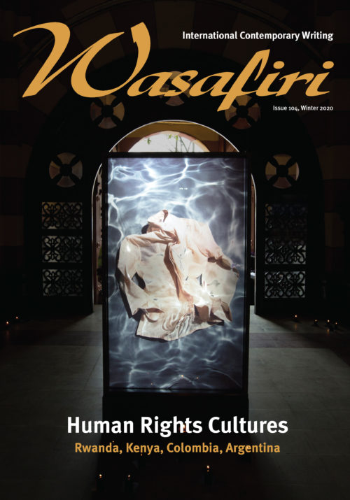
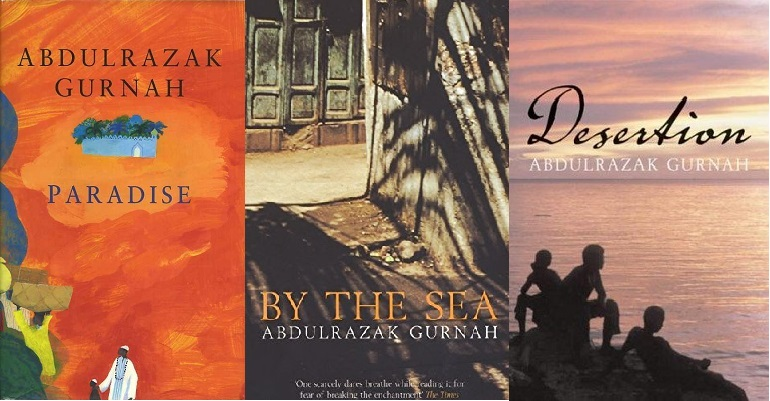

ಈ ವರ್ಷದ-೨೦೨೧ರ ಸಾಹಿತ್ಯದ ನೊಬೆಲ್‌ ಪುರಸ್ಕಾರವನ್ನು ತಾಂಜೇನಿಯಾದ, ಪ್ರಸ್ತುತ ಇಂಗ್ಲಂಡಿನಲ್ಲಿ ನೆಲೆಸಿರುವ ಇಂಗ್ಲಿಷ್‌ ಕಾದಂಬರಿಕಾರ ಅಬ್ದುಲ್‌ ರಜಾಕ್‌ ಗುರ್ನ್ಹಾ ಅವರಿಗೆ ನೀಡಲಾಗಿದೆ. ಪ್ರಮುಖರಾದ ಆಫ್ರಿಕನ್‌ ಮೂಲದ ಬರಹಗಾರರಲ್ಲಿ ಒಬ್ಬರಾದ ಅಬ್ದುಲ್‌ ರಜಾಕ್‌ ಅವರು ತಾಂಜೇನಿಯಾದ ಜಂಜ಼ಬರ್‌ ನಲ್ಲಿ ಜನಿಸಿದರು. ಗುರ್ನ್ಹಾ ಅವರು 1968ರಲ್ಲಿ ತಮ್ಮ ಇಪ್ಪತ್ತನೆಯ ವಯಸ್ಸಿನಲ್ಲಿ ವಿದ್ಯಾರ್ಥಿಯಾಗಿ ಬ್ರಿಟನ್‌ಗೆ ಬಂದವರು ಅಲ್ಲೇ ನೆಲೆಯಾಗಿದ್ದಾರೆ.

ಲಂಡನ್‌ ವಿಶ್ವವಿದ್ಯಾಲಯದ ಪದವಿಗಳನ್ನು ಪಡೆದ ಅಬ್ದುಲ್‌ ರಜಾಕ್‌ ಮುಂದೆ, ಕೆಂಟ್‌ ವಿಶ್ವವಿದ್ಯಾಲಯದಿಂದ ಪಿಎಚ್‌.ಡಿ. ಪದವಿಯನ್ನು 1982ರಲ್ಲಿ ಪಡೆದರು. ನಂತರದ ಕೆಲಕಾಲ ನೈಜಿರಿಯಾದಲ್ಲಿ ಇಂಗ್ಲಿಷ್‌ ಸಾಹಿತ್ಯವನ್ನು ಬೋಧಿಸಿದ ಅವರು ಮುಂದೆ ಕೆಂಟ್‌ ವಿಶ್ವವಿದ್ಯಾಲಯಕ್ಕೆ ವಾಪಾಸಾದರು. ಈಗ ಅಲ್ಲಿಯೇ ಇಂಗ್ಲಿಷ್‌ ವಿಭಾಗದ ಪ್ರೊಫೆಸರ್‌ ಮತ್ತು ಪದವಿ ಅಧ್ಯಯನಗಳ ನಿರ್ದೇಶಕರಾಗಿದ್ದಾರೆ. ಶೈಕ್ಞಣಿಕ ಆಸಕ್ತಿಯಿಂದ ವಸಾಹತೋತ್ತರ ಅಧ್ಯಯನಗಳಲ್ಲಿ ಆಸಕ್ತರಾದ ಪ್ರೊ. ಗುರ್ನ್ಹಾ, ಆಫ್ರಿಕಾ ಮತ್ತು ಯೂರೋಪಿನ ನಡುವಣ ನಿರಾಶ್ರಿತರ ಬದುಕಿನ ಇತಿಹಾಸ ಮತ್ತು ಭೌಗೋಳಿಕ ವಿಚಾರಗಳ ಶಿಸ್ತು ಬದ್ಧ ಸಂಶೋಧಕರಾಗಿದ್ದಾರೆ. ವಸಾಹತು ಕಾಲದ ನಂತರದ ಅಭಿವೃದ್ಧಿಯ ಬದಲಾವಣೆಗಳಲ್ಲಿ ಪ್ರಮುಖವಾಗಿ ಆಫ್ರಿಕಾ, ಕೆರಿಬ್ಬಿಯನ್‌ ಹಾಗೂ ಇಂಡಿಯಾ ದೇಶಗಳ ವಸಾಹತು ಪ್ರಭಾವಗಳ ಬಗೆಗಿನ ಚರ್ಚೆ ಹಾಗೂ ಸಂಶೋಧನೆಗಳಲ್ಲಿ ತೀವ್ರ ಆಸಕ್ತರಾಗಿದ್ದಾರೆ. ಅವರ ಬಹು ಪಾಲು ಬರಹಗಳೂ ಕೂಡ ನಿರಾಶ್ರಿತರ, ವಲಸೆಗಾರರ ಖಂಡಾಂತರದ ಸಾಂಸ್ಕೃತಿಕ ಚರ್ಚೆಗಳನ್ನೇ ವಸಹಾತುಗಳ ಪ್ರಭಾವದ ಹಿನ್ನಲೆಯಲ್ಲಿ ದಾಖಲಿಸುತ್ತವೆ.

ಪ್ರಸ್ತುತ ವರ್ಷದ ನೊಬೆಲ್‌ ಪುರಸ್ಕಾರದ ಘೋಷಣೆಯಲ್ಲಿಯೂ ಸಹಾ ನೊಬೆಲ್‌ ಸಮಿತಿಯು, **“ವಸಾಹತುಶಾಹಿಯ ಪರಿಣಾಮಗಳಲ್ಲಿ ರಾಜಿಯಾಗದ ಮತ್ತು ಸಹಾನುಭೂತಿಯ ಒಳನೊಟಗಳ”** (Uncompromising and compassionate penetration of the effects of colonialism) ಗೌರವಕ್ಕಾಗಿ ಎಂದೇ ಪ್ರಸ್ತಾಪಿಸಿದೆ. ಅಷ್ಟರ ಮಟ್ಟಿಗೆ ಪ್ರೊ. ಗುರ್ನ್ಹಾ ಅವರದ್ದು ತೀಕ್ಷ್ಣವಾದ ಹಾಗೂ ಮಾನವತೆಯ ಪರವಾದ ಬರಹಗಳಾಗಿವೆ.

ಪ್ರೊ. ಅಬ್ದುಲ್‌ ರಜಾಕ್‌ ಗುರ್ನ್ಹಾ ಅವರು ಈ ವರೆಗೆ ಸುಮಾರು ಹತ್ತು ಕಾದಂಬರಿಗಳನ್ನು ಹೊರ ತಂದಿದ್ದಾರೆ. ಅವುಗಳೆಂದರೆ Memory of Departure (1987), Pilgrims Way (1988), Dottie (1990), Paradise (1994), Admiring Silence (1996), By the Sea (2001), Desertion (2005), The Last Gift (2011), Gravel Heart (2017) ಮತ್ತು Afterlives (2020). ಇವುಗಳಲ್ಲದೆ ಸಣ್ಣ ಕಥೆಗಳ ಸಂಕಲನವನ್ನೂ (_My Mother Lived on a Farm in Africa_ -2006) ಪ್ರಕಟಿಸಿದ್ದಾರೆ. ವಸಾಹತುಕಾಲದ ನಂತರದ ಪ್ರಮುಖ ಸಮಕಾಲೀನ ಬರಹಗಾರರಾದ ವಿ.ಎಸ್‌. ನೈಪಾಲ್‌, ಸಲ್ಮಾನ್‌ ರಶ್ದಿ ಹಾಗೂ ಜೋ಼ ವೈಕೊಂಬ್‌ ಅವರ ಬರಹಗಳ ಕುರಿತ ಸಂಶೋಧನಾ ಪ್ರಬಂಧಗಳನ್ನು ಪ್ರಕಟಿಸಿರುವುದಲ್ಲದೆ, ಅವರ ಸಾಹಿತ್ಯದ ಅಧ್ಯಯನಗಳ ಸಂಶೋಧನಾ ಮಾರ್ಗದರ್ಶವನ್ನೂ ಮಾಡಿದ್ದಾರೆ. _Essays on African Writing_ ಎಂಬುದು ಅವರು ಸಂಪಾದಿಸಿದ ಗ್ರಂಥ.

**Wasafiri** ಎಂಬು ಸಾಹಿತ್ಯಿಕ ಪತ್ರಿಕೆಗೆ 1987ರಿಂದಲೂ contributing editor ಮತ್ತು ಸಲಹಾ ಮಂಡಳಿಯ ಸದಸ್ಯರಾಗಿದ್ದಾರೆ. **Wasafiri** ಯು 1984 ರಿಂದ ಬ್ರಿಟನ್ನಿನಿಂದ ಪ್ರಕಟವಾಗುತ್ತಿರುವ ಸಾಹಿತ್ಯಿಕ ಪತ್ರಿಕೆ (<https://www.wasafiri.org/>). ಈ ಪತ್ರಿಕೆಯ ಹೆಸರನ್ನು ಆಫ್ರಿಕಾದ ಜನಪ್ರಿಯ ಬಂಟು ಭಾಷೆಯಾದ ಸ್ವಾಹಿಲಿ (Swahili)ಯಿಂದ ಪಡೆಯಲಾಗಿದ್ದು ಅದರ ಮೂಲಾರ್ಥವು “ಪ್ರವಾಸಿಗರು” ಎಂಬುದಾಗಿದೆ. ಪ್ರೊ. ಗುರ್ನ್ಹಾ ಪತ್ರಿಕೆಯ ಆರಂಭದಿಂದಲೂ ಜೊತೆಯಲ್ಲಿದ್ದು ಸಹಕರಿಸುತ್ತಿರುವ ಪ್ರಮುಖ ಲೇಖಕರು. ಪ್ರವಾಸಿಗರ ಅದರಲ್ಲೂ ವಲಸೆಯವರ ಹಿತವು ಪಡೆಯುವಲ್ಲಿ ಮಾತ್ರವಲ್ಲದೆ ನೀಡುವಲ್ಲಿಯೂ ಜಾಗೃತ ಆಶಯವನ್ನು ಹೊಂದಿದೆ ಎಂದೇ ದೃಢವಾದ ವಿಶ್ವಾಸವುಳ್ಳ ಬರಹಗಾರರಾಗಿದ್ದಾರೆ. ಹಾಗೆಂದೇ ಭೂಗೋಳ, ಇತಿಹಾಸ, ರಾಜಕೀಯದ ಶೋಷಣೆಯ ಮುಂತಾದ ವಿಚಾರಗಳು ಅವರ ಬರಹಗಳ ಧಾರಾಳವಾದ ಚಿಂತನೆಗಳಾಗಿವೆ. 

ಪ್ರೊ. ಗುರ್ನ್ಹಾ ಅವರ ಕಾದಂಬರಿಗಳಲ್ಲಿ Paradise, By the Sea, ಮತ್ತು Desertion ಅತ್ಯಂತ ಜನಪ್ರಿಯವಾದವು. ನೊಬೆಲ್‌ ಪುರಸ್ಕಾರಕ್ಕೆ ಪಾತ್ರರಾಗುವಲ್ಲಿ ಈ ಮೂರೂ ಕಾದಂಬರಿಗಳ ಸಾಹಿತ್ಯಿಕ ಕೊಡುಗೆ ಅಪಾರವಾಗಿದೆ ಎಂಬುದು ಖ್ಯಾತ ಬರಹಗಾರರ ಹಾಗೂ ನೊಬೆಲ್‌ ಆಸಕ್ತರ ವಿಶ್ವಾಸಾರ್ಹವಾದ ಊಹೆಯಾಗಿದೆ. ಅವರು ಭಾಗವಹಿಸಿ ನಡೆಸಿಕೊಟ್ಟ ಅವರ By the Sea ಕಾದಂಬರಿಯ ಕುರಿತ ವೆಬಿನಾರ್‌ ಚರ್ಚೆಯನ್ನು <https://www.youtube.com/watch?v=fJInO5EfSjE> ಲಿಂಕ್‌ ನಲ್ಲಿ ನೋಡಬಹುದಾಗಿದೆ. ಪ್ರಸ್ತುತ By the Sea ಯು ಅವರ ಬಾಲ್ಯದ ನೆಲೆಯ ಅನುಭವಗಳಿಂದ ವಿಕಾಸಗೊಂಡ ಹಾಗೂ ವಲಸೆಯಾದ ನೆಲೆಯ ಜೀವನ ವಿಶೇಷತೆಗಳ ನಡುವಣ ರಾಜಕೀಯ ಹಾಗೂ ಚಾರಿತ್ರಿಕ ಸಂಬಂಧಗಳ ಕಥನವಾಗಿದೆ. ತಮ್ಮ ವಾಸದ ಮನೆಯ ಕಿಟಕಿಯಿಂದ ಕಾಣುವ ಸಮುದ್ರ ತೀರದ ಹಡುಗಗಳ ಲಂಗರುವಿನ ನೋಟ ಹಾಗೂ ಅಲ್ಲಿನ ಧಾರುಣ ಶೋಷಣೆಯ ವಿವರಗಳನ್ನು ಮಾನವತೆಯ ನಿಷ್ಠೂರದಿಂದ ದಾಖಲಿಸಿದ್ದಾರೆ.

ತಮ್ಮ ಬಹುಪಾಲು ಬರಹಗಳಲ್ಲಿ ಆಫ್ರಿಕಾ ಖಂಡವು ಜೋಡಿಸುವ ಸಾಗರದ ಅಂಚುಗಳ ಮೂಲಕ ಹಾಯ್ದ ಯೂರೋಪಿಯನ್ನರ ಹುಡುಕಾಟದಲ್ಲಿ ನಿರ್ಧಯವಾದ ಪೋರ್ಚುಗೀಸರ ದಾಳಿಗಳನ್ನು ರಾಜಿಮಾಡಿಕೊಳ್ಳದೆ ಚಾರಿತ್ರಿಕ ದಾಖಲೆಯಿಂದ ವರ್ಣಿಸಿದ್ದಾರೆ. ಹಿಂದೂ ಮಹಾ ಸಾಗರವು ಖಂಡಗಳಲ್ಲಿ ಬಂಧಿಯಾಗಿ ಅದರ ಗುಂಟಾ ದಾರಿಯಿರುವ ಬಗೆಗೆ ಯೂರೋಪಿಯನ್ನರ ಪೂರ್ವದ ತಿಳಿವನ್ನು ಪರ್ಷಿಯನ್‌ ಹಾಗೂ ಅರಬ್ಬರ ಮೂಲದಲ್ಲಿ ಚರ್ಚಿಸಿದ್ದಾರೆ. ಹಾಗಾಗಿ ಭಾರತಕ್ಕೆ ನೌಕಾ ಮಾರ್ಗವನ್ನು ಕಂಡುಹಿಡಿದವನು “ವಾಸ್ಕೋಡಿಗಾಮ” ಎಂಬ ಸಾಮಾನ್ಯ ಉತ್ತರಕ್ಕೆ – ಅವನಲ್ಲ ಎಂಬ ಚಾರಿತ್ರಿಕ ದಾಖಲೆಗಳ ವಿವರಗಳಿಂದ ಅರಬ್‌ ಮೂಲದ ಸಾದೃಶ್ಯಗಳನ್ನು ನೀಡುತ್ತಾರೆ. ಅವರ ಕೆಂಟ್‌ ವಿಶ್ವವಿದ್ಯಾಲಯದ THINK KENT ಚರ್ಚೆಗಳಲ್ಲಿ ಅವರ Indian Ocean Journeys ಭಾಷಣವನ್ನು <https://www.youtube.com/watch?v=92YgRBFUevM> ಲಿಂಕ್‌ ನಲ್ಲಿ ನೋಡಬಹುದಾಗಿದೆ. 

ಸ್ವರ್ಗದ ಹೆಸರನ್ನು ಹೊತ್ತ (Paradise)ಕಾದಂಬರಿಯು ಇಪ್ಪತ್ತನೇ ಶತಮಾನದ ತಾಂಜಾನಿಯಾದ ಕಾವಾ ಎಂಬ ಕಾಲ್ಪನಿಕ ಪಟ್ಟಣದಲ್ಲಿ ಜನಿಸಿದ ಯೂಸುಫ್ ಎಂಬ ಹುಡುಗನ ಧಾರುಣ ಕಥೆಯಾಗಿದೆ. ಯೂಸುಫ್ ತಂದೆ ಹೋಟೆಲ್ ಉದ್ಯಮಿಯಾಗಿದ್ದು, ಅಜೀಜ್ ಎಂಬ ಶ್ರೀಮಂತ ಅರಬ್ ವ್ಯಾಪಾರಿಗೆ ಸಾಲಗಾರರಾಗಿರುತ್ತಾರೆ. ಆರಂಭದಲ್ಲಿ ಯೂಸುಫ್ ತನ್ನ ತಂದೆಯ ಸಾಲವನ್ನು ತೀರಿಸಲು ಅಜೀಜ್‌ಗೆ ಗಿರವಿಯಾದ ಹುಡುಗನ ಕಥನವಾಗಿ ಶುರುವಾಗುತ್ತದೆ. ಯಾವುದೇ ಶುಲ್ಕ ಪಡೆಯದ ಸೇವಕನಾಗಿ ಕೆಲಸ ಮಾಡಬೇಕಾದ ಯೂಸುಫ್‌ ಮಧ್ಯ ಆಫ್ರಿಕಾ ಮತ್ತು ಕಾಂಗೋ ಜಲಾನಯನ ಪ್ರದೇಶಗಳಿಗೆ ಪಯಣಿಸುವ ಕಾರವಾನ್‌ ಗೆ ಸೇರಬೇಕಾಗುತ್ತದೆ. ಅಲ್ಲಿನ ಸಂಧರ್ಭದಲ್ಲಿ ಎದುರಿಸುವ ವಿವಿಧ ಕಷ್ಟಗಳ ಚಿತ್ರಣವನ್ನು ಪ್ಯಾರಡೈಸ್‌ ಕಾದಂಬರಿಯು ಚಿತ್ರಿಸುತ್ತದೆ.

ಪ್ರೊ. ಗುರ್ನ್ಹಾ ಅವರು ಓರ್ವ ಕಾದಂಬರಿಕಾರರಾಗಿ ಆಫ್ರಿಕದ ವಸಾಹತು ಕಾಲದ ಶೋಷಣೆ ಮತ್ತು ಅದರ ಸಲುವಾಗಿ ಜೀವನದ ದಬ್ಬಾಳಿಕೆಯ ಚಿತ್ರಣವನ್ನು ಚಾರಿತ್ರಿಕ ಹಿನ್ನಲೆಗಳಿಂದ ಕಟ್ಟಿಕೊಡುತ್ತಾರೆ. ಆ ಕಾಲದಲ್ಲಿ ಹಿಂದೂ ಸಾಗರದ ತೀರಗಳಲ್ಲಿ ಎಂದೂ ಸೈನ್ಯಗಳ ಕಾವಲನ್ನು ಕಾಣದ ನೆಲೆಯಾಗಿದ್ದು ಮುಂದೆ ಪೋರ್ಚುಗೀಸರ ಕಾರಣದಿಂದ ಸೈನ್ಯಗಳ ದಬ್ಬಾಳಿಕೆಯ ಸಹಜತೆಯನ್ನು ಎದುರಿಸಿದ ಮಾನವ ಕ್ಷಣಗಳನ್ನು ಕಥನಗಳಾಗಿಸಿದ್ದಾರೆ. ಓರ್ವ ಬರಹಗಾರರಾಗಿ ಚರಿತ್ರೆಯನ್ನು ತಮ್ಮ ಸಂಶೋಧನಾ ತೀಕ್ಷ್ಣತೆಯಿಂದ ಚಿಕಿತ್ಸಕ ದೃಷ್ಟಿಯಲ್ಲಿ ಕಟ್ಟುವ ಕೆಲಸವನ್ನು ಉತ್ಕೃಷ್ಟವಾಗಿ ನಿಭಾಯಿಸಿದ್ದಾರೆ. ಹಾಗೆಂದೇ ನೊಬೆಲ್‌ ಸಮಿತಿಯೂ ಅವರ ಈ ಗುಣವನ್ನು **“ದಬ್ಬಾಳಿಕೆಯ ವಿರುದ್ಧ ರಾಜಿ ಮಾಡಿಕೊಳ್ಳದ ಹಾಗೂ ಶೋಷಿತರ ಪರವಾಗಿರುವ ಸಹಾನುಭೂತಿಯ ಮನಸ್ಸು”** ಎಂದೇ ವ್ಯಾಖ್ಯಾನಿಸಿ ಪುರಸ್ಕರಿಸಿದೆ.

CPUS ಸಹಾ ಕನ್ನಡಿಗರೆಲ್ಲರ ಪರವಾಗಿ ತನ್ನ ಓದುಗರ ಮೂಲಕ ಪ್ರೊ. ಅಬ್ದುಲ್‌ ರಜಾಕ್‌ ಗುರ್ನ್ಹಾ ಅವರಿಗೆ ಅಭಿನಂದನೆಗಳನ್ನು ಸಲ್ಲಿಸುತ್ತದೆ.

ನಮಸ್ಕಾರ

ಡಾ. ಟಿ.ಎಸ್.‌ ಚನ್ನೇಶ್.‌
