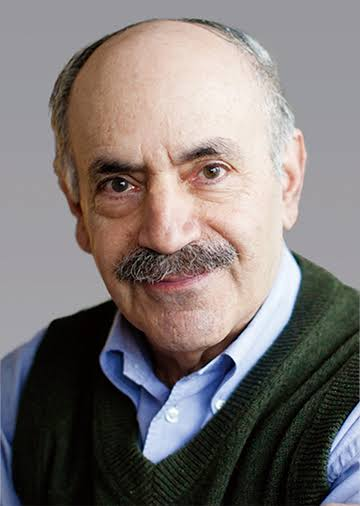
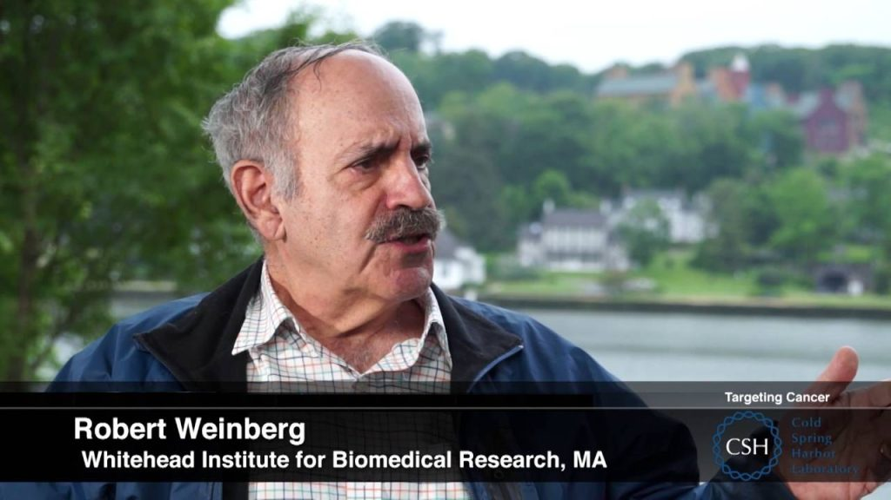
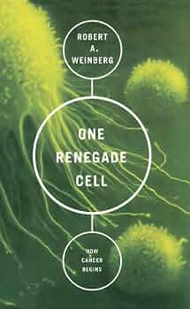
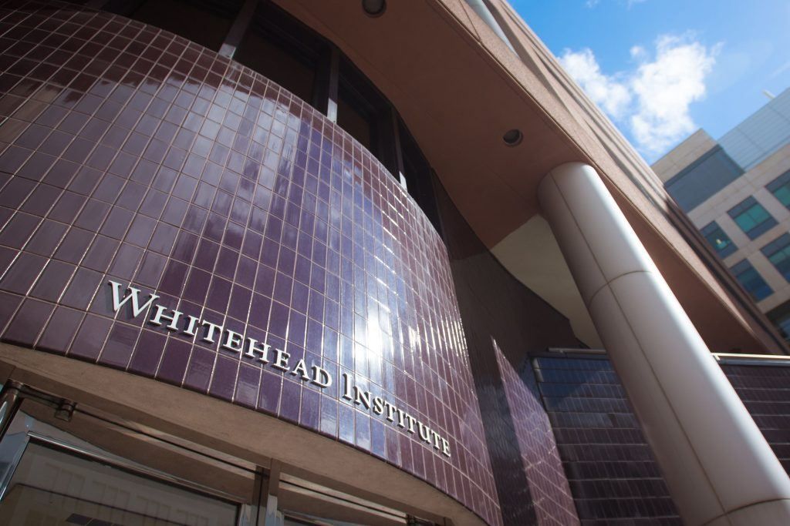

**ಡಾ. ರಾಬರ್ಟ್ ಎ. ವೈನ್‌ಬರ್ಗ್ ಒಬ್ಬ ಜಗತ್ಪ್ರಸಿದ್ಧ ಕ್ಯಾನ್ಸರ್ ಸಂಶೋಧಕ** ಎಂದು ಗೊತ್ತಾಗಿದ್ದು **2018ರಲ್ಲಿ!** ಅಮೆರಿಕದ ಮ್ಯಾಸಾಚುಸೇಟ್ಸ್‌ ಇನ್‌ಸ್ಟಿಟ್ಯೂಟ್‌ ಆಫ್‌ ಟೆಕ್ನಾಲಜಿ (MIT)ಯಲ್ಲಿ ಪ್ರಾಧ್ಯಾಪಕ ಹಾಗೂ ಜಗತ್ಪ್ರಸಿದ್ಧ ಕ್ಯಾನ್ಸರ್ ಜೀವಿವಿಜ್ಞಾನಿ ಎಂಬುದಾಗಿ ಅಷ್ಟೇ.

ಕಾರಣ ಏನು ಅಂದರೆ ಅವರ ಮಹತ್ವದ ಕೃತಿ **One Renegade Cell: The Quest for the Origins of Cancer** ಅನ್ನು ಕನ್ನಡಕ್ಕೆ ಅನುವಾದಿಸುವ ಹುರುಪಿನಲ್ಲಿ ಗೆಳೆಯ ಆಕಾಶ್‌ ಅವರನ್ನು ಸಂಪರ್ಕಿಸಿದ್ದರು. ಇಸ್ರೋದಲ್ಲಿ ಇಂಜನೀಯರ್‌ ಆಗಿರುವ ಉತ್ಸಾಹಿ ಯುವಕನಿಗೆ ಅವರು ಉತ್ತರಿಸಿದ್ದು ಮಾತ್ರವಲ್ಲದೆ, ಆ ಕೃತಿಯ 3 ಪ್ರತಿಗಳನ್ನೂ ಕಳಿಸಿಕೊಟ್ಟಿದ್ದರು. ಅಂತಹಾ ಓರ್ವ ಮಹಾನ್‌ ಮಾನವತಾ ವಿಜ್ಞಾನಿಯನ್ನು ಕನ್ನಡದ ಓದುಗರಿಗೆ ಅವರನ್ನು ಪರಿಚಯಿಸುವ ಕೆಲಸಕ್ಕೆ ಇಷ್ಟು ದಿನಬೇಕಾಯಿತು. ಅಂದ ಹಾಗೆ ಇಂದು ನವೆಂಬರ್‌ 11, ಅವರ ಜನ್ಮ ದಿನ. 1942 ರಲ್ಲಿ ಅಮೆರಿಕೆಯ ಪಿಟ್ಸ್‌ಬರ್ಗ್‌ನಲ್ಲಿ ಜನಿಸಿದ ಅವರೀಗ 84 ತುಂಬಿರುವ ಹೊತ್ತಿನಲ್ಲೂ ಉತ್ಸಾಹದಿಂದ ಸಂಶೋಧನೆಯಲ್ಲಿ ತೊಡಗಿರುವ ಸಾಧಕರನ್ನು ತಿಳಿಸಿಕೊಡುವುದು ಸಂತಸದ ಸಂಗತಿ ಅಲ್ಲದೆ CPUSನ ಜವಾಬ್ದಾರಿ ಕೂಡ ಆಗಿದೆ. ಅವರ **One Renegade Cell** ಪುಸ್ತಕವನ್ನು ನಾನು ಪೂರ್ಣವಾಗಿ ಓದಿರುವೆ ಎಂದು ಹೇಳಲಾರೆ, ಸುಮಾರಾಗಿ ಒಂದಷ್ಟು ಆಸಕ್ತಿಯಿಂದ ಓದಿರುವೆ. ಕಳೆದ ಕೆಲವು ತಿಂಗಳಿಂದ ಬರೆಯಲೇಬೇಕೆಂದು ಅಂದಕೊಂಡ ವಿಶಿಷ್ಟ ವ್ಯಕ್ತಿ ಅವರು.

ಕ್ಯಾನ್ಸರ್‌ ಜೊತೆಗೆ ಬದುಕುತ್ತಿದ್ದೇನೆ ಎಂದು, ದಾರ್ಶನಿಕವಾಗಿ ತಮ್ಮ ವೈಜ್ಞಾನಿಕ ಸಂಶೋಧಕನಾಗಿ ಪರಿಚಯಸಿಕೊಳ್ಳುವ ಅವರನ್ನು ಹಾಗೆಯೇ ಪರಿಚಯಿಸುವ ಪುಟ್ಟ ಪ್ರಯತ್ನ ಇದು. ಅವರು ಮಾಸಾಚುಸೇಟ್ಸ್‌ ಇನ್‌ಸ್ಟಿಟ್ಯೂಟ್‌ ಆಫ್‌ ಟೆಕ್ನಾಲಜಿ (MIT)ಯಲ್ಲಿ ಸ್ನಾತಕ ಪದವಿ ಪಡೆದು, ಅಲ್ಲಿಯೇ 1969ರಲ್ಲಿ Ph.D. ಪದವಿಯನ್ನೂ ಪಡೆದು ಮುಂದೆರಡು ಮೂರು ವರ್ಷಗಳಷ್ಟೇ ಹೊರಗೆ ಕಳೆದವರು. ಮತ್ತದೇ MIT ಗೆ 1972ರಲ್ಲಿ ಮರಳಿ ನೆಲೆಯಾಗಿ ಈವರೆಗೂ ಐದು ದಶಕಗಳಿಗೂ ಮೀರಿ ಸಂಶೋಧನೆ ಮತ್ತು ಬೋಧನೆಯಲ್ಲಿ ನಿರತರಾಗಿದ್ದಾರೆ. ಅವರ ವಿದ್ಯಾಭ್ಯಾಸದ ದಿನಗಳನ್ನೂ ಸೇರಿಸಿದರೆ, ಹೆಚ್ಚೂ-ಕಡಿಮೆ 1960ರಿಂದ ಈವರೆಗೂ MITಯಲ್ಲೇ ಕಳೆದಿದ್ದಾರೆ. ಕಳೆದಿದ್ದಾರೆ ಎನ್ನುವುದಕ್ಕಿಂತಲೂ ಕ್ಯಾನ್ಸರ್‌ ಅಂತಹಾ ಜೀವ ಕಳೆಯುವ ರೋಗಕ್ಕೂ ವೈಜ್ಞಾನಿಕ ತಿಳಿವಳಿಕೆಯ ಕಳೆಯನ್ನು ಹೆಚ್ಚಿಸಿದ್ದಾರೆ. ಈ ಸಾಧನೆಯ ಮೂಲಕವೇ ಅವರು ಪರಿಚಯ ಆಗಬೇಕಾದವರು, ಏಕೆಂದರೆ ಅವರ ಪೋಷಕರು 1938ರ ಸುಮಾರಿಗೆ ಜರ್ಮನಿಯಿಂದ ವಲಸೆ ಬಂದ ನಿರಾಶ್ರಿತರು. ಹಿಟ್ಲರನ ದಾಳಿಯಲ್ಲಿ ಬಂಡೆದ್ದ ಹೊರಬಂದ ಕುಟುಂಬದ ಕೂಸು, ನಮ್ಮೊಳಗಿನ ಬಂಡಾಯಗಾರ ಜೀವಿಕೋಶದ ಒಳಹೊರಗನ್ನು ಎಳೆ-ಎಳೆಯಾಗಿ ಸಂಶೋಧಿಸಿದ ವಿಜ್ಞಾನಿ. ಅವರಿಂದ ಕ್ಯಾನ್ಸರ್‌ನಂತಹಾ ಮಾನವಕುಲದ ಮಹಾ ಮಾರಿಯ ತಿಳಿವು ಹೆಚ್ಚಿದೆ. ಹಾಗೆಂದೇ ಅಂತಹಾ ಸಾಧನೆಯ ವಿವರಗಳಲ್ಲೇ ಅವರ ಜೀವನದ ಪಯಣವಿದೆ.

**ಹೌದು, ಕ್ಯಾನ್ಸರಿನ ಹುಟ್ಟು ಮತ್ತು ವಿಕಾಸವನ್ನು ಒಂದು ಬಂಡಾಯ ಕೋಶದ ಕಥೆ ಎಂದೇ ಕರೆದವರು ರಾಬರ್ಟ್‌ ವೈನ್‌ಬರ್ಗ್‌ - One Renegade Cell: The Quest for the Origins of Cancer. ಬಾಬ್‌ ಎಂದು ಕರೆಯಿಸಿಕೊಳ್ಳುವ ರಾಬರ್ಟ್‌ **ಕ್ಯಾನ್ಸರ್‌ನ ಮೂಲದ ಹುಡುಕಾಟಕ್ಕೆ ಜೀವಿಕೋಶದ ಒಳಗಿನ ಎಲ್ಲವನ್ನೂ ತೆರೆದಿಟ್ಟು ತಿಳಿವಳಿಕೆಯಾಗಿಸಿದ್ದಲ್ಲದೆ, ಅಕ್ಷರ ರೂಪವನ್ನೂ ಕೊಟ್ಟು ಪ್ರಕಟಿಸಿದ್ದಾರೆ. ಅವರ ಮಾತುಗಳೂ ಅಷ್ಟೇ, ಅದೊಂದು ಆತ್ಮೀಯ ಸಂಭಾಷಣೆ ( <https://www.youtube.com/watch?v=zffQOBNVL5U> ). MITಯ ಸಂಪ್ರಾಯಿಕ A Conversation with Scientist ನಲ್ಲಿ ಕಾಣದ್ದನ್ನೆಲ್ಲಾ ಅನುಭವಕ್ಕೆ ತರುವ ಆ ಮೂಲಕ ಸಾಧಕನೊಬ್ಬ ನಮ್ಮವನಾಗುವ ಅನುರಣನಕ್ಕೆ ನೋಡಬಹುದು.

**One Renegade Cell** ಪುಸ್ತಕದ ಪರಿಚಯವನ್ನು ಆಕಾಶ್‌ CPUSನ ವೆಬ್‌ಪುಟದ ಪುಸ್ತಕಯಾನದಲ್ಲಿ ( [https://cfpus.org/one-renegade-cell-ಹಾದಿ-ಹೊರಳಿದ-ಜೀವಿಕೋಶ-ಕ್/](https://cfpus.org/one-renegade-cell-ಹಾದಿ-ಹೊರಳಿದ-ಜೀವಿಕೋಶ-ಕ್/↗) ) ಮಾಡಿದ್ದಾರೆ. ವೈನ್‌ಬರ್ಗ್‌ ಅವರನ್ನು ಕನ್ನಡಿಗರಿಗೆ ಅದರಲ್ಲೂ ವಿಜ್ಞಾನದ ಆಸಕ್ತರಿಗೆ ಪರಿಚಯಿಸಲೇ ಬೇಕು ಎನ್ನುವ ಉತ್ಸಾಹದಲ್ಲಿ ಈ ಮುಂದಿನ ಮಾತುಗಳು. ಇಡೀ ಐದಾರು ದಶಕಗಳ ಜೀವಮಾನ ಸಾಧನೆಯ ವೈಜ್ಞಾನಿಕ ಅನುಸಂಧಾನವನ್ನು ಕೆಲವೇ ನೂರಾರು ಪದಗಳ ಅಕ್ಷರಗಳಲ್ಲಿ ಕೊಡುವ ಸಾಹಸವಲ್ಲ. ಕೇವಲ ಪುಟ್ಟದೊಂದು ಪರಿಚಯವಷ್ಟೇ!

ನಮ್ಮ ನಮ್ಮೆಲ್ಲರ ದೇಹವು ಕೋಟ್ಯಂತರ ಜೀವಿಕೋಶಗಳಿಂದ ನಿರ್ಮಾಣಗೊಂಡಿರುವ ಅದ್ಭುತವಾದ ಜೈವಿಕ ವ್ಯವಸ್ಥೆ. ಅಲ್ಲಿ ಪ್ರತಿಯೊಂದು ಜೀವಿಕೋಶಕ್ಕೂ ತನ್ನದೇ ಆದ ಜವಾಬ್ದಾರಿ, ಕಾರ್ಯವಿಧಾನ ಮತ್ತು ಜೀವಿತಾವಧಿಯಿದೆ. ಯಾವಾಗ ಹುಟ್ಟಬೇಕು, ಯಾವಾಗ ಬೆಳೆಯಬೇಕು, ಯಾವಾಗ ವಿಭಜನೆಯಾಗಬೇಕು ಮತ್ತು ಯಾವಾಗ ತನ್ನ ಜೀವನವನ್ನು ಅಂತ್ಯಗೊಳಿಸಿ ಸಾವನ್ನಪ್ಪಬೇಕು ಎಂಬುದನ್ನು ಈ ಕೋಶಗಳು ನಿರ್ದಿಷ್ಟ ಜೈವಿಕ ಸಂಕೇತಗಳ ಆಧಾರದ ಮೇಲೆ ನಿರ್ಧರಿಸುತ್ತವೆ. ಈ ಎಲ್ಲ ಪ್ರಕ್ರಿಯೆಗಳನ್ನು ನಿಯಂತ್ರಿಸುವುದು ನಮ್ಮ ಜೀವಕೋಶಗಳಲ್ಲಿರುವ DNA ಮತ್ತು ಅದರಲ್ಲಿರುವ ವಂಶವಾಹಿಗಳು (Genes).

ಆದರೆ ಕೆಲವೊಮ್ಮೆ ಈ ವ್ಯವಸ್ಥೆಯಲ್ಲಿ ಏರುಪೇರುಗಳು ಉಂಟಾಗಿ ಅಸಮರ್ಪಕತೆ ಏರ್ಪಡುತ್ತದೆ. ಜೀವಿಕೋಶದ ಆನುವಂಶಿಕ ಮಾಹಿತಿಯಲ್ಲಿ ಬದಲಾವಣೆಗಳು ಸಂಭವಿಸುತ್ತವೆ. ಆಗ ಸಾಮಾನ್ಯವಾಗಿ ದೇಹದ ರಕ್ಷಣಾ ವ್ಯವಸ್ಥೆಗಳು ಇಂತಹ ದೋಷಗಳನ್ನು ಸರಿಪಡಿಸುತ್ತವೆ. ಆದರೆ ಕೆಲವು ಸಂದರ್ಭಗಳಲ್ಲಿ ಈ ನಿಯಂತ್ರಣ ವ್ಯವಸ್ಥೆ ಆಯತಪ್ಪಿ ವಿಫಲವಾಗುತ್ತದೆ. ಆಗ ಒಂದು ಸಾಮಾನ್ಯ ಕೋಶ ತನ್ನ ಸಹಜ ನಿಯಮಗಳನ್ನು ಮೀರಿ ಬೆಳೆಯಲು ಮತ್ತು ನಿರಂತರವಾಗಿ ವಿಭಜನೆಯಾಗಲು ಆರಂಭಿಸುತ್ತದೆ. ಇದೇ ಕ್ಯಾನ್ಸರ್‌ನ ಆರಂಭಿಕ ಹಂತವಾಗಬಹುದು.

ಈ ಅದ್ಭುತವಾದ ಹಾಗೂ ಅಪಾಯಕಾರಿಯೂ ಆದ ಜೈವಿಕ ವಿದ್ಯಮಾನವನ್ನು ಅರ್ಥಮಾಡಿಕೊಳ್ಳಲು ತಮ್ಮ ಜೀವನವನ್ನೇ ಮುಡಿಪಾಗಿಟ್ಟ ವಿಜ್ಞಾನಿಗಳಲ್ಲಿ ಪ್ರಮುಖರಾದವರು **ಪ್ರೊ. ರಾಬರ್ಟ್ ಎ. ವೈನ್‌ಬರ್ಗ್**. ನಮ್ಮೊಳಗೇ ಇರುವ ಸಾಮಾನ್ಯ ಜೀವಿಕೋಶವೊಂದು ತನ್ನ ಬದುಕಿನ ಹಾದಿಯಲ್ಲಿ ದಿಕ್ಕು-ತಪ್ಪಿ _ಹೇಗೆ ಮಾರಕ ಕೋಶವಾಗಿ ಪರಿವರ್ತನೆಯಾಗುತ್ತದೆ ಮತ್ತು ಈ ಪ್ರಕ್ರಿಯೆಯಲ್ಲಿ ವಂಶವಾಹಿಗಳು ಯಾವ ಪಾತ್ರ ವಹಿಸುತ್ತವೆ ಎಂಬುದನ್ನು ಸರಳವಾಗಿ_ _, ವೈಜ್ಞಾನಿಕ ಆಳದ ವಿವರಣೆಗಳನ್ನು ಅವರ ಮಾತಲ್ಲೇ ಓದಬೇಕು, ಅಥವಾ ಕೇಳಬೇಕು. ಅಂತಹಾ_ _ಸ್ವೋಪಜ್ಞ ಬರಹಗಾರ_ _ವಿಜ್ಞಾನಿ_ .

ಕ್ಯಾನ್ಸರ್ ಎನ್ನುವುದು ಕೇವಲ ಒಂದು ಅಂಗದ ಕಾಯಿಲೆಯಲ್ಲ; ಅದು ಮೂಲತಃ ಕೋಶಗಳೊಳಗಿನ ಆನುವಂಶಿಕ ಮತ್ತು ಜೈವಿಕ ನಿಯಂತ್ರಣ ವ್ಯವಸ್ಥೆಯಲ್ಲಿ ಉಂಟಾಗುವ ಸಂಕೀರ್ಣ ಅಸಮತೋಲನ ಎನ್ನುವ ರಾಬರ್ಟ್ ಆಲನ್ ವೈನ್‌ಬರ್ಗ್ ಕ್ಯಾನ್ಸರ್‌ನ ಆಣ್ವಿಕ (ಮಾಲೆಕ್ಯೂಲಾರ್‌) ಜೀವಿವಿಜ್ಞಾನ (Molecular Biology of Cancer) ಕ್ಷೇತ್ರದಲ್ಲಿ ಮಹತ್ವದ ಕೊಡುಗೆ ನೀಡಿದ ಸಂಶೋಧಕರು.

ರಾಬರ್ಟ್ ವೈನ್‌ಬರ್ಗ್‌ 1982ರಲ್ಲಿ MITಯ ವೈಟ್‌ಹೆಡ್ ಇನ್‌ಸ್ಟಿಟ್ಯೂಟ್ ಫಾರ್ ಬಯೋಮೆಡಿಕಲ್ ರಿಸರ್ಚ್ ಸ್ಥಾಪನೆಯಲ್ಲಿಯೂ ಪ್ರಮುಖ ಪಾತ್ರವನ್ನು ವಹಿಸಿದರು. MITಯಲ್ಲಿ ಡೇನಿಯಲ್ ಕೆ. ಲುಡ್ವಿಗ್ ಪ್ರೊಫೆಸರ್ ಫಾರ್ ಕ್ಯಾನ್ಸರ್ ರಿಸರ್ಚ್ ಮತ್ತು ಲುಡ್ವಿಗ್ ಸೆಂಟರ್ ಫಾರ್ ಮಾಲಿಕ್ಯುಲರ್ ಆಂಕಾಲಜಿಯ ನಿರ್ದೇಶಕರೂ ಕೂಡ. ಕ್ಯಾನ್ಸರ್ ಉಂಟುಮಾಡುವಲ್ಲಿ ಮೊಟ್ಟ ಮೊದಲ ಮಾನವ ಆಂಕೋಜೀನ್‌ಗಳ ಗುರುತಿಸುವಿಕೆ ಮತ್ತು ಅದರ ಪ್ರಮುಖ ಟ್ಯೂಮರ್ ಸಪ್ರೆಸರ್ ಜೀನ್‌ಗಳ ಪ್ರತ್ಯೇಕಿಸುವಿಕೆಯಲ್ಲಿ ಅವರು ಮತ್ತವರ ಸಂಶೋಧನಾ ತಂಡದ ಕೊಡುಗೆ ಐತಿಹಾಸಿಕವಾದುದು.

ಅವರ ವೈಜ್ಞಾನಿಕ ಸಾಧನೆಗಳನ್ನು ಗುರುತಿಸಿ 1997ರಲ್ಲಿ ಅಮೆರಿಕದ ನ್ಯಾಷನಲ್ ಮೆಡಲ್ ಆಫ್ ಸೈನ್ಸ್, 2004ರಲ್ಲಿ ವುಲ್ಫ್ ಪ್ರಶಸ್ತಿ ಮತ್ತು 2013ರಲ್ಲಿ ಬ್ರೇಕ್‌ಥ್ರೂ ಪ್ರಶಸ್ತಿ ಸೇರಿದಂತೆ ಅನೇಕ ಪ್ರತಿಷ್ಠಿತ ಗೌರವಗಳನ್ನು ಪಡೆದಿದ್ದಾರೆ. ಜೀವಿವಿಜ್ಞಾನದ 2021ರ ಜಪಾನ್ ಪ್ರಶಸ್ತಿಯನ್ನೂ ಸಹಾ ಪಡೆದಿದ್ದಾರೆ. ವೈನ್‌ಬರ್ಗ್ ಅವರ ವಿಶೇಷತೆ ಎಂದರೆ, ಅವರು ಪ್ರಯೋಗಾಲಯದಲ್ಲಿ ನಡೆಸಿದ ಮೂಲಭೂತ ಸಂಶೋಧನೆಗಳನ್ನು ಕ್ಯಾನ್ಸರ್‌ನ ಸ್ವರೂಪವನ್ನು ಅರ್ಥಮಾಡಿಕೊಳ್ಳಲು ಎಲ್ಲವನ್ನೂ ಒಂದು ವಿಶಾಲವಾದ ವೈಜ್ಞಾನಿಕ ಚೌಕಟ್ಟಿಗೆ ಜೋಡಿಸಿಕೊಟ್ಟ ವಿವರಗಳು ಎನ್ನಬಹುದು.

ವೈನ್‌ಬರ್ಗ್ ಅವರು ತಮ್ಮ ಕ್ಯಾನ್ಸರ್ ಸಂಶೋಧನೆಯ ಆಸಕ್ತಿ ಮತ್ತು ಇತಿಹಾಸವನ್ನು ವಿವರಿಸುವಾಗ ಪ್ರಮುಖವಾಗಿ, ರಾಸಾಯನಿಕ ವಸ್ತುಗಳು, ವಿಕಿರಣ, ವೈರಸ್‌ಗಳು, ವಂಶವಾಹಿಗಳಲ್ಲಿನ ಬದಲಾವಣೆಗಳು ಮತ್ತು ಕೋಶ ವಿಭಜನೆಯ ನಿಯಂತ್ರಣದ ವೈಫಲ್ಯಗಳು ಕ್ಯಾನ್ಸರ್ ಬೆಳವಣಿಗೆಯಲ್ಲಿ ಹೇಗೆ ಪಾತ್ರವಹಿಸುತ್ತವೆ ಎಂಬುದನ್ನು ಎಳೆ ಎಳೆಯಾಗಿ ತೆರೆದಿಡುತ್ತಾರೆ.

ವೈನ್‌ಬರ್ಗ್ ಅವರ ಸಂಶೋಧನೆಗಳು ಕ್ಯಾನ್ಸರ್ ಅನ್ನು ಜೀನ್‌ಗಳ ಮಟ್ಟದಲ್ಲಿ ಅರ್ಥಮಾಡಿಕೊಳ್ಳುವಲ್ಲಿ ಮಹತ್ವದ ದಿಕ್ಕನ್ನು ತೋರಿಸಿದೆ. ಕ್ಯಾನ್ಸರ್ ಅನ್ನು ಅರ್ಥಮಾಡಿಕೊಳ್ಳಲು ಮೊದಲು DNA ಮತ್ತು ಜೀನ್‌ಗಳ ಕಾರ್ಯವಿಧಾನವನ್ನು ತಿಳಿದುಕೊಳ್ಳಬೇಕು. ಪ್ರತಿಯೊಂದು DNA ಬದಲಾವಣೆಯೇನೂ ಕ್ಯಾನ್ಸರ್‌ಗೆ ಕಾರಣವಾಗುವುದಿಲ್ಲ. ಆದರೆ ಜೀವಿಕೋಶದ ನಿರ್ದಿಷ್ಟ ಜೀನ್‌ಗಳಲ್ಲಿ ಸಂಭವಿಸುವ ಬದಲಾವಣೆಗಳು, ಅವುಗಳ ಪರಸ್ಪರ ಪರಿಣಾಮಗಳು ಮತ್ತು ಕೋಶದ ಪರಿಸರ ಪ್ರಮುಖವಾಗಿ ಕ್ಯಾನ್ಸರ್‌ ಗೆ ಕಾರಣವಾಗುತ್ತದೆ. ಮತ್ತೂ ಕೆಲವು ಸಂದರ್ಭಗಳಲ್ಲಿ DNAಯಲ್ಲಿ ಮ್ಯೂಟೇಷನ್‌ಗಳು (Mutations) ಸಂಭವಿಸುತ್ತವೆ. ಇವು DNAಯಲ್ಲಿನ ಅನುಕ್ರಮದಲ್ಲಿ ಕೆಲವು ಬದಲಾವಣೆಗಳನ್ನು ಉಂಟುಮಾಡುತ್ತದೆ. ಇಂತಹ ಬದಲಾವಣೆಗಳು ಕೋಶದ ಸಹಜ ಕಾರ್ಯನಿರ್ವಹಣೆಯ ಮೇಲೆ ಪರಿಣಾಮ ಬೀರಬಹುದು. ಇದನ್ನೆಲ್ಲಾ ವಿವರಿಸುವ ಅವರದ್ದೇ ಶೋಧನೆಯಾದ ಆಂಕೋಜೀನ್‌ಗಳು (Oncogenes) ಮತ್ತು ಟ್ಯೂಮರ್ ಸಪ್ರೆಸರ್ ಜೀನ್‌ಗಳು (Tumor Suppressor Genes) ಕುರಿತ ವಿವರಣೆಯು ತಿಳಿವು ಅವರ ಅತ್ಯಂತ ಪ್ರಮುಖ ವೈಜ್ಞಾನಿಕ ಕೊಡುಗೆ.

ಸಾಮಾನ್ಯ ಕೋಶಗಳಲ್ಲಿ ಪ್ರೋಟೋ-ಆಂಕೋಜೀನ್‌ಗಳು (Proto-oncogenes) ಎಂಬ ಜೀನ್‌ಗಳಿರುತ್ತವೆ. ಇವು ಕೋಶದ ಬೆಳವಣಿಗೆ, ವಿಭಜನೆ ಮತ್ತು ಬದುಕುಳಿಯುವಿಕೆಯನ್ನು ನಿಯಂತ್ರಿಸಲು ಸಹಾಯ ಮಾಡುತ್ತವೆ. ಆದರೆ ಇಂತಹ ಜೀನ್‌ಗಳಲ್ಲಿ ಏನಾದರೂ ಕೆಲವು ನಿರ್ದಿಷ್ಟ ಬದಲಾವಣೆಗಳು ಸಂಭವಿಸಿದಾಗ ಅವು ಆಂಕೋಜೀನ್‌ಗಳಾಗಿ (Oncogenes) ಕೆಲಸ ಮಾಡಬಹುದು. ಆಗಲೇ ರೋಗದ ಸಾಧ್ಯತೆಯ ಹುಟ್ಟು! ಸರಳವಾಗಿ ಹೇಳುವುದಾದರೆ, ವಾಹನದ ವೇಗವನ್ನು ನಿಯಂತ್ರಿಸುವ ಆಕ್ಸಿಲರೇಟರ್ ಇದ್ದಂತೆ, ಪ್ರೋಟೋ-ಆಂಕೋಜೀನ್‌ಗಳು ಕೋಶದ ಬೆಳವಣಿಗೆಯನ್ನು ನಿಯಂತ್ರಿಸುತ್ತವೆ. ಆದರೆ ಆಕ್ಸಲರೇಟರನ್ನು ಹೆಚ್ಚು ಕೊಟ್ಟರೆ ಇನ್ನೂ ವೇಗವಾಗಿ ಹೋಗುವಂತೆ, ಒಂದುವೇಳೆ ಅವುಗಳ ಚಟುವಟಿಕೆ ಅಸಹಜವಾಗಿ ಹೆಚ್ಚಾದರೆ ಕೋಶವು ಅನಿಯಂತ್ರಿತವಾಗಿ ಬೆಳೆಯಲು ಪ್ರಾರಂಭಿಸಬಹುದು. ಇದರ ಪರಿಣಾಮವಾಗಿ ಕೋಶ ವಿಭಜನೆ ಮತ್ತು ಬೆಳವಣಿಗೆಯ ಮೇಲೆ ನಿಯಂತ್ರಣ ತಪ್ಪಿ ಉಂಟಾಗುವುದೇ ಕ್ಯಾನ್ಸರ್‌. 1979ರಿಂದ 1981ರ ಅವಧಿಯಲ್ಲಿ ವೈನ್‌ಬರ್ಗ್ ಮತ್ತು ಅವರ ಸಹೋದ್ಯೋಗಿಗಳ ಸಂಶೋಧನೆಗಳು ಮಾನವ ಕ್ಯಾನ್ಸರ್‌ಗೆ ಸಂಬಂಧಿಸಿದ ಆಂಕೋಜೀನ್‌ ಅನ್ನು ಗುರುತಿಸಿದವು.

ಆಂಕೋಜೀನ್‌ಗಳು ಕೋಶದ ಬೆಳವಣಿಗೆಯನ್ನು ಉತ್ತೇಜಿಸುವ ಪಾತ್ರ ವಹಿಸಿದರೆ, ಟ್ಯೂಮರ್ ಸಪ್ರೆಸರ್ ಜೀನ್‌ಗಳು ಕೋಶದ ಬೆಳವಣಿಗೆಯನ್ನು ನಿಯಂತ್ರಿಸುವ ಮತ್ತು ಅಸಹಜ ಕೋಶಗಳ ವಿರುದ್ಧ ರಕ್ಷಣಾತ್ಮಕ ಪಾತ್ರ ವಹಿಸುವ ಜೀನ್‌ಗಳಾಗಿವೆ. ಇವು ಕೋಶ ವಿಭಜನೆಯನ್ನು ನಿಯಂತ್ರಿಸುತ್ತವೆ, DNA ಹಾನಿಯನ್ನು ಗುರುತಿಸಲು ಕೂಡ ನೆರವಾಗುತ್ತವೆ ಅಲ್ಲದೆ ಅಗತ್ಯವಿದ್ದಾಗ ಕೋಶದ ಸ್ವಯಂನಾಶಕ್ಕೆ (Apoptosis) ಸಹಾಯ ಮಾಡುತ್ತವೆ. ಈ ಕ್ಷೇತ್ರದಲ್ಲಿ ವೈನ್‌ಬರ್ಗ್ ಅವರ ಸಂಶೋಧನೆಯು ಜೀನ್‌ನ ಗುರುತಿಸುವಿಕೆ ಮತ್ತು ಪ್ರತ್ಯೇಕಿಸುವಿಕೆಯ ಮೂಲಕ ಮಹತ್ವದ ಪಾತ್ರ ವಹಿಸಿದೆ. ಇದರ ತಿಳಿವು ಕೆಲವೊಂದು ಕ್ಯಾನ್ಸರಿನ ನಿಯಂತ್ರಣದಲ್ಲಿ ಅಥವಾ ಚಿಕಿತ್ಸೆಗಳಲ್ಲಿ ಪರಿಣಾಮಕಾರಿಯಾಗಿದೆ.

ಅವರ ಈ ಸಂಶೋಧನೆಯು ಕ್ಯಾನ್ಸರ್ ಎಂಬುದು ಕೇವಲ ಬೆಳವಣಿಗೆಯನ್ನು ಉತ್ತೇಜಿಸುವ ಜೀನ್‌ಗಳ ಸಮಸ್ಯೆಯಲ್ಲ, ಆ ಬೆಳವಣಿಗೆಯನ್ನು ತಡೆಯುವ ರಕ್ಷಣಾತ್ಮಕ ಜೀನ್‌ಗಳ ವೈಫಲ್ಯವೂ ಕೂಡ ಎಂಬುದನ್ನು ಸ್ಪಷ್ಟಪಡಿಸಿತು. ಕ್ಯಾನ್ಸರ್ ಸಂಶೋಧನೆಯಲ್ಲಿ ಅತ್ಯಂತ ಪ್ರಮುಖವಾದ ವಿಷಯವೆಂದರೆ, ಒಂದು ಅಂಗದಲ್ಲಿ ಹುಟ್ಟಿಕೊಂಡ ಕ್ಯಾನ್ಸರ್ ಕೋಶಗಳು ಅಲ್ಲಿಂದ ಹೊರಬಂದು ದೇಹದ ಇತರ ಅಂಗಗಳಲ್ಲಿ ಹೊಸ ಕ್ಯಾನ್ಸರ್ ಬೆಳವಣಿಗೆಗೆ ಕಾರಣವಾಗುವ ಮೆಟಾಸ್ಟಾಸಿಸ್ (Metastasis). ಉದಾಹರಣೆಗೆ, ಸ್ತನದಲ್ಲಿ ಹುಟ್ಟಿಕೊಂಡ ಕ್ಯಾನ್ಸರ್ ಕೋಶಗಳು ರಕ್ತ ಅಥವಾ ಇತರೇ ವ್ಯವಸ್ಥೆಯ ಮೂಲಕ ಶ್ವಾಸಕೋಶ, ಯಕೃತ್ತು ಅಥವಾ ಎಲುಬುಗಳಿಗೆ ಹರಡಬಹುದು. ಈ ಪ್ರಕ್ರಿಯೆಯಲ್ಲಿ ಕ್ಯಾನ್ಸರ್ ಕೋಶಗಳು ಹಲವಾರು ಸವಾಲುಗಳನ್ನು ಎದುರಿಸುತ್ತವೆ. ಅವು ದೇಹದ ರಕ್ಷಣಾ ವ್ಯವಸ್ಥೆಯಿಂದ ತಪ್ಪಿಸಿಕೊಂಡು ಹೊಸ ಅಂಗಾಂಶದೊಳಗೆ ಪ್ರಯಾಣಿಸಬೇಕು. ಕೊನೆಗೆ ಆ ಅಂಗದಲ್ಲಿ ನೆಲೆಸಿ ಅಲ್ಲಿ ಹೊಸ ಬೆಳವಣಿಗೆಯನ್ನು ಆರಂಭಿಸಬೇಕು. ವೈನ್‌ಬರ್ಗ್ ಅವರ ಸಂಶೋಧನೆಗಳು ಈ ಪ್ರಕ್ರಿಯೆಯನ್ನೂ ಸಹಾ ಅರ್ಥಮಾಡಿಕೊಳ್ಳಲು ಮಹತ್ವದ ಕೊಡುಗೆಯನ್ನು ನೀಡಿವೆ.

ರಾಬರ್ಟ್ ಎ. ವೈನ್‌ಬರ್ಗ್ ಅವರ ವೈಜ್ಞಾನಿಕ ಜೀವನವು ನಮಗೊಂದು ಮಹತ್ವದ ಪಾಠವನ್ನು ಕಲಿಸಿದೆ. ಏನೆಂದರೆ ಕ್ಯಾನ್ಸರ್ ಅನ್ನು ಒಂದು ರಹಸ್ಯಮಯ ಅಥವಾ ಅರ್ಥವಾಗದ ಕಾಯಿಲೆಯೆಂದು ಪರಿಗಣಿಸುವ ಬದಲು, ಅದರ ಹಿಂದಿರುವ ಜೈವಿಕ ಪ್ರಕ್ರಿಯೆಗಳನ್ನು ವೈಜ್ಞಾನಿಕವಾಗಿ ಅಧ್ಯಯನ ಮಾಡಬಹುದು ಎಂಬ ವಿಶ್ವಾಸವನ್ನು ಮೂಡಿಸಿ ಹೆಚ್ಚಿಸಿದ್ದು ಪ್ರೊ. ರಾಬರ್ಟ್‌ ವೈನ್‌ಬರ್ಗ್‌ ಮತ್ತು ಅವರ ನೇತೃತ್ವದ ಸಂಶೋಧನಾ ತಂಡ. ನಮ್ಮೊಳಗಿನ ಜೀವಿಕೋಶದ ಆಂತರಿಕ ಜಗತ್ತಿನೊಳಗೆ ನಡೆಸುವ ಒಂದು ವೈಜ್ಞಾನಿಕ ಪಯಣ ಅನುಭವವನ್ನು ಕೊಟ್ಟಿದೆ. ಮಾನವ ದೇಹದಲ್ಲಿ ಕಾಣಿಸಿಕೊಳ್ಳುವ ಒಂದು ಸಣ್ಣ ಕೋಶೀಯ ಬದಲಾವಣೆಯ ಹಿಂದೆ ಎಷ್ಟು ಸಂಕೀರ್ಣವಾದ ಆಣ್ವಿಕ ಪ್ರಕ್ರಿಯೆಗಳು ಅಡಗಿರಬಹುದು ಎಂಬುದರ ಕಥನವೂ ಇದಾಗಿದೆ.

ರಾಬರ್ಟ್ ಎ. ವೈನ್‌ಬರ್ಗ್ ಅವರು _One Renegade Cell ಅಲ್ಲದೆ The Biology of Cancer ನಂತಹಾ ಮಹತ್ವದ ಕೃತಿಗಳನ್ನೂ ನೀಡಿದ್ದಾರೆ. ಅಲ್ಲದೆ_ 1982ರಲ್ಲಿ ಪ್ರಕಟವಾದ _Mechanism of Activation of a Human Oncogene_ _2000ದಲ್ಲಿ ಪ್ರಕಟವಾದ The Hallmarks of Cancer ಮ_ __ತ್ತು__ _2011_ _ದಲ್ಲಿ ಪ್ರಕಟವಾದ_ _The Hallmarks of Cancer: The Next Generation_ _ಎಂಬ ಸಂಶೋಧನಾ ಪ್ರಬಂಧಗಳು ಕ್ಯಾನ್ಸರ್‌ನ ಜೀವಿ ವಿಜ್ಞಾನದ ಇತಿಹಾಸದಲ್ಲಿ ಮಹತ್ವದ ಸ್ಥಾನ ಪಡೆದಿವೆ._

ರಾಬರ್ಟ್ ಎ. ವೈನ್‌ಬರ್ಗ್ ಅವರಿಗೆ ಶುಭಾಶಯಗಳನ್ನು ಕೋರುತ್ತಾ, _**ಅವರ ಜನ್ನ ದಿನದ ನೆಪದಲ್ಲಿ ಅಂತಹಾ ಮಹಾನ್‌ ವಿಜ್ಞಾನಿಯನ್ನು ಕನ್ನಡದ ಓದುಗರಿಗೆ ಪರಿಚಯಿಸಲು CPUSಗೆ ಸಂತೋಷವಾಗುತ್ತದೆ.**_

**ನಮಸ್ಕಾರ**

ಡಾ. ಟಿ.ಎಸ್. ಚನ್ನೇಶ್‌
