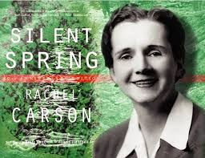
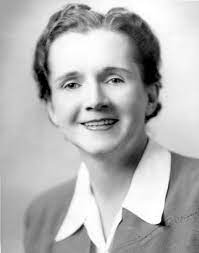
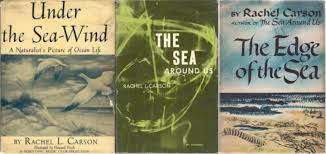
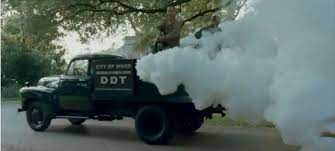
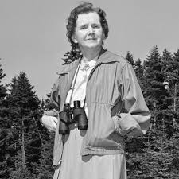
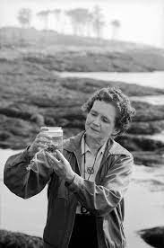
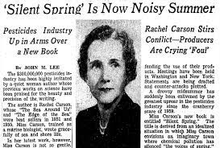
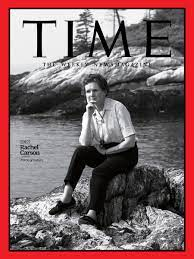
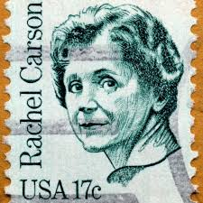

ಪುಸ್ತಕಯಾನದಲ್ಲಿ ಈ ವಾರದ ಪುಸ್ತಕ ಪರಿಸರ ಸಂರಕ್ಷಣೆಯ ಪ್ರಜ್ಞೆ ಮತ್ತು ಜಾಗೃತಿಯನ್ನು ಮೊಟ್ಟಮೊದಲಿಗೆ ಸಾರಿದ, ಇಡೀ ಜಗತ್ತಿನಲ್ಲಿ ಸಂಚಲನವನ್ನು ಮೂಡಿಸಿದ, ಇಂದಿಗೂ, ಎಂದಿಗೂ ಪ್ರಸ್ತುತವೆನಿಸುವ 1962 ರ ಸೆಪ್ಟೆಂಬರ್ 27 ರಂದು ಬಿಡುಗಡೆಗೊಂಡ ರಾಚೆಲ್ ಲೂಯಿಸ್ ಕಾರ್ಸನ್ ರವರ “ಸೈಲೆಂಟ್ ಸ್ಪ್ರಿಂಗ್”. “ಸೈಲೆಂಟ್ ಸ್ಪ್ರಿಂಗ್” - “ಮೌನ ವಸಂತ”. ವಸಂತದಲ್ಲಿ ಮೌನವೇ? ಎನ್ನುವುದು ಆಶ್ಚರ್ಯ ಮತ್ತು ಕುತೂಹಲವನ್ನುಂಟು ಮಾಡುತ್ತಿದೆ. ಹೌದು. ಪುಸ್ತಕದ ಆಳಕ್ಕೆ ಇಳಿದಂತೆಲ್ಲಾ ಆಶ್ಚರ್ಯ, ಕುತೂಹಲವೆಲ್ಲಾ ಆತಂಕಕ್ಕೊಳಗಾಗಿ ನನ್ನನ್ನು ಮೂಕ ಓದುಗನನ್ನಾಗಿಸಿತು. ನನ್ನ ನಲಿದಾಡುವ ಮನೋವಸಂತ “ಮೌನ ವಸಂತ” ವಾಯಿತು.

ಸಾಮಾನ್ಯವಾಗಿ ನಾವು ದಿನಾ ಬೆಳಿಗ್ಗೆ ಎಚ್ಚರಗೊಂಡು ಕಣ್ಣುಬಿಡುವುದರ ಮೊದಲು ಕೇಳಿಸುತ್ತಿದ್ದದ್ದು ಹಕ್ಕಿಗಳ ಚಿಲಿಪಿಲಿಗಾನ. ಹಕ್ಕಿಗಳ ಇಂಚರ ಕೇಳಿಯೇ ಬೆಳಗಾಯಿತೆಂದು ಎಚ್ಚರಗೊಂಡ ನಿದರ್ಶನಗಳಿವೆ. ಇತ್ತೀಚೆಗೆ ಇದು ನಗರದಲ್ಲಿ ಅಪರೂಪವಾಗಿದೆ. ಎಚ್ಚರತಪ್ಪಿದರೆ ಮುಂದೆ ಹಕ್ಕಿಗಳ ಇಂಚರ ಕೇಳದಿರಲೂಬಹುದು. ವಸಂತದಲ್ಲಿ ಕೇಳುವ ಕೋಗಿಲೆಗಾನವೂ ಇಲ್ಲವಾಗಬಹುದು. ಗಾನ ವಸಂತ ಮೌನ ವಸಂತ ವಾಗಬಹುದು. ಅದಕ್ಕೆ ಸಂಭಾವಿತ ಕಾರಣಗಳನ್ನು ಸಾಕ್ಷ್ಯಗಳೊಂದಿಗೆ ಸೈಲೆಂಟ್ ಸ್ಪ್ರಿಂಗ್ ನಮ್ಮ ಮುಂದೆ ಹಿಡಿಯುತ್ತದೆ. ಇದಕ್ಕೆ ಪೂರಕವಾಗಿ ಇನ್ನೊಂದು ವಿಷಯವನ್ನು ಅವಲೋಕಿಸೋಣ. ಎಂಬತ್ತರ ದಶಕದಲ್ಲಿ ಮನೆಯಲ್ಲಿ ಇರುವೆ ಸಾಲು ಕಂಡ ತಕ್ಷಣ ಅಪ್ಪ ಹುಡುಕುತ್ತಿದ್ದದ್ದು ತೊಲೆಯ ಸಂದಿಯಲ್ಲಿ ಇಡುತ್ತಿದ್ದ ಬಿಳಿಬಣ್ಣದ ಪೌಡರ್ ಇರುವ ಪ್ಯಾಕೇಟನ್ನು. ಅದನ್ನು ತೆಗೆದು ಇರುವೆ ಸಾಲಿನ ಮೇಲೆ ಚಿಮುಕಿಸುತ್ತಿದ್ದರು. ಅದು ಡಿಡಿಟಿ ಪೌಡರು, ಕೆಲವೊಮ್ಮೆ ನಮಗೆ ನಾಲ್ಕಾಣೆಯ ನಾಣ್ಯ ಕೊಟ್ಟು ಅಂಗಡಿಯಲ್ಲಿ ಡಿಡಿಟಿ ಪೌಡರ್ ಪ್ಯಾಕೆಟ್ ತರಲು ಹೇಳುತ್ತಿದ್ದರು. ಅದಲ್ಲದೇ ಸೊಳ್ಳೆಗಳ ನಾಶಕ್ಕಾಗಿ ನಮ್ಮ ಊರಿನ ಮುನಿಸಿಪಾಲಿಟಿಯವರು ವಾರಕ್ಕೊಮ್ಮೆಯೋ, ಹದಿನೈದು ದಿನಗಳಿಗೊಮ್ಮೆಯೋ ಚರಂಡಿಗಳಿಗೆ ಸಿಂಪಡಿಸುತ್ತಿದ್ದ ಡಿಡಿಟಿಯ ಮೊದಲ ಪರಿಚಯ ನಮಗೆ ಹೀಗೆಯೇ ಅದದ್ದು. ಆ ಹೊತ್ತಿನಲ್ಲಿ ಇರುವೆಯ ಕಾಟ, ಸೊಳ್ಳೆಯ ಕಾಟ ತಪ್ಪುತ್ತಿದ್ದರೂ, ನಂತರದಲ್ಲಿ ಮತ್ತೆ ಇರುವೆಯ ಸಾಲು, ಸೊಳ್ಳೆಗಳ ಕಡಿತ ಇಣುಕುತ್ತಿದ್ದವು.

ಇದೇಕೆ ಹಕ್ಕಿಗಳ ಇಂಚರದ ಮಾತಿನ ಜೊತೆಗೆ ಡಿಡಿಟಿ ಮಾತು ಅಂತನ್ನಿಸುತ್ತಿದೆಯೇ? ಹೌದು ಒಂದಕ್ಕೊಂದು ಸಂಬಂಧವಿದೆ. ಡಿಡಿಟಿ ಸಿಂಪಡನೆಯ ದುಷ್ಪರಿಣಾಮಗಳನ್ನು ಜಗತ್ತಿನಾದ್ಯಂತ ಅತ್ಯಂತ ಪರಿಣಾಮಕಾರಿಯಾಗಿ ಸಂಶೋಧನೆ ಮತ್ತು ಸಾಕ್ಷ್ಯಗಳ ಸಮೇತ ನಿರೂಪಿಸಿದವರು ಅಮೆರಿಕದ ಸಮುದ್ರ ಜೀವಿವಿಜ್ಞಾನಿ, ಪರಿಸರ ಸಂರಕ್ಷಣಾವಾದಿ ರಾಚೆಲ್ ಲೂಯಿಸ್ ಕಾರ್ಸನ್ ರವರು. ಅವರು ತಮ್ಮ ಸಂಶೋಧನೆಯ ಅಮೂಲ್ಯ ಮಾಹಿತಿಯನ್ನು ಪ್ರಭಾವಶಾಲಿಯಾಗಿ ನಿರೂಪಿಸಿರುವ ಪುಸ್ತಕವೇ ಸೈಲೆಂಟ್ ಸ್ಪ್ರಿಂಗ್.

ಸೈಲೆಂಟ್ ಸ್ಪ್ರಿಂಗ್ ಪುಸ್ತಕ ರಚನೆ, ಪ್ರಕಟಣೆಯ ಹಿಂದೆ ಅಗಾಧ ಸಂಶೋಧನೆ ಮತ್ತು ಪರಿಶ್ರಮವಿದೆ. ಜೊತೆಗೆ ಅದು ಜಾಗತಿಕ ಮಟ್ಟದಲ್ಲಿ ಬೀರಿದ ಪರಿಣಾಮವು ಒಂದು ರೋಚಕ ಕಥೆ.

ರಾಚೆಲ್ ಲೂಯಿಸ್ ಕಾರ್ಸನ್ (ಮೇ 27, 1907 - ಏಪ್ರಿಲ್ 14, 1964) ಯುಎಸ್ ಬ್ಯೂರೋ ಆಫ್ ಫಿಶರೀಸ್‌ನಲ್ಲಿ ಜಲಚರ ಜೀವಿವಿಜ್ಞಾನಿಯಾಗಿ ತನ್ನ ವೃತ್ತಿಜೀವನವನ್ನು ಪ್ರಾರಂಭಿಸಿದರು. ಅವರ “ಅಂಡರ್ ದ ಸೀ ವಿಂಡ್” 1941ರಲ್ಲಿ ಪ್ರಕಟವಾದ ಪುಸ್ತಕ. 1950 ರ ದಶಕದಲ್ಲಿ ಕಾರ್ಸನ್ ಪೂರ್ಣ ಪ್ರಮಾಣದ ಪ್ರಕೃತಿ ಬರಹಗಾರರಾದರು. ವ್ಯಾಪಕವಾಗಿ ಶ್ಲಾಘಿಸಲ್ಪಟ್ಟ 1951 ರ ಬೆಸ್ಟ್ ಸೆಲ್ಲರ್ “ದಿ ಸೀ ಅರೌಂಡ್ ಅಸ್” ಅವರಿಗೆ U.S. ರಾಷ್ಟ್ರೀಯ ಪುಸ್ತಕ ಪ್ರಶಸ್ತಿಯನ್ನು ದೊರಕಿಸಿಕೊಟ್ಟಿತು. ಹೆಸರಿನ ಜೊತೆಗೆ ಆರ್ಥಿಕ ಭದ್ರತೆಯನ್ನು ಸಹ ನೀಡಿತು. ಅವರ ಮುಂದಿನ ಪುಸ್ತಕ, “ದಿ ಎಡ್ಜ್ ಆಫ್ ದಿ ಸೀ” 1955ರಲ್ಲಿ ಪ್ರಕಟವಾಗಿ ಹೆಚ್ಚು ಮಾರಾಟವಾಯಿತು. ಜೊತೆಗೆ ಅವರ ಮೊದಲ ಪುಸ್ತಕ “ಅಂಡರ್ ದ ಸೀ ವಿಂಡ್” ನ ಮರುಮುದ್ರಿತ ಆವೃತ್ತಿ, ಕೂಡ ಹೆಚ್ಚು ಮಾರಾಟವಾದವು. ಈ ಸಮುದ್ರ ಟ್ರೈಲಜಿಯು ಸಮುದ್ರದ ಸಂಪೂರ್ಣ ಜೀವನವನ್ನು ತೀರದಿಂದ ಆಳದವರೆಗೆ ಪರಿಶೋಧಿಸುತ್ತದೆ. 1950 ರ ದಶಕದ ಕೊನೆಯಲ್ಲಿ, ಕಾರ್ಸನ್ ತಮ್ಮ ಗಮನವನ್ನು ಸಂರಕ್ಷಣೆಯತ್ತ ತಿರುಗಿಸಿದರು, ವಿಶೇಷವಾಗಿ ಕೆಲವು ಸಮಸ್ಯೆಗಳು ಸಂಶ್ಲೇಷಿತ ಕೀಟನಾಶಕಗಳಿಂದ ಉಂಟಾಗುತ್ತವೆ ಎಂದು ಅವರು ನಂಬಿದ್ದರು. ಇದರ ಫಲಿತಾಂಶವೇ ಸೈಲೆಂಟ್ ಸ್ಪ್ರಿಂಗ್.

ರಾಚೆಲ್ ಕಾರ್ಸನ್ ಅವರಿಗೆ, **ಸೈಲೆಂಟ್ ಸ್ಪ್ರಿಂಗ್‌** ಬರೆಯಲು ಪ್ರಚೋದನೆ ದೊರಕಿದ್ದು ಕಾರ್ಸನ್‌ ಸ್ನೇಹಿತೆ ಓಲ್ಗಾ ಓವೆನ್ಸ್ ಹಕಿನ್ಸ್ ಬರೆದ ಪತ್ರದಿಂದ. ಜನವರಿ, 1958 ರಲ್ಲಿ ಕೋಪಗೊಂಡು ಬರೆದ ಪತ್ರದಲ್ಲಿ ಹಕಿನ್ಸ್, ಮ್ಯಾಸಚೂಸೆಟ್ಸ್‌ನ ಡಕ್ಸ್‌ಬರಿಯಲ್ಲಿರುವ ಪೌಡರ್ ಪಾಯಿಂಟ್‌ನಲ್ಲಿರುವ ತಮ್ಮ ಖಾಸಗಿ ಎರಡು ಎಕರೆ ಪಕ್ಷಿಧಾಮದ ಮೇಲೆ ಸೊಳ್ಳೆ ನಿಯಂತ್ರಣಕ್ಕಾಗಿ ಡಿಡಿಟಿ ಸಿಂಪಡಿಸುವಿಕೆಯ ಮಾರಕ ಪರಿಣಾಮವನ್ನು ವಿವರಿಸಿದ್ದರು. ಸ್ವಲ್ಪ ಸಮಯದ ನಂತರ ಕಾರ್ಸನ್ ಪೌಡರ್ ಪಾಯಿಂಟ್‌ನ ಮನೆಯ ಅತಿಥಿಯಾದರು. ಒಂದು ಮಧ್ಯಾಹ್ನ ಡಿಡಿಟಿ ಸಿಂಪಡಿಸುವ ವಿಮಾನವು ಹಾರಿಹೋಯಿತು. ಮರುದಿನ ಬೆಳಿಗ್ಗೆ ಹಕಿನ್ಸ್ ಜೊತೆ ನದಿಮೂಲಕ ದೋಣಿಯಲ್ಲಿ ಹೋದ ಕಾರ್ಸನ್ ಅಲ್ಲಿನ ದೃಶ್ಯಗಳನ್ನು ಕಂಡು ಅಸ್ವಸ್ಥರಾದರು - ಎಲ್ಲೆಡೆ ಸತ್ತ ಮತ್ತು ಸಾಯುತ್ತಿರುವ ಮೀನುಗಳು, ಕ್ರೇಫಿಶ್ ಮತ್ತು ಏಡಿಗಳು ಸತ್ತಂತೆ ಅಥವಾ ಅವುಗಳ ನರಮಂಡಲವು ಪಾರ್ಶ್ವವಾಯುವಿಗೆ ತುತ್ತಾದಂತೆ ಕಾಣಿಸಿಕೊಂಡವು. ಇದು ಮೂಲತಃ ಸಮುದ್ರ ಜೀವಿವಿಜ್ಞಾನಿಯಾದ ಕಾರ್ಸನ್ ರವರಿಗೆ, ರಾಸಾಯನಿಕ ಕೀಟನಾಶಕಗಳಿಂದ ಉಂಟಾಗುವ ಪರಿಸರ ಸಮಸ್ಯೆಗಳನ್ನು ಅಧ್ಯಯನ ಮಾಡಲು ಪ್ರೇರೇಪಿಸಿತು ಹಾಗೂ DDT ಯ ಪರಿಣಾಮದ ಬಗ್ಗೆ ಬರೆಯಲು ತೀರ್ಮಾನಿಸಿದರು.

ಅಂದಿನ ಪರಿಸ್ಥಿತಿಯನ್ನು ಅವಲೋಕಿಸಿದಾಗ ತಿಳಿದಿದ್ದೇನೆಂದರೆ ಕೀಟನಾಶಕ ಗುಣಗಳನ್ನು ಹೊಂದಿದ್ದ ಡಿಡಿಟಿ (Dichlorodiphenyltrichloroethane-DDT) ಯನ್ನು ಎರಡನೇ ಜಾಗತಿಕ ಯುದ್ಧಕಾಲದಲ್ಲಿ ಪ್ರಪಂಚದಾದ್ಯಂತ ನಿಯೋಜಿಸಲಾದ ಲಕ್ಷಾಂತರ ಮಿತ್ರರಾಷ್ಟ್ರಗಳ ಸೈನ್ಯ ಮತ್ತು ನೌಕಾಪಡೆಯ ಸಿಬ್ಬಂದಿಗಳು, ಹಲವಾರು ಕೀಟಗಳಿಂದ ಹರಡುವ ರೋಗಗಳ ನಿಯಂತ್ರಣಕ್ಕಾಗಿ ಹೊತ್ತೊಯ್ದು ಸಿಂಪಡಿಸುತ್ತಿದ್ದರು. ವಿಶೇಷವಾಗಿ ಉಷ್ಣವಲಯದಲ್ಲಿ, ಡೇರೆಗಳು, ಬ್ಯಾರಕ್‌ಗಳು ಮತ್ತು ಮೆಸ್ ಹಾಲ್‌ಗಳ ಒಳಭಾಗವನ್ನು ಸಿಂಪಡಿಸಲು ಲಕ್ಷಾಂತರ ಡಿಡಿಟಿ ಏರೋಸಾಲ್ ಬಾಂಬ್‌ಗಳನ್ನು ಬಳಸಲಾಗುತ್ತಿತ್ತು. ಯುರೋಪಿಯನ್ ನಿರಾಶ್ರಿತರ ಶಿಬಿರಗಳ ಉದ್ದಕ್ಕೂ, ಬರ್ಮಾ ರಸ್ತೆಯ ಉದ್ದಕ್ಕೂ, ಆಗ್ನೇಯ ಏಷ್ಯಾದ ಕಾಡಿನ ಯುದ್ಧಭೂಮಿಗಳಾದ್ಯಂತ DDT ತನ್ನ ಮಂಜನ್ನು ಹರಡಿತ್ತು.

1950 ರ ದಶಕದ ಆರಂಭದಲ್ಲಿ ವಿಶ್ವ ಆರೋಗ್ಯ ಸಂಸ್ಥೆಯು ಜಾಗತಿಕ ಮಲೇರಿಯಾ ನಿರ್ಮೂಲನೆ ಕಾರ್ಯಕ್ರಮವನ್ನು ಪ್ರಾರಂಭಿಸಿತ್ತು. ಮಲೇರಿಯಾ ತಡೆಗಟ್ಟುವ ಕಾರ್ಯದಲ್ಲಿ ಡಿಡಿಟಿ ಅತ್ಯಂತ ಪರಿಣಾಮ ಬೀರಿತ್ತು. ಅಗಾಧವಾಗಿ ಹೊಲಗದ್ದೆಗಳ ಮೇಲೆ, ಕಟ್ಟಡಗಳ ಒಳಗೆ, ರಸ್ತೆಗಳ ಮೇಲೆ ಮತ್ತು ಮನುಷ್ಯರ ಮೇಲೆಯೂ ಸಿಂಪಡಿಸಲಾಗುತ್ತಿತ್ತು.

DDT ಸಿಂಪಡಣೆಯ ಗಾಢತೆಯನ್ನು ಈ ಕೆಳಕಂಡ ವಿಡಿಯೋ ಲಿಂಕ್ ನಲ್ಲಿ ನೋಡಬಹುದು: 

<https://www.youtube.com/watch?v=Ipbc-6IvMQI>

ಸ್ನೇಹಿತೆಯ ಮನೆಯಂಗಳದ ಡಿಡಿಟಿ ಪರಿಣಾಮವನ್ನು ನೋಡಿದ ಕಾರ್ಸನ್, ರಾಸಾಯನಿಕ ಸಿಂಪರಣೆ ಕಾರ್ಯಕ್ರಮಗಳನ್ನು ಸಕ್ರಿಯವಾಗಿ ವಿರೋಧಿಸುತ್ತಿದ್ದ ಆಡುಬನ್ ನ್ಯಾಚುರಲಿಸ್ಟ್ ಸೊಸೈಟಿಯಲ್ಲಿ ನೇಮಕವಾದರು. ಇಲ್ಲಿ ಅವರ ಮುಖ್ಯಕೆಲಸವೆಂದರೆ U.S. ಸರ್ಕಾರದ ಡಿಡಿಟಿ ಸಿಂಪರಣೆ ಅಭ್ಯಾಸಗಳು ಮತ್ತು ಸಂಬಂಧಿತ ಪರಿಣಾಮಗಳನ್ನು ವಿಶ್ಲೇಷಿಸಿ ಪ್ರಚಾರ ಮಾಡುವುದಾಗಿತ್ತು. ಹೀಗಾಗಿ, ಕಾರ್ಸನ್ ಡಿಡಿಟಿಗೆ ಕಾರಣವಾದ ಪರಿಸರ ಹಾನಿಯ ಉದಾಹರಣೆಗಳನ್ನು ಸಂಗ್ರಹಿಸುವ ಮೂಲಕ ಸೈಲೆಂಟ್ ಸ್ಪ್ರಿಂಗ್‌ನ ನಾಲ್ಕು ವರ್ಷಗಳ ಯೋಜನೆಯನ್ನು ಪ್ರಾರಂಭಿಸಿದರು. ಕಾರ್ಸನ್ ತಮ್ಮ ಸಂಶೋಧನೆಯು ಮುಂದುವರೆಸಿದಂತೆ, ಕೀಟನಾಶಕಗಳ ಶಾರೀರಿಕ ಮತ್ತು ಪರಿಸರದ ಪರಿಣಾಮಗಳನ್ನು ದಾಖಲಿಸುವ ವಿಜ್ಞಾನಿಗಳ ಗಣನೀಯ ಸಮುದಾಯವನ್ನು ಗುರುತಿಸಿದರು. ಅನೇಕ ಸರ್ಕಾರಿ ವಿಜ್ಞಾನಿಗಳೊಂದಿಗಿನ ತಮ್ಮ ವೈಯಕ್ತಿಕ ಸಂಪರ್ಕಗಳ ಲಾಭದಿಂದ ವಿಷಯದ ಬಗ್ಗೆ ಗೌಪ್ಯ ಮಾಹಿತಿಯನ್ನು ಪಡೆದರು.1959 ರ ವಸಂತಕಾಲದಲ್ಲಿ, ಕಾರ್ಸನ್ ವಾಷಿಂಗ್ಟನ್ ಪೋಸ್ಟ್‌ನಲ್ಲಿ ಪತ್ರವೊಂದನ್ನು ಪ್ರಕಟಿಸಿದರು. ಅದು ಪಕ್ಷಿಗಳ ಸಂಖ್ಯೆಯಲ್ಲಿನ ಇತ್ತೀಚಿನ ಕುಸಿತಕ್ಕೆ ಕಾರಣವನ್ನು ವಿವರಿಸಿದರು. ಅವರ ಮಾತಿನಂತೆ "ಪಕ್ಷಿಗಳ ಮೌನಕ್ಕೆ ಕೀಟನಾಶಕಗಳ ಮಿತಿಮೀರಿದ ಬಳಕೆಯೆ ಕಾರಣ”.

ಹಾಗೆಯೇ ನ್ಯಾಷನಲ್ ಇನ್‌ಸ್ಟಿಟ್ಯೂಟ್ ಆಫ್ ಹೆಲ್ತ್‌ನ(NIH) ನ್ಯಾಷನಲ್ ಲೈಬ್ರರಿ ಆಫ್ ಮೆಡಿಸಿನ್‌ನಲ್ಲಿನ ಸಂಶೋಧನೆಯು ಕಾರ್ಸನ್‌ರನ್ನು ಕ್ಯಾನ್ಸರ್ ಉಂಟುಮಾಡುವ ರಾಸಾಯನಿಕಗಳ ಹರವುಗಳನ್ನು ತನಿಖೆ ಮಾಡುವ ವೈದ್ಯಕೀಯ ಸಂಶೋಧಕರೊಂದಿಗೆ ಸಂಪರ್ಕಕ್ಕೆ ತಂದಿತು. ಕಾರ್ಸನ್ ಮತ್ತು ಆಕೆಯ ಸಂಶೋಧನಾ ಸಹಾಯಕಿ ಜೀನ್ ಡೇವಿಸ್, NIH ಲೈಬ್ರರಿಯನ್ ಡೊರೊಥಿ ಅಲ್ಗೈರ್ ಅವರ ಸಹಾಯದಿಂದ, ಕೀಟನಾಶಕಗಳು ಕ್ಯಾನ್ಸರ್ ಗೆ ಕಾರಣವಾಗುವ ಅಂಶಗಳನ್ನು ಗುರುತಿಸಿದರು.

1960 ರ ಹೊತ್ತಿಗೆ, ಕಾರ್ಸನ್ ಕೀಟನಾಶಕ ಒಡ್ಡಿದ ನೂರಾರು ವೈಯಕ್ತಿಕ ಅನುಭವಗಳು ಮತ್ತು ಮಾನವನ ಅನಾರೋಗ್ಯ ಹಾಗೂ ಪರಿಸರ ಹಾನಿಯನ್ನು ತನಿಖೆ ಮಾಡಿ ಸಾಕಷ್ಟು ಸಂಶೋಧನಾ ವಿವರಗಳನ್ನು ಹೊಂದಿಸಿಕೊಂಡರು. ಪುಸ್ತಕ ಬರವಣಿಗೆಯು ಪ್ರಗತಿ ಹೊಂದಿತು. ಆದರೆ ಜನವರಿ 1960 ರಲ್ಲಿ, ಅವರು ಅನಾರೋಗ್ಯದಿಂದ ಬಳಲಿ ವಾರಗಳವರೆಗೆ ಹಾಸಿಗೆ ಹಿಡಿದು ಪುಸ್ತಕದ ಅಂತಿಮ ಪರಿಷ್ಕರಣೆಗಳನ್ನು ವಿಳಂಬಗೊಳಿಸಿದವು. 

ಪುಸ್ತಕದ ಶೀರ್ಷಿಕೆಯು ಸಿಕ್ಕಿದ್ದು ಸಹ ಮತ್ತೊಂದು ಕುತೂಹಲದ ವಿಷಯ. ಕವಿ ಜಾನ್ ಕೀಟ್ಸ್‌ನ " [La Belle Dame sans Merci](https://en.wikipedia.org/wiki/La_Belle_Dame_sans_Merci) " ಕವಿತೆಯ " The sedge is wither'd from the lake, And no birds sing” ಎಂಬ ಸಾಲು ಸ್ಪೂರ್ತಿಯಾಯಿತು. (ಈ ಸಾಲುಗಳನ್ನು ಪುಸ್ತಕದ ಎರಡನೇ ಪುಟದಲ್ಲಿಯೇ ಕಾಣಬಹುದು) . "ಸೈಲೆಂಟ್ ಸ್ಪ್ರಿಂಗ್" ಶೀರ್ಷಿಕೆಯನ್ನು ಆರಂಭದಲ್ಲಿ ಪಕ್ಷಿಗಳ ಕುರಿತು ಬರೆದಿರುವ ಅಧ್ಯಾಯಕ್ಕೆ ಸೂಚಿಸಲಾಯಿತು. ಆದರೆ “ಸೈಲೆಂಟ್ ಸ್ಪ್ರಿಂಗ್” ಇಡೀ ಪುಸ್ತಕಕ್ಕೆ ರೂಪಕ ಶೀರ್ಷಿಕೆಯಾಗಿ ಬಳಸಿಕೊಂಡರು. ಇದು ಬರೀ ಪಕ್ಷಿಗಳ ಹಾಡಿನ ಅನುಪಸ್ಥಿತಿಗಿಂತ ಇಡೀ ನೈಸರ್ಗಿಕ ಪ್ರಪಂಚಕ್ಕೆ ಒಂದು ಕರಾಳ ಭವಿಷ್ಯವನ್ನು ಸೂಚಿಸುತ್ತದೆ ಎನ್ನುವುದೇ ಸಕಾರಣವಾಗಿತ್ತು. ಪ್ರಕಾಶಕರು ಪುಸ್ತಕದ ಒಳ ಚಿತ್ರಣಗಳಿಗೆ ಮತ್ತು ಮುಖಪುಟ ವಿನ್ಯಾಸಕ್ಕೆ ವ್ಯವಸ್ಥೆ ಮಾಡಿದರು, ಪುಸ್ತಕದ ಅಂತಿಮ ಬರಹವೇ ಮೊದಲ ಅಧ್ಯಾಯ, " A Fable for Tomorrow -ನಾಳೆಗಾಗಿ ನೀತಿಕಥೆ", ಇದು ಗಂಭೀರವಾದ ವಿಷಯಕ್ಕೆ ಸೌಮ್ಯವಾದ ಪರಿಚಯವನ್ನು ನೀಡುವ ಉದ್ದೇಶವನ್ನು ಹೊಂದಿ ಬರೆಯಲ್ಪಟ್ಟಿತು.

ಸೈಲೆಂಟ್ ಸ್ಪ್ರಿಂಗ್ ಪುಸ್ತಕ ತೆರೆದುಕೊಳ್ಳುವುದೇ, 1952ರ ನೊಬೆಲ್ ಶಾಂತಿ ಪಾರಿತೋಷಕ, ಗಾಂಧೀವಾದಿ ಆಲ್ಬರ್ಟ್ ಸ್ವೆಟ್ಜರ್(Albert Schweitzer)ನ ಈ ಹೇಳಿಕೆಯಿಂದ: “Man has lost the capacity to foresee and to forestall. He will end by destroying the earth”. ಸೈಲೆಂಟ್ ಸ್ಪ್ರಿಂಗ್‌ ಪ್ರಮುಖವಾಗಿ ಹಾಗೂ ವ್ಯಾಪಕವಾಗಿ ನಿಸರ್ಗದ ಮೇಲಾಗುತ್ತಿರುವ ಮಾನವನ ಶಕ್ತಿಯುತ ಪ್ರಭಾವ ಮತ್ತು ಅದರಿಂದಾಗುವ ಋಣಾತ್ಮಕ ಪರಿಣಾಮವನ್ನು ವಿವರಿಸುತ್ತದೆ. ಕಾರ್ಸನ್ ರವರ ಮುಖ್ಯ ವಾದವೆಂದರೆ ಕೀಟನಾಶಕಗಳು ಪರಿಸರದ ಮೇಲೆ ಹಾನಿಕಾರಕ ಪರಿಣಾಮಗಳನ್ನು ಬೀರುತ್ತವೆ; ಇವುಗಳನ್ನು ಕೀಟನಾಶಕಗಳು ಎನ್ನುವುದಕ್ಕಿಂತ "ಜೈವಿಕನಾಶಕಗಳು" ಎಂದು ಕರೆಯುವುದೇ ಸರಿ ಎನ್ನುತ್ತಾರೆ. ಏಕೆಂದರೆ ಅವುಗಳ ಪರಿಣಾಮಗಳು ಕೇವಲ ಗುರಿಮಾಡುವ ಕೀಟಗಳಿಗೆ ಸೀಮಿತವಾಗಿರುವುದು ಅಪರೂಪ. ಇದಕ್ಕೆ DDT ಒಂದು ಪ್ರಮುಖ ಉದಾಹರಣೆಯಾಗಿದೆ. DDT ಮಣ್ಣು, ಕುಡಿಯುವ ನೀರು ಮತ್ತು ಚರ್ಮದಲ್ಲಿ ನೆಲೆಸಲು ಅವಕಾಶ ನೀಡುವುದು ಮಾನವರ ಆರೋಗ್ಯದ ಮೇಲೆ ಪರಿಣಾಮಗಳನ್ನು ಬೀರುತ್ತದೆ ಎನ್ನುವುದನ್ನು ಆರಂಭದಲ್ಲಿಯೇ ಎಚ್ಚರಿಸುತ್ತಾರೆ.

ಕಾರ್ಸನ್, "ಎ ಫೇಬಲ್ ಫಾರ್ ಟುಮಾರೊ" ಅಧ್ಯಾಯದಲ್ಲಿ, ಡಿಡಿಟಿ ಆಹಾರ ಸರಪಳಿಯನ್ನು ಹೇಗೆ ಪ್ರವೇಶಿಸಿತು ಎಂಬುದನ್ನು ವಿವರಿಸಿದ್ದಾರೆ. ಕೀಟಗಳನ್ನು ಕೊಲ್ಲಲು ವಾರಗಳು ಮತ್ತು ತಿಂಗಳುಗಳವರೆಗೆ ಡಿಡಿಟಿ ಸಿಂಪಡಿಸುತ್ತಾರೆ. ಇದು ಗುರಿಪಡಿಸಿದ ಕೀಟಗಳು ಮಾತ್ರವಲ್ಲದೆ ಲೆಕ್ಕವಿಲ್ಲದಷ್ಟು ಪಕ್ಷಿಗಳು ಮತ್ತು ಪ್ರಾಣಿಗಳಿಗೆ ಬದಲಾವಣೆಯೇ ಸಾಧ್ಯವಿಲ್ಲದಂತೆ ಹಾನಿ ಮಾಡಿದೆ. ಇಡೀ ಪ್ರಪಂಚದ ಆಹಾರ ಪೂರೈಕೆಯನ್ನು ಕಲುಷಿತಗೊಳಿಸುತ್ತಿದೆ ಎಂದು ಕಾರ್ಸನ್ ವಾದಿಸುತ್ತಾರೆ. ಮೀನುಗಳಿಂದ ಹಿಡಿದು ಸೇಬಿನ ಹೂವುಗಳವರೆಗೆ, ಮಕ್ಕಳವರೆಗೆ DDT ಯ ಕಪಟ ಪರಿಣಾಮವು ಎಲ್ಲವನ್ನೂ "ಮೌನಗೊಳಿಸಿದೆ" ಎನ್ನುತ್ತಾರೆ.

ಸೈಲೆಂಟ್ ಸ್ಪ್ರಿಂಗ್ ನಲ್ಲಿ ಒಂದು ಜಾತಿಯ ಪಕ್ಷಿಗಳು ಅಳಿವಿನಂಚಿನಲ್ಲಿವೆ ಎನ್ನುವುದನ್ನು ದಾಖಲಿಸುತ್ತಾರೆ. ಇದಕ್ಕೆ ನಿದರ್ಶನವನ್ನು ಮಿಚಿಗನ್ ಸ್ಟೇಟ್ ಯೂನಿವರ್ಸಿಟಿಯ ಕ್ಯಾಂಪಸ್‌ನಲ್ಲಿ ಸಂಭವಿಸಿದ ಘಟನೆಗಳನ್ನು ಸಾಕ್ಷ್ಯರೂಪದಲ್ಲಿ ಹೀಗೆ ನೀಡುತ್ತಾರೆ. “ಡಚ್ ಎಲ್ಮ್ ರೋಗವನ್ನು ಹರಡುವ ಜೀರುಂಡೆಯನ್ನು ನಿಯಂತ್ರಿಸಲು 1954 ರಲ್ಲಿ ಎಲ್ಮ್ ಮರಗಳಿಗೆ DDT ಯ ವಾರ್ಷಿಕ ಸಿಂಪಡಿಸುವಿಕೆಯನ್ನು ಪ್ರಾರಂಭಿಸಲಾಯಿತು. ಮೊದಲ ವರ್ಷ ಅಥವಾ ಅದಕ್ಕಿಂತ ಹೆಚ್ಚು ಕಾಲ, ಸ್ವಲ್ಪ ಅಡ್ಡಪರಿಣಾಮಗಳು ಗೋಚರಿಸಿದವು. ಕ್ಯಾಂಪಸ್‌ನಿಂದ ರಾಬಿನ್‌ಗಳು ಕಣ್ಮರೆಯಾಗಿರುವುದನ್ನು ಜನರು ಗಮನಿಸಲಾರಂಭಿಸಿದರು. ಎಲ್ಮ್ ಎಲೆಗಳನ್ನು ತಿನ್ನುವ ಎರೆಹುಳುಗಳು ಸಣ್ಣ ಪ್ರಮಾಣದ ಡಿಡಿಟಿಯಿಂದ ಕಲುಷಿತಗೊಂಡವು ಕಲುಷಿತ ಹುಳುಗಳನ್ನು ಸೇವಿಸಿದ ರಾಬಿನ್‌ಗಳು ಸತ್ತವು. ಡಿಡಿಟಿ ಸಿಂಪರಣೆ ನಿಲ್ಲಿಸಿದ ಎರಡು ವರ್ಷಗಳ ನಂತರ ಕ್ಯಾಂಪಸ್‌ಗೆ ಭೇಟಿ ನೀಡಿದ ರಾಬಿನ್‌ಗಳು ಸಹ ದುರದೃಷ್ಟಕರ ಸಾವಿಗೆ ತುತ್ತಾದವು”. ಇದು ಕಾರ್ಸನ್ ವಿವರಿಸಿದ ವಸಂತಮೌನಕ್ಕೆ ಸಾಕ್ಷಿಯಾಯಿತು.

“ರಾಬಿನ್‌ನಂತೆ, ಅಮೆರಿಕದ ರಾಷ್ಟ್ರೀಯ ಹಕ್ಕಿ ಹದ್ದು ಸಹ ಅಳಿವಿನ ಅಂಚಿನಲ್ಲಿ ಸಿಲುಕಿದೆ” ಎಂದು ಕಾರ್ಸನ್ ಬರೆಯುತ್ತಾರೆ. ಮುಂದುವರೆಯುತ್ತಾ, “ಈಸ್ಟ್ ಕೋಸ್ಟ್‌ನಲ್ಲಿ ಬೋಳು ಹದ್ದುಗಳು ಸಂತಾನೋತ್ಪತ್ತಿ ಮಾಡುವುದನ್ನು ನಿಲ್ಲಿಸುತ್ತಿವೆ. ಅಕಾಲಿಕವಾಗಿ ಸತ್ತ ಹದ್ದುಗಳ ಮೆದುಳಿನಲ್ಲಿ ಹೆಚ್ಚಿನ ಸಾಂದ್ರತೆಯ ಡಿಡಿಟಿ ಅವಶೇಷಗಳು ಕಂಡುಬಂದಿವೆ ಮತ್ತು ಗ್ರೇಟ್‌ನಲ್ಲಿ ಹದ್ದುಗಳ ಆಹಾರ ಸರಪಳಿಯ ಮೇಲೆ DDT ಯ ಬೃಹತ್ ಆಕ್ರಮಣವು ಹೆಚ್ಚಾಗಿದೆ ಅವುಗಳ ಮೊಟ್ಟೆಯ ಚಿಪ್ಪುಗಳು ತುಂಬಾ ತೆಳುವಾಗಿ ಬೆಳೆಯುತ್ತಿವೆ. ಹೀಗಾಗಿ ಈ ಸರೋವರಗಳ ಪ್ರದೇಶವು ಅಳಿವಿನಂಚಿನಲ್ಲಿದೆ” ಎಂದು ಅವರು ಸೂಚಿಸುತ್ತಾರೆ.

ಕಾರ್ಸನ್ , ಡಿಡಿಟಿ ಮತ್ತು ಸಂಬಂಧಿತ ರಾಸಾಯನಿಕಗಳ ಅತ್ಯಂತ ಮಹತ್ವದ ವೈಶಿಷ್ಟ್ಯ, ಅಂದರೆ ಆಹಾರ ಸರಪಳಿಯ ಎಲ್ಲಾ ಲಿಂಕ್‌ಗಳ ಮೂಲಕ ಒಂದು ಜೀವಿಯಿಂದ ಇನ್ನೊಂದಕ್ಕೆ ರವಾನಿಸುವ ವಿಧಾನವನ್ನು ವಿವರಿಸುತ್ತಾ, “ಸೊಪ್ಪುಗಳ ಹೊಲಗಳು DDT ಯೊಂದಿಗೆ ಧೂಳೀಪಟವಾಗಿದೆ; ಊಟವನ್ನು ಸೊಪ್ಪಿನಿಂದ ತಯಾರಿಸಲಾಗುತ್ತದೆ ಮತ್ತು ಕೋಳಿಗಳಿಗೆ ತಿನ್ನಿಸಲಾಗುತ್ತದೆ; ಕೋಳಿಗಳು ಡಿಡಿಟಿಯನ್ನು ಹೊಂದಿರುವ ಮೊಟ್ಟೆಗಳನ್ನು ಇಡುತ್ತವೆ. ಅಥವಾ ಡಿಡಿಟಿಯ ಪ್ರತಿ ಮಿಲಿಯನ್‌ಗೆ ಏಳರಿಂದ ಎಂಟು ಭಾಗಗಳ ಶೇಷವನ್ನು ಹೊಂದಿರುವ ಹುಲ್ಲನ್ನು ಹಸುಗಳಿಗೆ ನೀಡಬಹುದು. ಇದರಿಂದ ಹಸುವಿನ ಹಾಲಿನಲ್ಲಿ DDT ಪ್ರತಿ ಮಿಲಿಯನ್‌ಗೆ ಸುಮಾರು ಮೂರು ಭಾಗಗಳಾಗಿ ಬದಲಾಗುತ್ತದೆ, ಆದರೆ ಈ ಹಾಲಿನಿಂದ ಮಾಡಿದ ಬೆಣ್ಣೆಯಲ್ಲಿ ಸಾಂದ್ರತೆಯು ಪ್ರತಿ ಮಿಲಿಯನ್‌ಗೆ ಅರವತ್ತೈದು ಭಾಗಗಳಿಗೆ ಚಲಿಸಬಹುದು. ವರ್ಗಾವಣೆಯ ಪ್ರಕ್ರಿಯೆಯಲ್ಲಿ, ಡಿಡಿಟಿಯ ಅತ್ಯಂತ ಕಡಿಮೆ ಪ್ರಮಾಣದಲ್ಲಿ ಪ್ರಾರಂಭವಾದದ್ದು ಭಾರೀ ಸಾಂದ್ರತೆಯಾಗಿ ಕೊನೆಗೊಳ್ಳಬಹುದು. ವಿಷವು ತಾಯಿಯಿಂದ ಸಂತತಿಗೆ ಹರಡಬಹುದು. ಮಾನವನಲ್ಲಿಯೂ ಸಹ ತಾಯಿಯ ಎದೆ ಹಾಲಿನಲ್ಲಿ ಕೀಟನಾಶಕಗಳ ಅವಶೇಷಗಳ ಉಪಸ್ಥಿತಿಯನ್ನು ಆಹಾರ ಮತ್ತು ಔಷಧ ಆಡಳಿತದ ವಿಜ್ಞಾನಿಗಳು ದಾಖಲಿಸಿದ್ದಾರೆ.” ಎನ್ನುತ್ತಾರೆ

“ಇತರ ಸಂಶ್ಲೇಷಿತ ಕೀಟನಾಶಕಗಳಲ್ಲಿ ಹೆಚ್ಚಿನವು ಜೈವಿಕ ಶೇಖರಣೆಗೆ ಒಳಪಟ್ಟಿರುತ್ತವೆ ಎಂದು ಪರಿಶೀಲಿಸಲಾಗಿದೆ. ರಾಸಾಯನಿಕ ಉದ್ಯಮವು ಉದ್ದೇಶಪೂರ್ವಕವಾಗಿ ತಪ್ಪು ಮಾಹಿತಿಯನ್ನು ಹರಡುತ್ತಿದೆ ಮತ್ತು ಸಾರ್ವಜನಿಕ ಅಧಿಕಾರಿಗಳು ಉದ್ಯಮದ ಹಕ್ಕುಗಳನ್ನು ವಿಚಾರರಹಿತವಾಗಿ ಸ್ವೀಕರಿಸುತ್ತಾರೆ” ಎಂದು ಕಾರ್ಸನ್ ಆರೋಪಿಸಿದ್ದಾರೆ.

ಪುಸ್ತಕದ ಹೆಚ್ಚಿನ ಭಾಗವು ನೈಸರ್ಗಿಕ ಪರಿಸರ ವ್ಯವಸ್ಥೆಗಳ ಮೇಲೆ ಕೀಟನಾಶಕಗಳ ಪರಿಣಾಮಗಳಿಗೆ ಮೀಸಲಾಗಿದೆ, ಆದರೆ ನಾಲ್ಕು ಅಧ್ಯಾಯಗಳು ಕೀಟನಾಶಕಗಳಿಂದಾಗುವ ವಿಷ ಪ್ರಯೋಗ, ಕ್ಯಾನ್ಸರ್ ಮತ್ತು ಇತರ ಕಾಯಿಲೆಗಳ ಪ್ರಕರಣಗಳನ್ನು ವಿವರಿಸುತ್ತದೆ.

ಕಾರ್ಸನ್ ಮುಂದುವರೆಯುತ್ತಾ, ಭವಿಷ್ಯದಲ್ಲಿ ಉಂಟಾಗುವ ಹೆಚ್ಚಿನ ಪರಿಣಾಮಗಳ ಮುನ್ಸೂಚನೆ ನೀಡುತ್ತಾರೆ, ವಿಶೇಷವಾಗಿ ಉದ್ದೇಶಿತ ಕೀಟಗಳು ಕೀಟನಾಶಕಗಳಿಗೆ ಪ್ರತಿರೋಧವನ್ನು ಬೆಳೆಸಿಕೊಳ್ಳಬಹುದು ಮತ್ತು ದುರ್ಬಲಗೊಂಡ ಪರಿಸರ ವ್ಯವಸ್ಥೆಗಳು ಅನಿರೀಕ್ಷಿತ ಆಕ್ರಮಣಕಾರಿ ಪ್ರಭೇದಗಳಿಗೆ ಬಲಿಯಾಗುತ್ತವೆ ಎಂದು ಅಭಿಪ್ರಾಯ ಪಡುತ್ತಾರೆ. ಕಾರ್ಸನ್ ಎಂದಿಗೂ ಡಿಡಿಟಿಯ ಮೇಲೆ ಸಂಪೂರ್ಣ ನಿಷೇಧಕ್ಕೆ ಕರೆ ನೀಡಲಿಲ್ಲ. DDT ಮತ್ತು ಇತರ ಕೀಟನಾಶಕಗಳು ಯಾವುದೇ ಪರಿಸರೀಯ ಅಡ್ಡ ಪರಿಣಾಮಗಳನ್ನು ಹೊಂದಿರದಿದ್ದರೂ ಸಹ, ಅವುಗಳ ವಿವೇಚನೆಯಿಲ್ಲದ ಮಿತಿಮೀರಿದ ಬಳಕೆಯು ಪ್ರತಿಕೂಲವಾಗಿದೆ ಎನ್ನುತ್ತಾರೆ.

ಕಾರ್ಸನ್ “ಯಾವುದೇ ಜವಾಬ್ದಾರಿಯುತ ವ್ಯಕ್ತಿ ಕೀಟದಿಂದ ಹರಡುವ ರೋಗವನ್ನು ನಿರ್ಲಕ್ಷಿಸಬೇಕೆಂದು ವಾದಿಸುವುದಿಲ್ಲ. ಆದರೆ ಅದಕ್ಕೆ ತುರ್ತಾಗಿ ಪ್ರಸ್ತುತಪಡಿಸಿದ ಪ್ರಶ್ನೆಯೆಂದರೆ, ಸಮಸ್ಯೆಯನ್ನು ನಿವಾರಿಸುವ ಬದಲು, ಅದನ್ನು ಶೀಘ್ರವಾಗಿ ಹದಗೆಡಿಸುವ ವಿಧಾನಗಳ ಮೂಲಕ ದಾಳಿ ಮಾಡುವುದು ಬುದ್ಧಿವಂತ ಅಥವಾ ಜವಾಬ್ದಾರಿಯುತ ನಡೆಯೇ?” ಎಂದು ಪ್ರಶ್ನಿಸುತ್ತಾರೆ. ಮುಂದು ವರಿದು, “ ಸೋಂಕಿನ ಕೀಟ ವಾಹಕಗಳನಿಯಂತ್ರಣದ ಮೂಲಕ ರೋಗದ ವಿರುದ್ಧದ ವಿಜಯೋತ್ಸವದ ಯುದ್ಧವನ್ನು ಜಗತ್ತು ಕೇಳಿದೆ, ಆದರೆ ಕಥೆಯ ಇನ್ನೊಂದು ಬದಿಯ ಬಗ್ಗೆ ಸ್ವಲ್ಪವೇ ತಿಳಿದಿದೆ - ಸೋಲುಗಳು, ಅಲ್ಪಾವಧಿಯ ವಿಜಯಗಳು ಈಗ ಆತಂಕಕಾರಿ ದೃಷ್ಟಿಕೋನವನ್ನು ಬಲವಾಗಿ ಬೆಂಬಲಿಸುತ್ತವೆ. ನಮ್ಮ ಪ್ರಯತ್ನಗಳಿಂದ ಕೀಟ ಶತ್ರುವನ್ನು ವಾಸ್ತವವಾಗಿ ಬಲಗೊಳಿಸಲಾಗಿದೆ. ಇನ್ನೂ ಕೆಟ್ಟದಾಗಿ, ನಾವು ನಮ್ಮ ಹೋರಾಟದ ಸಾಧನವನ್ನೇ ನಾಶಪಡಿಸಿರಬಹುದು” ಎಂಬ ಉದ್ಗಾರವೆಳೆಯುತ್ತಾರೆ.

ಕಾರ್ಸನ್ "ಸೊಳ್ಳೆಗಳ ನಡುವಿನ ಪ್ರತಿರೋಧದಿಂದ ಮಲೇರಿಯಾ ಕಾರ್ಯಕ್ರಮಗಳಿಗೆ ಬೆದರಿಕೆ ಇದೆ" ಎಂದು ಹೇಳಿದ್ದಾರೆ ಮತ್ತು ಹಾಲೆಂಡ್‌ನ ಸಸ್ಯ ಸಂರಕ್ಷಣಾ ಸೇವೆಯ ನಿರ್ದೇಶಕರು ನೀಡಿದ ಈ ಸಲಹೆಯನ್ನು ಉಲ್ಲೇಖಿಸಿದ್ದಾರೆ: "ಕೀಟನಾಶಕಗಳನ್ನು ನಿಮ್ಮ ಸಾಮರ್ಥ್ಯದ ಮಿತಿಗೆ ಸಿಂಪಡಿಸುವ ಬದಲು ಸಾಧ್ಯವಾದಷ್ಟು ಕಡಿಮೆ ಸಿಂಪಡಿಸಿ. ಕೀಟಗಳ ಮೇಲಿನ ಒತ್ತಡವು ಯಾವಾಗಲೂ ಸಾಧ್ಯವಾದಷ್ಟು ಕಡಿಮೆ ಇರಬೇಕು."

ಕೊನೆಗೆ ರಾಸಾಯನಿಕ ಕೀಟನಾಶಕಗಳಿಗೆ ಪರ್ಯಾಯವಾಗಿ ಕೀಟ ನಿಯಂತ್ರಣಕ್ಕೆ ಜೈವಿಕ ವಿಧಾನದ ಕರೆಯೊಂದಿಗೆ ಪುಸ್ತಕವು ಮುಕ್ತಾಯಗೊಳ್ಳುತ್ತದೆ.

ಸೈಲೆಂಟ್ ಸ್ಪ್ರಿಂಗ್ ಪುಸ್ತಕದ ಪ್ರಚಾರ ಮತ್ತು ಅದನ್ನು ಸಮಾಜ ಒಪ್ಪಿಕೊಂಡಿದ್ದರ ಹಿಂದೆ ಮತ್ತಷ್ಟು ಕುತೂಹಲದ ಸಂಗತಿಗಳಿವೆ. ಕಾರ್ಸನ್ ಸೈಲೆಂಟ್ ಸ್ಪ್ರಿಂಗ್ ಪ್ರಕಟಣೆಯಲ್ಲಿ ತೀವ್ರ ಟೀಕೆಗಳನ್ನು ನಿರೀಕ್ಷಿಸಿದ್ದರು ಮತ್ತು ಮಾನಹಾನಿಗಾಗಿ ಮೊಕದ್ದಮೆ ಹೂಡುವ ಸಾಧ್ಯತೆಯ ಬಗ್ಗೆ ಕಳವಳ ವ್ಯಕ್ತಪಡಿಸಿದ್ದರು.

ಪುಸ್ತಕದ ಹೆಚ್ಚಿನ ವೈಜ್ಞಾನಿಕ ಅಧ್ಯಾಯಗಳನ್ನು ಸಂಬಂಧಿತ ಪರಿಣತಿ ಹೊಂದಿರುವ ವಿಜ್ಞಾನಿಗಳು ಪರಿಶೀಲಿಸಿದ್ದರು. ಅವರಲ್ಲಿ ಕಾರ್ಸನ್ ಬಲವಾದ ಬೆಂಬಲವನ್ನು ಕಂಡುಕೊಂಡರು. ಕಾರ್ಸನ್ ಮೇ 1962 ರಲ್ಲಿ ಸಂರಕ್ಷಣೆ ಕುರಿತ ವೈಟ್ ಹೌಸ್ ಸಮ್ಮೇಳನದಲ್ಲಿ ಭಾಗವಹಿಸಿದರು; ಪ್ರಕಾಶಕರಾದ ಹೌಟನ್ ಮಿಫ್ಲಿನ್ ಅವರು ಸೈಲೆಂಟ್ ಸ್ಪ್ರಿಂಗ್‌ನ ಪುರಾವೆ ಪ್ರತಿಗಳನ್ನು ಅನೇಕ ಪ್ರತಿನಿಧಿಗಳಿಗೆ ವಿತರಿಸಿದರು ಮತ್ತು ದಿ ನ್ಯೂಯಾರ್ಕರ್‌ನಲ್ಲಿ ಮುಂಬರುವ ಧಾರಾವಾಹಿಯ ಬಗ್ಗೆ ಪ್ರಚಾರ ಮಾಡಿದರು. ಪರಿಸರ ವಕೀಲರಾದ ವಿಲಿಯಂ ಓ ಡೌಗ್ಲಾಸ್‌ಗೆ ಕಾರ್ಸನ್ ಪುರಾವೆ ಪ್ರತಿಯನ್ನು ಕಳುಹಿಸಿದರು ಮತ್ತು ಅವರು ಸೂಚಿಸಿದ ಸಲಹೆಗಳನ್ನು ಕೆಲವು ಅಧ್ಯಾಯಗಳಲ್ಲಿ ಸೇರಿಸಿದರು.

ಸೈಲೆಂಟ್ ಸ್ಪ್ರಿಂಗ್ ಪೂರ್ವ-ಪ್ರಕಟಣೆಯ ಪ್ರಚಾರದ ಆಧಾರದ ಮೇಲೆ ಸಾಕಷ್ಟು ಉನ್ನತ ಮಟ್ಟದ ಆಸಕ್ತಿಯನ್ನು ಹುಟ್ಟುಹಾಕಿದ್ದರೂ, ದಿ ನ್ಯೂಯಾರ್ಕರ್‌ ನ ಜೂನ್ 16, 1962 ರ ಸಂಚಿಕೆಯಲ್ಲಿ ಪ್ರಾರಂಭವಾದ ಅದರ ಧಾರಾವಾಹಿಯೊಂದಿಗೆ ಇದು ಹೆಚ್ಚು ತೀವ್ರವಾಯಿತು. ಇದು ಪುಸ್ತಕವನ್ನು ರಾಸಾಯನಿಕ ಉದ್ಯಮ ಮತ್ತು ಅದರ ಲಾಬಿಗಾರರು ಮತ್ತು ಅಮೆರಿಕನ್ ಸಾರ್ವಜನಿಕರ ಗಮನಕ್ಕೆ ತಂದಿತು. ಇದಕ್ಕೆ ಪೂರಕವೆಂಬಂತೆ ದಿ ನ್ಯೂಯಾರ್ಕ್ ಟೈಮ್ಸ್‌ನಲ್ಲಿ ಸಕಾರಾತ್ಮಕ ಸಂಪಾದಕೀಯ ಮತ್ತು ಪುಸ್ತಕದ ಆಯ್ದ ಭಾಗಗಳು ಪ್ರಕಟವಾಯಿತು . ಧಾರಾವಾಹಿಯ ಆವೃತ್ತಿಯನ್ನು ಆಡುಬನ್ ಮ್ಯಾಗಜೀನ್‌ನಲ್ಲಿ ಪ್ರಕಟಿಸಲಾಯಿತು. ಪುಸ್ತಕ ಪ್ರಕಟಣೆಯ ಹಿಂದಿನ ವಾರಗಳಲ್ಲಿ, ರಾಸಾಯನಿಕ ಉದ್ಯಮದಿಂದ ಸೈಲೆಂಟ್ ಸ್ಪ್ರಿಂಗ್‌ಗೆ ಬಲವಾದ ವಿರೋಧವಿತ್ತು. ರಾಸಾಯನಿಕ ಉದ್ಯಮದ ಪ್ರತಿನಿಧಿಗಳು ಮತ್ತು ಲಾಬಿಗಾರರು ನಿರ್ದಿಷ್ಟವಲ್ಲದ ದೂರುಗಳ ಶ್ರೇಣಿಯನ್ನು ಸಲ್ಲಿಸಿದರು, ಕೆಲವು ಅನಾಮಧೇಯವಾಗಿ. ರಾಸಾಯನಿಕ ಕಂಪನಿಗಳು ಮತ್ತು ಸಂಬಂಧಿತ ಸಂಸ್ಥೆಗಳು ಕೀಟನಾಶಕ ಬಳಕೆಯನ್ನು ಉತ್ತೇಜಿಸುವ ಮತ್ತು ಸಮರ್ಥಿಸುವ ಕರಪತ್ರಗಳು ಮತ್ತು ಲೇಖನಗಳನ್ನು ತಯಾರಿಸಿದವು. ಆದರೆ ಕಾರ್ಸನ್ ಮತ್ತು ಪ್ರಕಾಶಕರ ವಕೀಲರು ಸೈಲೆಂಟ್ ಸ್ಪ್ರಿಂಗ್ ಪರಿಶೀಲನೆ ಪ್ರಕ್ರಿಯೆಗೆ ಒಳಗಾಯಿತು ಎಂದು ವಿಶ್ವಾಸ ಹೊಂದಿದ್ದರು. ನಿಯತಕಾಲಿಕೆ ಮತ್ತು ಪುಸ್ತಕ ಪ್ರಕಟಣೆಗಳು ಯೋಜಿಸಿದಂತೆ ಮುಂದುವರೆದವು. ಪುಸ್ತಕವನ್ನು ಅನುಮೋದಿಸುವ ವಿಲಿಯಂ ಓ ಡಗ್ಲಾಸ್‌ನ ಕರಪತ್ರವನ್ನು ಅದು ಒಳಗೊಂಡಿತ್ತು. ಸೆಪ್ಟೆಂಬರ್ 27, 1962 ರಂದು ಪುಸ್ತಕ ಬಿಡುಗಡೆಯಾಯಿತು.

ಕೃಷಿ ರಾಸಾಯನಿಕ ಕಂಪನಿ ಮೊನ್ಸಾಂಟೊ "ದಿ ಡೆಸೊಲೇಟ್ ಇಯರ್ (1962)” ಎಂಬ ವಿಡಂಬನೆಯ 5,000 ಪ್ರತಿಗಳನ್ನು ಪ್ರಕಟಿಸಿತು. ಇದು ಕೀಟನಾಶಕಗಳನ್ನು ನಿಷೇಧಿಸುವ ಮೂಲಕ ಕ್ಷಾಮ ಮತ್ತು ರೋಗಗಳ ಪ್ರಪಂಚವನ್ನು ಸೃಷ್ಟಿಸಿದಂತೆ ಎಂಬ ಅರ್ಥವನ್ನು ಹೊಂದಿತ್ತು. ಅನೇಕ ವಿಮರ್ಶಕರು ಪದೇ ಪದೇ ಕಾರ್ಸನ್ ಎಲ್ಲಾ ಕೀಟನಾಶಕಗಳ ನಿರ್ಮೂಲನೆಗೆ ಕರೆ ನೀಡುತ್ತಿದ್ದಾರೆ ಎಂದು ಹೇಳಿದರು, ಆದರೆ ಕಾರ್ಸನ್ ಇದನ್ನು ಪ್ರತಿಪಾದಿಸುತ್ತಿಲ್ಲ ಎಂದು ಸ್ಪಷ್ಟಪಡಿಸಿದರು. ಆದರೆ ಪರಿಸರ ವ್ಯವಸ್ಥೆಗಳ ಮೇಲೆ ರಾಸಾಯನಿಕಗಳ ಪ್ರಭಾವದ ಅರಿವಿನೊಂದಿಗೆ ಜವಾಬ್ದಾರಿಯುತ ಮತ್ತು ಎಚ್ಚರಿಕೆಯಿಂದ ನಿರ್ವಹಿಸಿದ ಬಳಕೆಯನ್ನು ಪ್ರೋತ್ಸಾಹಿಸುತ್ತಿದ್ದರು.

ಶೈಕ್ಷಣಿಕ ಸಮುದಾಯವು ಹೆಚ್ಚಾಗಿ ಪುಸ್ತಕದ ವೈಜ್ಞಾನಿಕ ಹಕ್ಕುಗಳನ್ನು ಬೆಂಬಲಿಸಿತು ಮತ್ತು ಸಾರ್ವಜನಿಕ ಅಭಿಪ್ರಾಯವು ಕಾರ್ಸನ್ ಪಠ್ಯವನ್ನು ಬೆಂಬಲಿಸಿತು. ಇವು ಕೀಟನಾಶಕಗಳ ಸಂಭಾವ್ಯ ಅಪಾಯಗಳ ಬಗ್ಗೆ ಸಾರ್ವಜನಿಕ ಜಾಗೃತಿಯನ್ನು ಹೆಚ್ಚಿಸಿತು. ಏಪ್ರಿಲ್ 3, 1963 ರಂದು ಪ್ರಸಾರವಾದ ದಿ ಸೈಲೆಂಟ್ ಸ್ಪ್ರಿಂಗ್ ಆಫ್ ರಾಚೆಲ್ ಕಾರ್ಸನ್ ಸಿಬಿಎಸ್ ವರದಿಗಳ ನಂತರ ಕೀಟನಾಶಕ ಬಳಕೆಯು ಪ್ರಮುಖ ಸಾರ್ವಜನಿಕ ಸಮಸ್ಯೆಯಾಯಿತು. ಕಾರ್ಯಕ್ರಮವು ಸೈಲೆಂಟ್ ಸ್ಪ್ರಿಂಗ್‌ನಿಂದ ಕಾರ್ಸನ್ ಓದುವ ಭಾಗಗಳನ್ನು ಮತ್ತು ಇತರ ತಜ್ಞರೊಂದಿಗೆ ಸಂದರ್ಶನಗಳನ್ನು ಒಳಗೊಂಡಿತ್ತು. ಅಂದಾಜು ಹತ್ತರಿಂದ ಹದಿನೈದು ಮಿಲಿಯನ್ ಪ್ರೇಕ್ಷಕರಿಂದ ಪ್ರತಿಕ್ರಿಯೆಗಳು ಅಗಾಧವಾಗಿ ಸಕಾರಾತ್ಮಕವಾಗಿದ್ದವು. ಈ ಕಾರ್ಯಕ್ರಮವು ಕೀಟನಾಶಕ ಅಪಾಯಗಳ ಬಗ್ಗೆ ಅಮೆರಿಕ ಸರ್ಕಾರದ ಕಾಂಗ್ರೆಸ್ಸಿನ 

ವಿಮರ್ಶೆಗೆ ಒಳಪಟ್ಟು ಅಧ್ಯಕ್ಷರ ವಿಜ್ಞಾನ ಸಲಹಾ ಸಮಿತಿಯಿಂದ ಕೀಟನಾಶಕ ವರದಿಯ ಸಾರ್ವಜನಿಕ ಬಿಡುಗಡೆಗೆ ಉತ್ತೇಜನ ನೀಡಿತು. ಪ್ರಕಟಣೆಯ ಒಂದು ವರ್ಷದೊಳಗೆ, ಪುಸ್ತಕ ಮತ್ತು ಕಾರ್ಸನ್‌ನ ಮೇಲಿನ ದಾಳಿ ಕಡಿಮೆಯಾಯಿತು. ಟೈಮ್ ಮ್ಯಾಗಜೀನ್ ಮುಖಪುಟದಲ್ಲಿ ಕಾರ್ಸನ್ ರವರ ಚಿತ್ರ ಪ್ರಕಟಿಸಿ ಗೌರವಸೂಚಿಸಿತು. ಆ ವರ್ಷ ನೂರು ಪ್ರಭಾವಿತ ಮಹಿಳೆಯರಲ್ಲಿ ಕಾರ್ಸನ್ ಒಬ್ಬರೆನಿಸಿಕೊಂಡರು.

ಕಾರ್ಸನ್, ಅಧ್ಯಕ್ಷ ಜಾನ್ ಎಫ್. ಕೆನಡಿಯವರ ವಿಜ್ಞಾನ ಸಲಹಾ ಸಮಿತಿಯ ಮುಂದೆ ಪುಸ್ತಕದ ವೈಜ್ಞಾನಿಕ ವಿವರಗಳ ಸಾಕ್ಷ್ಯ ನೀಡಿದರು. ಇದು ಮೇ 15, 1963 ರಂದು ತನ್ನ ವರದಿಯನ್ನು ನೀಡಿತು. ಕಾರ್ಸನ್ ಅವರ ವೈಜ್ಞಾನಿಕ ಹಕ್ಕುಗಳನ್ನು ಹೆಚ್ಚಾಗಿ ಇದು ಬೆಂಬಲಿಸಿತ್ತು. ವರದಿಯ ಬಿಡುಗಡೆಯ ನಂತರ, ನೀತಿ ಶಿಫಾರಸುಗಳನ್ನು ಮಾಡಲು ಕಾರ್ಸನ್ ಯುಎಸ್ ಸೆನೆಟ್ ಉಪಸಮಿತಿಯ ಮುಂದೆ ಸಾಕ್ಷ್ಯ ನೀಡಿದರು.

1963 ರ ಕೊನೆಯಲ್ಲಿ, ಅವರು ಪ್ರಶಸ್ತಿಗಳು ಮತ್ತು ಗೌರವಗಳ ಮಹಾಪೂರವನ್ನು ಪಡೆದರು: ನ್ಯಾಷನಲ್ ಆಡುಬನ್ ಸೊಸೈಟಿಯಿಂದ ಆಡುಬನ್ ಪದಕ, ಅಮೆರಿಕನ್ ಜಿಯಾಗ್ರಫಿಕಲ್ ಸೊಸೈಟಿಯಿಂದ ಕಲಮ್ ಜಿಯೋಗ್ರಾಫಿಕಲ್ ಮೆಡಲ್, ಮತ್ತು ಅಮೇರಿಕನ್ ಅಕಾಡೆಮಿ ಆಫ್ ಆರ್ಟ್ಸ್ ಅಂಡ್ ಲೆಟರ್ಸ್‌ಗೆ ಸೇರ್ಪಡೆ.

ಸೈಲೆಂಟ್ ಸ್ಪ್ರಿಂಗ್ ಜರ್ಮನ್, ಫ್ರೆಂಚ್ , ಡಚ್‌, ರಷ್ಯನ್ ಭಾಷೆಯಲ್ಲಿ ಪ್ರಕಟಿಸಲಾಯಿತು. ಜೊತೆಗೆ ಇಟಾಲಿಯನ್ ಮತ್ತು ಸ್ಪ್ಯಾನಿಷ್ ಗಳಲ್ಲೂ ಪ್ರಕಟವಾಯಿತು.

ಸೈಲೆಂಟ್ ಸ್ಪ್ರಿಂಗ್ ಪ್ರಕಟವಾದ ಎರಡು ವರ್ಷಗಳ ನಂತರ - ಏಪ್ರಿಲ್, 1964 ರಲ್ಲಿ - ಐವತ್ತಾರು ವರ್ಷ ವಯಸ್ಸಿನ ರಾಚೆಲ್ ಕಾರ್ಸನ್ ಕ್ಯಾನ್ಸರ್ ನಿಂದ ನಿಧನರಾದರು.

ಸೈಲೆಂಟ್ ಸ್ಪ್ರಿಂಗ್ ಪರಿಸರ ಚಳುವಳಿಯ ಮೇಲೆ ಪ್ರಬಲ ಪ್ರಭಾವ ಬೀರಿತು. 1960 ರ ದಶಕದಲ್ಲಿ ಹೊಸ ಸಾಮಾಜಿಕ ಆಂದೋಲನಕ್ಕೆ ಒಂದು ಟರ್ನಿಂಗ್ ಪಾಯಿಂಟ್ ಆಯಿತು. ಇದು ಪರಿಸರ ಸ್ತ್ರೀವಾದದ ಉದಯಕ್ಕೆ ಮತ್ತು ಅನೇಕ ಸ್ತ್ರೀವಾದಿ ವಿಜ್ಞಾನಿಗಳಿಗೂ ಸಹ ಪ್ರಭಾವ ಬೀರಿತು. ಯುನೈಟೆಡ್ ಸ್ಟೇಟ್ಸ್‌ನಲ್ಲಿ DDT ಬಳಕೆಯನ್ನು ನಿಷೇಧಿಸುವ ಅಭಿಯಾನ ಮತ್ತು ಪ್ರಪಂಚದಾದ್ಯಂತ ಅದರ ಬಳಕೆಯನ್ನು ನಿಷೇಧಿಸುವ ಅಥವಾ ಮಿತಿಗೊಳಿಸುವ ಸಂಬಂಧಿತ ಪ್ರಯತ್ನಗಳು ಕಾರ್ಸನ್‌ರ ಪರಿಸರ ಚಳವಳಿಯ ನೇರ ಪರಂಪರೆಯಾಗಿದೆ. 1967 ರ ಪರಿಸರ ರಕ್ಷಣಾ ನಿಧಿಯ ರಚನೆಯು DDT ವಿರುದ್ಧದ ಅಭಿಯಾನದಲ್ಲಿ ಮೊದಲ ಪ್ರಮುಖ ಮೈಲಿಗಲ್ಲು. ಈ ಸಂಸ್ಥೆಯು "ಸ್ವಚ್ಛ ಪರಿಸರಕ್ಕೆ ನಾಗರಿಕರ ಹಕ್ಕನ್ನು ಸ್ಥಾಪಿಸಲು ಸರ್ಕಾರದ ವಿರುದ್ಧ ಮೊಕದ್ದಮೆಗಳನ್ನು ಹಾಕಿತು. 1972 ರ ಹೊತ್ತಿಗೆ, ಪರಿಸರ ರಕ್ಷಣಾ ನಿಧಿ ಮತ್ತು ಇತರ ಕ್ರಿಯಾಶೀಲ ಗುಂಪುಗಳು ತುರ್ತು ಸಂದರ್ಭಗಳಲ್ಲಿ ಹೊರತುಪಡಿಸಿ, ಯುನೈಟೆಡ್ ಸ್ಟೇಟ್ಸ್‌ನಲ್ಲಿ DDT ಬಳಕೆಯನ್ನು ಹಂತ-ಹಂತವಾಗಿ ತಡೆಯುವಲ್ಲಿ ಯಶಸ್ವಿಯಾದವು.

ಸೈಲೆಂಟ್ ಸ್ಪ್ರಿಂಗ್ ಸೃಷ್ಟಿಸಿದ ಅಗಾಧ ಪ್ರಭಾವ 1970 ರಲ್ಲಿ ನಿಕ್ಸನ್ ಆಡಳಿತದಿಂದ ಎನ್ವಿರಾನ್ಮೆಂಟಲ್ ಪ್ರೊಟೆಕ್ಷನ್ ಏಜೆನ್ಸಿಯ(Environment Protection Agency- EPA) ರಚನೆಗೆ ನಾಂದಿಯಾಡಿತು. EPA ಇಂದಿಗೂ ಸಹ ಅಮೆರಿಕದ ಅತ್ಯಂತ ಪ್ರಭಾವಶಾಲಿ ಪರಿಸರ ಸಂರಕ್ಷಣಾ ಸಂಸ್ಥೆ. 1972ರ ಫೆಡರಲ್ ಕೀಟನಾಶಕ, ಶಿಲೀಂಧ್ರನಾಶಕ ಮತ್ತು ರೊಡೆಂಟಿಸೈಡ್ ಆಕ್ಟ್‌ ಜಾರಿಯಂತಹ ಆರಂಭಿಕ ಯೋಜನೆಗಳು ಕಾರ್ಸನ್‌ರ ಕೆಲಸಗಳಿಗೆ ನೇರವಾಗಿ ಸಂಬಂಧಿಸಿವೆ.

ಯುನೈಟೆಡ್ ಸ್ಟೇಟ್ಸ್‌ನ ಮಾಜಿ ಉಪಾಧ್ಯಕ್ಷ ಮತ್ತು ಪರಿಸರವಾದಿ ಅಲ್ ಗೋರ್, "ಸೈಲೆಂಟ್ ಸ್ಪ್ರಿಂಗ್ ಆಳವಾದ ಪ್ರಭಾವವನ್ನು ಬೀರಿತು, ವಾಸ್ತವವಾಗಿ, ನಾನು ಪರಿಸರದ ಬಗ್ಗೆ ತುಂಬಾ ಜಾಗೃತನಾಗಲು ಮತ್ತು ಪರಿಸರ ಸಮಸ್ಯೆಗಳೊಂದಿಗೆ ತೊಡಗಿಸಿಕೊಳ್ಳಲು ರಾಚೆಲ್ ಕಾರ್ಸನ್ ಒಂದು ಕಾರಣ” ಎಂದು 1992 ರ ಸೈಲೆಂಟ್ ಸ್ಪ್ರಿಂಗ್ ಆವೃತ್ತಿಗೆ ಪರಿಚಯ ಬರೆದರು.

ಸೈಲೆಂಟ್ ಸ್ಪ್ರಿಂಗ್ 20ನೇ ಶತಮಾನದ ಅತ್ಯುತ್ತಮ ಕಾಲ್ಪನಿಕವಲ್ಲದ ಆಧುನಿಕ ಲೈಬ್ರರಿ ಪಟ್ಟಿಯಲ್ಲಿ ಐದನೇ ಮತ್ತು ನ್ಯಾಷನಲ್ ರಿವ್ಯೂನ 20ನೇ ಶತಮಾನದ 100 ಅತ್ಯುತ್ತಮ ಕಾಲ್ಪನಿಕವಲ್ಲದ ಪುಸ್ತಕಗಳಲ್ಲಿ 78ನೇ ಸ್ಥಾನದಲ್ಲಿದೆ. 2006 ರಲ್ಲಿ, ಡಿಸ್ಕವರ್ ಮ್ಯಾಗಜೀನ್‌ನ ಸಂಪಾದಕರು ಸೈಲೆಂಟ್ ಸ್ಪ್ರಿಂಗ್ ಅನ್ನು ಸಾರ್ವಕಾಲಿಕ 25 ಶ್ರೇಷ್ಠ ವಿಜ್ಞಾನ ಪುಸ್ತಕಗಳಲ್ಲಿ ಒಂದೆಂದು ಹೆಸರಿಸಿದರು. 2012 ರಲ್ಲಿ, ಅಮೇರಿಕನ್ ಕೆಮಿಕಲ್ ಸೊಸೈಟಿಯು ಪಿಟ್ಸ್‌ಬರ್ಗ್‌ನ ಚಾಥಮ್ ವಿಶ್ವವಿದ್ಯಾಲಯದಲ್ಲಿ ಸೈಲೆಂಟ್ ಸ್ಪ್ರಿಂಗ್‌ನ ಪರಂಪರೆಯನ್ನು ರಾಷ್ಟ್ರೀಯ ಐತಿಹಾಸಿಕ ರಾಸಾಯನಿಕ ಹೆಗ್ಗುರುತಾಗಿ ಗೊತ್ತುಪಡಿಸಿತು.

1996 ರಲ್ಲಿ, H.F. ವ್ಯಾನ್ ಎಂಡೆನ್ ಮತ್ತು ಡೇವಿಡ್ ಪೀಕಾಲ್ ಬರೆದ “ಬಿಯಾಂಡ್ ಸೈಲೆಂಟ್ ಸ್ಪ್ರಿಂಗ್” ಎಂಬ ಪುಸ್ತಕವನ್ನು ಪ್ರಕಟಿಸಲಾಯಿತು. 2011 ರಲ್ಲಿ, ಅಮೇರಿಕನ್ ಸಂಯೋಜಕ ಸ್ಟೀವನ್ ಸ್ಟಕಿ ಪುಸ್ತಕದ ಪ್ರಕಟಣೆಯ ಐವತ್ತನೇ ವಾರ್ಷಿಕೋತ್ಸವದ ಸ್ಮರಣಾರ್ಥವಾಗಿ ಸೈಲೆಂಟ್ ಸ್ಪ್ರಿಂಗ್ ಎಂಬ ಸ್ವರಮೇಳದ ಕವಿತೆಯನ್ನು ನಾಮಸೂಚಕವಾಗಿ ಶೀರ್ಷಿಕೆ ಮಾಡಿದರು. ಫೆಬ್ರವರಿ 17, 2012 ರಂದು ಪಿಟ್ಸ್‌ಬರ್ಗ್‌ನಲ್ಲಿ ಅದರ ವಿಶ್ವ ಪ್ರಥಮ ಪ್ರದರ್ಶನವನ್ನು ನೀಡಲಾಯಿತು, ಕಂಡಕ್ಟರ್ ಮ್ಯಾನ್‌ಫ್ರೆಡ್ ಹೊನೆಕ್ ಪಿಟ್ಸ್‌ಬರ್ಗ್ ಸಿಂಫನಿ ಆರ್ಕೆಸ್ಟ್ರಾವನ್ನು ಮುನ್ನಡೆಸಿದರು.

ನೈಸರ್ಗಿಕವಾದಿ ಡೇವಿಡ್ ಅಟೆನ್‌ಬರೋ ಅವರು ಸೈಲೆಂಟ್ ಸ್ಪ್ರಿಂಗ್ ಪ್ರಾಯಶಃ ಚಾರ್ಲ್ಸ್ ಡಾರ್ವಿನ್‌ರ Origin of Species ನಂತರ ವೈಜ್ಞಾನಿಕ ಜಗತ್ತನ್ನು ಹೆಚ್ಚು ಬದಲಿಸಿದ ಪುಸ್ತಕ ಎಂದು ಹೇಳಿದ್ದಾರೆ.

ಕಾರ್ಸನ್ ಅವರಿಗೆ ಮರಣೋತ್ತರವಾಗಿ ಅಧ್ಯಕ್ಷ ಜಿಮ್ಮಿ ಕಾರ್ಟರ್ ಅವರು [Presidential Medal of Freedom](https://en.wikipedia.org/wiki/Presidential_Medal_of_Freedom) (ಅಧ್ಯಕ್ಷರ ಸ್ವಾತಂತ್ರ್ಯ ಪದಕ) ವನ್ನು ನೀಡಿದರು. 

20ರ ದಶಕದ ಉತ್ತರಾರ್ಧದಲ್ಲಿ ಕಾರ್ಸನ್ ಬೆಳೆಸಿದ ಪರಿಸರ ಜಾಗೃತಿ ಮತ್ತು ಆಂದೋಲನದ ಗೌರವಾರ್ಥವಾಗಿ 1981 ರಲ್ಲಿ USA ಸ್ಟಾಂಪ್ ಅನ್ನು ಪ್ರಕಟಿಸಿತು. 

ಸೈಲೆಂಟ್ ಸ್ಪ್ರಿಂಗ್ ಪ್ರಕಟಗೊಂಡ 50ನೇ ವಾರ್ಷಿಕೋತ್ಸವದ ಅಂಗವಾಗಿ USA ಯ ಮಾಸಚುಸೆಟ್ಸ್ ನ ವುಡ್ಸ್ ಹೋಲ್ ನ ವಾಟರ್ ಫ್ರಂಟ್ ಪಾರ್ಕ್ ನಲ್ಲಿ 2013 ರ ಜುಲೈ14 ರಂದು ಕಾರ್ಸನ್ ರವರ ಪ್ರತಿಮೆಯನ್ನು ಸ್ಥಾಪಿಸಿ ಗೌರವವನ್ನು ಅರ್ಪಿಸಲಾಯಿತು.

0

“But man is part of nature, and his war against nature is inevitably a war against himself” ಎಂಬ ರಾಚೆಲ್ ಕಾರ್ಸನ್ ರವರ ಮಾತು ನಮಗೆ ಎಚ್ಚರ.

ಸೈಲೆಂಟ್ ಸ್ಪ್ರಿಂಗ್ ನ ಹೆಚ್ಚಿನ ತಿಳಿವಳಿಕೆಗಾಗಿ ಈ ಕೊಂಡಿಗಳನ್ನು ಬಳಸಿ;

<https://www.youtube.com/watch?v=cbLACDNJyN4>

<https://www.youtube.com/watch?v=4e7y1mNrE5M>

<https://jmvh.org/article/ddt-and-silent-spring-fifty-years-after/>

ನಮಸ್ಕಾರ

ಪ್ರೊ. ವೆಂಕಟೇಶ ಜಿ.
