ಮನೆಗೆ ತರಬೇಕಾದ ವಾರದ ತರಕಾರಿಯ ಪಟ್ಟಿಯಲ್ಲಿ "ಟೊಮ್ಯಾಟೊ" ಇಲ್ಲದೇ ಇರುವುದನ್ನು ನಾವ್ಯಾರಾದರೂ ಊಹಿಸಲು ಸಾಧ್ಯವೇ? ಆದರೆ ನಮ್ಮಲ್ಲೂ ಇಷ್ಟರಮಟ್ಟಿಗೆ ಟೊಮ್ಯಾಟೊ ಹತ್ತಿರವಾಗಲು ಕೇವಲ ಒಂದು ನೂರು ವರ್ಷಗಳಿಗೂ ಕಡಿಮೆಯಾಗಿದೆ ಅಂದರೆ ಒಪ್ಪೋದು ಕಷ್ಟ ಅನ್ನಿಸಬಹುದು! ಏಕೆಂದರೆ ಉಪ್ಪಿಟ್ಟಿನಿಂದ ಆರಂಭವಾಗಿ, ಚಿತ್ರನ್ನ, ಅವಲಕ್ಕಿಗಳನ್ನೆಲ್ಲಾ ಆವರಿಸಿಕೊಂಡೂ, ಯಾವುದೇ ತರಕಾರಿ ಸಾಂಬಾರಿನಲ್ಲೂ ಒಂದಾದ್ರೂ ಟೊಮ್ಯಾಟೊ ಇದ್ದರೆ ಅದರ ರುಚಿನೇ ಬೇರೆ ಅಂತಲೂ, ಚಟ್ನಿ, ಗೊಜ್ಜು, ದಿಡೀರ್‌ ಉಪ್ಪಿನಕಾಯಿಯನ್ನೂ ಜೊತೆಗೆ ಅರ್ಜೆಂಟಿಗೆ ಜ್ಯೂಸ್‌ ಅನ್ನೂ ಅಣಿಗೊಳಿಸಲು ಟೊಮ್ಯಾಟೊ ಮಾತ್ರದಿಂದಲೇ ಸಾಧ್ಯ!

ಸ್ಪ್ಯಾನಿಷರು ಅಮೆರಿಕಾದಿಂದ ಯೂರೋಪಿಗೆ, ಅಲ್ಲಿಂದ ಪೋರ್ಚುಗೀಸರ ಅಥವಾ ಬ್ರಿಟೀಷರ ಮೂಲಕ ಭಾರತಕ್ಕೆ ಬಂದಿರುವ ಟೊಮ್ಯಾಟೊ 16 ಅಥವಾ 17ನೆಯ ಶತಮಾನದಲ್ಲೇ ನಮ್ಮ ನೆಲಕ್ಕೆ ಪರಿಚಯವಾಗಿದೆ. ಇಲ್ಲಿನ ದಟ್ಟ ಬಿಸಿಲಿನ ವಾತಾವರಣದಿಂದಾಗಿ ಅದ್ಭುತವಾಗಿ ಹೊಂದಿಕೊಂಡಿದೆ. ಆದರೂ ನಮ್ಮವರ ಹೊಟ್ಟೆಯನ್ನು ತಡವಾಗಿಯೇ ಸೇರಲು ಆರಂಭಿಸಿದೆ. ಅಮೆರಿಕಾದವರು ನೋಡಿಕೊಂಡು ಸುಮ್ಮನಿದ್ದರು, ನಮ್ಮವರು ಪಡೆದುಕೊಂಡೂ ಸುಮ್ಮನಿದ್ದರು! ಮೊದ ಮೊದಲು ನಮ್ಮ ಊರುಗಳಲ್ಲಿ ನೆಲೆಯಾಗಿದ್ದ ಪರಂಗಿಯವರ ಹಿತ್ತಲುಗಳಲ್ಲಿದ್ದ ಕಾರಣವೇನೋ ಟೊಮ್ಯಾಟೊವನ್ನು ದೂರ ಇಟ್ಟಿದ್ದೆವು. ಈಗಲೂ ಬೆಳ್ಳುಳ್ಳಿಯನ್ನು ಬದಿಗಿಟ್ಟ ಹಾಗೆ! ಪರಂಗಿಯ ಬಣ್ಣ ಕೊಟ್ಟು ತಟ್ಟೆಯಿಂದ, ಹಾಗೆಯೇ ಹೊಟ್ಟೆಯಿಂದ ದೂರ ಇಟ್ಟಿದ್ದೆವು. ಪರಂಗಿಯರ ಎಲ್ಲಾ ವೈನ್‌, ವಿಸ್ಕಿಯ ಬಣ್ಣ, ಫ್ಲೇವರ್ರೂ, ಬ್ರಾಂಡುಗಳು ಮಾತ್ರ ಬೇಡವಾಗದೆ ಬೆಳ್ಳುಳ್ಳಿಯು ವಾಸನೆಯ ಹೆಸರಲ್ಲಿ ಬೇಡವಾಗಿದೆಯಲ್ಲಯೇ? ಹಾಗೆಯೇ ಟೊಮ್ಯಾಟೊ ಕೂಡ ಕೆಲ-ಕಾಲ, ಒಂದು ನೆಪವಾಗಿ ದೂರಾನೇ ಇತ್ತು. ಆದರೆ ಇಂದು ಅದೆಷ್ಟು ಪಾಪ್ಯೂಲರ್‌ ಅದ್ರೆ ನಮ್ಮ ದೇಶದಲ್ಲೇ ಇವತ್ತು ಆರೆಂಟು ಸಾವಿರ ತಳಿಗಳಿವೆ! ಟೊಮ್ಯಾಟೊ ಇಲ್ಲದೆ ಯಾವ ಸಸ್ಯಾಹಾರದ ಸಮಾರಂಭಗಳೇನು! ಬಾಡೂಟಗಳೂ ನಡೆಯುವುದಿಲ್ಲ. ಅಷ್ಟೇಕೆ ಹೆಚ್ಚೇನೂ ಬೆಳೆಯದ ಉತ್ತರ ಭಾರತದ ರಾಜ್ಯಗಳ ಮಸಾಲೆಯ ಗ್ರೆವಿಯಲ್ಲಿ ಟೊಮ್ಯಾಟೊದ್ದೇ ಮೇಲುಗೈ. ಹಣ್ಣು ಹೆಸರಿಗಷ್ಟೇ! ಸಾಥ್‌ ಮಾತ್ರ, ಈರುಳ್ಳಿ-ಬೆಳ್ಳುಳ್ಳಿಯ ಜೊತೆಗೆ. ಟೊಮ್ಯಾಟೊ-ಈರುಳ್ಳಿ ಇದ್ದರೆ ಅನ್ನದ ಜೊತೆ ಸಾರು ತಡವಾಗುವುದಿಲ್ಲ. ವರ್ಷದ ಮುನ್ನೂರ ಅರವತ್ತೈದೂ ದಿವಸವೂ ನಮ್ಮ ಅಡುಗೆಗೆ ಬಣ್ಣದ, ಹುಳಿಯ ರುಚಿಯನ್ನು ಬೆರಸುತ್ತಲೇ, ಭಾರತೀಯರ ಬದುಕಿನಲ್ಲಿ ಒಂದಾಗಿದೆ. ಇಂದು ನಮ್ಮ ದೇಶವು 15 ದಶಲಕ್ಷ ಟನ್ನುಗಳಷ್ಟು ಹಣ್ಣನ್ನು ಉತ್ಪಾದಿಸುತ್ತಾ, ಜಗತ್ತಿನಲ್ಲಿ ಮೂರನೆಯ ಸ್ಥಾನದಲ್ಲಿದೆ.

ಖ್ಯಾತ **ಭಾರತೀಯ ಆಹಾರ ತಜ್ಞರಾದ ಡಾ. ಕೆ.ಟಿ. ಅಚಯ್ಯಾ** ಅವರು ತಮ್ಮ **"ಅ ಹಿಸ್ಟಾರಿಕಲ್‌ ಡಿಕ್ಷನರಿ ಆಫ್‌ ಇಂಡಿಯನ್‌ ಫುಡ್‌ (A Historical Dictionary of Indian Food)"** ಪುಸ್ತಕದಲ್ಲಿ ಪ್ರಸ್ತಾಪಿಸಿದಂತೆ ಟೊಮ್ಯಾಟೊ, ಇತರೇ ಅನೇಕ ಪರದೇಶದ ಬೆಳೆಗಳಂತೆ ಇದು ಭಾರತೀಯ ನೆಲಕ್ಕೆ ಬರಲಿಲ್ಲ, ಬದಲಾಗಿ ಬ್ರಿಟೀಷರ ಮೂಲಕ ಬಂದಿರಬೇಕು ಎನ್ನುತ್ತಾರೆ. ಅದಕ್ಕೆ ಕಾರಣವಾಗಿ **ಜಾರ್ಜ್‌ ವ್ಯಾಟ್‌** ಅವರ **ಡಿಕ್ಷನರಿ ಆಫ್‌ ಇಕಾನಾಮಿಕ್ ಪ್ರಾಡಕ್ಟ್ಸ್‌ ಇನ್‌ ಇಂಡಿಯಾ Dictionary of the Economic Products in India (1880)** ದ ವಿವರಗಳನ್ನು ಉದಾಹರಿಸುತ್ತಾರೆ. ಜಾರ್ಜ್‌ ವ್ಯಾಟ್‌ ಬಹುಶಃ ನಮಗೆಲ್ಲಾ ಪರಿಚಯವಿರಬಹುದಾದ **"ವೆಲ್ತ್‌ ಆಫ್‌ ಇಂಡಿಯಾ" (Wealth of India)** ಸಂಪುಟಗಳಿಗಿಂತಾ ಪೂರ್ವದ ಭಾರತೀಯ ಉತ್ಪನ್ನಗಳ ದಾಖಲೆಗಳನ್ನು ರಚಿಸಿದವರು. ಅವರ ವಿವರಣೆಯಲ್ಲಿ ಭಾರತೀಯರು ಟೊಮ್ಯಾಟೊವನ್ನು ಬಂಗಾಳೀಯರು ಮತ್ತು ಬರ್ಮಿಯರು ಆಸ್ವಾದಿಸಿದ ನಂತರವೇ ಆನಂದಿಸಲು ಆರಂಭಿಸಿದ ಬಗ್ಗೆ ಪ್ರಸ್ತಾಪಿರುವರಂತೆ. ಹಾಗಾಗಿ ಟೊಮ್ಯಾಟೊ ಒಂದು ರೀತಿಯಲ್ಲಿ ಭಾರತೀಯರನ್ನು ತಲುಪಿದ ಬಗ್ಗೆ ಅನುಮಾನದ ಚರ್ಚೆಗಳೇ ಹೆಚ್ಚು! ಅದೇನೇ ಇರಲಿ, ಅಂತೂ ಯೂರೋಪಿಯನ್ನರ ಭಾರತೀಯ ನೆಲದ ಪ್ರೀತಿಯಲ್ಲಿ ಟೊಮ್ಯಟೊ ನಮ್ಮಲ್ಲಿ ನೆಲೆಯಾಗಿದ್ದಂತೂ ನಿಜ.

ಟೊಮ್ಯಾಟೊ ಒಂದು ಗಿಡವಾಗಿ ವಿಶಿಷ್ಟ ಪರಿಮಳವನ್ನು ಹೊಂದಿದ್ದು, ಆಕರ್ಷಕವಾದ ಸಸ್ಯ. ತಿಳಿ ಹಸಿರಿಂದ ದಟ್ಟವಾದ ಹಸಿರನ್ನು, ಮೈಯೆಲ್ಲಾ ತುಂಬಿಕೊಂಡು, ರೆಂಬೆ-ಕೊಂಬೆಗಳ ಹಾಗೂ ಎಲೆಗಳ ಮೇಲೂ ಸೂಕ್ಷ್ಮವಾದ ಸಣ್ಣ ರೋಮಗಳಿಂದ ವಿಶಿಷ್ಟವಾದ ನೋಟವನ್ನೂ ಹಾಗೂ ಮುಟ್ಟಿದಾಗ ವಿಶಿಷ್ಟ ಅನುಭವವನ್ನೂ ಕೊಡುತ್ತದೆ. ಹಸಿರಲ್ಲಿ ಹಳದಿಯ ಅಥವಾ ಹಸಿರು ಛಾಯೆಯ ಹಳದಿಯ ಬಣ್ಣದ ಹೂವುಗಳನ್ನೂ, ಹಸಿರಾದ ಕೆಲವೊಮ್ಮೆ ಹಳದಿ, ನೇರಳೆಯ ಪಟ್ಟೆಯ ನೆರಳಂತಿರುವ ಹೊದಿಕೆಯ ಹಸಿರು ಕಾಯಿಗಳನ್ನೂ, ಕೆಂಬಣ್ಣದ ಹಣ್ಣುಗಳನ್ನು ತುಂಬಿಕೊಂಡಿರುತ್ತದೆ. ಈ ಹಿಂದೆಯೇ ಪ್ರಸ್ತಾಪಿಸಿದಂತೆ (ಭಾಗ-1 ರಲ್ಲಿ) ಎರಡು ಬಗೆಯ ಗಿಡಗಳು ಸಹಜವಾಗಿರುತ್ತವೆ. ನಿರ್ದಿಷ್ಟ ಹಾಗೂ ಅನಿರ್ದಿಷ್ಟ ಬೆಳವಣಿಗೆಯ ಗಿಡಗಳು. ನಿರ್ದಿಷ್ಟ ಬೆಳೆವಣಿಗೆಯವು ಗಿಡ್ಡವಾದವು. ತುದಿಯಲ್ಲಿ ಹೂ ಹಣ್ಣು ಬಿಟ್ಟು ಬೆಳವಣಿಗೆಯನ್ನು ನಿಯಂತ್ರಿಸುತ್ತವೆ. ಅನಿರ್ದಿಷ್ಟ ಬೆಳವಣಿಗೆಯವು, ತುದಿಯು ಬೆಳೆಯುತ್ತಲೇ ಇದ್ದು, ಹಿಂದಿನ ರೆಂಬೆಗಳಲ್ಲಿ ಹೂವು-ಹಣ್ಣುಗಳನ್ನು ಬಿಡುತ್ತಲೇ ಇರುವ ಗಿಡ. ಮುಂದೆ ಚಳಿಯಲ್ಲಿ ಸಿಕ್ಕಾಗ ಮಾತ್ರವೇ ತನ್ನ ಬೆಳವಣಿಗೆಯನ್ನು ನಿಲ್ಲಿಸಿ ಜೀವನ ಚಕ್ರವನ್ನು ಪೂರೈಸುತ್ತದೆ. ಈ ಎರಡೂ ಬೆಳವಣಿಗೆಯ ಗುಣಗಳನ್ನು ಕಳೆದ ಎರಡು-ಎರಡೂವರೆ ಶತಮಾನಗಳ ಕಾಲ ಸಾಕಷ್ಟು ಬಳಸಿ, ಬೆಳಸಿ ಒಂದಕ್ಕೊಂದು ಒರೆಹಚ್ಚಿ, ಬೆಳೆದು ಕೃಷಿಗೆ ಆರಂಭಿಸಿ ವಿವಿಧ ತಳಿಗಳನ್ನು ಪಡೆಯಲಾಗಿದೆ.

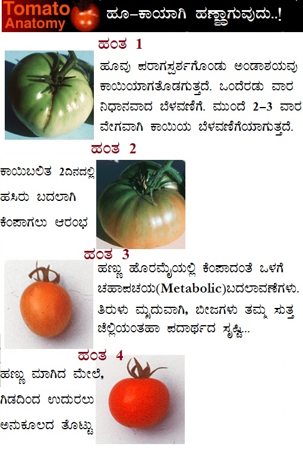

ಸಾಮಾನ್ಯವಾಗಿ ಕೃಷಿಗೆ ಆರಂಭಗೊಂಡು, ಅದರಲ್ಲೂ ವಿವಿಧ ತಳಿಗಳನ್ನು ಪಡೆಯಲು ಪ್ರಾರಂಭಿಸಿದ ಮೇಲೆ, ಸಸ್ಯದ ಒಟ್ಟಾರೆ ಆನುವಂಶಿಕ ವಿವಿಧತೆಯು ಕುಂಠಿತಗೊಳಿಸುವುದು ಸಹಜ. ಆದರೆ ಟೊಮ್ಯಾಟೊ ಮಾತ್ರ ಕೃಷಿಗೆ ಒಳಗಾಗಿಯೂ ಅದರ ಆನುವಂಶಿಕ ವಿವಿಧತೆಯನ್ನು ಹೆಚ್ಚಿಸಿಕೊಂಡಿದೆಯಂತೆ. ತಳಿಗಳು ವಿಸ್ತಾರವಾದಷ್ಟೂ ಆನುವಂಶಿಕ ಹಿಡಿತವು ವನ್ಯ ಮೂಲದಿಂದ ನಾಶವಾಗದೆ ಉಳಿದಿದೆಯಲ್ಲದೆ, ವಿಸ್ತಾರವೂ ಆಗಿದೆ. ಇದೊಂದು ಸಸ್ಯ-ಸಂಗತಿಯಾಗಿ ವಿಶಿಷ್ಟವೇ ಹೌದು. ಇರಲಿ ಇದೆಲ್ಲವೂ ನಿಜಕ್ಕೂ ವಿವರಗಳಿಂದ ಒಂದು ಪುಟ್ಟ ಪ್ರಬಂಧದಲ್ಲಿ ವರ್ಣಿಸಲು ಆಗದ ಮಾತು ನಿಜ. ಆದರೂ ವಿವಿಧತೆಗಳ ಹಿನ್ನೆಲೆಯಲ್ಲಿ ಟೊಮ್ಯಾಟೊ ತಳಿಗಳ ವಿವರಗಳನ್ನಾದರೂ ತಿಳಿದು ಆನಂದಿಸೋಣ. ಅದಕ್ಕಾಗಿ ತೀರಾ ತಡವಾಗಿ ನೆಲವನ್ನು ಹೊಂದಿಸಿಕೊಂಡ, ಚೀನಿಯರು ಮುಂದು. ಇಂದು ಜಗತ್ತಿನಲ್ಲಿ ಅತ್ಯಂತ ಹೆಚ್ಚು ಉತ್ಪಾದನೆಯನ್ನು ಮಾಡುತ್ತಿರುವ ದೇಶವೂ ಸಹಾ ಚೀನಾ! ತಳಿಗಳ ಹೆಸರಿನಲ್ಲಿ ಟೊಮ್ಯಾಟೊದು ತುಂಬಾ ವಿಶಿಷ್ಟವೇ! ಮುಖ್ಯವಾಗಿ ನೇರ ನೋಟದಿಂದಲೇ ಅರಿಯಬಹುದಾದಂತೆ ಬಣ್ಣದಲ್ಲೂ ಸಾಕಷ್ಟು ವಿವಿಧತೆಯನ್ನು ಹೊಂದಿದೆ. ನೇರಳೆ ಅಥವಾ ಊದ ಬಣ್ಣ, ದಟ್ಟವಾದ ಕಡುಕೆಂಪು, ಮಾಸಲು ಕೆಂಪು, ಕೆನ್ನೀಲಿ, ಪಿಂಕ್‌, ಕಿತ್ತಳೆ, ಹೊಳಪುಳ್ಳ ಹಳದಿ, ಮಾಸಲು ಹಳದಿ, ಹೀಗೆ.. ಇಷ್ಟಾದರೂ ಟೊಮ್ಯಾಟೊ ಕೆಂಪು ಬಣ್ಣದಿಂದಲೇ ಖ್ಯಾತವಾಗಿದೆ. ಈ ಕೆಂಪು ಬಣ್ಣವು ಪ್ರಮುಖವಾಗಿ ಲೈಕೊಪಿನ್‌ (Lycopene) ಹಾಗೂ ಬೀಟಾ ಕ್ಯಾರೊಟಿನ್‌ (β carotene) ಎಂಬ ರಾಸಯಾನಿಕಗಳು ಹಣ್ಣಿನಲ್ಲಿ ಇರುವ ಪ್ರಮಾಣವನ್ನು ಅನುಸರಿಸಿದೆ. ಉಳಿದಂತೆ ಪ್ರಮುಖವಾದ ರಾಸಾಯನಿಕ ವಿಟಮಿನ್‌ "ಸಿ"ಯಲ್ಲಿ ಅಂತಹಾ ಮಹತ್ತರವಾದ ಬದಲಾವಣೆಯನ್ನು ಬಣ್ಣವು ತರುವುದಿಲ್ಲ. ಹೆಚ್ಚು ದಟ್ಟವಾದ ಕೆಂಪು ಬಣ್ಣದವು ಹೆಚ್ಚು ಲೈಕೊಪಿನ್‌ ಹಾಗೂ ಬೀಟಾ ಕ್ಯಾರೊಟಿನ್ನ್‌ಗಳನ್ನು ಹೊಂದಿರುತ್ತವೆ. ಇತ್ತೀಚೆಗಿನ ತಳಿಗಳಂತೂ ಕಾಯಿ ಕಚ್ಚಿದ ಮೇಲೆ ಹಣ್ಣಾಗುವುದು ತಡವಾಗುವುದೇ ಇಲ್ಲ. ಕಾಯಿಗಳು ಹಣ್ಣಾಗಲು 4 ಹಂತಗಳಿದ್ದು, ಅವುಗಳು ಬೇಗನೆ ನಡೆದು ಹೋಗುವಂತೆ ತಳಿಗಳ ರೂಪಾಂತರವಾಗಿದೆ. ದಟ್ಟ ಹಸಿರು ಬಣ್ಣ, ಕೆಂಪಾಗಲು ಆರಂಭಗೊಂಡು, ಹಳದಿ-ಕಿತ್ತಳೆಯಂತೆ ಮುಂದೆ ದಟ್ಟ ಕೆಂಪಗೆ ತಿರುಗುತ್ತದೆ. ಅಷ್ಟರಲ್ಲಿ ಗಟ್ಟಿಯಾದ ಕಾಯೊಳಗಿನ ಭಾಗವು ಮೃದುವಾಗಿ ತಿರುಳಾಗಿ, ಹದವರಿತು ಅಣಿಯಾಗುತ್ತದೆ.

ಭಾರತೀಯ ಹಿನ್ನೆಲೆಯ ತಳಿ ವೈಭವವನ್ನು ಬರೀ ಹೆಸರುಗಳನ್ನು ಪಟ್ಟಿ ಮಾಡಿದರೂ ಹತ್ತಾರು ಪುಟಗಳಾಗಬಹುದು. ಸುಮಾರು **7500 ತಳಿ** ಗಳನ್ನು ಕೇವಲ ಒಂದು-ಒಂದೂವರೆ ಶತಮಾನವು ಹೆಸರಿಸಿದೆ. ಇತ್ತೀಚೆಗಿನ ಹೆಸರುಗಳಂತೂ ತುಂಬಾ ವಿಚಿತ್ರ. “ವೈಶಾಲಿ, ರೂಪಾಲಿ, ರಶ್ಮಿ, ರಜನಿ, ರೂಬಿ, ರೊಮಾ, ಬೆಸ್ಟ್‌ ಆಫ್‌ ಆಲ್‌, ಫೈರ್‌ ಬಾಲ್‌, ಚುಹ್ರಾ, ವಿಕಾಸ್‌, ಸೌರಭ, ಆಹುತಿ, ಆಶಿಶ್‌, ಅಭಾ, ಅಲೋಕ್‌, ವಿಶಾಲ್‌, ವರ್ಧನ್‌, ರೋಹಿಣಿ, ಸದಾಬಹಾರ್‌, ಉಪಹಾರ್‌, ಕೇಸರಿ, ಅಮೋಘ್, ಅವಿನಾಶ್‌....‌ ಹೀಗೆ ನೂರಾರು.. ಸಾವಿರಾರು ಹೆಸರುಗಳು ಕೆಲವಂತೂ ಅಂಕೆ-ಸಂಖ್ಯೆಗಳು ಉದಾಹರಣೆಗೆ Co-150, ಇತ್ಯಾದಿ ಇವೆಲ್ಲಾ ಆಧುನಿಕ ಕೃಷಿಯ ಅಭಿವೃದ್ಧಿಯಲ್ಲಿ ಟೊಮ್ಯಾಟೊ ಪಡೆದುಕೊಂಡ ವಿಶೇಷತೆಗೆ ಉದಾಹರಣೆ. ಏಕೆಂದರೆ ರೈತರಂತೂ ತರಕಾರಿ ಬೆಳೆಗಳಲ್ಲಿ ಹಣ ಕಂಡದ್ದೂ, ಕಳೆದದ್ದೂ ಎರಡರಲ್ಲೂ ಟೊಮ್ಯಾಟೊಗೆ ಅಗ್ರ ಸ್ಥಾನ. ಬೆಳೆದ ರೈತನಿಗೆ ಸಾಕಷ್ಟು ಬೆಲೆ ಸಿಗದೆ ಬೀದಿಗೆ ಚೆಲ್ಲಿ ನಡೆಸಿದ ಪ್ರತಿಭಟನೆಗಳೂ ಸಾಕಷ್ಟು. ಹಾಗೆಯೇ ಜಾಣತನದಿಂದ ಸಾಕಷ್ಟು ಹಣಗಳಿಸಿ ಕೊಟ್ಟದ್ದೂ ಟೊಮ್ಯಾಟೊ ಬೆಳೆಯೆ! ಕಳೆದುಕೊಂಡರೂ ಸಹಾ ನನ್ನೂರಿನ ನನ್ನ ಜಮೀನನ್ನು ನಿರ್ವಹಿಸುವ ನನ್ನ ರೈತ ಮಿತ್ರನನ್ನೂ ಸೇರಿಸಿಕೊಂಡು ಹಣಕ್ಕೆಂದೇ ಬೆಳೆಯುವ ಬೆಳೆಯಲ್ಲಿ ಟೊಮ್ಯಾಟೊ ಕೂಡ ಒಂದು. ಹೀಗೆ ಟೊಮ್ಯಾಟೊ ಒಂದು ಲಾಟರಿ ಬೆಳೆಯಾಗಿ ಪರಿವರ್ತನೆಯಾಗಿದ್ದು ಭಾರತೀಯ ಕೃಷಿಯಲ್ಲಿ ಮಾತ್ರವಲ್ಲದೆ, ಎಲ್ಲೆಡೆ ಟೊಮ್ಯಾಟೊ ವಿಶಿಷ್ಟವಾಗಿದೆ. 

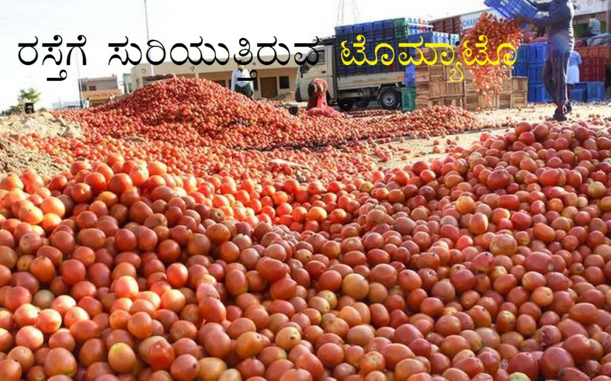

ಎಷ್ಟೇ ಹೆಸರಿನ ತಳಿಗಳು ಬರಲಿ ತಿನ್ನುವವರಿಗೆ ಮಾತ್ರ ನಾಟಿ, ಹೈಬ್ರಿಡ್‌ ಅಥವಾ ಫಾರಂ ಟೊಮ್ಯಾಟೊ ಎಂದೇ ಜನಪ್ರಿಯ. ಇದು ಕೇವಲ ನಮ್ಮ ದೇಶದಲ್ಲಿ ಮಾತ್ರವಲ್ಲ, ಜಗತ್ತಿನ ಎಲ್ಲೆಡೆ ಕೂಡ ಇದೇ ಪ್ರಭಾವಳಿ ಈ ಬೆಳೆಗೆ. ತಳಿ ಅಭಿವೃದ್ಧಿಯಲ್ಲಿ ಪ್ರಮುಖವಾಗಿ ವನ್ಯ ಮೂಲದಿಂದ ಆರಂಭಿಸಿದಾಗ ಅದರ ಹುಳಿ ಗುಣ ಕಡಿಮೆಯಾಗಬೇಕು, ಕಾಯಿ ಅಥವಾ ಹಣ್ಣಿನ ಗಾತ್ರ ಹೆಚ್ಚಬೇಕು, ಇವರೆಡೂ ಮುಖ್ಯವಾಗಿದ್ದವು. ಇಂದಿಗೂ ಇವೇ ಮುಖ್ಯವಾಗಿ ಒಟ್ಟಾರೆ ಇಳುವರಿ ಹಾಗೂ ಜನರ ಇಷ್ಟ ಪಡುವ ಗುಣ ಹೆಚ್ಚಬೇಕು! ಇವುಗಳನ್ನು ಆಧರಿಸಿ ತಳಿಗಳ ಅಭಿವೃದ್ಧಿಯಾಗಿದೆ. ಈ ಹಿನ್ನೆಲೆಯಲ್ಲಿ ಜಾಗತಿಕವಾಗಿ ಜನಪ್ರಿಯವಾಗಿರುವ ಕೆಲವು ವಿವಿಧ ಬಗೆಯ ಟೊಮ್ಯಾಟೊಗಳನ್ನು ನೋಡೋಣ. 

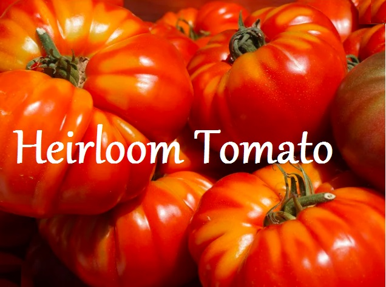

ನಾವೂ ಸಹಾ **ನಾಟಿ ಟೊಮ್ಯಾಟೊ** ಎಂದು ಗುರುತಿಸಲು ಹಣ್ಣುಗಳ ರೂಪವನ್ನು ಗಮನಿಸುತ್ತೇವಲ್ಲವೇ? ಇದು ಜಗತ್ತಿನ ಎಲ್ಲೆಡೆಯೂ ಇರುವಂತಹಾ ಸಂಗತಿಯೇ. ನಾವು ನಾಟಿ ಟೊಮ್ಯಾಟೊ ಎನ್ನುವ ಗುಣದ/ರೂಪದವನ್ನು **ಹೇರ್‌ಲೂಮ್‌ (Heirloom) ಟೊಮ್ಯಾಟೊ** ಗಳೆಂದು ಕರೆಯುತ್ತಾರೆ. ಇವು ಸಾಮಾನ್ಯವಾಗಿ **ಮುಕ್ತ ಪರಾಗಸ್ಪರ್ಶ(ಓಪನ್‌ ಪಾಲಿನೇಶನ್‌)ದ ತಳಿಗಳು**. ಇವುಗಳು ಅದರೊಳಗಿನ ಧಾರಾಳ ಹುಳಿಗೆ, ಕೆಲವು ಸಿಹಿಗೆ, ಒಟ್ಟಾರೆಯ ವಿಶಿಷ್ಟ ರುಚಿಗೆ ಜನಪ್ರಿಯವಾಗಿವೆ. ಇವು ಸಂಕರಗೊಳಿಸಿದ ಬೀಜಗಳಿಂದ ಪಡೆದವುಗಳಲ್ಲ. ಕಾಲಾಂತರದಲ್ಲೂ ರೈತರು ಬೀಜಗಳನ್ನು ಕಾಪಾಡಿ, ಇಟ್ಟು ಪಡೆದ ಬೆಳೆಗಳು. ಎಲ್ಲೆಡೆಯಲ್ಲಿಯೂ ಇವು ಸಾಕಷ್ಟು ಇವೆ. ಅಂದಂತೆ ಎಲ್ಲಾ ಹೇರ್‌ಲೂಮ್‌ಗಳೂ ಒಂದೇ ಏನಲ್ಲ. ಒಂದೊಂದು ಕಡೆಯಲ್ಲೂ ಒಂದೊಂದು ಬಗೆಯವು. ಈ ಬಗೆಯ ತಳಿಗಳನ್ನು ಸಾಂಬಾರಿಗೆ, ಜೊತೆಗೆ ಮಾಂಸಹಾರಿ ಅಡುಗೆಯಲ್ಲಿ ಬಳಸಲೂ ಜನಪ್ರಿಯವಾಗಿವೆ.

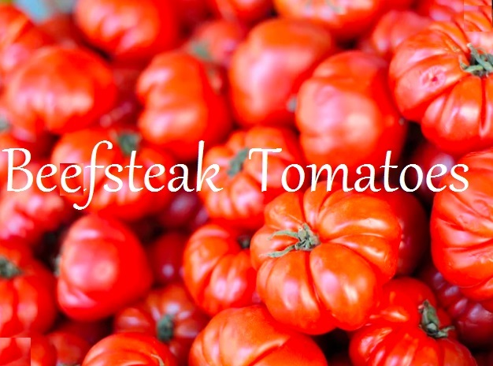

ಜಗತ್ತಿನಲ್ಲಿ ಅತಿ ಹೆಚ್ಚು ಕೃಷಿಗೆ ಒಳಗಾದ ತಳಿಯ ಬಗೆಗಳೆಂದರೆ **ಬೀಫ್‌ಸ್ಟೀಕ್‌ (Beefsteak) ಟೊಮ್ಯಾಟೊ** ಗಳು. ಇವು ಕತ್ತರಿಸಲು ಅನುಕೂಲಕರವಾದ ರೂಪದವು. ಆದ್ದರಿಂದ ಸಲಾಡ್‌ಗಳಲ್ಲಿ, ಸ್ಯಾಂಡ್‌ವಿಚ್‌ನಲ್ಲಿ, ಹಸಿಯಾಗಿ ಬಳಸುವ ವಿವಿಧ ತಿಂಡಿಗಳಲ್ಲಿ ಇವು ಜನಪ್ರಿಯ. ಸಾಮಾನ್ಯವಾಗಿ ನಾವು ಈಗ ಬಳಸುವ ಅನೇಕ ತಳಿಗಳು ಈ ಬಗೆಯವು. ಇವು ಹೆಚ್ಚಿನ ಬಣ್ಣಗಳಲ್ಲೂ ದೊರಕಿದರೂ ಇವುಗಳಲ್ಲಿ ಕೆಂಪು ಮತ್ತು ಪಿಂಕ್‌ ಬಣ್ಣದವು ಜನಪ್ರಿಯವಾದವು. ಇವುಗಳಲ್ಲಿ ಒಟ್ಟಾರೆ ರಸವು ಕಡಿಮೆಯಾದ್ದರಿಂದ ಸಾಕಷ್ಟು ಕಾಲ ಇಡಬಲ್ಲಂತಹಾ ತಳಿಗಳು. ಹಾಗಾಗಿ ಇವುಗಳ ಕೃಷಿ ಜಗತ್ತಿನಲ್ಲಿ ಅತೀ ಹೆಚ್ಚು ಬಳಕೆಯಾಗಿವೆ.

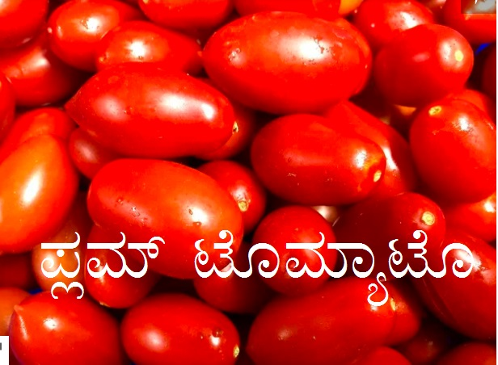

"**ಪ್ಲಮ್‌" ಟೊಮ್ಯಾಟೊ** ಗಳು ರಸವತ್ತಾದ ತಳಿಗಳಾಗಿದ್ದು ಸಂಸ್ಕರಿಸಿ ಬಳಸಲು ಅನುಕೂಲಕರವಾದವು. ಇವುಗಳಲ್ಲಿ ಹೆಚ್ಚು ಬೀಜಗಳು ಇರುವುದಿಲ್ಲ. ಹೆಚ್ಚು ರಸ ಹಾಗೂ ತಿರುಳು ಇರುವಂತಹಾ ತಳಿಗಳು. ಇವು ಕೆಚೆಪ್‌ ಹಾಗೂ ಪೇಸ್ಟ್‌ ಅಥವಾ ಚಟ್ನಿ ರೂಪದ ತಿಂಡಿಗೆ ಅನುಕೂಲಕರವಾದ ತಳಿಗಳು. ಇವುಗಳಲ್ಲಿ ಚಿಕ್ಕ ಪ್ಲಮ್‌ಗಳನ್ನು **ದ್ರಾಕ್ಷಿ** ಅಥವಾ **ಗ್ರೇಪ್‌ ಟೊಮ್ಯಾಟೊ** ಎಂದೂ ಕರೆಯುತ್ತಾರೆ. ಹೆಚ್ಚು ಸಮಯ ಇವು ಪರಿಮಳಕ್ಕೆ ಹೆಸರಾದವು. ಜೊತೆಗೆ ಸಾಕಷ್ಟು ಕಾಲ ಕೆಡದಂತೆ ಸಂಗ್ರಹಿಸಲೂ ಹೇಳಿ ಮಾಡಿಸಿದವು. 

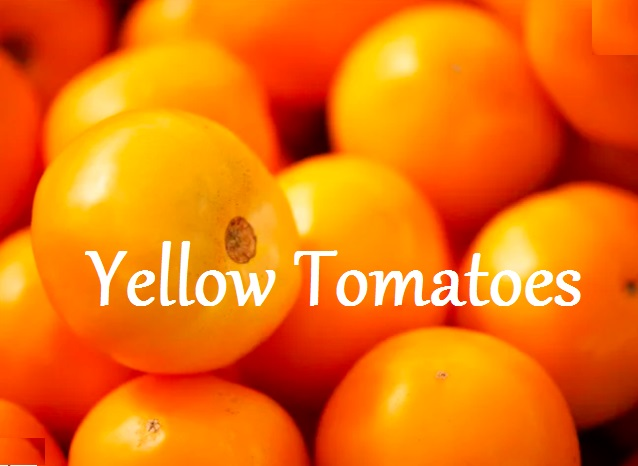

**ಹಳದಿ ಬಣ್ಣದ ತಳಿ** ಗಳು ಎಲ್ಲಾ ಬಗೆಯಲ್ಲೂ ಅಂದರೆ ನಾಟಿ ಹಾಗೂ ಹೈಬ್ರಿಡ್‌ ಎರಡರಲ್ಲೂ ಇರುತ್ತವೆ. ಇವು ಕೇವಲ ಬಣ್ಣದಿಂದ ಆಕರ್ಷಣೆಗೆ ರೂಪುಗೊಳಿಸಿದ ತಳಿಗಳು. ಸಾಮಾನ್ಯವಾಗಿ ಹಳದಿ ತಳಿಗಳು ಕಡಿಮೆ ಹುಳಿ ಅಥವಾ ಆಮ್ಲತೆಯನ್ನು ಹೊಂದಿರುವ ತಳಿಗಳು. ಹಾಗಾಗಿ ಕೆಂಪು ತಳಿಗಳಿಗಿಂತಾ ವಿಟಮಿನ್‌ "ಸಿ"ಯನ್ನೂ ಕಡಿಮೆ ಹೊಂದಿರುತ್ತವೆ. ಇವುಗಳು ಜ್ಯೂಸ್‌ ತಯಾರಿಕೆಯಲ್ಲಿ ಶರಬತ್ತಿನ ತಯಾರಿಕೆಯಲ್ಲಿ ವಿಶೇಷವಾಗಿ ಬಳಸುವ ತಳಿಗಳಾಗಿವೆ.

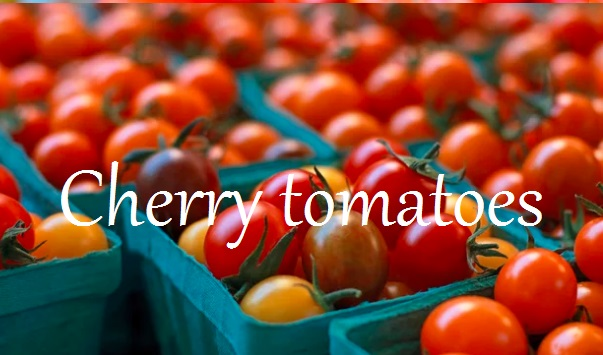

ಕೆಲವು ಅತೀ ಸಣ್ಣ ಗಾತ್ರದ ಟೊಮ್ಯಾಟೊಗಳನ್ನು **"ಚರ್ರಿ" ಟೊಮ್ಯಾಟೊ** ಎಂದು ಕರೆಯಲಾಗುತ್ತದೆ. ಮುಖ್ಯವಾಗಿ ಇವು ವನ್ಯ-ತಳಿಗಳನ್ನು ಹತ್ತಿರವಾಗಿಸುವ ರೂಪದವು. ಇವುಗಳನ್ನು ನೇರವಾದ ಬಳಕೆಗೆ ಅನುಕೂಲಕರವಾದ ಆಸಕ್ತಿಯಲ್ಲಿ ರೂಪಿಸಲಾಗಿದೆ. ತುಂಬಾ ನಾಜೂಕಾದ ತಳಿಗಳಿವು. ದ್ರಾಕ್ಷಿ ಟೊಮ್ಯಾಟೊಗಿಂತಲೂ ಚಿಕ್ಕ ಗಾತ್ರದವು. ತುಂಬಾ ರಸಭರಿತವಾಗಿದ್ದು. ಕೆಲವೊಮ್ಮೆ ಐಸ್‌ ಕ್ರೀಮ್‌ ಜೊತೆ, ವಿವಿಧ ಹಣ್ಣುಗಳ ಜೊತೆ ಬಳಸಲೂ ಯೋಗ್ಯವಾದವು. ಹೆಚ್ಚಿನ ಪಾಲು ಈ ತಳಿಗಳು ಸಿಹಿಯಾದ ರುಚಿಯನ್ನು ಹೊಂದಿರುತ್ತವೆ.

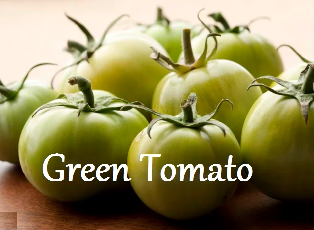

**ಗ್ರೀನ್‌** ಅಥವಾ **ಹಸಿರು ಟೊಮ್ಯಾಟೊ** ಕಾಯಿಯಿಂದ ಹಣ್ಣಾದ ಮೇಲೂ ಹಸಿರು ಬಣ್ಣವನ್ನು ಉಳಿಸಿಕೊಂಡ ತಳಿಗಳಿವು. ನಮ್ಮ ದೇಶದಲ್ಲಿ ಇವುಗಳ ಮೇಲಿರುವ ಪ್ರೀತಿ ಅಷ್ಟಕಷ್ಟೆ. ಏಕೆಂದರೆ ನಮ್ಮಲ್ಲಿ ಕಾಯಿಗಳ ಬಳಕೆಯನ್ನೇ ವಿವಿಧ ಖಾದ್ಯಗಳಾಗಿಸುವ ಅಡುಗೆಗಳು ಜನಪ್ರಿಯವಾಗಿರುವುದರಿಂದ ಹಸಿರಾದ ಹಣ್ಣುಗಳಿಗೆ ಬೇಡಿಕೆ ಇಲ್ಲ. ಇವುಗಳಲ್ಲಿ ಹೆಚ್ಚಿನವು ನಾಟಿ ಟೊಮ್ಯಾಟೊಗಳು ಹಾಗೂ ಬೇಗನೇ ಕೊಯಿಲನ್ನು ಮಾಡಿದವೂ ಆಗಿರುವುದುಂಟು. ಇವುಗಳು ಉಪ್ಪಿನಕಾಯಿಯ ತಯಾರಿಯಲ್ಲಿ ಹೆಚ್ಚು ಬಳಕೆಯಾಗುತ್ತವೆ. ನಮಗೆಲ್ಲಾ ತಿಳಿದಿರುವಂತೆ ಹಸಿರು ಕಾಯಿಗಳನ್ನು ಹುರಿದು ಮಾಡುವ ಹಲವು ಖಾದ್ಯಗಳಂತೆ ಹಸಿರು ಹಣ್ಣುಗಳನ್ನೂ ಹುರಿದು ತಿನ್ನಲು ಬಳಸುತ್ತಾರೆ.

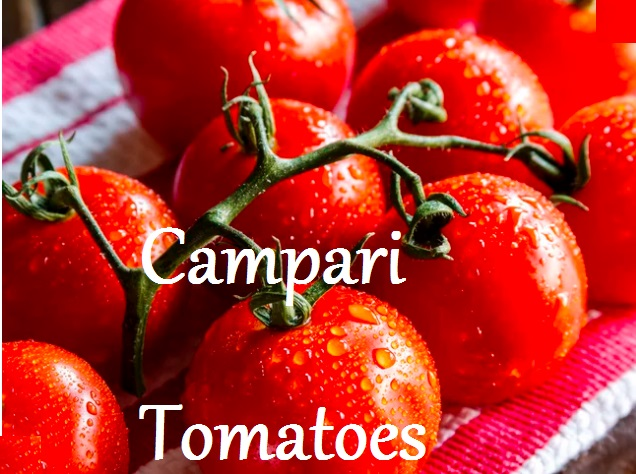

ಕೆಲವೊಂದು ಬಗೆಯ ಹೈಬ್ರಿಡ್‌ ಟೊಮ್ಯಾಟೊಗಳು ತುಂಬಾ ಸಿಹಿಯಾಗಿರುತ್ತವೆ ಇವು **"ಕಂಪ್ರಿ ಟೊಮ್ಯಾಟೊ"** ಗಳು. ಇವುಗಳು ಸ್ವಾದಕ್ಕೆ ಹೆಸರುವಾಸಿ. ರಸಭರಿತವಾದ್ದರಿಂದ ಜ್ಯೂಸ್‌ ತಯಾರಿಯಲ್ಲೂ ಇವು ಜನಪ್ರಿಯ.

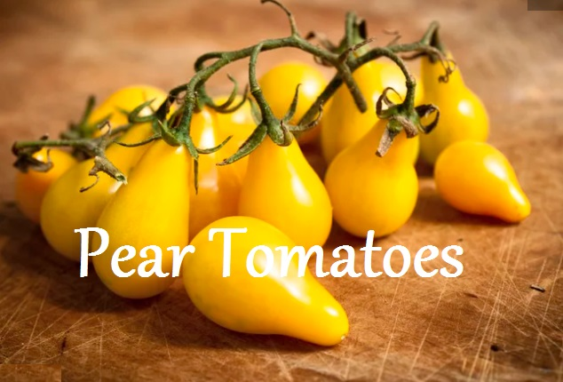

ಮತ್ತೊಂದು ಬಗೆಯ ನಾಟಿ ತಳಿಗಳಲ್ಲಿ ಆಕರ್ಷಕ ರೂಪದವು ಇವೆ. ಅವುಗಳನ್ನು **"ಪೀರ್‌ ಟೊಮ್ಯಾಟೊ"** ಎಂದೇ ಕರೆಯಲಾಗುತ್ತದೆ. ಹೆಚ್ಚಿನ ಪಾಲು ಇವು ಹಳದಿ ಬಣ್ಣದವು. ಇವುಗಳಲ್ಲಿ ಕೆಂಪು ಅಥವಾ ಕಿತ್ತಿಳೆ ಬಣ್ಣದವೂ ಇದ್ದರೂ ಕಡಿಮೆ ಜನಪ್ರಿಯತೆಯನ್ನು ಪಡೆದಿವೆ. ಬಿಸಿಯಾದ ಖಾದ್ಯಗಳ ತಯಾರಿಯಲ್ಲಿ ಈ ಬಗೆಯ ಹಳದಿ ಹಾಗೂ ರೂಪದಲ್ಲೂ ಭಿನ್ನವಾದ ಪೀರ್‌ ಟೊಮ್ಯಾಟೊಗಳು ಜನಪ್ರಿಯ.

ಪರಿಚಯಗೊಂಡು ತಡವಾಗಿಯಾದರೂ ಇಷ್ಟೊಂದು ಜನಪ್ರಿಯವಾದ ಟೊಮ್ಯಾಟೊಗಳು ರುಚಿಯಲ್ಲಿ, ಆಹಾರಾಂಶದ ಲಾಭದಲ್ಲಿ ಮಾನವ ಕುಲಕ್ಕೆ ನೀಡಿರಬಹುದಾದ ಕೊಡುಗೆ ಇರಲೇಬೇಕಲ್ಲವೇ? ನಿಜ, ಅವುಗಳ ಆಕರ್ಷಕ ಬಣ್ಣವು, ಅಡುಗೆಯಲ್ಲೂ ಬೆರೆತು ಜೊತೆಗೆ ರುಚಿಯನ್ನೂ, ಉತ್ತಮ ಆಹಾರಾಂಶಗಳನ್ನೂ ಕೊಡುವುದರಿಂದ ಜನಪ್ರಿಯತೆಯು ಹೆಚ್ಚುತ್ತಲೇ ಇದೆ. ಅಲ್ಲದೆ, ಟೊಮ್ಯಾಟೊಗಳು ಮಾಡಿರುವ ಮತ್ತೊಂದು ಬಹು ಮುಖ್ಯವಾದ ಮೋಡಿ ಎಂದರೆ ಸುಲಭವಾಗಿ ಅವುಗಳಿಂದ ನಿರ್ವಹಿಸಬಹುದಾದ ವೈವಿಧ್ಯದ ತಯಾರಿಗಳು. ಅಲ್ಲದೆ ಈ ಬಣ್ಣದ ಕಾರಣಗಳಲ್ಲಿ ಒಂದು ಪ್ರಮುಖ ರಾಸಾಯನಿಕವಾದ ಲೈಕೊಪಿನ್‌ (Lycopene) ಹೊಂದಿರುವ ಹಣ್ಣು-ತರಕಾರಿಗಳಲ್ಲಿ ಟೊಮ್ಯಾಟೊ ಮಾತ್ರವೇ ಅತಿ ಹೆಚ್ಚು ಹೊಂದಿರುವಂತಹದು. ಕಲ್ಲಂಗಡಿ, ಕ್ಯಾರೆಟ್‌ಗಳಲ್ಲೂ ಇದು ಇರುವುದಾದರೂ ಟೊಮ್ಯಾಟೊದಲ್ಲಿ ಇರುವಷ್ಟು ಅಲ್ಲ. ಜೊತೆಗೆ ಈ ರಾಸಾಯನಿಕದ ಪೋಷಕ ಗುಣ ಅದ್ಭುತವಾದುದು. ಇದು ನಮ್ಮ ದೇಹಕ್ಕೆ ಕ್ಯಾನ್ಸರ್‌, ಹೃದಯ ಸಂಬಂಧಿ ಕಾಯಿಲೆ, ಅಲ್ಲದೆ ಎಲುಬು ಸವಕಳಿಯನ್ನೂ ಎದುರಿಸುವ ಗುಣವನ್ನು ನೀಡುತ್ತದೆ. ಟೊಮ್ಯಾಟೊ ಈ ರಾಸಾಯನಿಕವನ್ನು ತನ್ನಲ್ಲಿಟ್ಟುಕೊಂಡ ವಿಶೇಷತೆಯೆಂದರೆ, ಇತರೇ ತರಕಾರಿಗಳಂತೆ ಲೈಕೊಪಿನ್‌ ಇದರಲ್ಲಿ ಬೇಯಿಸಿದರೆ, ಸಂಸ್ಕರಿಸಿದರೆ ಹಾಳಾಗುವುದಿಲ್ಲ. ಆದ್ದರಿಂದ ಕೆಚೆಪ್‌ ಅಲ್ಲೂ, ಸೂಪ್‌ಗಳಲ್ಲೂ ಅಥವಾ ಸಾಂಬಾರು ಗೊಜ್ಜುಗಳಲ್ಲಿಯೂ ಲೈಕೊಪಿನ್‌ ನಮ್ಮ ದೇಹಕ್ಕೆ ಒದಗುವ ರೂಪದಲ್ಲಿಯೇ ಇರುತ್ತದೆ.

ಇತರೇ ಪ್ರಮುಖ ಆಹಾರಾಂಶದ ಲಾಭವೆಂದರೆ ಪ್ರತೀ ನೂರು ಗ್ರಾಂ ಟೊಮ್ಯಾಟೊಗಳು ಕೇವಲ 18 ಕಿಲೊ ಕ್ಯಾಲೊರಿ ಶಕ್ತಿಯನ್ನು ಮಾತ್ರವೇ ಒದಗಿಸುತ್ತವೆ. ಹಾಗಾಗಿ ಇವು ಕಡಿಮೆ ಕ್ಯಾಲೊರಿ ಕೊಡುವ ಆಹಾರವಾಗಿ ಜನಪ್ರಿಯ. ಇದರಲ್ಲಿ ಸುಮಾರು 3.9% ಕಾರ್ಬೊಹೈಡ್ರೇಟು, 1.2% ನಾರಿನಾಂಶ, 0.9% ಪ್ರೊಟೀನು ಮತ್ತು 0.2 % ಕೊಬ್ಬು ಅಲ್ಲದೆ ಸಾಕಷ್ಟು ಪ್ರಮಾಣದ ವಿಟಮಿನ್ನುಗಳು ಇವೆ. ವಿಟಮಿನ್‌ "ಎ", “ಸಿ", “ಇ", “ಕೆ" ಅಲ್ಲದೆ ಥಯಾಮಿನ್‌, ನಿಯಾಸಿನ್‌, ಫೊಲೇಟ್‌, ವಿಟಮಿನ್‌ "ಬಿ-6" ಅಲ್ಲದೆ ಖನಿಜಾಂಶಗಳಾದ ಪೊಟ್ಯಾಸಿಯಂ, ತಾಮ್ರ, ಮ್ಯಾಂಗನೀಸ್‌, ರಂಜಕ ಗಳೂ ಸಹಾ ಸಾಕಷ್ಟು ಪ್ರಮಾಣದಲ್ಲಿ ಇವೆ. ಇವೆಲ್ಲಾ ಕಾರಣಗಳಿಂದ ಬಣ್ಣದ ಮೆರುಗಿನ ಜೊತೆಗೆ ನಮ್ಮ ಆರೋಗ್ಯದ ಹಿತವನ್ನು ಕಾಪಾಡುವ ಪ್ರಮುಖ ತರಕಾರಿಯಾಗಿದೆ. ಒಂದು ಮುಖ್ಯವಾದ ಸಂಗತಿ ಎಂದರೆ ಟೊಮ್ಯಾಟೊವನ್ನು ಹೆಚ್ಚು ಕಾಲ ಶೀತದ ವಾತಾವರಣದಲ್ಲಿ, ತಂಪಾಗಿ ಇಡಬಾರದು. ಹಾಗಾಗಿ ರಿಫ್ರಿಜರೇಟರ್‌ ನಲ್ಲಿ ಇಟ್ಟು ಸೇವಿಸುವುದು ಅಷ್ಟು ಒಳ್ಳೆಯದಲ್ಲ. ಅದಕ್ಕೆ ಟೊಮ್ಯಾಟೊನ ನಿಜವಾದ ರುಚಿಯನ್ನು ಸವಿಯಲು ತೋಟದಲ್ಲೇ ಬಿಸಿಲಿಗೆ ತೆರೆದುಕೊಂಡ ಹಣ್ಣನ್ನು ಅಲ್ಲೇ ತಿಂದು ನೋಡಿ! ಅದರ ಬೇರೊಂದು ಮುಖ ತಿಳಿದೀತು. ಹಿಂದೊಮ್ಮೆ ನಾನು ಒಂದು ವಾರದಷ್ಟು ಸಮಯ 5-6 ದಿನ ನನ್ನ ತೋಟದಲ್ಲಿ ಪ್ರತಿದಿನವೂ ಒಂದು ಊಟಕ್ಕೆ…. ಬದಲಾಗಿ, ತೋಟದಲ್ಲೇ ಕಿತ್ತು ಕೂಡಲೆ ತಿನ್ನುವ ಪ್ರಯೋಗಕ್ಕೆ ತೊಡಗಿದ್ದೆ. ಕೇವಲ ತಾಜಾ ಟೊಮ್ಯಾಟೊ ಒಂದು ಊಟವನ್ನು ನಿಭಾಯಿಸುವ ನಾಲ್ಕಾರು ದಿನಗಳೂ ವಿಶೇಷ ಅನುಭವವನ್ನು ಕೊಟ್ಟಿದ್ದವು. ಕಡೆಯದಾಗಿ ಒಂದು ವಿಶೇಷ ಸಂಗತಿಯಿಂದ ಮುಗಿಸುತ್ತೇನೆ.

ಸ್ಪೈಯಿನ್‌ ದೇಶದ ಕೊಲಂಬಸ್‌ ನಿಂದಾಗಿ ದಕ್ಷಿಣ ಅಮೆರಿಕಾದಿಂದ ಯೂರೋಪು ಹೊಕ್ಕ ಟೊಮ್ಯಾಟೊ, ಆ ದೇಶದಲ್ಲಿ ತೀರಾ ಇತ್ತಿಚೆಗೆ ಅಂದರೆ 1945ರಿಂದ ಅದಕ್ಕೊಂದು ಹಬ್ಬವು ನಡೆಯಲು ಆರಂಭವಾಯಿತು. ಕಳೆದ 20-30 ವರ್ಷಗಳಿಂದ ಅಲ್ಲಿನ ಗೂಳಿ ಕಾಳಗದಂತೆ ಮುನ್ನೆಲೆಗೆ ಬಂದು ಜಗತ್ತಿಗೆಲ್ಲಾ ಸುದ್ದಿಯಾಗುತ್ತಿದೆ. ಪುಟ್ಟ ಪಟ್ಟಣದ ಕೇವಲ ಹತ್ತಾರು ಯುವಕರ ಆಟವಾಗಿತ್ತು. ಪ್ರತೀ ವರ್ಷದ ಆಗಸ್ಟ್‌ ತಿಂಗಳ ಕೊನೆಯ ಬುಧವಾರ ಸ್ಪೈಯಿನಿನ ವಾಲೆನ್ಸಿಯಾ ಪ್ರಾಂತ್ಯದ ಪುಟ್ಟ ಪಟ್ಟಣವಾದ ಬುನ್ಯೊಲ್‌ ಎಂಬಲ್ಲಿ ಟೊಮ್ಯಾಟೊ ಹಣ್ಣುಗಳ ಎರಚಾಟ ನಡೆಯುತ್ತದೆ. ಸರಿ ಸುಮಾರು 25ರಿಂದ 40 ಸಾವಿರ ಜನರು ಭಾಗವಹಿಸುವ ಈ ತಮಾಷೆಯ ಆಟವು ಜರುಗುವುದು ಒಂದು ಗಂಟೆಗಳ ಕಾಲವಷ್ಟೇ. ಟ್ರಕ್‌ನಲ್ಲಿ ಟನ್ನುಗಟ್ಟಲೆ ತುಂಬಿಕೊಂಡು ಬಂದ ಟೊಮ್ಯಾಟೊಗಳನ್ನು ಬುನ್ಯೊಲ್‌ ನ ಚೌಕವನ್ನು ಕೂಡುವ ರಸ್ತೆಯಲ್ಲಿ ನಡೆಯುವ ಎರೆಚಾಟದ ಹಬ್ಬವನ್ನು **"ಲಾ ತೊಮಟಿನಾ" (La Tomatina)** ಎಂದು ಕರೆಯಲಾಗುತ್ತದೆ. 

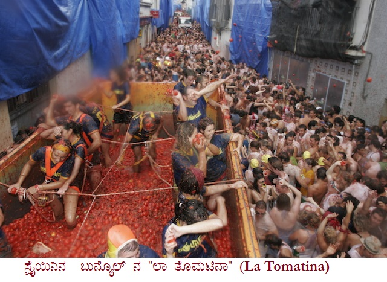

ಇದಕ್ಕೊಂದು ಸಣ್ಣ ಇತಿಹಾಸವಿದೆ. 1945ಆಗಸ್ಟ್‌ ತಿಂಗಳ ಕೊನೆಯ ಬುಧವಾರದಂದು ಆ ಪಟ್ಟಣದ ಕೆಲವು ಹುಡುಗರು, ಒಂದು ಮೆರವಣಿಗೆಯಲ್ಲಿ ಹಾಡುತ್ತಾ ಬರುವಾಗ ಅವರ ಮಧ್ಯೆ ಸಣ್ಣ ಜಗಳವೇರ್ಪಟ್ಟು, ಆಗ ಆ ಬೀದಿಯಲ್ಲಿನ ಒಂದು ಸಣ್ಣ ತರಕಾರಿ ಅಂಗಡಿಯು ಬಲಿಯಾಗಿತ್ತು. ಉನ್ಮಾದದಲ್ಲಿ ಯುವಕರು ಅಂಗಡಿಯಲ್ಲಿ ಕೈಗೆ ಸಿಕ್ಕ ಟೊಮ್ಯಾಟೊ ಹಣ್ಣುಗಳಿಂದ ಹೊಡೆದಾಡಿದರು. ಮಧ್ಯೆ ಹಿರಿಯರು ಬಂದು ಬಿಡಿಸಿದ್ದು ಬೇರೆಯದೇ ಸಂಗತಿ. ಆದರೆ ಇದೊಂದು ತಮಾಷೆಯಂದರೆ ಮುಂದಿನ ವರ್ಷವೂ ಅಲ್ಲಿನ ಹತ್ತಾರು ಯುವಕರು ತಾವೇ ಟೊಮ್ಯಾಟೊ ಹಣ್ಣುಗಳನ್ನು ತಂದು, ಎರೆಚಾಟದ ಆಟವಾಡಲು ಆರಂಭಿಸಿದರು. ಮೊದ ಮೊದಲು ದೊಡ್ಡ ಸಂಗತಿಯೇನೂ ಅಲ್ಲದ ಇದು ಪ್ರತೀ ವರ್ಷ ಅದೇ ದಿನ ಆಡಲು ಆರಂಭವಾಗಿ ನಾಲ್ಕಾರು ವರ್ಷಗಳು ಕಳೆದವು. ಎಚ್ಚೆತ್ತ ಅಲ್ಲಿನ ಮುನಿಸಿಪಾಲಿಟಿಯು ಹಣ್ಣುಗಳ ಎರೆಚಾಟವನ್ನು ಬ್ಯಾನ್‌ ಮಾಡಿತು. ಆದರೂ ಒತ್ತಾಯದಿಂದ ಆಟವಾಡಿ ಬಂಧನಕ್ಕೆ ಒಳಗಾಗಿಯೂ ಮುಂದುವರೆಸಲು ಆರಂಭವಾಯಿತು. ಮತ್ತೆ ಕೆಲಕಾಲದಲ್ಲಿ ಸಾರ್ವಜನಿಕ ಒತ್ತಾಯದಿಂದ ಪ್ರತೀ ವರ್ಷ ಟೊಮ್ಯಾಟೊ ಎರೆಚಾಟದ ಆಟ ಅಧಿಕೃತವಾಯಿತು. ಆದರೂ ಸರಿ ಸುಮಾರು 90ರ ದಶಕದವರೆಗೂ ಅಷ್ಟಾಗಿ ತಿಳಿಯದ ಈ ಹಬ್ಬ, ಮುಂದೆ **ಜವೀಯರ್‌ ಬಸಲಿಯೊ ಎಂಬ ಟೆಲಿವಿಷನ್‌ ಮಾಧ್ಯಮ** ದ ವರದಿಗಾರನಿಂದಾಗಿ 2002ರಲ್ಲಿ ಸ್ಪೈಯಿನಾಚೆಗೂ ಸುದ್ದಿಯಾಯಿತು. ಸರಿ ನೂರಾರು ಯುವಕರ ನಡುವೆ ನಡೆಯುತ್ತಿದ್ದ ಆಟ ಸಾವಿರದಾಟಿ 25,000 ಸಂಖ್ಯೆಯನ್ನೂ ಮುಟ್ಟಿತು. ಅದು ಆ ಊರಿನ ಜನಸಂಖ್ಯೆಯ ಮೂರು-ನಾಲ್ಕು ಪಟ್ಟಾಗಿತ್ತು. ಅದಕ್ಕೆಂದೆ ಜನಗಳು ಆ ದಿನ ಬಂದು ತಮಾಷೆಯ ಆನಂದವನ್ನು ಪಡೆಯಲಾರಂಭಿಸಿದರು. ಜನ ಮರುಳೋ ಜಾತ್ರೆ ಮರುಳೋ ಎಂಬಂತೆ ನೂರಾರು ಸಾವಿರ ಜನ ಅದನ್ನು ನೋಡಲೆಂದೇ ಬರತೊಡಗಿದರು. ಕಳೆದ ಒಂದೆರಡು ವರ್ಷಗಳಲ್ಲಂತೂ ಸರಾಸರಿ ಸುಮಾರು 150 ರಿಂದ 175 ಟನ್ನುಗಳಷ್ಟು ಹಣ್ಣುಗಳ ಎರೆಚಾಟ ನಡೆದಿದೆ.

ಎರೆಚಾಟದ ನಡುವೆ, ಅಗ್ನಿಶಾಮಕದ ಲಾರಿಗಳಲ್ಲಿ ನೀರು ಹೊಡೆದು ನೆರೆದವರಿಗೆ ಹತ್ತಿಕೊಂಡ ಹಣ್ಣುಗಳನ್ನು ತೆಗೆಯಲು ಆಗಾಗ್ಗೆ ತೊಳೆಯಲಾಗುತ್ತದೆ. ಕೇವಲ ಒಂದು ಗಂಟೆಯಲ್ಲಿ ಹತ್ತಾರು ಸಾವಿರ ಜನರು ಕನಿಷ್ಠ ೧೫೦ ಟನ್ ಹಣ್ಣುಗಳನ್ನು ಹಾಳುಮಾಡುತ್ತಾರೆ. ಇತ್ತೀಚೆಗೆ ಸ್ಪೈಯಿನಿನ ಒಂದು ಜಗತ್‌ಪ್ರಸಿದ್ಧ ಹಬ್ಬವಾಗಿ ಸುದ್ದಿಯಾಗತೊಡಗಿದೆ. ಈ ವರ್ಷ 2020ರ ಆಗಸ್ಟ್‌ 26ರಂದು ನಡೆಯಬೇಕಿದ್ದ "ಲಾ, ತೊಮಟಿನಾ" ಟೊಮ್ಯಾಟೊ ಹಬ್ಬವನ್ನು ಕೊವಿಡ್‌-19ರ ಹಿನ್ನೆಲೆಯಲ್ಲಿ ಬ್ಯಾನ್‌ ಮಾಡಲಾಗಿದೆ. ಕಳೆದ ಒಂದು ದಶಕದಲ್ಲಿ ಇದು ಜಗತ್ತಿನ ಅನೇಕ ದೇಶಗಳಿಗೆ ಹಬ್ಬಿಕೊಂಡಿತು. 2013ರಿಂದ ಈಚೆಗೆ ಹಣಕೊಟ್ಟು ಟಿಕೆಟ್‌ ಪಡೆದವರನ್ನು ಮಾತ್ರವೇ ಭಾಗವಹಿಸಲು ಅವಕಾಶ ನೀಡಲಾಗುತ್ತಿದೆ.

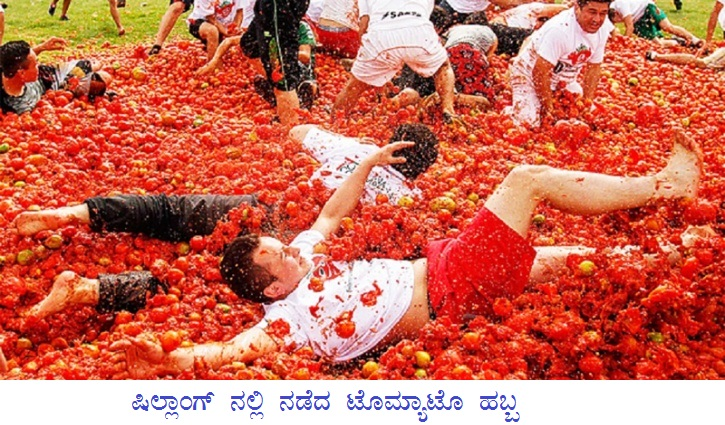

ಭಾರತದಲ್ಲೂ 2016ರಲ್ಲಿ ಮೊದಲ ಆಚರಣೆಯನ್ನು ಮೇಘಾಲಯದ ಷಿಲ್ಲಾಂಗ್‌ನಲ್ಲಿ ನಡೆಸಲಾಯಿತು. ಭಾರತಕ್ಕೆ ಈ ಹಬ್ಬ ಪರಿಚಯವಾಗಲು ಹೆಚ್ಚೂ-ಕಡಿಮೆ **ಸ್ಪೈಯಿನಲ್ಲೇ ಚಿತ್ರೀಕರಣಗೊಂಡ ಹಿಂದಿ ಚಲನಚಿತ್ರ Zindagi Na Milegi Dobara ಕಾರಣವಾಯಿತು.** ಈ ಸಿನಿಮಾದಲ್ಲಿ ಸ್ಪೈಯಿನ್‌ಗೆ ರಜೆಯ ಮಜಾಕ್ಕೆಂದು ಹೋದ ಯುವಕರು ಆ ಹಬ್ಬದಲ್ಲಿ ಭಾಗವಹಿಸುವ ಹಾಡಿನ 3-4 ನಿಮಿಷದ ದೃಶ್ಯವಿದೆ. ನಾವು ಹೋಳಿಯಂತೆ ಬಣ್ಣಗಳ ಓಕುಳಿಗೆ ಸಮೀಕರಿಸಿ ಹೇಳುವುದು ಸಾಕಷ್ಟು ಟೊಮ್ಯಾಟೊ ಉತ್ಪಾದಿಸುವ ಭಾರತಕ್ಕೂ ಆಸೆ ತೋರಿಸಿರಬೇಕು. 2011ರಲ್ಲಿ ಬಿಡುಗಡೆಯಾದ ಚಿತ್ರದಿಂದ ಪ್ರೇರಣೆಗೊಂಡ ಮೇಘಾಲಯ ರಾಜ್ಯವು ಪ್ರವಾಸಿಗಳ ಸೆಳೆಯಲು 2016ತೋಟಗಾರಿಕಾ ಇಲಾಖೆಯ ನೆರವಿನಿಂದ ಪ್ರಾಯೋಜಿಸಿತ್ತು. ಅದಕ್ಕೆ ಅಲ್ಲಿನ ಟೊಮ್ಯಾಟೊ ಮಾರಾಟಗಾರರೂ ಅಳಿದುಳಿದ ಟೊಮ್ಯಟೊಗಳನ್ನೂ ಕೊಟ್ಟು ಸಹಾಯ ಮಾಡಿದರು. ನಂತರದಲ್ಲಿ ಅಲ್ಲಲ್ಲಿ ಸಣ್ಣ ಪುಟ್ಟ ಆಸಕ್ತಿಗಳು ತೋರಿ ಬಂದು ಆಂಧ್ರಪ್ರದೇಶದ ವಿಶಾಖಪಟ್ಟಣದಲ್ಲೂ ಕೆಲವು ಖಾಸಗಿಯವರ ಹಿತಾಸಕ್ತಿಯಿಂದ ನೆರವೇರಿದ್ದೂ ಇದೆ. ಆದರೆ ಆರಂಭದಲ್ಲೇ ಆಗಿನ ಮುಖ್ಯ ಮಂತ್ರಿ ಶ್ರೀ ಸದಾನಂದಗೌಡರು ಕರ್ನಾಟಕದಲ್ಲಿ ನಿರಾಕರಿಸುವ ಮೂಲಕ ಒಳ್ಳೆಯದು ಮಾಡಿದರು. ಕರ್ನಾಟಕದಲ್ಲಿ ಹೆಚ್ಚಾಗಿ ಬೆಳೆಯುವ ಕೋಲಾರ ಮತ್ತು ಚಿಕ್ಕ ಬಳ್ಳಾಪುರ ಜಿಲ್ಲೆಯಲ್ಲಿ ಸಾವಿರಾರು ಅಡಿ ಆಳದ ಕೊಳವೆ ಬಾವಿ ಕೊರೆದು ನೀರು ಮೇಲೆತ್ತಿ ಟೊಮ್ಯಾಟೊಗಳನ್ನು ಬೆಳೆಯಲಾಗುತ್ತದೆ. ಬೆಂಗಳೂರು-ಮೈಸೂರು ಎರಡೂ ಊರಿನಲ್ಲಿ ನಡೆಯಬೇಕಿದ್ದ ಟೊಮ್ಯಾಟೊ ಹಬ್ಬದ ಅನಾಹುತವು ತಪ್ಪಿದೆ. ದೇಶದಲ್ಲಿ ಹೆಚ್ಚು ಬೆಳೆಯುವ ಆಂಧ್ರಪ್ರದೇಶ ಹಾಗೂ ಕರ್ನಾಟಕ ಎರಡರಲ್ಲೂ ಕಷ್ಟ ಪಟ್ಟು ನೀರಾರವರಿಯಲ್ಲಿ ಕೃಷಿ ಮಾಡಿ ಟೊಮ್ಯಾಟೊ ಉತ್ಪಾದಿಸಲಾಗುತ್ತದೆ. ಹಣ್ಣು ಹೆಚ್ಚೂ ಕಡಿಮೆ 90% ನೀರೇ...ಅಲ್ಲದೆ ಬೆಳೆಗೆ ಸಾಕಷ್ಟು ನೀರು ಖರ್ಚಾಗಿ ಹೀಗೆ ಟನ್ನುಗಟ್ಟಲೆ ಟೊಮ್ಯಾಟೊ ವ್ಯರ್ಥವಾಗುವುದನ್ನು ಹಲವು ಸಂಘಟನೆಗಳು, ಸಂದರ್ಭಗಳೂ ವಿರೋಧಿಸಿವೆ. ಸದ್ಯಕ್ಕಂತೂ ಜಾಗತಿಕ ಹುನ್ನಾರಗಳಲ್ಲಿ ಬಲಿಯಾಗುತ್ತಿರುವ ಅನೇಕ ಸನ್ನಿವೇಶಗಳಿಗೆ ಇದೂ ಸೇರಿ ಮತ್ತಷ್ಟು ನಷ್ಟವಾಗುವುದು ಬೇಡ. ಆಹಾರ ಸಂಸ್ಕೃತಿಯು ಭಿನ್ನವಾಗಿದ್ದು, ಅಲ್ಲದೆ ತುಂಟಾಟಕ್ಕೆ ಆರಂಭಗೊಂಡ ಇದನ್ನು ಪ್ರೋತ್ಸಾಹಿಸದಿರುವುದು ಒಳಿತು. 

ಟೊಮ್ಯಾಟೊ ಹಣ್ಣು, ಅಗಿದು ರಸವನ್ನು ಆಸ್ವಾಧಿಸುವುದರಿಂದ ಹಿಡಿದು, ಉಗಿದು ಮೈ-ಕೈ ತೊಳೆದುಕೊಳ್ಳವವರೆಗೂ ಮುಗಿಸಲಾರದ ಸಂಗತಿಗಳನ್ನು ಮಡಿಲಲ್ಲಿಟ್ಟು ರಂಗು ರಂಗಾದ ಸುದ್ದಿಗಳಿಗೂ ಕಾರಣವಾಗಿದೆ. ತನ್ನ ಮೈಯ ಕೆಂಪು ಬಣ್ಣದಲ್ಲಿ ಅಳಿಸಲಾರದ ಪ್ರೀತಿಯನ್ನೂ ತುಂಬಿಟ್ಟು ದಿನವೂ ನಮ್ಮ ಅಡುಗೆಯ ಮನೆಯನ್ನು ಆಳುತ್ತಿದೆ. ಸುಮ್ಮನೆ ತಿನ್ನುತ್ತಲೇ ಬಾಯಿ ಸವಿ ಮಾಡಿಕೊಂಡು ಆರೋಗ್ಯವನ್ನೂ ಕಾಪಾಡಿಕೊಂಡು ಆನಂದಿಸೋಣ.

ನಮಸ್ಕಾರ

ಡಾ. ಟಿ.ಎಸ್.‌ ಚನ್ನೇಶ್.‌
